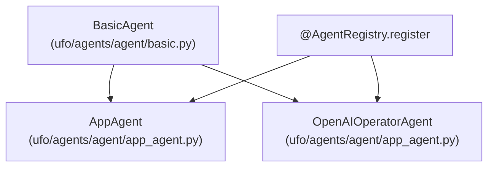
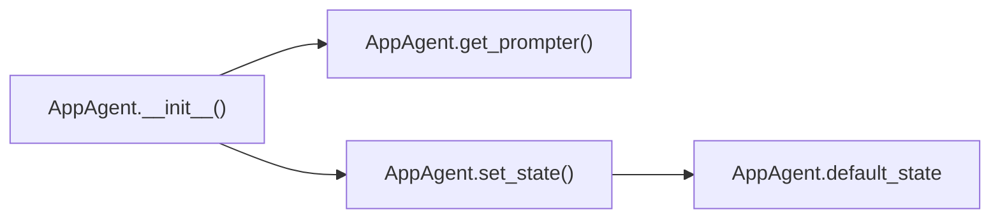
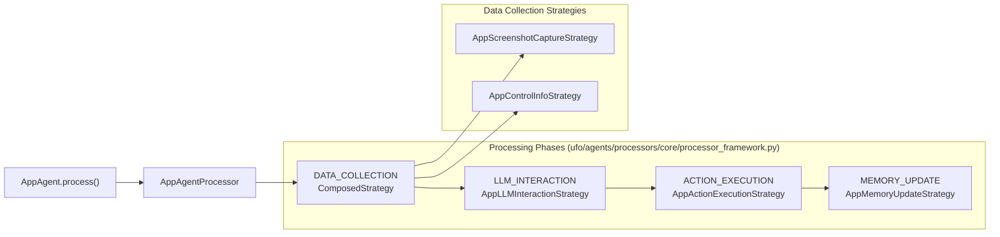
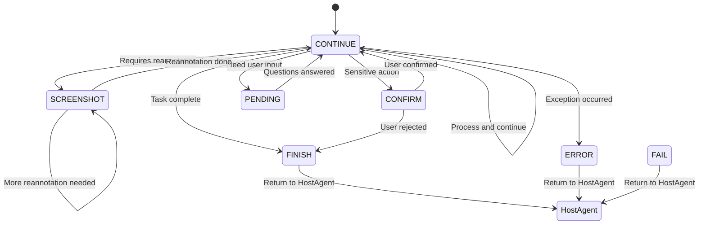
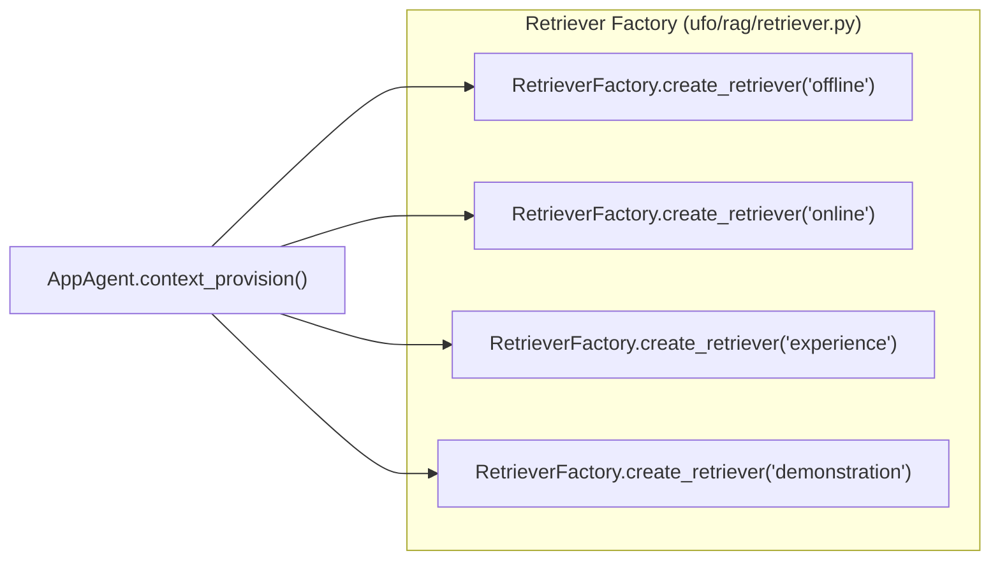

<!-- source: DeepWiki mcp.deepwiki.com · repo microsoft/UFO · page 3.4 App Agent · fetched 2026-10-26 -->

# App Agent

Relevant source files

The following files were used as context for generating this wiki page:

- [documents/docs/img/add_comment.png](documents/docs/img/add_comment.png)
- [documents/docs/img/app_agent_creation.png](documents/docs/img/app_agent_creation.png)
- [documents/docs/img/app_state_machine.png](documents/docs/img/app_state_machine.png)
- [documents/docs/img/host_state_machine.png](documents/docs/img/host_state_machine.png)
- [documents/docs/img/session.png](documents/docs/img/session.png)
- [ufo/agents/agent/app_agent.py](ufo/agents/agent/app_agent.py)
- [ufo/agents/agent/basic.py](ufo/agents/agent/basic.py)
- [ufo/agents/agent/evaluation_agent.py](ufo/agents/agent/evaluation_agent.py)
- [ufo/agents/agent/host_agent.py](ufo/agents/agent/host_agent.py)
- [ufo/agents/processors/app_agent_processor.py](ufo/agents/processors/app_agent_processor.py)
- [ufo/agents/processors/host_agent_processor.py](ufo/agents/processors/host_agent_processor.py)
- [ufo/agents/states/app_agent_state.py](ufo/agents/states/app_agent_state.py)
- [ufo/agents/states/basic.py](ufo/agents/states/basic.py)
- [ufo/agents/states/host_agent_state.py](ufo/agents/states/host_agent_state.py)
- [ufo/agents/states/operator_state.py](ufo/agents/states/operator_state.py)
- [ufo/automator/ui_control/control_filter.py](ufo/automator/ui_control/control_filter.py)
- [ufo/module/basic.py](ufo/module/basic.py)
- [ufo/module/interactor.py](ufo/module/interactor.py)
- [ufo/module/sessions/plan_reader.py](ufo/module/sessions/plan_reader.py)
- [ufo/module/sessions/session.py](ufo/module/sessions/session.py)

The AppAgent is an application-specific agent that executes subtasks within individual applications. It receives subtasks from the HostAgent, interacts with application UI through the AppPuppeteer, and manages its execution flow using a state machine. The AppAgent is registered with `@AgentRegistry.register(agent_name="appagent", processor_cls=AppAgentProcessor)` and processes tasks using the Processor-Strategy-Middleware architecture.

## AppAgent Class Structure

The `AppAgent` class [ufo/agents/agent/app_agent.py:42-555]() inherits from `BasicAgent` [ufo/agents/agent/basic.py:34-408]() and implements application-specific automation capabilities.

**Class Hierarchy and Registration**

Sources: [ufo/agents/agent/app_agent.py:42-43](), [ufo/agents/agent/app_agent.py:557-558](), [ufo/agents/agent/basic.py:34-39]()

**Key Attributes**

The AppAgent maintains the following state:

| Attribute | Type | Description |
|-----------|------|-------------|
| `_name` | str | Agent identifier (e.g., "AppAgent/EXCEL.EXE/EXCEL.EXE") |
| `_process_name` | str | Application process name |
| `_app_root_name` | str | Application root name |
| `prompter` | AppAgentPrompter | Prompt construction helper [ufo/prompter/agent_prompter.py]() |
| `_processor` | AppAgentProcessor | Processor instance for task execution |
| `_state` | AgentState | Current state in state machine |
| `_mode` | str | Operating mode (normal/follower/batch_normal) |
| `offline_doc_retriever` | Retriever | Offline documentation retriever |
| `experience_retriever` | Retriever | Experience database retriever |
| `human_demonstration_retriever` | Retriever | Human demonstration retriever |

Sources: [ufo/agents/agent/app_agent.py:72-87]()

**Initialization**

The AppAgent is initialized [ufo/agents/agent/app_agent.py:48-86]() with application-specific parameters and sets up its prompter and initial state. The `skip_prompter` flag allows bypassing prompter initialization for special agent types like the `OpenAIOperatorAgent` [ufo/agents/agent/app_agent.py:557-614]().

Sources: [ufo/agents/agent/app_agent.py:48-86](), [ufo/agents/agent/app_agent.py:89-102]()

## Processing Pipeline with AppAgentProcessor

The AppAgent delegates processing to `AppAgentProcessor` [ufo/agents/processors/app_agent_processor.py:54-130](), which implements the Processor-Strategy-Middleware architecture. The processor executes a phase-based pipeline consisting of data collection, LLM interaction, action execution, and memory updates.

**Processing Phases and Strategies**

Sources: [ufo/agents/processors/app_agent_processor.py:82-109](), [ufo/agents/processors/strategies/app_agent_processing_strategy.py:27-33]()

The `_setup_strategies` method [ufo/agents/processors/app_agent_processor.py:82-109]() configures the processing pipeline:

1.  **DATA_COLLECTION**: A `ComposedStrategy` [ufo/agents/processors/app_agent_processor.py:87-94]() that combines `AppScreenshotCaptureStrategy` and `AppControlInfoStrategy`.
2.  **LLM_INTERACTION**: `AppLLMInteractionStrategy` [ufo/agents/processors/app_agent_processor.py:97-99]() builds prompts with RAG augmentation and calls the LLM.
3.  **ACTION_EXECUTION**: `AppActionExecutionStrategy` [ufo/agents/processors/app_agent_processor.py:102-104]() executes commands via the command dispatcher.
4.  **MEMORY_UPDATE**: `AppMemoryUpdateStrategy` [ufo/agents/processors/app_agent_processor.py:107-109]() updates agent memory and blackboard.

**Middleware Stack**

The processor uses `AppAgentLoggingMiddleware` [ufo/agents/processors/app_agent_processor.py:132-254]() for enhanced logging with contextual information including subtask details, application names, and execution summaries.

Sources: [ufo/agents/processors/app_agent_processor.py:111-114](), [ufo/agents/processors/app_agent_processor.py:132-146]()

## State Machine

The AppAgent uses a state machine managed by `AppAgentStateManager` [ufo/agents/states/app_agent_state.py:44-54]() to control execution flow. States are registered using the `@AppAgentStateManager.register` decorator.

**State Transitions**

Sources: [ufo/agents/states/app_agent_state.py:30-41](), [ufo/agents/states/app_agent_state.py:91-100]()

**State Implementations**

| State Class | Status Value | Purpose | Is Subtask End? |
|-------------|--------------|---------|-----------------|
| `ContinueAppAgentState` | CONTINUE | Normal processing [ufo/agents/states/app_agent_state.py:186-216]() | No |
| `ScreenshotAppAgentState` | SCREENSHOT | Control reannotation [ufo/agents/states/app_agent_state.py:219-255]() | No |
| `ConfirmAppAgentState` | CONFIRM | Sensitive action confirmation [ufo/agents/states/app_agent_state.py:301-361]() | No |
| `PendingAppAgentState` | PENDING | Waiting for user input [ufo/agents/states/app_agent_state.py:258-298]() | No |
| `FinishAppAgentState` | FINISH | Successful completion [ufo/agents/states/app_agent_state.py:128-183]() | Yes |
| `ErrorAppAgentState` | ERROR | Error occurred [ufo/agents/states/app_agent_state.py:364-414]() | Yes |
| `FailAppAgentState` | FAIL | Task failed [ufo/agents/states/app_agent_state.py:417-464]() | Yes |

Sources: [ufo/agents/states/app_agent_state.py:56-525]()

## RAG and Knowledge Integration

The AppAgent integrates multiple knowledge sources through RAG (Retrieval-Augmented Generation) to enhance decision-making.

**Context Provision**

The `context_provision` method [ufo/agents/agent/app_agent.py:454-528]() initializes retrieval components based on the `ufo_config` [ufo/agents/agent/app_agent.py:39]().

Sources: [ufo/agents/agent/app_agent.py:454-493](), [ufo/agents/agent/basic.py:49]()

**Retrieval Helpers**

-   **Experience/Demonstration**: `demonstration_prompt_helper` [ufo/agents/agent/app_agent.py:220-244]() retrieves both self-learned experiences and human demonstrations.
-   **External Knowledge**: `external_knowledge_prompt_helper` [ufo/agents/agent/app_agent.py:246-295]() retrieves information from offline help documents and online search engines.
-   **MCP Tools**: `_load_mcp_context` [ufo/agents/agent/app_agent.py:496-528]() discovers tools available via the Model Context Protocol to expose them to the agent's action space.

Sources: [ufo/agents/agent/app_agent.py:220-295](), [ufo/agents/agent/app_agent.py:496-528]()

## Subtask Execution

The AppAgent executes subtasks assigned by the `HostAgent` [ufo/agents/agent/host_agent.py:143-214](). 

**Execution Flow**

1.  **Message Construction**: `message_constructor` [ufo/agents/agent/app_agent.py:104-163]() assembles the system and user prompts, including visual screenshots and UI control trees.
2.  **LLM Call**: The agent invokes the LLM via `get_response` [ufo/agents/agent/basic.py:159-175]().
3.  **Action Dispatch**: The `AppActionExecutionStrategy` [ufo/agents/processors/strategies/app_agent_processing_strategy.py:156-253]() parses the response and uses the `LocalCommandDispatcher` [ufo/module/sessions/session.py:102-103]() to execute UI or API commands.
4.  **Feedback Loop**: Results are stored in the `ProcessingContext` and used to determine the next state (e.g., transition to `FINISH` if the subtask is done).

Sources: [ufo/agents/agent/app_agent.py:104-163](), [ufo/agents/processors/strategies/app_agent_processing_strategy.py:156-253](), [ufo/module/basic.py:156-181]()

---

