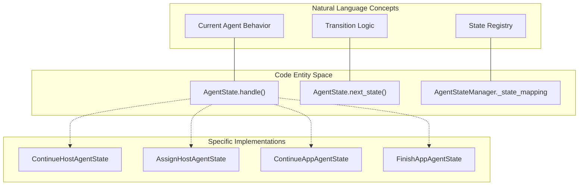
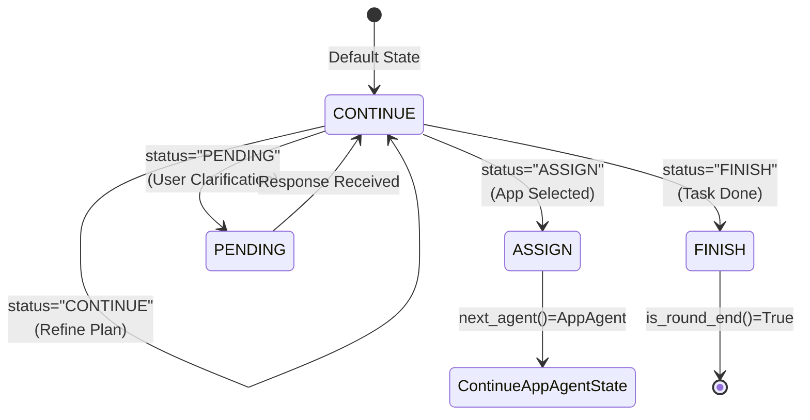
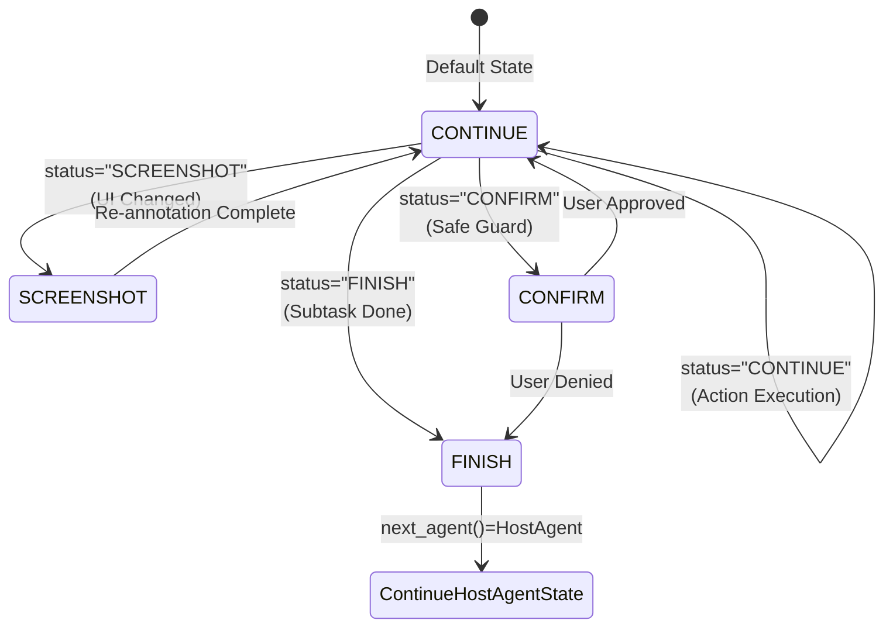
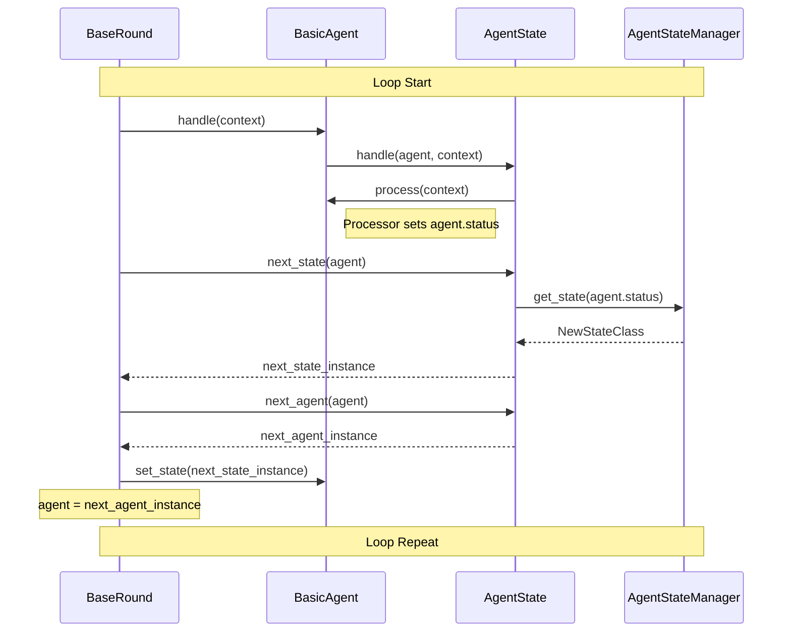

<!-- source: DeepWiki mcp.deepwiki.com · repo microsoft/UFO · page 3.5 Agent State Machines · fetched 2026-10-26 -->

# Agent State Machines

Relevant source files

The following files were used as context for generating this wiki page:

- [documents/docs/infrastructure/agents/design/blackboard.md](documents/docs/infrastructure/agents/design/blackboard.md)
- [documents/docs/infrastructure/agents/design/command.md](documents/docs/infrastructure/agents/design/command.md)
- [documents/docs/infrastructure/agents/design/memory.md](documents/docs/infrastructure/agents/design/memory.md)
- [documents/docs/infrastructure/agents/design/processor.md](documents/docs/infrastructure/agents/design/processor.md)
- [documents/docs/infrastructure/agents/design/prompter.md](documents/docs/infrastructure/agents/design/prompter.md)
- [documents/docs/infrastructure/agents/design/state.md](documents/docs/infrastructure/agents/design/state.md)
- [documents/docs/infrastructure/agents/design/strategy.md](documents/docs/infrastructure/agents/design/strategy.md)
- [ufo/agents/agent/app_agent.py](ufo/agents/agent/app_agent.py)
- [ufo/agents/agent/basic.py](ufo/agents/agent/basic.py)
- [ufo/agents/agent/evaluation_agent.py](ufo/agents/agent/evaluation_agent.py)
- [ufo/agents/agent/host_agent.py](ufo/agents/agent/host_agent.py)
- [ufo/agents/processors/app_agent_processor.py](ufo/agents/processors/app_agent_processor.py)
- [ufo/agents/processors/host_agent_processor.py](ufo/agents/processors/host_agent_processor.py)
- [ufo/agents/states/app_agent_state.py](ufo/agents/states/app_agent_state.py)
- [ufo/agents/states/basic.py](ufo/agents/states/basic.py)
- [ufo/agents/states/host_agent_state.py](ufo/agents/states/host_agent_state.py)
- [ufo/agents/states/operator_state.py](ufo/agents/states/operator_state.py)
- [ufo/automator/ui_control/control_filter.py](ufo/automator/ui_control/control_filter.py)
- [ufo/module/basic.py](ufo/module/basic.py)
- [ufo/module/interactor.py](ufo/module/interactor.py)
- [ufo/module/sessions/plan_reader.py](ufo/module/sessions/plan_reader.py)
- [ufo/module/sessions/session.py](ufo/module/sessions/session.py)

## Purpose and Scope

This document describes the **state machine architecture** that controls agent behavior in UFO². Each agent (HostAgent, AppAgent, and specialized agents) operates as a finite state machine (FSM) where states determine the agent's current behavior and valid transitions to subsequent states. The state pattern enables clean separation of concerns, maintainable control flow, and extensible agent behaviors.

For information about the broader agent architecture and processing pipeline, see [Agent Processing System](3.1). For specific agent implementations, see [Host Agent](3.3) and [App Agent](3.4).

---

## State Pattern Architecture

UFO² implements the **State Pattern** to manage agent behavior through explicit state objects. Each state encapsulates specific behavior logic and determines valid transitions to other states. This architecture enables dynamic behavior changes without modifying agent classes and provides clear visibility into the agent's execution flow.

### Core Components

The state machine architecture consists of three primary components:

1.  **`AgentState`**: Abstract base class defining the state interface [ufo/agents/states/basic.py:117-184]().
2.  **`AgentStateManager`**: Singleton registry managing state instances and mapping status strings to state classes [ufo/agents/states/basic.py:49-115]().
3.  **Concrete State Classes**: Specific implementations for each agent state (e.g., `ContinueHostAgentState`, `FinishAppAgentState`).

### Natural Language to Code Entity Mapping: State Management

The following diagram bridges the gap between high-level state concepts and the specific code entities that implement them.

**Sources:** [ufo/agents/states/basic.py:49-184](), [ufo/agents/states/host_agent_state.py:35-48](), [ufo/agents/states/app_agent_state.py:44-54]()

---

### AgentState Interface

The `AgentState` abstract class defines the contract that all state implementations must fulfill [ufo/agents/states/basic.py:117-184]():

| Method | Purpose | Return Type |
| :--- | :--- | :--- |
| `handle(agent, context)` | Execute state-specific behavior (usually calls `agent.process`) | `None` |
| `next_state(agent)` | Determine the next state based on `agent.status` | `AgentState` |
| `next_agent(agent)` | Determine the agent for the next step (enables handoffs) | `BasicAgent` |
| `is_round_end()` | Check if the current round should end | `bool` |
| `is_subtask_end()` | Check if the current subtask should end (triggers snapshot) | `bool` |
| `agent_class()` | Return the agent class this state applies to | `Type[BasicAgent]` |
| `name()` | Return the state's string identifier (e.g., "CONTINUE") | `str` |

**Key Principles:**
*   **State Ownership**: Each state knows which agent type it applies to via `agent_class()` [ufo/agents/states/basic.py:126-132]().
*   **Transition Logic**: Successors are determined through `next_state()` based on `agent.status` [ufo/agents/states/basic.py:141-150]().
*   **Agent Handoff**: States can transfer control between agents via `next_agent()` (e.g., HostAgent → AppAgent) [ufo/agents/states/basic.py:152-159]().

**Sources:** [ufo/agents/states/basic.py:117-184]()

---

## HostAgent State Machine

The `HostAgent` operates as a desktop-level orchestrator. It manages high-level workflow decisions, application selection, and sub-agent creation [ufo/agents/agent/host_agent.py:143-180]().

### HostAgent State Transition Diagram

### HostAgent States

| State Class | Status String | Behavior | Transition |
| :--- | :--- | :--- | :--- |
| `ContinueHostAgentState` | `CONTINUE` | Calls `agent.process(context)` [ufo/agents/states/host_agent_state.py:136](). | Stays in `CONTINUE` or moves to `ASSIGN`/`FINISH`. |
| `AssignHostAgentState` | `ASSIGN` | Calls `agent.create_subagent(context)` [ufo/agents/states/host_agent_state.py:189](). | `next_agent()` returns the new `AppAgent` [ufo/agents/states/host_agent_state.py:222](). |
| `PendingHostAgentState` | `PENDING` | Prompts user via `question_asker` [ufo/agents/states/host_agent_state.py:256-260](). | Transitions back to `CONTINUE` [ufo/agents/states/host_agent_state.py:262](). |
| `FinishHostAgentState` | `FINISH` | Sets `is_round_end() = True` [ufo/agents/states/host_agent_state.py:111](). | Terminates the round loop. |

**Sources:** [ufo/agents/states/host_agent_state.py:100-281]()

---

## AppAgent State Machine

The `AppAgent` manages interactions within a specific application. It handles UI automation, screenshot re-annotation, and subtask completion [ufo/agents/agent/app_agent.py:43-88]().

### AppAgent State Transition Diagram

### AppAgent States

| State Class | Status String | Behavior | Transition |
| :--- | :--- | :--- | :--- |
| `ContinueAppAgentState` | `CONTINUE` | Calls `agent.process(context)` [ufo/agents/states/app_agent_state.py:200](). | Normal execution loop. |
| `ScreenshotAppAgentState` | `SCREENSHOT` | Triggers re-annotation of specific controls [ufo/agents/states/app_agent_state.py:232-247](). | Moves to `CONTINUE` after capture. |
| `ConfirmAppAgentState` | `CONFIRM` | Calls `agent.process_confirmation()` for sensitive steps [ufo/agents/states/app_agent_state.py:316-321](). | `CONTINUE` if confirmed, `FINISH` if not. |
| `FinishAppAgentState` | `FINISH` | Calls `archive_subtask()` to save results [ufo/agents/states/app_agent_state.py:147](). | `next_agent()` returns `HostAgent` [ufo/agents/states/app_agent_state.py:155](). |

**Sources:** [ufo/agents/states/app_agent_state.py:128-361]()

---

## State Transition Mechanism in Round Loop

The `BaseRound` class orchestrates the transitions by calling state methods in a loop until `is_finished()` returns `True` [ufo/module/basic.py:161-182]().

### Round Execution Flow

### Code Implementation of Transition

The core logic for moving between states is implemented in `BaseRound.run()` [ufo/module/basic.py:156-182]():

1.  **Execute**: `await self.agent.handle(self.context)` calls the current state's logic.
2.  **Determine Next State**: `self.state = self.agent.state.next_state(self.agent)` queries the state manager using the status set during execution.
3.  **Determine Next Agent**: `self.agent = self.agent.state.next_agent(self.agent)` allows switching from `HostAgent` to `AppAgent` (during `ASSIGN`) or back (during `FINISH`).
4.  **Update**: `self.agent.set_state(self.state)` binds the new state to the agent for the next iteration.

**Sources:** [ufo/module/basic.py:156-182](), [ufo/agents/states/basic.py:141-159]()

---

## State Machine and Processor Integration

While the State Machine controls the **flow**, the `ProcessorTemplate` (and its strategies) handles the **work** [ufo/agents/processors/core/processor_framework.py]().

1.  **Processor Context**: During `handle()`, the state triggers the processor. The processor uses `ProcessingContext` to store local data (like LLM results or action success) [ufo/agents/processors/app_agent_processor.py:21-35]().
2.  **Status Assignment**: In the `LLM_INTERACTION` phase, the `AppLLMInteractionStrategy` or `HostLLMInteractionStrategy` parses the LLM response and sets `agent.status` (e.g., to "FINISH" or "CONTINUE") [ufo/agents/processors/strategies/app_agent_processing_strategy.py]().
3.  **State Reaction**: Once the processor finishes, the state machine reads that `agent.status` to pick the next `AgentState` object [ufo/agents/states/basic.py:141-150]().

**Sources:** [ufo/agents/processors/app_agent_processor.py:54-110](), [ufo/agents/processors/host_agent_processor.py:66-112](), [ufo/agents/agent/basic.py:251-262]()

---

