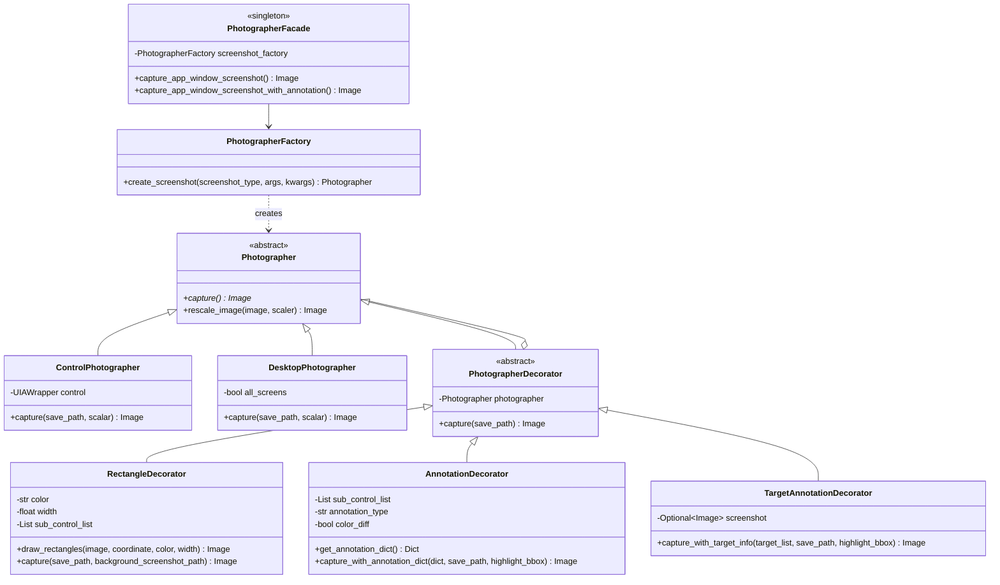
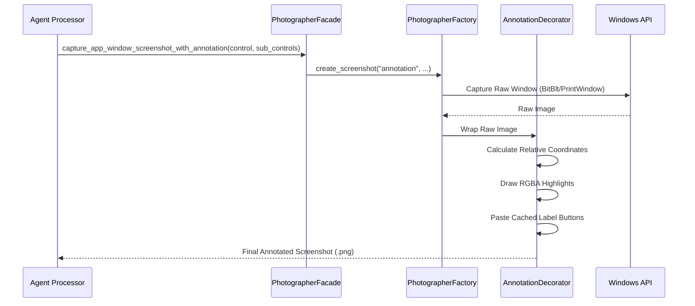
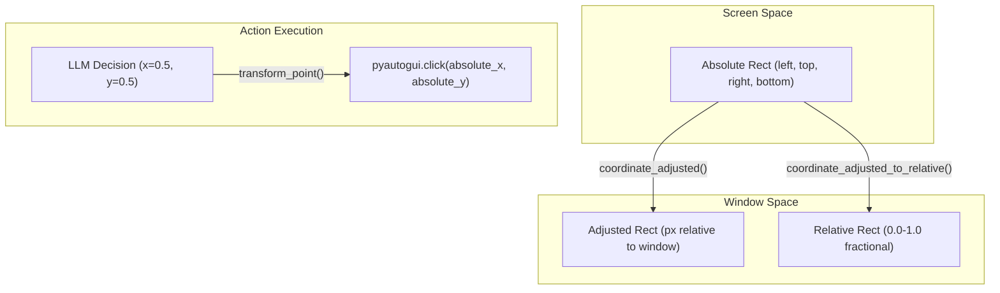

<!-- source: DeepWiki mcp.deepwiki.com · repo microsoft/UFO · page 3.6 Screenshot and Annotation System · fetched 2026-10-26 -->

# Screenshot and Annotation System

Relevant source files

The following files were used as context for generating this wiki page:

- [.github/workflows/document_deploy.yml](.github/workflows/document_deploy.yml)
- [documents/docs/img/comparison.png](documents/docs/img/comparison.png)
- [documents/docs/img/controls.png](documents/docs/img/controls.png)
- [documents/docs/img/framework2.png](documents/docs/img/framework2.png)
- [ufo/automator/ui_control/controller.py](ufo/automator/ui_control/controller.py)
- [ufo/automator/ui_control/screenshot.py](ufo/automator/ui_control/screenshot.py)
- [ufo/utils/__init__.py](ufo/utils/__init__.py)

## Purpose and Scope

The Screenshot and Annotation System provides visual observation capabilities for UFO² Desktop AgentOS, enabling agents to capture, annotate, and present UI controls to LLMs for decision-making. This system implements a decorator pattern to layer visual feedback (bounding boxes, labels, highlights) onto screenshots of application windows and desktop screens. The annotated screenshots help LLMs understand the spatial layout and identify specific UI controls for interaction.

The system is designed to be robust across different environments, including support for disconnected RDP sessions via specialized Win32 APIs. It serves as the visual bridge between the operating system's UI tree and the multi-modal capabilities of Large Action Models (LAMs).

Sources: [ufo/automator/ui_control/screenshot.py:1-35](), [ufo/automator/ui_control/screenshot.py:36-69]()

---

## Architecture Overview

The system architecture follows a clear separation of concerns using three primary design patterns:

1.  **Abstract Factory Pattern**: `PhotographerFactory` encapsulates the logic for creating specific photographer instances based on requested types.
2.  **Decorator Pattern**: The `PhotographerDecorator` hierarchy allows for dynamic stacking of visual enhancements (rectangles, labels, highlights) without modifying the base capture logic.
3.  **Facade Pattern**: `PhotographerFacade` provides a high-level, simplified interface for the rest of the UFO framework to perform complex visual tasks.

### Class Hierarchy and Relationships

Sources: [ufo/automator/ui_control/screenshot.py:36-703](), [ufo/automator/ui_control/screenshot.py:705-719]()

---

## Photographer Hierarchy

### Abstract Base Class
The `Photographer` abstract class defines the core interface. It includes a robust `rescale_image` utility that uses `LANCZOS` resampling to maintain visual fidelity when preparing images for LLM context windows.

Sources: [ufo/automator/ui_control/screenshot.py:36-69]()

### ControlPhotographer (Window Capture)
Captures screenshots of specific application windows or controls. It implements a multi-stage fallback mechanism to ensure reliability:
1.  **pywinauto**: Attempts `control.capture_as_image()`.
2.  **PrintWindow API**: A specialized Win32 fallback (`_win32_print_window`) that works on disconnected RDP sessions by asking the window to paint itself to a device context.
3.  **Desktop Capture**: Falls back to a full desktop crop if window-specific methods fail.

Sources: [ufo/automator/ui_control/screenshot.py:70-133](), [ufo/automator/ui_control/screenshot.py:136-206]()

### DesktopPhotographer (Screen Capture)
Captures the entire desktop. It also includes a fallback for disconnected sessions (`_win32_grab_screen`) using BitBlt or PrintWindow on the desktop window handle.

Sources: [ufo/automator/ui_control/screenshot.py:208-250](), [ufo/automator/ui_control/screenshot.py:252-295]()

---

## Decorator Pattern and Annotations

The system uses decorators to "paint" metadata onto raw screenshots.

### AnnotationDecorator
This is the primary visual feedback mechanism. It generates labels (numbers or letters) for UI controls.

*   **Color Differentiation**: Controls are colored based on their `control_type` (e.g., Button vs Edit) using a mapping defined in `ufo_config.system.annotation_colors`.
*   **Highlighting**: Supports `highlight_bbox` which creates a semi-transparent RGBA overlay on the control area to make it pop visually.
*   **Label Rendering**: Uses `_get_button_img` (which is LRU cached for performance) to create high-quality, readable labels at the top-left of each control.

Sources: [ufo/automator/ui_control/screenshot.py:350-551](), [ufo/automator/ui_control/screenshot.py:473-533]()

### TargetAnnotationDecorator
A specialized decorator designed for scenarios where the agent is working with `TargetInfo` objects (often from RAG or previous state) rather than live `UIAWrapper` objects. It handles the conversion of absolute screen coordinates to window-relative coordinates to ensure annotations align correctly with the background image.

Sources: [ufo/automator/ui_control/screenshot.py:553-703]()

---

## PhotographerFacade: Unified Interface

The `PhotographerFacade` acts as a singleton entry point for all visual operations. It simplifies the instantiation of the factory and decorators.

### Natural Language to Code Entity Mapping

| System Concept | Code Entity | File Location |
| :--- | :--- | :--- |
| **Annotation Generation** | `get_annotation_dict` | [ufo/automator/ui_control/screenshot.py:820-849]() |
| **Window Capture** | `capture_app_window_screenshot` | [ufo/automator/ui_control/screenshot.py:730-754]() |
| **Visual Highlighting** | `capture_app_window_screenshot_with_annotation` | [ufo/automator/ui_control/screenshot.py:777-802]() |
| **Icon Extraction** | `get_cropped_icons_dict` | [ufo/automator/ui_control/screenshot.py:851-879]() |
| **Image Merging** | `concat_screenshots` | [ufo/automator/ui_control/screenshot.py:910-940]() |

Sources: [ufo/automator/ui_control/screenshot.py:721-1000]()

---

## Visual Feedback Data Flow

The following diagram illustrates how a raw UI control is transformed into an annotated visual prompt for the LLM.

Sources: [ufo/automator/ui_control/screenshot.py:777-802](), [ufo/automator/ui_control/screenshot.py:408-471]()

---

## Coordinate Systems and Transformations

Correct visual annotation requires precise coordinate mapping across different reference frames.

### Transformation Utilities

The system provides static methods in `PhotographerDecorator` and helper functions in `ufo.utils` to manage these transformations:

*   **`coordinate_adjusted`**: Converts absolute screen coordinates (from `control.rectangle()`) into pixel coordinates relative to the top-left of the application window.
*   **`coordinate_adjusted_to_relative`**: Converts absolute coordinates into fractional coordinates (0.0 to 1.0) relative to the window size. This is crucial for LLMs that operate on normalized coordinate spaces.
*   **`transform_point`**: (Found in `ControlReceiver`) Reverses the process, converting fractional coordinates back to absolute screen pixels for `pyautogui` or `pywinauto` click actions.

Sources: [ufo/automator/ui_control/screenshot.py:145-182](), [ufo/utils/__init__.py:182-219](), [ufo/automator/ui_control/controller.py:388-410]()

### Coordinate Mapping Diagram

Sources: [ufo/automator/ui_control/screenshot.py:145-182](), [ufo/automator/ui_control/controller.py:388-410]()

---

## Performance and Optimization

Visual processing can be resource-intensive. UFO implements several optimizations:

1.  **LRU Caching**: The `_get_button_img` function uses `functools.lru_cache` to avoid re-rendering identical label buttons (e.g., the number "1" in a red circle) across multiple frames.
2.  **Font Caching**: `_get_font` is cached to prevent repeated disk I/O for TrueType font files.
3.  **Configurable Compression**: PNG compression levels are adjustable via `ufo_config.system.default_png_compress_level` to balance save speed vs. disk usage.
4.  **Selective Rendering**: `AnnotationDecorator` only renders annotations for controls currently visible or within the provided `sub_control_list`.

Sources: [ufo/automator/ui_control/screenshot.py:33-34](), [ufo/automator/ui_control/screenshot.py:357-393]()

---

