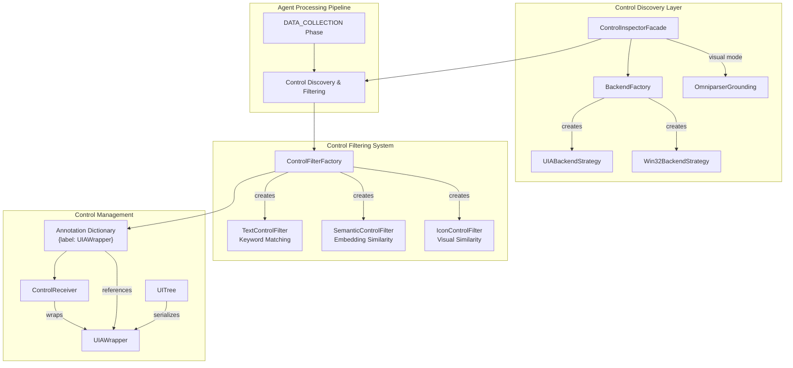
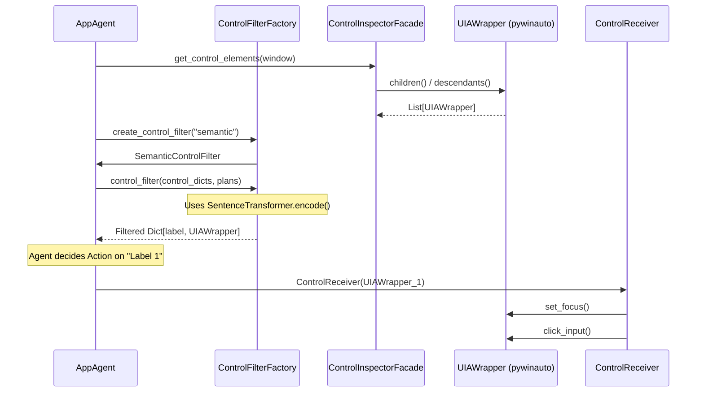

<!-- source: DeepWiki mcp.deepwiki.com · repo microsoft/UFO · page 3.7 UI Control and Inspection · fetched 2026-10-26 -->

# UI Control and Inspection

Relevant source files

The following files were used as context for generating this wiki page:

- [documents/docs/about/CODE_OF_CONDUCT.md](documents/docs/about/CODE_OF_CONDUCT.md)
- [documents/docs/about/CONTRIBUTING.md](documents/docs/about/CONTRIBUTING.md)
- [documents/docs/about/DISCLAIMER.md](documents/docs/about/DISCLAIMER.md)
- [documents/docs/about/LICENSE.md](documents/docs/about/LICENSE.md)
- [documents/docs/about/SUPPORT.md](documents/docs/about/SUPPORT.md)
- [ufo/automator/ui_control/control_filter.py](ufo/automator/ui_control/control_filter.py)
- [ufo/automator/ui_control/grounding/basic.py](ufo/automator/ui_control/grounding/basic.py)
- [ufo/automator/ui_control/grounding/omniparser.py](ufo/automator/ui_control/grounding/omniparser.py)
- [ufo/automator/ui_control/inspector.py](ufo/automator/ui_control/inspector.py)
- [ufo/automator/ui_control/ui_tree.py](ufo/automator/ui_control/ui_tree.py)
- [ufo/experience/summarizer.py](ufo/experience/summarizer.py)
- [ufo/llm/grounding_model/omniparser_service.py](ufo/llm/grounding_model/omniparser_service.py)
- [ufo/module/interactor.py](ufo/module/interactor.py)
- [ufo/rag/web_search.py](ufo/rag/web_search.py)

## Purpose and Scope

This document covers the UI control discovery, filtering, and inspection mechanisms in UFO² Desktop AgentOS. The system identifies interactive elements on the desktop and within applications, filters them based on task relevance, and extracts metadata for agent decision-making. This is a critical component of the `DATA_COLLECTION` phase in the agent processing pipeline.

The module provides a unified interface, `ControlInspectorFacade`, which abstracts different backend strategies (UIA vs. Win32) and integrates with advanced grounding models like **Omniparser** for visual-based control discovery.

---

## System Architecture

The control inspection system operates in three stages: (1) control discovery via the `BackendStrategy` or visual grounding, (2) filtering based on task relevance using text, semantic, or icon strategies, and (3) wrapping in `ControlReceiver` for action execution.

**Control Filtering and Inspection Architecture**

Sources: [ufo/automator/ui_control/inspector.py:32-50](), [ufo/automator/ui_control/control_filter.py:10-30](), [ufo/automator/ui_control/ui_tree.py:20-39]()

---

## Control Discovery Backends

UFO supports multiple strategies for identifying UI elements, managed by the `BackendFactory` [ufo/automator/ui_control/inspector.py:32-50]().

### UIA vs. Win32 Backends
The `BackendStrategy` abstract class defines the interface for finding elements [ufo/automator/ui_control/inspector.py:52-89]().

*   **`UIABackendStrategy`**: Uses the Microsoft UI Automation (UIA) framework. It is the primary backend for modern Windows applications. To optimize performance, it uses Win32 to acquire window handles before converting them to UIA interfaces [ufo/automator/ui_control/inspector.py:174-204]().
*   **`Win32BackendStrategy`**: Uses the older Win32 API. This is often faster for legacy applications but provides less semantic information than UIA [ufo/automator/ui_control/inspector.py:46-47]().

### Visual Grounding (Omniparser)
For scenarios where the UI tree is inaccessible or unreliable, UFO integrates **Omniparser**, a visual grounding model.
*   **`OmniparserGrounding`**: Inherits from `BasicGrounding` [ufo/automator/ui_control/grounding/omniparser.py:25-28](). It sends screenshots to an OmniParser service (via `OmniParser` service class [ufo/llm/grounding_model/omniparser_service.py:8-11]()) to predict bounding boxes and control types.
*   **`VirtualUIAElementInfo`**: Since Omniparser results are coordinates and types, UFO wraps them into "virtual" UIA elements so they can be treated like standard controls by the rest of the system [ufo/automator/ui_control/grounding/basic.py:22-78]().

Sources: [ufo/automator/ui_control/inspector.py:174-204](), [ufo/automator/ui_control/grounding/omniparser.py:32-85](), [ufo/automator/ui_control/grounding/basic.py:154-173]()

---

## Control Filtering Strategies

The `ControlFilterFactory` provides three filtering strategies to reduce the control space based on task-relevant plans.

### Text-Based Filtering
`TextControlFilter` performs exact substring matching between keywords extracted from agent plans and control names [ufo/automator/ui_control/control_filter.py:164-188](). It uses `plans_to_keywords` to strip punctuation and isolate alphabetic or Chinese characters [ufo/automator/ui_control/control_filter.py:113-129]().

### Semantic Filtering
`SemanticControlFilter` uses sentence embeddings to compute semantic similarity.
*   **Mechanism**: Uses `SentenceTransformer` to encode both the plan text and the control's name [ufo/automator/ui_control/control_filter.py:82-100]().
*   **Scoring**: Computes cosine similarity between embeddings and selects the `top_k` most relevant controls using a heap [ufo/automator/ui_control/control_filter.py:195-231]().

### Icon-Based Filtering
`IconControlFilter` applies the same semantic logic but compares plan text against visual features of cropped control icons [ufo/automator/ui_control/control_filter.py:233-273]().

Sources: [ufo/automator/ui_control/control_filter.py:10-30](), [ufo/automator/ui_control/control_filter.py:190-231]()

---

## Control Metadata and UI Tree

UFO extracts detailed metadata to build a structured representation of the interface.

### UI Tree Representation
The `UITree` class recursively traverses the control hierarchy starting from a root element [ufo/automator/ui_control/ui_tree.py:20-39]().
*   **Node Metadata**: Each node in the tree contains `id`, `name`, `control_type`, and three types of rectangles: `rectangle` (absolute), `adjusted_rectangle` (relative to app), and `relative_rectangle` (ratio 0-1) [ufo/automator/ui_control/ui_tree.py:67-91]().
*   **Serialization**: The tree can be flattened or saved to JSON for debugging and state tracking [ufo/automator/ui_control/ui_tree.py:108-149]().

### Performance Optimization
To mitigate performance issues with the UIA COM API, UFO implements `UIAElementInfoFix`, which adds:
*   **Caching**: Caches bounding rectangles to avoid redundant cross-process calls [ufo/automator/ui_control/inspector.py:160-163]().
*   **Timing Wrappers**: Monitors lookup times and introduces markers if a call takes too long (e.g., >20ms) [ufo/automator/ui_control/inspector.py:112-132]().

Sources: [ufo/automator/ui_control/ui_tree.py:48-99](), [ufo/automator/ui_control/inspector.py:92-158]()

---

## Data Flow: From Discovery to Action

The following diagram bridges the Natural Language plans to the Code Entities responsible for control manipulation.

Sources: [ufo/automator/ui_control/inspector.py:32-50](), [ufo/automator/ui_control/control_filter.py:190-231](), [ufo/automator/ui_control/controller.py:45-73]()

---

## Key Classes and Functions

| Class/Function | File | Description |
| :--- | :--- | :--- |
| `ControlInspectorFacade` | `inspector.py` | Main entry point for control discovery and inspection. |
| `BackendFactory` | `inspector.py` | Creates `UIABackendStrategy` or `Win32BackendStrategy`. |
| `ControlFilterFactory` | `control_filter.py` | Creates filters for text, semantic, or icon-based relevance. |
| `OmniparserGrounding` | `omniparser.py` | Implements visual-based control discovery using OmniParser. |
| `UITree` | `ui_tree.py` | Manages the hierarchical structure of UI elements. |
| `UIAElementInfoFix` | `inspector.py` | Performance-optimized wrapper for pywinauto's element info. |

Sources: [ufo/automator/ui_control/inspector.py:32-50](), [ufo/automator/ui_control/control_filter.py:10-30](), [ufo/automator/ui_control/grounding/omniparser.py:25-28](), [ufo/automator/ui_control/ui_tree.py:20-25]()

---

