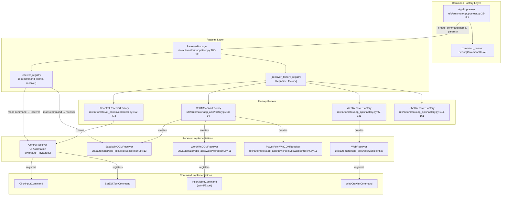
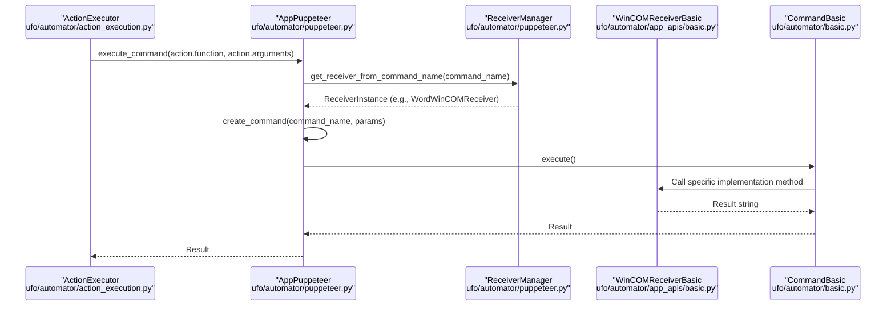

<!-- source: DeepWiki mcp.deepwiki.com · repo microsoft/UFO · page 3.8 Automation Framework · fetched 2026-10-26 -->

# Automation Framework

Relevant source files

The following files were used as context for generating this wiki page:

- [documents/docs/img/add_comment.png](documents/docs/img/add_comment.png)
- [ufo/automator/action_execution.py](ufo/automator/action_execution.py)
- [ufo/automator/app_apis/basic.py](ufo/automator/app_apis/basic.py)
- [ufo/automator/app_apis/excel/excelclient.py](ufo/automator/app_apis/excel/excelclient.py)
- [ufo/automator/app_apis/factory.py](ufo/automator/app_apis/factory.py)
- [ufo/automator/app_apis/powerpoint/__init__.py](ufo/automator/app_apis/powerpoint/__init__.py)
- [ufo/automator/app_apis/powerpoint/powerpointclient.py](ufo/automator/app_apis/powerpoint/powerpointclient.py)
- [ufo/automator/app_apis/web/webclient.py](ufo/automator/app_apis/web/webclient.py)
- [ufo/automator/app_apis/word/wordclient.py](ufo/automator/app_apis/word/wordclient.py)
- [ufo/automator/basic.py](ufo/automator/basic.py)
- [ufo/automator/puppeteer.py](ufo/automator/puppeteer.py)
- [ufo/client/mcp/local_servers/__init__.py](ufo/client/mcp/local_servers/__init__.py)
- [ufo/client/mcp/local_servers/excel_wincom_mcp_server.py](ufo/client/mcp/local_servers/excel_wincom_mcp_server.py)
- [ufo/client/mcp/local_servers/ppt_wincom_mcp_server.py](ufo/client/mcp/local_servers/ppt_wincom_mcp_server.py)
- [ufo/client/mcp/local_servers/word_wincom_mcp_server.py](ufo/client/mcp/local_servers/word_wincom_mcp_server.py)

The Automation Framework provides the execution layer for UFO² Desktop AgentOS, implementing a flexible Command pattern architecture that abstracts UI and COM automation operations. This framework enables agents to control Windows applications through multiple automation strategies: UI manipulation via `pywinauto`/`pyautogui`, application-specific COM APIs via `win32com`, and specialized receivers for web and shell interactions.

For the overall agent system that uses this framework, see [Agent Processing System](#3.1). For MCP-based tool execution (an alternative automation approach), see [MCP Tool System](#3.10).

## Architecture Overview

The framework implements the Command design pattern with three primary components:

1.  **AppPuppeteer**: Command factory and invoker that creates, queues, and executes commands.
2.  **ReceiverManager**: Registry pattern for managing receiver factories and receiver instances.
3.  **Receivers**: Implementation objects that perform actual automation operations.

### System Entity Mapping

The following diagram bridges the conceptual automation flow to specific code entities within the UFO codebase.

**Sources**: [ufo/automator/puppeteer.py:22-185](), [ufo/automator/basic.py:10-128](), [ufo/automator/app_apis/factory.py:33-161](), [ufo/automator/app_apis/excel/excelclient.py:13-16](), [ufo/automator/app_apis/word/wordclient.py:11-16](), [ufo/automator/app_apis/powerpoint/powerpointclient.py:11-16]()

## Base Abstractions

The framework defines three core abstract base classes in `ufo/automator/basic.py`.

### CommandBasic
The command interface that all automation commands must implement. Commands are immutable value objects that encapsulate operation parameters. The `execute()` method delegates to the receiver's implementation [ufo/automator/basic.py:68-104]().

### ReceiverBasic
The receiver interface that implements actual automation logic. Receivers maintain a registry of commands they support using the `@register` decorator pattern [ufo/automator/basic.py:10-66]().

### ReceiverFactory
The factory interface for creating receiver instances. Factories are registered with `ReceiverManager` using the `@ReceiverManager.register` decorator [ufo/automator/basic.py:106-128]().

**Sources**: [ufo/automator/basic.py:10-128]()

## AppPuppeteer: Command Factory

`AppPuppeteer` serves as the central command factory and invoker. It maintains a command queue and coordinates with `ReceiverManager` to route commands to appropriate receivers [ufo/automator/puppeteer.py:22-37]().

### Core Responsibilities

| Method | Purpose | Return Type |
| :--- | :--- | :--- |
| `create_command` | Instantiate command from name and parameters [ufo/automator/puppeteer.py:39-56]() | `Optional[CommandBasic]` |
| `execute_command` | Create and immediately execute command [ufo/automator/puppeteer.py:73-85]() | `str` (result) |
| `add_command` | Add command to queue for batch execution [ufo/automator/puppeteer.py:99-108]() | `None` |
| `execute_all_commands` | Execute all queued commands [ufo/automator/puppeteer.py:87-97]() | `List[Any]` |
| `list_commands` | Get all available command names [ufo/automator/puppeteer.py:110-120]() | `set` |

### Command Execution Data Flow

This diagram traces the flow of a single action from the `ActionExecutor` down to the specific application receiver.

**Sources**: [ufo/automator/puppeteer.py:73-85](), [ufo/automator/action_execution.py:85-134](), [ufo/automator/basic.py:81-86]()

## ReceiverManager: Registry Pattern

`ReceiverManager` implements a two-level registry system. Factories self-register using the `@ReceiverManager.register` decorator [ufo/automator/puppeteer.py:293-309]().

Receivers are created in two phases:
1.  **UI Control Receiver**: Created via `create_ui_control_receiver(control, application)` [ufo/automator/puppeteer.py:202-221]().
2.  **API Receivers**: Created via `create_api_receiver(app_root_name, process_name)` which iterates through all registered API factories [ufo/automator/puppeteer.py:231-250]().

**Sources**: [ufo/automator/puppeteer.py:185-309]()

## COM Receivers: Office Automation

COM receivers provide application-specific automation for Microsoft Office applications using `win32com.client`. They inherit from `WinCOMReceiverBasic` [ufo/automator/app_apis/basic.py:21-47]().

### WinCOMReceiver Hierarchy

| Application | Receiver Class | CLSID Mapping |
| :--- | :--- | :--- |
| Word | `WordWinCOMReceiver` [ufo/automator/app_apis/word/wordclient.py:11]() | `Word.Application` |
| Excel | `ExcelWinCOMReceiver` [ufo/automator/app_apis/excel/excelclient.py:13]() | `Excel.Application` |
| PowerPoint | `PowerPointWinCOMReceiver` [ufo/automator/app_apis/powerpoint/powerpointclient.py:11]() | `PowerPoint.Application` |

### Specialized API Operations

*   **Excel**: Includes `table2markdown` [ufo/automator/app_apis/excel/excelclient.py:34-82](), `insert_excel_table` [ufo/automator/app_apis/excel/excelclient.py:84-109](), and `reorder_columns` [ufo/automator/app_apis/excel/excelclient.py:157-200]().
*   **Word**: Includes `insert_table` [ufo/automator/app_apis/word/wordclient.py:32-52](), `select_text` [ufo/automator/app_apis/word/wordclient.py:54-66](), and `save_as` for PDF export [ufo/automator/app_apis/word/wordclient.py:146-189]().
*   **PowerPoint**: Includes `set_background_color` [ufo/automator/app_apis/powerpoint/powerpointclient.py:35-64]() and `save_as` for slide export [ufo/automator/app_apis/powerpoint/powerpointclient.py:66-142]().

**Sources**: [ufo/automator/app_apis/excel/excelclient.py:13-200](), [ufo/automator/app_apis/word/wordclient.py:11-189](), [ufo/automator/app_apis/powerpoint/powerpointclient.py:11-142]()

## MCP Tool Integration

UFO² integrates with the **Model Context Protocol (MCP)** to expose automation capabilities as standardized tools. Local MCP servers like `create_word_mcp_server` [ufo/client/mcp/local_servers/word_wincom_mcp_server.py:58-220]() use `AppPuppeteer` and `ActionExecutor` internally to perform tasks.

These servers are lazily loaded and platform-checked to ensure Windows-only COM servers do not load on other OS types [ufo/client/mcp/local_servers/__init__.py:19-71]().

**Sources**: [ufo/client/mcp/local_servers/word_wincom_mcp_server.py:58-220](), [ufo/client/mcp/local_servers/__init__.py:19-71]()

---

