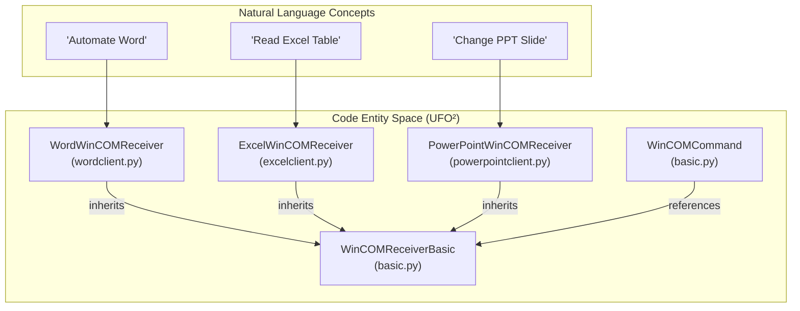
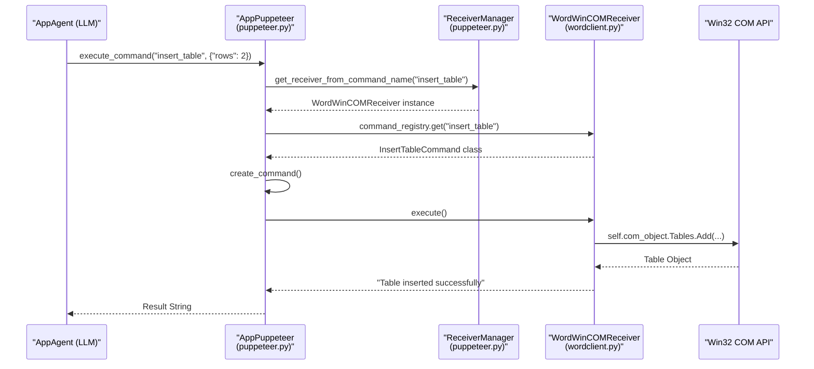

<!-- source: DeepWiki mcp.deepwiki.com · repo microsoft/UFO · page 3.9 COM Application Receivers · fetched 2026-10-26 -->

# COM Application Receivers

Relevant source files

The following files were used as context for generating this wiki page:

- [.gitignore](.gitignore)
- [assets/ufo.png](assets/ufo.png)
- [config/galaxy/constellation.yaml](config/galaxy/constellation.yaml)
- [config/ufo/mcp.yaml](config/ufo/mcp.yaml)
- [config/ufo/prices.yaml](config/ufo/prices.yaml)
- [config/ufo/third_party.yaml](config/ufo/third_party.yaml)
- [ufo/automator/action_execution.py](ufo/automator/action_execution.py)
- [ufo/automator/app_apis/basic.py](ufo/automator/app_apis/basic.py)
- [ufo/automator/app_apis/excel/excelclient.py](ufo/automator/app_apis/excel/excelclient.py)
- [ufo/automator/app_apis/factory.py](ufo/automator/app_apis/factory.py)
- [ufo/automator/app_apis/powerpoint/__init__.py](ufo/automator/app_apis/powerpoint/__init__.py)
- [ufo/automator/app_apis/powerpoint/powerpointclient.py](ufo/automator/app_apis/powerpoint/powerpointclient.py)
- [ufo/automator/app_apis/web/webclient.py](ufo/automator/app_apis/web/webclient.py)
- [ufo/automator/app_apis/word/wordclient.py](ufo/automator/app_apis/word/wordclient.py)
- [ufo/automator/basic.py](ufo/automator/basic.py)
- [ufo/automator/puppeteer.py](ufo/automator/puppeteer.py)
- [ufo/client/mcp/local_servers/__init__.py](ufo/client/mcp/local_servers/__init__.py)
- [ufo/client/mcp/local_servers/excel_wincom_mcp_server.py](ufo/client/mcp/local_servers/excel_wincom_mcp_server.py)
- [ufo/client/mcp/local_servers/ppt_wincom_mcp_server.py](ufo/client/mcp/local_servers/ppt_wincom_mcp_server.py)
- [ufo/client/mcp/local_servers/word_wincom_mcp_server.py](ufo/client/mcp/local_servers/word_wincom_mcp_server.py)

## Purpose and Scope

This page documents the COM (Component Object Model) Application Receivers in UFO², which provide programmatic access to Microsoft Office applications through their native COM APIs. These receivers enable AppAgents to perform document-level operations on Word, Excel, and PowerPoint files without relying on UI automation, offering more reliable and efficient execution for tasks like data extraction, document formatting, and file conversion.

For information about UI-based control automation, see [UI Control and Inspection](#3.7). For the broader automation orchestration system that coordinates both COM and UI receivers, see [Automation Framework](#3.8). For MCP-based tool execution, see [MCP Tool System](#3.10).

## Architecture Overview

COM Application Receivers follow a hierarchical inheritance pattern with the Command design pattern for operation encapsulation. The architecture consists of three layers:

1. **Base Abstractions**: `ReceiverBasic` and `CommandBasic` define the receiver-command interface [ufo/automator/basic.py:10-104]().
2. **COM Layer**: `WinCOMReceiverBasic` and `WinCOMCommand` provide COM-specific functionality [ufo/automator/app_apis/basic.py:21-183]().
3. **Application Layer**: Specialized receivers for Word, Excel, PowerPoint with app-specific commands [ufo/automator/app_apis/factory.py:57-86]().

### Natural Language to Code Entity Space: COM Architecture
This diagram maps high-level automation concepts to the specific classes and files that implement them.

**Sources:** [ufo/automator/app_apis/basic.py:21-183](), [ufo/automator/app_apis/word/wordclient.py:11-31](), [ufo/automator/app_apis/excel/excelclient.py:13-32](), [ufo/automator/app_apis/powerpoint/powerpointclient.py:11-33]()

## Base COM Receiver Class

### WinCOMReceiverBasic

The `WinCOMReceiverBasic` class provides core functionality for all COM-based receivers. It handles COM object initialization, process-to-document mapping, and common operations like saving and closing [ufo/automator/app_apis/basic.py:21-165]().

**Key Responsibilities:**

| Responsibility | Method | Description |
|---------------|---------|-------------|
| COM Initialization | `__init__` | Dispatches COM client using CLSID via `win32com.client.Dispatch` [ufo/automator/app_apis/basic.py:42-43](). |
| Document Matching | `get_object_from_process_name` | Maps process name to active document (abstract) [ufo/automator/app_apis/basic.py:48-53](). |
| Process-Name Matching | `app_match` | Finds best document match using longest common substring [ufo/automator/app_apis/basic.py:69-89](). |
| File Operations | `save`, `close`, `save_to_xml` | Standard document lifecycle operations [ufo/automator/app_apis/basic.py:103-129](). |
| Path Access | `full_path` | Returns absolute path of active document via `com_object.FullName` [ufo/automator/app_apis/basic.py:91-101](). |

**Sources:** [ufo/automator/app_apis/basic.py:21-165]()

### Process-to-Document Matching Algorithm

The `app_match()` method identifies which open document corresponds to the target process. It uses `longest_common_substring_length` to handle cases where the process name may have a suffix removed or slight variations [ufo/automator/app_apis/basic.py:69-89]().

**Sources:** [ufo/automator/app_apis/basic.py:69-89](), [ufo/automator/app_apis/basic.py:140-164]()

## Excel COM Receiver

### ExcelWinCOMReceiver

The `ExcelWinCOMReceiver` exposes Excel-specific COM APIs for spreadsheet manipulation [ufo/automator/app_apis/excel/excelclient.py:13-32]().

**Key Operations:**

*   **Table-to-Markdown**: `table2markdown()` converts Excel ranges to Markdown tables using pandas [ufo/automator/app_apis/excel/excelclient.py:34-82]().
*   **Table Insertion**: `insert_excel_table()` inserts a list of lists into a specific sheet and starting cell [ufo/automator/app_apis/excel/excelclient.py:84-109]().
*   **Range Selection**: `select_table_range()` selects a range of cells, supporting `-1` for end boundaries [ufo/automator/app_apis/excel/excelclient.py:111-155]().
*   **Column Reordering**: `reorder_columns()` reorders non-empty columns based on a desired header list [ufo/automator/app_apis/excel/excelclient.py:157-219]().

**Sources:** [ufo/automator/app_apis/excel/excelclient.py:13-219]()

## Word COM Receiver

### WordWinCOMReceiver

The `WordWinCOMReceiver` provides document-level operations for Microsoft Word [ufo/automator/app_apis/word/wordclient.py:11-31]().

**Key Operations:**

*   **Table Insertion**: `insert_table()` adds a table at the end of the document [ufo/automator/app_apis/word/wordclient.py:32-52]().
*   **Text Selection**: `select_text()` finds and selects specific text strings [ufo/automator/app_apis/word/wordclient.py:54-66]().
*   **Paragraph Selection**: `select_paragraph()` selects paragraphs by index, with optional empty paragraph filtering [ufo/automator/app_apis/word/wordclient.py:68-97]().
*   **Formatting**: `set_font()` modifies font name and size for the current selection [ufo/automator/app_apis/word/wordclient.py:114-144]().
*   **Export**: `save_as()` supports saving to PDF, TXT, HTML, etc., using `ext_to_fileformat` mapping [ufo/automator/app_apis/word/wordclient.py:146-189]().

**Sources:** [ufo/automator/app_apis/word/wordclient.py:11-189]()

## PowerPoint COM Receiver

### PowerPointWinCOMReceiver

The `PowerPointWinCOMReceiver` focuses on slide manipulation and export functionality [ufo/automator/app_apis/powerpoint/powerpointclient.py:11-33]().

**Key Operations:**

*   **Background Color**: `set_background_color()` sets slide background colors using BGR format [ufo/automator/app_apis/powerpoint/powerpointclient.py:35-64]().
*   **Export/Save**: `save_as()` handles document saving and slide-to-image exports (JPG, PNG, etc.) [ufo/automator/app_apis/powerpoint/powerpointclient.py:66-142]().

**Sources:** [ufo/automator/app_apis/powerpoint/powerpointclient.py:11-142]()

## Command Execution Pipeline

The `AppPuppeteer` coordinates the execution of these COM commands through a `ReceiverManager` [ufo/automator/puppeteer.py:36-37]().

### Command Flow: Natural Language to API Execution
This diagram traces how a user's natural language request (processed into a command) reaches the COM API.

**Sources:** [ufo/automator/puppeteer.py:73-85](), [ufo/automator/puppeteer.py:47-56](), [ufo/automator/app_apis/word/wordclient.py:200-213]()

### Integration with MCP
COM Application Receivers are also exposed as tools through the MCP (Model Context Protocol) system. Specialized servers like `word_wincom_mcp_server.py` wrap the `AppPuppeteer` and `ActionExecutor` to expose COM methods as standardized tools [ufo/client/mcp/local_servers/word_wincom_mcp_server.py:58-89]().

**Sources:** [ufo/client/mcp/local_servers/word_wincom_mcp_server.py:58-220](), [ufo/client/mcp/local_servers/excel_wincom_mcp_server.py:55-147](), [ufo/client/mcp/local_servers/ppt_wincom_mcp_server.py:55-165]()

## Factory Pattern and Integration

The `COMReceiverFactory` maps application root names (e.g., `WINWORD.EXE`) to their respective receiver classes and COM CLSIDs [ufo/automator/app_apis/factory.py:32-86]().

| App Root Name | Receiver Class | CLSID |
| :--- | :--- | :--- |
| `WINWORD.EXE` | `WordWinCOMReceiver` | `Word.Application` |
| `EXCEL.EXE` | `ExcelWinCOMReceiver` | `Excel.Application` |
| `POWERPNT.EXE` | `PowerPointWinCOMReceiver` | `PowerPoint.Application` |
| `olk.exe` | N/A | `Outlook.Application` |

**Sources:** [ufo/automator/app_apis/factory.py:63-86]()

---

