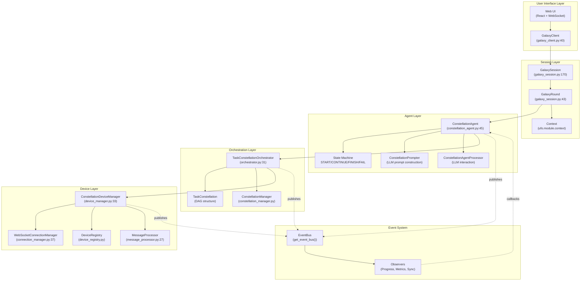
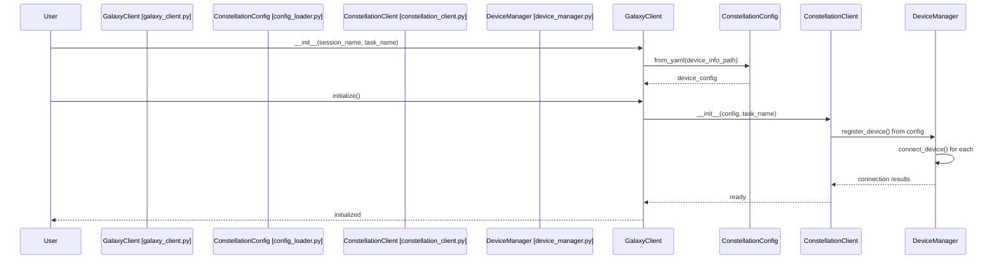
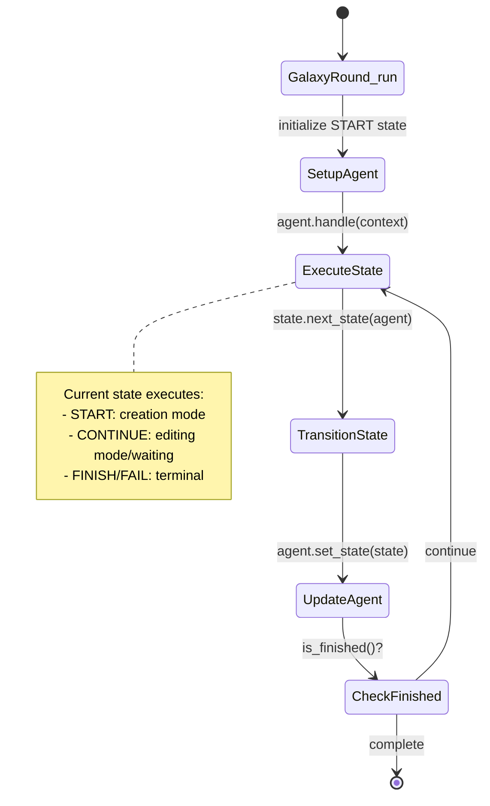
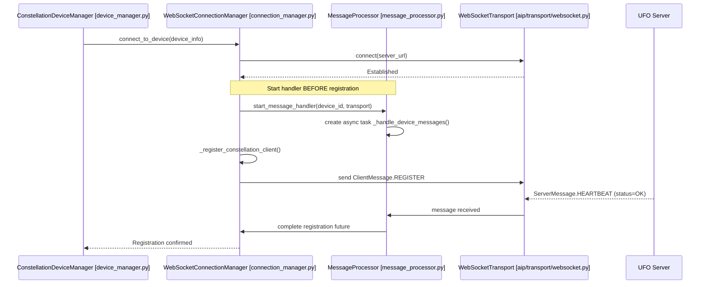

<!-- source: DeepWiki mcp.deepwiki.com · repo microsoft/UFO · page 4.1 Galaxy Architecture · fetched 2026-10-26 -->

# Galaxy Architecture

Relevant source files

The following files were used as context for generating this wiki page:

- [documents/docs/galaxy/client/aip_integration.md](documents/docs/galaxy/client/aip_integration.md)
- [documents/docs/galaxy/client/components.md](documents/docs/galaxy/client/components.md)
- [documents/docs/galaxy/client/constellation_client.md](documents/docs/galaxy/client/constellation_client.md)
- [documents/docs/galaxy/client/device_manager.md](documents/docs/galaxy/client/device_manager.md)
- [documents/docs/galaxy/client/galaxy_client.md](documents/docs/galaxy/client/galaxy_client.md)
- [documents/docs/galaxy/client/overview.md](documents/docs/galaxy/client/overview.md)
- [galaxy/client/components/connection_manager.py](galaxy/client/components/connection_manager.py)
- [galaxy/client/components/device_registry.py](galaxy/client/components/device_registry.py)
- [galaxy/client/components/message_processor.py](galaxy/client/components/message_processor.py)
- [galaxy/client/constellation_client.py](galaxy/client/constellation_client.py)
- [galaxy/client/device_manager.py](galaxy/client/device_manager.py)
- [galaxy/constellation/orchestrator/orchestrator.py](galaxy/constellation/orchestrator/orchestrator.py)
- [galaxy/galaxy.py](galaxy/galaxy.py)
- [galaxy/galaxy_client.py](galaxy/galaxy_client.py)
- [galaxy/session/galaxy_session.py](galaxy/session/galaxy_session.py)
- [galaxy/webui/frontend/.env.example](galaxy/webui/frontend/.env.example)
- [galaxy/webui/frontend/README.md](galaxy/webui/frontend/README.md)
- [galaxy/webui/frontend/src/components/devices/AddDeviceModal.tsx](galaxy/webui/frontend/src/components/devices/AddDeviceModal.tsx)
- [galaxy/webui/frontend/vite.config.ts](galaxy/webui/frontend/vite.config.ts)

## Purpose and Scope

This document describes the architectural components of UFO³ Galaxy, the multi-device orchestration layer. It covers the core classes and their interactions: `GalaxyClient`, `GalaxySession`, `GalaxyRound`, `ConstellationAgent`, and `TaskConstellationOrchestrator`. For details on the DAG data structures, see [Task Constellation](#4.3). For orchestration execution mechanics, see [Task Orchestration](#4.4). For device communication protocols, see [Agent Interaction Protocol](#5).

---

## Component Overview

Galaxy implements a layered architecture where user requests flow through session management, agent planning, and orchestration execution. The system coordinates multiple UFO² devices through event-driven asynchronous communication.

### High-Level Component Structure

**Sources:** [galaxy/galaxy_client.py:40-105](), [galaxy/session/galaxy_session.py:170-246](), [galaxy/agents/constellation_agent.py:45-99](), [galaxy/constellation/orchestrator/orchestrator.py:31-98](), [galaxy/client/device_manager.py:33-86]()

---

## GalaxyClient - Entry Point

`GalaxyClient` provides the main programmatic interface for Galaxy framework. It initializes all subsystems and manages the request processing lifecycle.

### GalaxyClient Responsibilities

| Responsibility | Implementation |
|---------------|----------------|
| Session Management | Creates and manages `GalaxySession` instances per request [galaxy/galaxy_client.py:195-200]() |
| Device Configuration | Loads configuration via `ConstellationConfig.from_yaml()` [galaxy/galaxy_client.py:91-94]() |
| Constellation Client | Initializes `ConstellationClient` for device coordination [galaxy/galaxy_client.py:126-132]() |
| Request Processing | Orchestrates end-to-end request execution [galaxy/galaxy_client.py:150-316]() |
| Lifecycle Control | Handles initialization, shutdown, and cancellation [galaxy/galaxy_client.py:538-601]() |

### Initialization Flow

**Sources:** [galaxy/galaxy_client.py:40-149](), [galaxy/client/constellation_client.py:18-89](), [galaxy/client/device_manager.py:174-213]()

---

## Session Lifecycle

Galaxy uses a two-level session structure: `GalaxySession` manages the overall request lifecycle, while `GalaxyRound` executes the agent state machine.

### GalaxySession Structure

`GalaxySession` extends `BaseSession` [galaxy/session/galaxy_session.py:170-176]() to support constellation-based task execution.

**Context Initialization** [galaxy/session/galaxy_session.py:247-272]():
- Populates `DEVICE_INFO` from device registry.
- Attaches `LocalCommandDispatcher` for MCP tool execution.

**Observer Setup** [galaxy/session/galaxy_session.py:279-323]():
- `ConstellationProgressObserver`: Routes task events to agent queue.
- `SessionMetricsObserver`: Collects timing and statistics.
- `DAGVisualizationObserver`: Generates constellation visualizations.
- `ConstellationModificationSynchronizer`: Prevents race conditions between agent edits and orchestration.

### GalaxyRound Execution

`GalaxyRound` manages the agent state machine until completion [galaxy/session/galaxy_session.py:43-70]().

**Key Round Methods:**
- **`run()`** [galaxy/session/galaxy_session.py:71-112](): Executes agent state machine loop.
- **`is_finished()`** [galaxy/session/galaxy_session.py:136-151](): Checks termination conditions (Terminal state or `MAX_STEP`).

**Sources:** [galaxy/session/galaxy_session.py:43-323]()

---

## ConstellationAgent - Planning and Adaptation

`ConstellationAgent` is the LLM-driven planning agent that creates and modifies the task constellation dynamically.

### Dual-Mode Operation

1. **Creation Mode** [galaxy/agents/constellation_agent.py:307-338](): The agent generates an initial constellation from user request.
2. **Editing Mode** [galaxy/agents/constellation_agent.py:340-416](): The agent adapts the constellation after task completion, allowing for dynamic branching and error recovery.

### Event Queues
The agent maintains two asyncio queues for coordination:
- **`task_completion_queue`** [galaxy/agents/constellation_agent.py:580-630](): Receives `TASK_COMPLETED` / `TASK_FAILED` events from the `ConstellationProgressObserver`.
- **`constellation_completion_queue`** [galaxy/agents/constellation_agent.py:588-664](): Receives `CONSTELLATION_COMPLETED` events.

**Sources:** [galaxy/agents/constellation_agent.py:45-664](), [galaxy/session/galaxy_session.py:279-300]()

---

## TaskConstellationOrchestrator - Execution Control

`TaskConstellationOrchestrator` [galaxy/constellation/orchestrator/orchestrator.py:31-38]() manages the execution flow of the DAG.

### Orchestration Loop

The `orchestrate_constellation()` method [galaxy/constellation/orchestrator/orchestrator.py:143-195]() coordinates execution:

1. **Validation** [galaxy/constellation/orchestrator/orchestrator.py:226-268](): Checks DAG validity and prepares assignments.
2. **Execution Loop** [galaxy/constellation/orchestrator/orchestrator.py:394-433]():
   - Waits for agent modifications via `_sync_constellation_modifications()` [galaxy/constellation/orchestrator/orchestrator.py:434-467]().
   - Fetches ready tasks using `constellation.get_ready_tasks()`.
   - Dispatches tasks to devices via `_schedule_ready_tasks()`.

### Synchronization with Agent
The `ConstellationModificationSynchronizer` [galaxy/session/observers/constellation_sync_observer.py]() acts as a bridge. It ensures the orchestrator does not start new tasks while the agent is in the middle of editing the DAG (Editing Mode).

**Sources:** [galaxy/constellation/orchestrator/orchestrator.py:31-467](), [galaxy/session/galaxy_session.py:318-323]()

---

## ConstellationDeviceManager - Device Coordination

`ConstellationDeviceManager` [galaxy/client/device_manager.py:33-43]() coordinates communication with UFO² device agents.

### Component Modules

| Component | Responsibility |
|-----------|---------------|
| **DeviceRegistry** | Single source of truth for device status and metadata [galaxy/client/components/device_registry.py](). |
| **WebSocketConnectionManager** | Manages low-level WebSocket connections using AIP protocols [galaxy/client/components/connection_manager.py:37](). |
| **MessageProcessor** | Listens for incoming AIP messages and routes them to handlers [galaxy/client/components/message_processor.py:27](). |
| **HeartbeatManager** | Health monitoring for connected devices [galaxy/client/components/heartbeat_manager.py](). |
| **TaskQueueManager** | Manages task scheduling for devices [galaxy/client/components/task_queue_manager.py](). |

### Device Connection Flow

**Sources:** [galaxy/client/device_manager.py:33-86](), [galaxy/client/components/connection_manager.py:37-152](), [galaxy/client/components/message_processor.py:27-140](), [documents/docs/galaxy/client/components.md:14-56]()

---

## Interaction Patterns

### Context and Data Flow
Context is used to share state across the session [galaxy/session/galaxy_session.py:212-216](). Key keys include:
- `DEVICE_INFO`: Metadata about registered devices.
- `CONSTELLATION`: The current `TaskConstellation` object.
- `WEAVING_MODE`: Whether the agent is currently in `CREATION` or `EDITING` mode.

### Event-Driven Orchestration
The system uses an `EventBus` [galaxy/core/events.py]().
1. **DeviceManager** publishes `DeviceEvent` on connection changes [galaxy/client/device_manager.py:116-173]().
2. **Orchestrator** publishes `TaskEvent` (STARTED/COMPLETED) [galaxy/constellation/orchestrator/orchestrator.py:603-697]().
3. **Agent** publishes `AgentEvent` for LLM outputs [galaxy/agents/constellation_agent.py:530-553]().

**Sources:** [galaxy/session/galaxy_session.py:212-272](), [galaxy/core/events.py](), [galaxy/constellation/orchestrator/orchestrator.py:143-179]()

---

