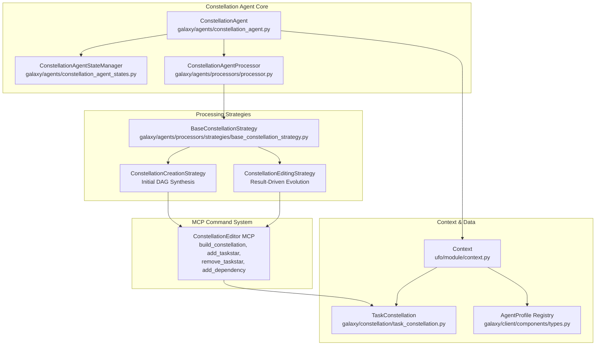
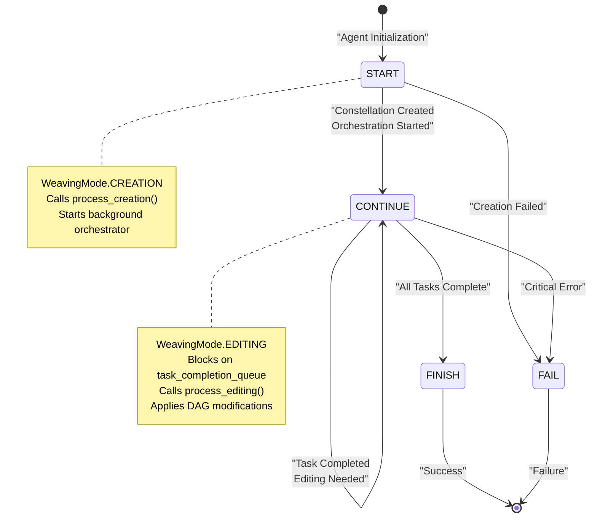
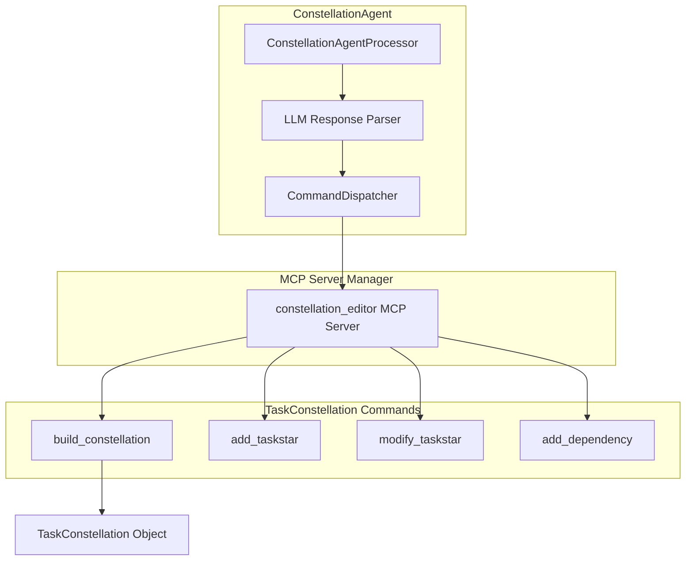

<!-- source: DeepWiki mcp.deepwiki.com · repo microsoft/UFO · page 4.2 Constellation Agent · fetched 2026-10-26 -->

# Constellation Agent

Relevant source files

The following files were used as context for generating this wiki page:

- [documents/docs/galaxy/constellation_agent/command.md](documents/docs/galaxy/constellation_agent/command.md)
- [documents/docs/galaxy/constellation_agent/overview.md](documents/docs/galaxy/constellation_agent/overview.md)
- [documents/docs/galaxy/constellation_agent/state.md](documents/docs/galaxy/constellation_agent/state.md)
- [documents/docs/galaxy/constellation_agent/strategy.md](documents/docs/galaxy/constellation_agent/strategy.md)
- [documents/docs/galaxy/constellation_orchestrator/api_reference.md](documents/docs/galaxy/constellation_orchestrator/api_reference.md)
- [documents/docs/galaxy/constellation_orchestrator/asynchronous_scheduling.md](documents/docs/galaxy/constellation_orchestrator/asynchronous_scheduling.md)
- [documents/docs/galaxy/constellation_orchestrator/batched_editing.md](documents/docs/galaxy/constellation_orchestrator/batched_editing.md)
- [documents/docs/galaxy/constellation_orchestrator/consistency_guarantees.md](documents/docs/galaxy/constellation_orchestrator/consistency_guarantees.md)
- [documents/docs/galaxy/constellation_orchestrator/constellation_manager.md](documents/docs/galaxy/constellation_orchestrator/constellation_manager.md)
- [documents/docs/galaxy/constellation_orchestrator/event_driven_coordination.md](documents/docs/galaxy/constellation_orchestrator/event_driven_coordination.md)
- [documents/docs/galaxy/constellation_orchestrator/overview.md](documents/docs/galaxy/constellation_orchestrator/overview.md)
- [documents/docs/galaxy/constellation_orchestrator/safe_assignment_locking.md](documents/docs/galaxy/constellation_orchestrator/safe_assignment_locking.md)
- [galaxy/agents/constellation_agent.py](galaxy/agents/constellation_agent.py)
- [galaxy/agents/constellation_agent_states.py](galaxy/agents/constellation_agent_states.py)
- [galaxy/agents/processors/strategies/base_constellation_strategy.py](galaxy/agents/processors/strategies/base_constellation_strategy.py)
- [galaxy/agents/processors/strategies/constellation_creation_strategy.py](galaxy/agents/processors/strategies/constellation_creation_strategy.py)
- [galaxy/agents/processors/strategies/constellation_editing_strategy.py](galaxy/agents/processors/strategies/constellation_editing_strategy.py)
- [galaxy/agents/schema.py](galaxy/agents/schema.py)
- [galaxy/constellation/editor/commands.py](galaxy/constellation/editor/commands.py)
- [galaxy/constellation/task_constellation.py](galaxy/constellation/task_constellation.py)
- [galaxy/constellation/task_star.py](galaxy/constellation/task_star.py)
- [galaxy/core/events.py](galaxy/core/events.py)
- [galaxy/session/observers/__init__.py](galaxy/session/observers/__init__.py)
- [galaxy/session/observers/agent_output_observer.py](galaxy/session/observers/agent_output_observer.py)
- [galaxy/session/observers/base_observer.py](galaxy/session/observers/base_observer.py)
- [galaxy/session/observers/constellation_sync_observer.py](galaxy/session/observers/constellation_sync_observer.py)
- [tests/integration/test_e2e_galaxy.py](tests/integration/test_e2e_galaxy.py)
- [tests/unit/galaxy/agents/test_galaxy_agent_states.py](tests/unit/galaxy/agents/test_galaxy_agent_states.py)

The **Constellation Agent** is the strategic planning component in UFO³ Galaxy that decomposes complex user requests into executable Task Constellations (DAGs) and manages their evolution throughout execution. It serves as the high-level orchestrator that translates natural language requests into structured, device-aware task graphs that can be executed across heterogeneous devices.

**Scope**: This document covers the Constellation Agent's architecture, state machine, dual-mode operation (Creation/Editing), processing strategies, and integration with the Task Constellation system.

---

## Architecture Overview

The Constellation Agent follows UFO's **Processor-Strategy-Middleware** architecture pattern, adapted for high-level task planning. It operates as an LLM-driven agent that maintains a finite state machine (FSM) to control its behavior across different phases of constellation management.

### Component Structure

**Sources**: [galaxy/agents/constellation_agent.py:45-61](), [galaxy/agents/processors/processor.py:1-25](), [galaxy/agents/processors/strategies/base_constellation_strategy.py:54-72](), [galaxy/agents/constellation_agent_states.py:33-42]()

---

## State Machine

The `ConstellationAgent` uses a finite state machine (FSM) implemented via the `ConstellationAgentStateManager` to control its operational mode. The FSM has four states defined in the `ConstellationAgentStatus` enum.

### State Definitions

| State | Class | Purpose | Transitions To |
|-------|-------|---------|----------------|
| **START** | `StartConstellationAgentState` | Initial constellation creation from user request via `process_creation()` | CONTINUE, FAIL |
| **CONTINUE** | `ContinueConstellationAgentState` | Event-driven editing; waits on `task_completion_queue` for task results | CONTINUE, FINISH, FAIL |
| **FINISH** | Terminal State | Successful completion of all tasks in the constellation | - |
| **FAIL** | Terminal State | Unrecoverable error during creation or execution | - |

**FSM State Machine Diagram**

### State Implementation Details

**START State** ([galaxy/agents/constellation_agent_states.py:64-104]()):
- Sets `ContextNames.WEAVING_MODE` to `WeavingMode.CREATION`.
- Calls `agent.process_creation(context)` to generate the initial DAG via LLM.
- Starts orchestration in the background using `asyncio.create_task(agent.orchestrator.orchestrate_constellation())`.
- Transitions to `CONTINUE` if a constellation is successfully created.

**CONTINUE State** ([galaxy/agents/constellation_agent_states.py:182-248]()):
- Sets `ContextNames.WEAVING_MODE` to `WeavingMode.EDITING`.
- Blocks on `await agent.task_completion_queue.get()` for task completion events.
- Collects multiple pending events from the queue for batch processing.
- Uses `_get_merged_constellation()` to synchronize with the orchestrator's latest state, ensuring it processes with the most up-to-date DAG including runtime results.
- Calls `agent.process_editing()` to adapt the DAG based on results.

**Sources**: [galaxy/agents/constellation_agent_states.py:24-31](), [galaxy/agents/constellation_agent_states.py:64-140](), [galaxy/agents/constellation_agent_states.py:144-248]()

---

## Dual-Mode Operation: Creation vs Editing

The Constellation Agent operates in two distinct modes determined by the `WeavingMode` schema.

### Mode Characteristics

| Aspect | Creation Mode (START) | Editing Mode (CONTINUE) |
|--------|----------------------|------------------------|
| **Trigger** | Initial user request | Task completion events |
| **Strategy** | `ConstellationCreationStrategy` | `ConstellationEditingStrategy` |
| **Context** | User request, device capabilities | Task results, current DAG state |
| **Output** | Complete initial DAG | DAG modifications (edits) |

### Creation Mode (START)
In this mode, the agent receives a natural language request and uses the `build_constellation` tool to synthesize a structured DAG.
- **Processing**: The `ConstellationAgentProcessor` executes the creation strategy [galaxy/agents/constellation_agent.py:130-143]().
- **Validation**: After creation, `validate_dag()` is called to ensure acyclicity and structural integrity [galaxy/agents/constellation_agent.py:152-168]().
- **Tooling**: The agent uses the `_constellation_creation_tool_name` ("build_constellation") to finalize the graph [galaxy/agents/constellation_agent.py:63-64]().

### Editing Mode (CONTINUE)
During execution, the agent enters editing mode to process feedback from the `TaskConstellationOrchestrator`.
- **Event Collection**: The agent waits for `TaskEvent` objects in its `task_completion_queue` [galaxy/agents/constellation_agent_states.py:190-203]().
- **Synchronization**: It employs a `ConstellationModificationSynchronizer` to prevent race conditions between the orchestrator executing tasks and the agent modifying the DAG [galaxy/session/observers/constellation_sync_observer.py:45-56]().
- **Dynamic Adaptation**: The agent can add new tasks, modify existing ones, or change dependencies based on the success or failure of previous tasks.

**Sources**: [galaxy/agents/constellation_agent.py:306-337](), [galaxy/agents/constellation_agent.py:339-415](), [galaxy/agents/constellation_agent_states.py:81-85](), [galaxy/agents/constellation_agent_states.py:188-190]()

---

## DAG Modification and MCP Integration

The agent modifies the `TaskConstellation` through the Model Context Protocol (MCP). It generates structured commands that are dispatched to a local MCP server.

### MCP Command Architecture

### Synchronization and Locking
To ensure consistency, the agent uses a `ConstellationModificationSynchronizer`. When a task completes:
1. The synchronizer registers a "pending modification" for that `task_id` [galaxy/session/observers/constellation_sync_observer.py:123-128]().
2. The orchestrator's scheduling loop waits for these modifications to clear before dispatching new tasks [galaxy/session/observers/constellation_sync_observer.py:23-25]().
3. Once the agent publishes a `CONSTELLATION_MODIFIED` event, the modification is marked complete, and the orchestrator proceeds [galaxy/session/observers/constellation_sync_observer.py:15-17]().

**Sources**: [galaxy/agents/constellation_agent.py:187-207](), [galaxy/session/observers/constellation_sync_observer.py:13-25](), [galaxy/session/observers/constellation_sync_observer.py:72-73]()

---

## Summary of Implementation

The `ConstellationAgent` extends `BasicAgent` and implements `IRequestProcessor` and `IResultProcessor` [galaxy/agents/constellation_agent.py:45]().

| Component | Code Reference | Role |
|-----------|----------------|------|
| **FSM Manager** | `ConstellationAgentStateManager` | Manages transitions between START, CONTINUE, FINISH, FAIL [galaxy/agents/constellation_agent_states.py:33]() |
| **Processor** | `ConstellationAgentProcessor` | Orchestrates the LLM interaction and command execution phases [galaxy/agents/processors/processor.py:20]() |
| **Prompter** | `BaseConstellationPrompter` | Constructs system and user prompts for Creation/Editing modes [galaxy/agents/prompters/base_constellation_prompter.py:21]() |
| **Synchronizer** | `ConstellationModificationSynchronizer` | Prevents race conditions during concurrent editing [galaxy/session/observers/constellation_sync_observer.py:45]() |
| **Event Bus** | `get_event_bus()` | Handles `AgentEvent`, `TaskEvent`, and `ConstellationEvent` [galaxy/agents/constellation_agent.py:28-34]() |

**Sources**: [galaxy/agents/constellation_agent.py:45-100](), [galaxy/agents/constellation_agent_states.py:1-42](), [galaxy/session/observers/constellation_sync_observer.py:45-73]()

---

