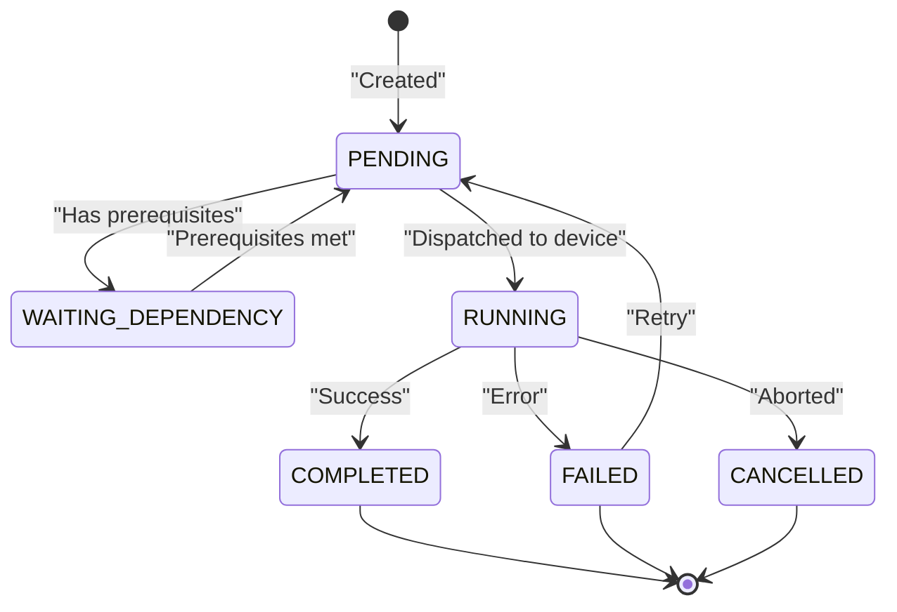
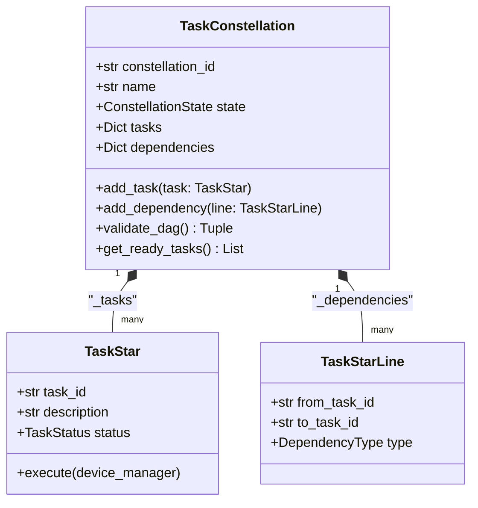
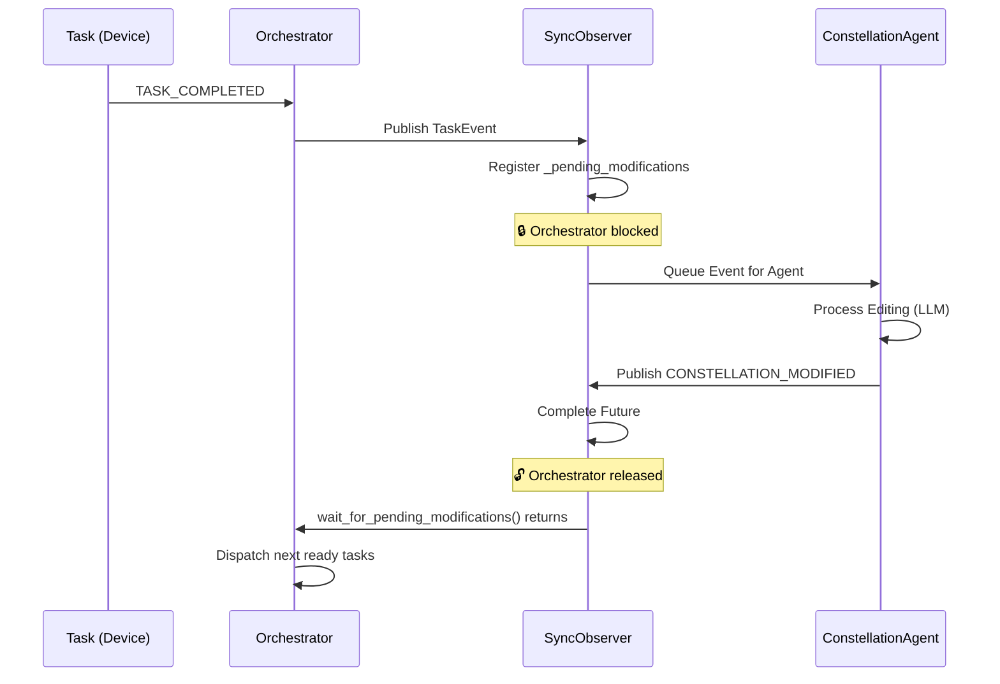

<!-- source: DeepWiki mcp.deepwiki.com · repo microsoft/UFO · page 4.3 Task Constellation · fetched 2026-10-26 -->

# Task Constellation

Relevant source files

The following files were used as context for generating this wiki page:

- [documents/docs/galaxy/constellation/constellation_editor.md](documents/docs/galaxy/constellation/constellation_editor.md)
- [documents/docs/galaxy/constellation/overview.md](documents/docs/galaxy/constellation/overview.md)
- [documents/docs/galaxy/constellation/task_constellation.md](documents/docs/galaxy/constellation/task_constellation.md)
- [documents/docs/galaxy/constellation/task_star.md](documents/docs/galaxy/constellation/task_star.md)
- [documents/docs/galaxy/constellation/task_star_line.md](documents/docs/galaxy/constellation/task_star_line.md)
- [galaxy/agents/constellation_agent.py](galaxy/agents/constellation_agent.py)
- [galaxy/agents/constellation_agent_states.py](galaxy/agents/constellation_agent_states.py)
- [galaxy/agents/schema.py](galaxy/agents/schema.py)
- [galaxy/constellation/editor/commands.py](galaxy/constellation/editor/commands.py)
- [galaxy/constellation/task_constellation.py](galaxy/constellation/task_constellation.py)
- [galaxy/constellation/task_star.py](galaxy/constellation/task_star.py)
- [galaxy/session/observers/base_observer.py](galaxy/session/observers/base_observer.py)
- [galaxy/session/observers/constellation_sync_observer.py](galaxy/session/observers/constellation_sync_observer.py)

This document describes the **TaskConstellation** data structure, which represents the Directed Acyclic Graph (DAG) of tasks in UFO³ Galaxy. The TaskConstellation serves as the executable workflow representation that `ConstellationAgent` creates and modifies dynamically during execution.

For information about the agent that creates and modifies constellations, see [Constellation Agent](#4.2). For information about how constellations are executed, see [Task Orchestration](#4.4).

---

## Overview

The TaskConstellation is a dynamic DAG data structure formally defined as $\mathcal{C} = (\mathcal{T}, \mathcal{E})$, where $\mathcal{T}$ is the set of TaskStars and $\mathcal{E}$ is the set of TaskStarLines. [documents/docs/galaxy/constellation/task_constellation.md:7-13]().

It consists of:
- **TaskStars**: Nodes representing atomic execution units scheduled on device agents. [documents/docs/galaxy/constellation/task_star.md:5-12]()
- **TaskStarLines**: Directed edges encoding dependencies (e.g., success-only or completion-only). [documents/docs/galaxy/constellation/overview.md:67-75]()
- **ConstellationEditor**: A command-pattern interface providing transactional safety and undo/redo for DAG manipulation. [documents/docs/galaxy/constellation/constellation_editor.md:7-11]()
- **Validation System**: Enforces invariants including acyclicity and reference integrity. [galaxy/constellation/task_constellation.py:255-265]()

**Sources**: [galaxy/constellation/task_constellation.py:31-74](), [documents/docs/galaxy/constellation/overview.md:10-30]()

---

## Core Data Structures

### TaskStar: Individual Task Nodes

A `TaskStar` ([galaxy/constellation/task_star.py:28-40]()) represents the smallest indivisible unit of computation.

| Property | Type | Purpose |
|----------|------|---------|
| `task_id` | `str` | Unique UUID or generated ID. [galaxy/constellation/task_star.py:73]() |
| `name` | `str` | Human-readable short name. [galaxy/constellation/task_star.py:74]() |
| `description` | `str` | Natural language specification for the device agent. [galaxy/constellation/task_star.py:75]() |
| `target_device_id`| `str` | ID of the device responsible for execution. [galaxy/constellation/task_star.py:77]() |
| `status` | `TaskStatus` | Current state (PENDING, RUNNING, COMPLETED, etc.). [galaxy/constellation/task_star.py:94]() |
| `priority` | `TaskPriority`| Scheduling priority (LOW to CRITICAL). [galaxy/constellation/task_star.py:79]() |
| `tips` | `List[str]` | Guidance hints for the device agent. [galaxy/constellation/task_star.py:76]() |

#### TaskStatus Lifecycle

**Sources**: [galaxy/constellation/task_star.py:42-111](), [documents/docs/galaxy/constellation/task_star.md:61-74]()

---

### TaskStarLine: Dependency Edges

A `TaskStarLine` defines how tasks relate. Galaxy supports several dependency behaviors:
- **Success-only**: Target proceeds only if source succeeds. [documents/docs/galaxy/constellation/overview.md:72]()
- **Completion-only**: Target proceeds when source finishes, regardless of outcome. [documents/docs/galaxy/constellation/overview.md:73]()
- **Unconditional**: Target always waits for source. [documents/docs/galaxy/constellation/overview.md:71]()

**Sources**: [galaxy/constellation/task_star_line.py:1-25](), [documents/docs/galaxy/constellation/overview.md:63-75]()

---

### TaskConstellation: The DAG Container

The `TaskConstellation` class ([galaxy/constellation/task_constellation.py:31]()) manages the graph topology and execution state tracking.

**Sources**: [galaxy/constellation/task_constellation.py:31-150]()

---

## ConstellationEditor: Command Pattern

The `ConstellationEditor` provides a high-level interface for safe manipulation. It wraps every change in a `BaseConstellationCommand` ([galaxy/constellation/editor/commands.py:21]()) to allow for undo/redo and validation.

### Mapping Natural Language to Code Commands

| Natural Language Intent | Code Entity (Command Class) | Implementation File |
|-------------------------|----------------------------|---------------------|
| "Add a new step" | `AddTaskCommand` | [galaxy/constellation/editor/commands.py:103]() |
| "Remove this task" | `RemoveTaskCommand` | [galaxy/constellation/editor/commands.py:191]() |
| "Link Task A to Task B" | `AddDependencyCommand` | [galaxy/constellation/editor/commands.py:284]() |
| "Change device for task"| `UpdateTaskCommand` | [galaxy/constellation/editor/commands.py:382]() |
| "Generate full plan" | `BuildConstellationCommand` | [galaxy/constellation/editor/commands.py:588]() |

**Sources**: [galaxy/constellation/editor/commands.py:1-600](), [documents/docs/galaxy/constellation/constellation_editor.md:68-200]()

---

## DAG Invariants and Validation

The `TaskConstellation` enforces formal invariants to ensure the workflow is executable:

1.  **Acyclicity (Invariant I1)**: Uses `has_cycle()` or `get_topological_order()` to ensure no circular dependencies exist. [galaxy/constellation/task_constellation.py:315-330]()
2.  **Reference Integrity**: Validates that `from_task_id` and `to_task_id` in a `TaskStarLine` exist within the `_tasks` dictionary. [galaxy/constellation/task_constellation.py:217-220]()
3.  **Terminal State Safety**: Prevents removal of tasks currently in the `RUNNING` state. [galaxy/constellation/task_constellation.py:183-184]()

**Sources**: [galaxy/constellation/task_constellation.py:210-350](), [documents/docs/galaxy/constellation/task_constellation.md:171-205]()

---

## Constellation Synchronization

To prevent race conditions between the `TaskConstellationOrchestrator` and the `ConstellationAgent`, the system uses a `ConstellationModificationSynchronizer`. [galaxy/session/observers/constellation_sync_observer.py:45]()

### Synchronization Flow

**Sources**: [galaxy/session/observers/constellation_sync_observer.py:7-25](), [galaxy/session/observers/constellation_sync_observer.py:89-138]()

---

## Schema and Serialization

Constellation data is exchanged using Pydantic models defined in `galaxy.agents.schema`.

- **TaskStarSchema**: Serializes task metadata, timing, and results. [galaxy/agents/schema.py:126-152]()
- **IDManager**: A singleton that ensures unique ID allocation for `task_xxx` and `line_xxx` within a constellation context. [galaxy/agents/schema.py:13-33]()

**Sources**: [galaxy/agents/schema.py:13-180]()

---

