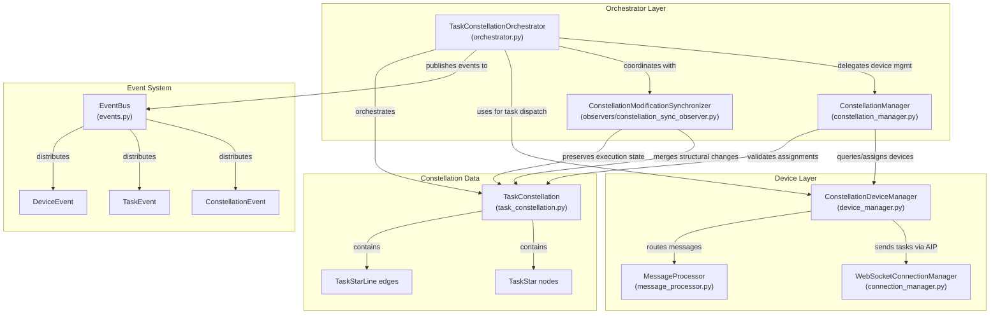
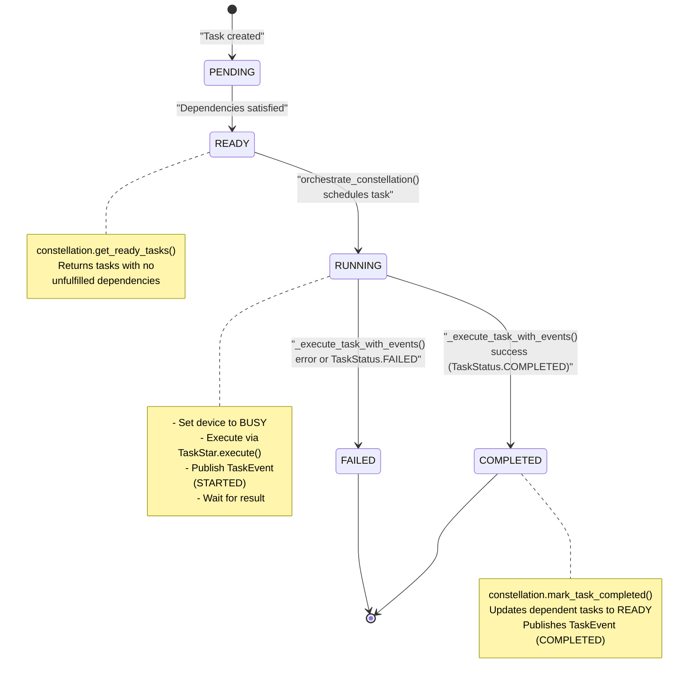
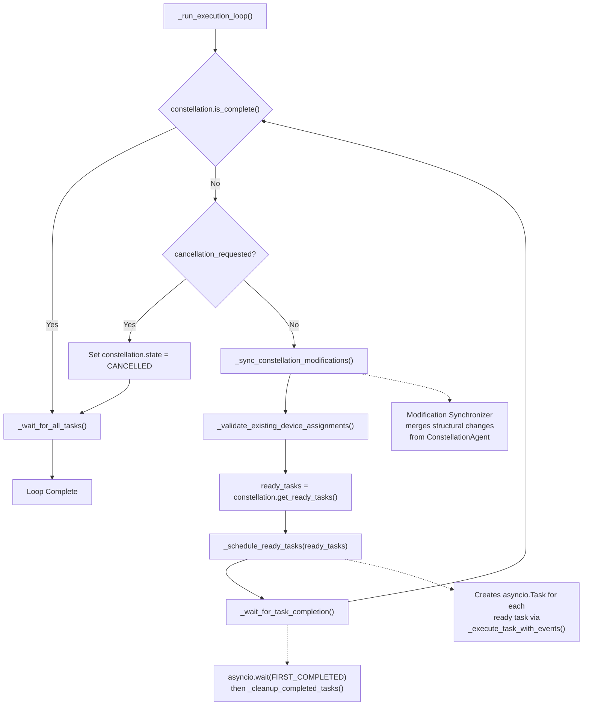
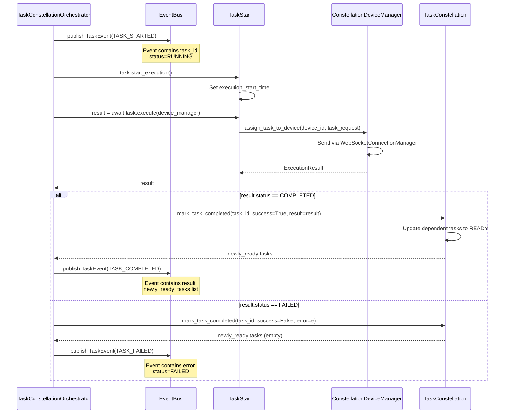
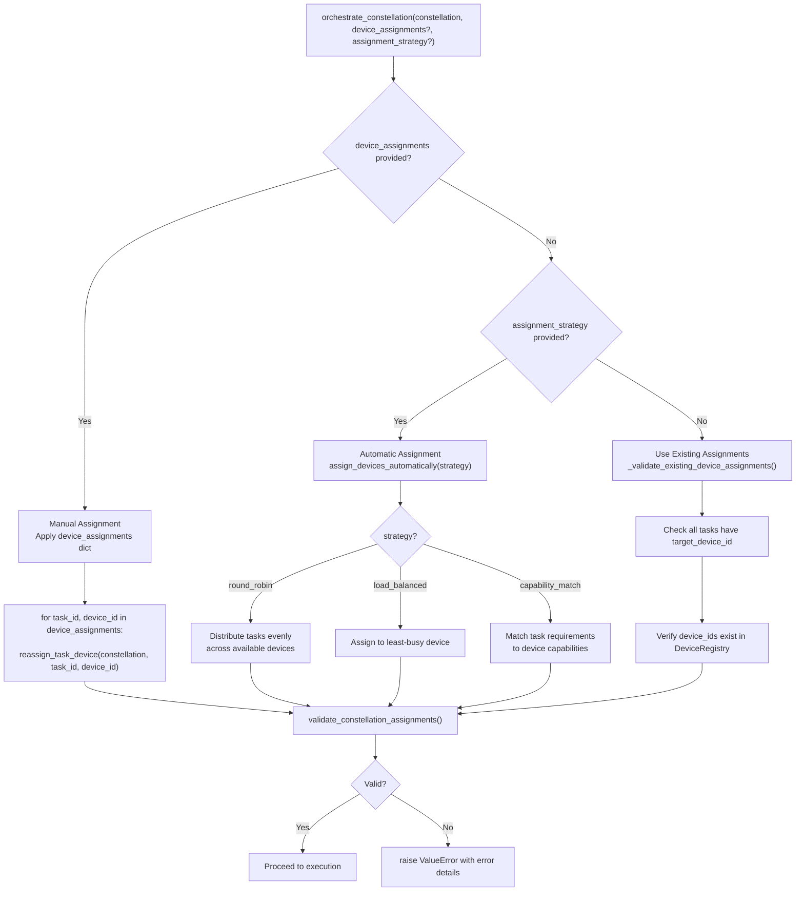
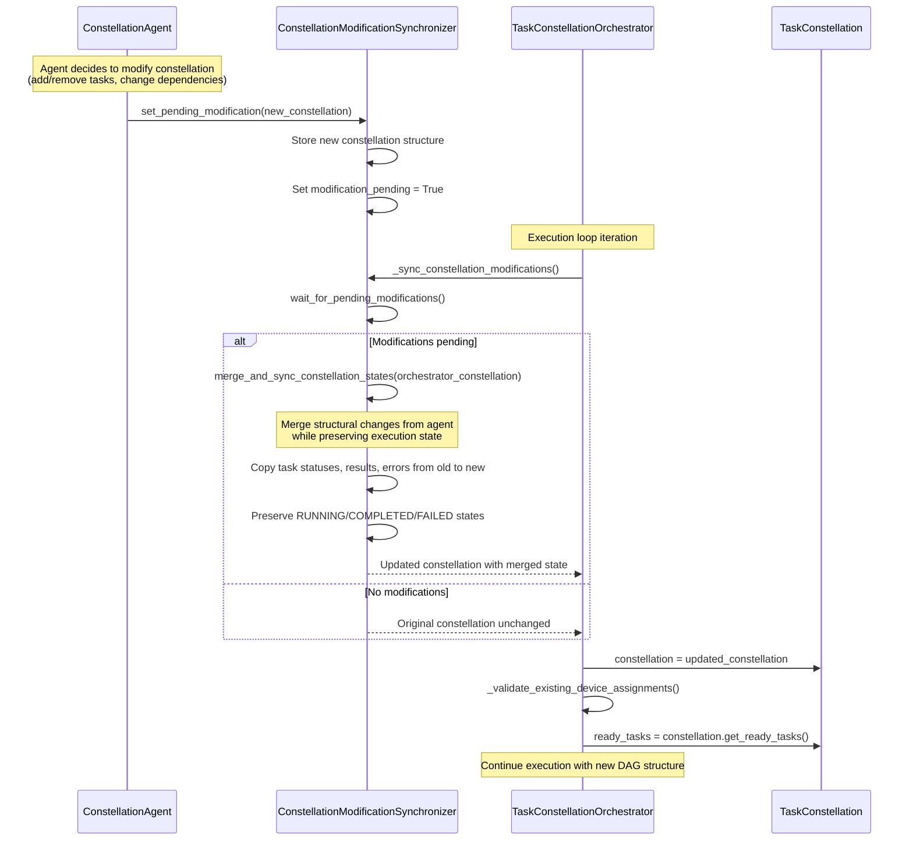
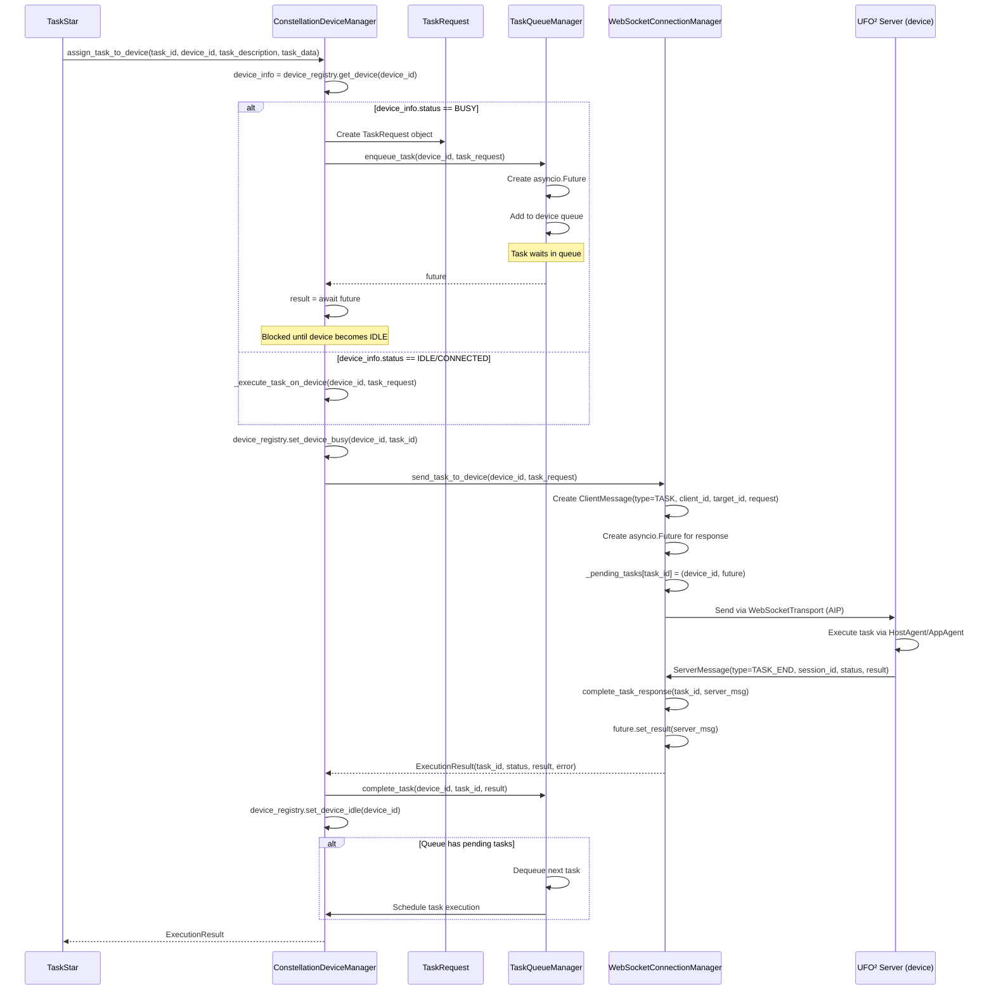
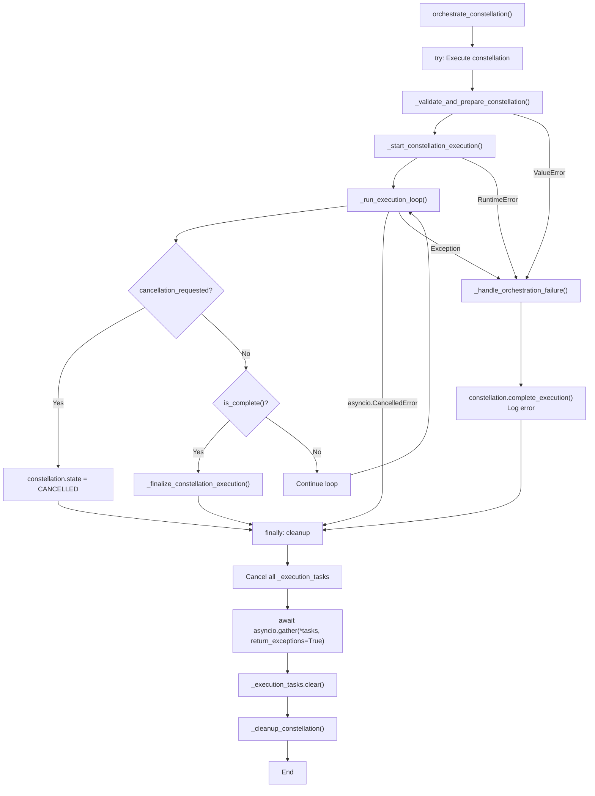
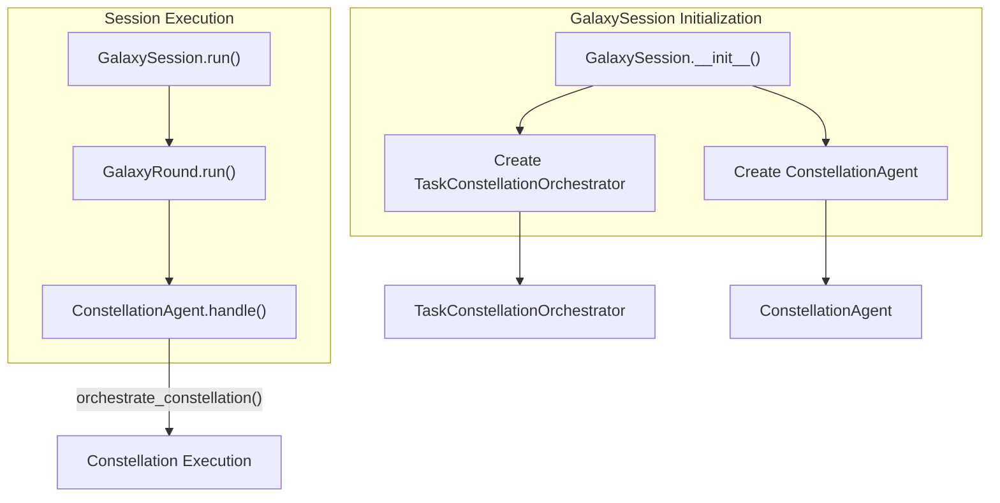

<!-- source: DeepWiki mcp.deepwiki.com · repo microsoft/UFO · page 4.4 Task Orchestration · fetched 2026-10-26 -->

# Task Orchestration

<details>
<summary>Relevant source files</summary>

The following files were used as context for generating this wiki page:

- [documents/docs/galaxy/constellation_agent/command.md](documents/docs/galaxy/constellation_agent/command.md)
- [documents/docs/galaxy/constellation_agent/overview.md](documents/docs/galaxy/constellation_agent/overview.md)
- [documents/docs/galaxy/constellation_agent/state.md](documents/docs/galaxy/constellation_agent/state.md)
- [documents/docs/galaxy/constellation_agent/strategy.md](documents/docs/galaxy/constellation_agent/strategy.md)
- [documents/docs/galaxy/constellation_orchestrator/api_reference.md](documents/docs/galaxy/constellation_orchestrator/api_reference.md)
- [documents/docs/galaxy/constellation_orchestrator/asynchronous_scheduling.md](documents/docs/galaxy/constellation_orchestrator/asynchronous_scheduling.md)
- [documents/docs/galaxy/constellation_orchestrator/batched_editing.md](documents/docs/galaxy/constellation_orchestrator/batched_editing.md)
- [documents/docs/galaxy/constellation_orchestrator/consistency_guarantees.md](documents/docs/galaxy/constellation_orchestrator/consistency_guarantees.md)
- [documents/docs/galaxy/constellation_orchestrator/constellation_manager.md](documents/docs/galaxy/constellation_orchestrator/constellation_manager.md)
- [documents/docs/galaxy/constellation_orchestrator/event_driven_coordination.md](documents/docs/galaxy/constellation_orchestrator/event_driven_coordination.md)
- [documents/docs/galaxy/constellation_orchestrator/overview.md](documents/docs/galaxy/constellation_orchestrator/overview.md)
- [documents/docs/galaxy/constellation_orchestrator/safe_assignment_locking.md](documents/docs/galaxy/constellation_orchestrator/safe_assignment_locking.md)
- [galaxy/client/components/connection_manager.py](galaxy/client/components/connection_manager.py)
- [galaxy/client/components/device_registry.py](galaxy/client/components/device_registry.py)
- [galaxy/client/components/message_processor.py](galaxy/client/components/message_processor.py)
- [galaxy/client/constellation_client.py](galaxy/client/constellation_client.py)
- [galaxy/client/device_manager.py](galaxy/client/device_manager.py)
- [galaxy/constellation/orchestrator/orchestrator.py](galaxy/constellation/orchestrator/orchestrator.py)
- [galaxy/galaxy_client.py](galaxy/galaxy_client.py)
- [galaxy/session/galaxy_session.py](galaxy/session/galaxy_session.py)
- [tests/test_constellation_manager.py](tests/test_constellation_manager.py)
- [tests/test_constellation_parser.py](tests/test_constellation_parser.py)
- [tests/test_constellation_parser_refactored.py](tests/test_constellation_parser_refactored.py)
- [tests/test_constellation_serializer.py](tests/test_constellation_serializer.py)
- [tests/test_constellation_updater.py](tests/test_constellation_updater.py)
- [tests/test_orchestrator_refactored.py](tests/test_orchestrator_refactored.py)

</details>


## Purpose and Scope

This document describes the task orchestration system in UFO³ Galaxy Framework, which manages the execution of TaskConstellation DAGs across distributed devices. The `TaskConstellationOrchestrator` class is the central component responsible for scheduling tasks based on dependencies, dispatching them to devices via the Agent Interaction Protocol (AIP), and coordinating execution using event-driven patterns.

For information about the DAG structure itself (TaskStar nodes and TaskStarLine edges), see [Task Constellation](#4.3). For device connection management and AIP protocol details, see [Device Management](#4.5). For the high-level planning agent that creates and modifies constellations, see [Constellation Agent](#4.2).

**Sources:** [galaxy/constellation/orchestrator/orchestrator.py:1-10]()

## Orchestrator Architecture

The `TaskConstellationOrchestrator` implements a modular architecture that separates execution orchestration from device management and state tracking. It coordinates with multiple components to provide parallel, dependency-aware task execution.



**Key Components:**

| Component | Responsibility | Key Methods |
|-----------|---------------|-------------|
| `TaskConstellationOrchestrator` | Main orchestration logic, execution loop, event publishing | `orchestrate_constellation()`, `_run_execution_loop()`, `_execute_task_with_events()` |
| `ConstellationManager` | Device assignment validation, state management | `validate_constellation_assignments()`, `assign_devices_automatically()`, `get_available_devices()` |
| `ConstellationDeviceManager` | Device communication, task dispatch to UFO² servers | `assign_task_to_device()`, `connect_device()`, `get_all_devices()` |
| `ConstellationModificationSynchronizer` | Coordinates constellation updates during execution | `wait_for_pending_modifications()`, `merge_and_sync_constellation_states()` |
| `EventBus` | Event distribution to observers | `publish_event()`, `subscribe()`, `unsubscribe()` |

**Sources:** [galaxy/constellation/orchestrator/orchestrator.py:31-76](), [galaxy/client/device_manager.py:33-72](), [documents/docs/galaxy/constellation_orchestrator/api_reference.md:5-9]()

## Task Execution Lifecycle

The orchestrator manages tasks through a state-based lifecycle, transitioning them from PENDING → READY → RUNNING → COMPLETED/FAILED based on dependency satisfaction and execution results.



**State Transitions:**

1. **PENDING → READY**: Called by `TaskConstellation.get_ready_tasks()` when all dependencies are satisfied.
2. **READY → RUNNING**: Orchestrator calls `asyncio.create_task(_execute_task_with_events())` in `_schedule_ready_tasks()`.
3. **RUNNING → COMPLETED/FAILED**: Task execution completes via `TaskStar.execute()`, result processed in `_execute_task_with_events()`.

**Sources:** [documents/docs/galaxy/constellation_orchestrator/asynchronous_scheduling.md:144-163](), [documents/docs/galaxy/constellation_orchestrator/asynchronous_scheduling.md:98-110]()

## Orchestrate Constellation Entry Point

The `orchestrate_constellation()` method is the main entry point that coordinates the entire orchestration workflow through a four-phase pipeline.

```mermaid
sequenceDiagram
    participant Client as GalaxySession
    participant Orch as TaskConstellationOrchestrator
    participant Valid as _validate_and_prepare_constellation
    participant Start as _start_constellation_execution
    participant Loop as _run_execution_loop
    participant Final as _finalize_constellation_execution
    participant EventBus as EventBus
    
    Client->>Orch: orchestrate_constellation(constellation, device_assignments)
    
    Orch->>Valid: validate & prepare
    Valid->>Valid: constellation.validate_dag()
    Valid->>Valid: _assign_devices_to_tasks()
    Valid->>Valid: validate_constellation_assignments()
    Valid-->>Orch: validation complete
    
    Orch->>Start: start execution
    Start->>Start: constellation.start_execution()
    Start->>EventBus: publish ConstellationEvent(CONSTELLATION_STARTED)
    Start-->>Orch: start_event
    
    Orch->>Loop: run execution loop
    loop until constellation.is_complete()
        Loop->>Loop: _sync_constellation_modifications()
        Loop->>Loop: constellation.get_ready_tasks()
        Loop->>Loop: _schedule_ready_tasks()
        Loop->>Loop: _wait_for_task_completion()
    end
    Loop-->>Orch: execution complete
    
    Orch->>Final: finalize execution
    Final->>Final: constellation.complete_execution()
    Final->>EventBus: publish ConstellationEvent(CONSTELLATION_COMPLETED)
    Final-->>Orch: results
    
    Orch-->>Client: orchestration_results
```

**Pipeline Phases:**

| Phase | Method | Responsibility | Key Operations |
|-------|--------|---------------|----------------|
| 1. Validation | `_validate_and_prepare_constellation()` | Validate DAG and device assignments | `constellation.validate_dag()`, `_assign_devices_to_tasks()`, `validate_constellation_assignments()` |
| 2. Start | `_start_constellation_execution()` | Mark start, publish event | `constellation.start_execution()`, publish `CONSTELLATION_STARTED` event |
| 3. Execution Loop | `_run_execution_loop()` | Schedule and execute tasks | `get_ready_tasks()`, `_schedule_ready_tasks()`, `_wait_for_task_completion()` |
| 4. Finalization | `_finalize_constellation_execution()` | Mark completion, publish event | `constellation.complete_execution()`, publish `CONSTELLATION_COMPLETED` event |

**Sources:** [galaxy/constellation/orchestrator/orchestrator.py:143-195](), [documents/docs/galaxy/constellation_orchestrator/api_reference.md:49-80]()

## Execution Loop and Task Scheduling

The `_run_execution_loop()` method continuously processes tasks until the constellation completes, handling dynamic modifications and parallel execution.



**Key Operations:**

1. **Modification Sync** (`_sync_constellation_modifications()`): Waits for pending modifications from `ConstellationAgent` and merges them while preserving execution state. [documents/docs/galaxy/constellation_orchestrator/asynchronous_scheduling.md:71-74]()
2. **Ready Task Detection** (`constellation.get_ready_tasks()`): Returns tasks whose dependencies are satisfied. [documents/docs/galaxy/constellation_orchestrator/asynchronous_scheduling.md:98-110]()
3. **Task Scheduling** (`_schedule_ready_tasks()`): Creates `asyncio.Task` for each ready task. [documents/docs/galaxy/constellation_orchestrator/asynchronous_scheduling.md:120-132]()
4. **Completion Waiting** (`_wait_for_task_completion()`): Uses `asyncio.wait(FIRST_COMPLETED)` to wait for at least one task to finish. [documents/docs/galaxy/constellation_orchestrator/asynchronous_scheduling.md:60-62]()

**Sources:** [documents/docs/galaxy/constellation_orchestrator/asynchronous_scheduling.md:20-39](), [documents/docs/galaxy/constellation_orchestrator/asynchronous_scheduling.md:43-65]()

## Task Execution and Event Publishing

The `_execute_task_with_events()` method manages individual task execution, publishing events at each lifecycle transition.



**Event Publishing Points:**

| Event Type | Trigger | Data Included |
|------------|---------|---------------|
| `TASK_STARTED` | Before `task.execute()` | `task_id`, `status=RUNNING`, `constellation_id` |
| `TASK_COMPLETED` | After successful execution | `task_id`, `status=COMPLETED`, `result`, `newly_ready_tasks` |
| `TASK_FAILED` | After execution error | `task_id`, `status=FAILED`, `error`, `newly_ready_tasks` (empty) |

**Sources:** [documents/docs/galaxy/constellation_orchestrator/asynchronous_scheduling.md:168-200]()

## Device Assignment Strategies

The orchestrator supports three device assignment strategies, with validation ensuring all tasks have valid device assignments before execution.



**Assignment Strategies:**

1. **Manual Assignment**: Explicitly map `task_id → device_id` via `device_assignments` parameter. [documents/docs/galaxy/constellation_orchestrator/api_reference.md:68]()
2. **Automatic Assignment**: Use `ConstellationManager.assign_devices_automatically()` with strategies like `"round_robin"`, `"load_balanced"`, or `"capability_match"`. [documents/docs/galaxy/constellation_orchestrator/api_reference.md:69]()
3. **Existing Assignments**: Validate that all tasks already have `target_device_id` set (fails if any task is unassigned). [documents/docs/galaxy/constellation_orchestrator/api_reference.md:129]()

**Sources:** [documents/docs/galaxy/constellation_orchestrator/api_reference.md:53-80](), [documents/docs/galaxy/constellation_orchestrator/api_reference.md:245-257]()

## Dynamic Constellation Modification

The orchestrator supports modifying the constellation DAG during execution through the `ConstellationModificationSynchronizer`, which coordinates updates between the `ConstellationAgent` and orchestrator.



**Modification Workflow:**

1. **Agent Modification**: `ConstellationAgent` creates new constellation structure with added/removed tasks or changed dependencies. [documents/docs/galaxy/constellation_agent/overview.md:156-173]()
2. **Wait for Sync**: Orchestrator calls `_sync_constellation_modifications()` at start of each loop iteration. [documents/docs/galaxy/constellation_orchestrator/asynchronous_scheduling.md:25]()
3. **Merge States**: Synchronizer merges structural changes while preserving execution state (task statuses, results, errors) to prevent race conditions. [documents/docs/galaxy/constellation_orchestrator/asynchronous_scheduling.md:71-74]()

**Sources:** [documents/docs/galaxy/constellation_agent/overview.md:156-173](), [documents/docs/galaxy/constellation_orchestrator/asynchronous_scheduling.md:71-78]()

## Task Dispatch via ConstellationDeviceManager

The orchestrator dispatches tasks to devices through `ConstellationDeviceManager`, which manages device connections, task queuing, and result collection using the Agent Interaction Protocol (AIP).



**Device Status Handling:**

| Device Status | Behavior | Queue Used |
|---------------|----------|------------|
| IDLE/CONNECTED | Execute immediately | No |
| BUSY | Enqueue task, wait for device | Yes (TaskQueueManager) |
| DISCONNECTED/FAILED | Raise ConnectionError | N/A |

**Sources:** [galaxy/client/device_manager.py:33-72](), [galaxy/client/components/connection_manager.py:67-153](), [galaxy/client/components/message_processor.py:27-58]()

## Error Handling and Cancellation

The orchestrator implements comprehensive error handling and cancellation support to ensure clean shutdown and recovery from failures.



**Cancellation Support:**

The `cancel_execution()` method provides immediate cancellation of constellation execution:

```python
async def cancel_execution(self, constellation_id: str) -> bool:
    """Cancel constellation execution immediately."""
    self._cancellation_requested = True
    self._cancelled_constellations[constellation_id] = True
    if self._execution_tasks:
        for task_id, task in list(self._execution_tasks.items()):
            if not task.done():
                task.cancel()
        await asyncio.gather(*self._execution_tasks.values(), return_exceptions=True)
        self._execution_tasks.clear()
    return True
```

**Sources:** [galaxy/constellation/orchestrator/orchestrator.py:99-141](), [galaxy/constellation/orchestrator/orchestrator.py:180-195]()

## Integration with GalaxySession

The `GalaxySession` creates and configures the orchestrator, sets up observers, and coordinates between the `ConstellationAgent` and orchestrator.



**Session Initialization:**

1. **Create Orchestrator**: Initialized within the session to manage DAG execution. [galaxy/session/galaxy_session.py:170-220]()
2. **Create Agent**: The `ConstellationAgent` uses the orchestrator to execute the synthesized plan. [galaxy/session/galaxy_session.py:71-112]()
3. **Execution**: `GalaxyRound` drives the agent's state machine, which triggers orchestration. [galaxy/session/galaxy_session.py:83-106]()

**Sources:** [galaxy/session/galaxy_session.py:43-70](), [galaxy/session/galaxy_session.py:71-135](), [galaxy/session/galaxy_session.py:170-220]()

---

