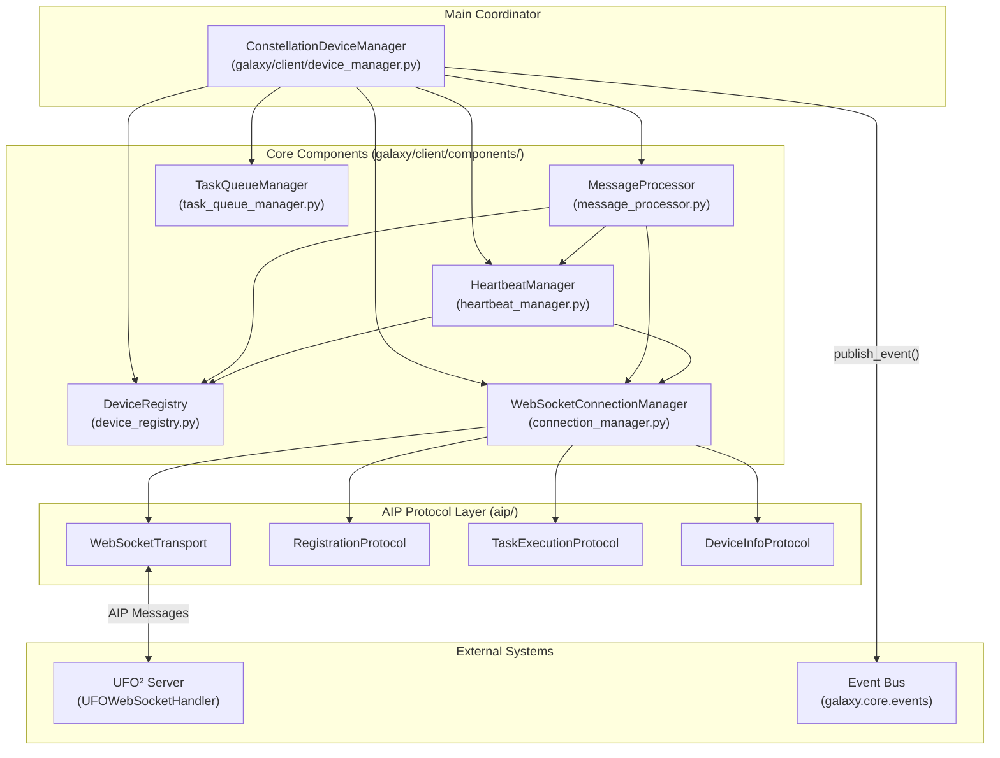
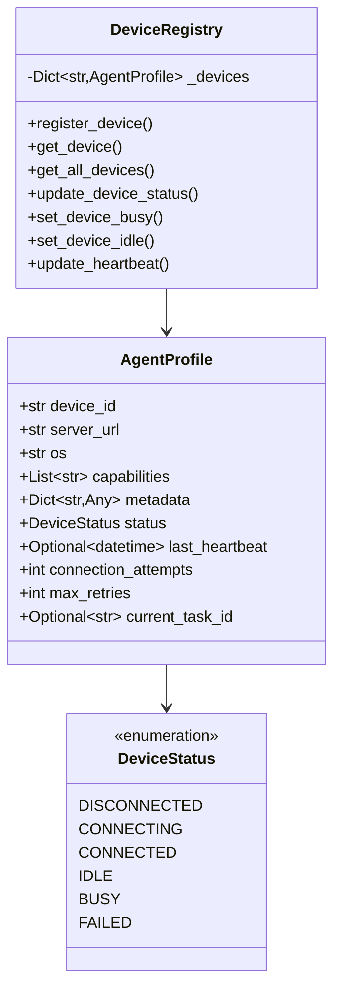
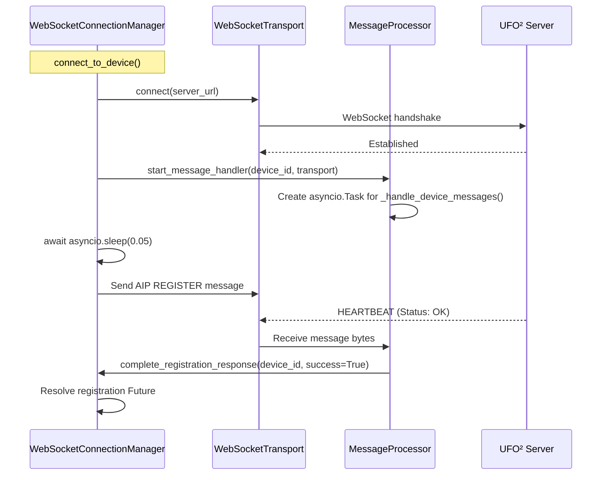
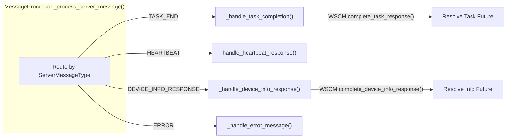
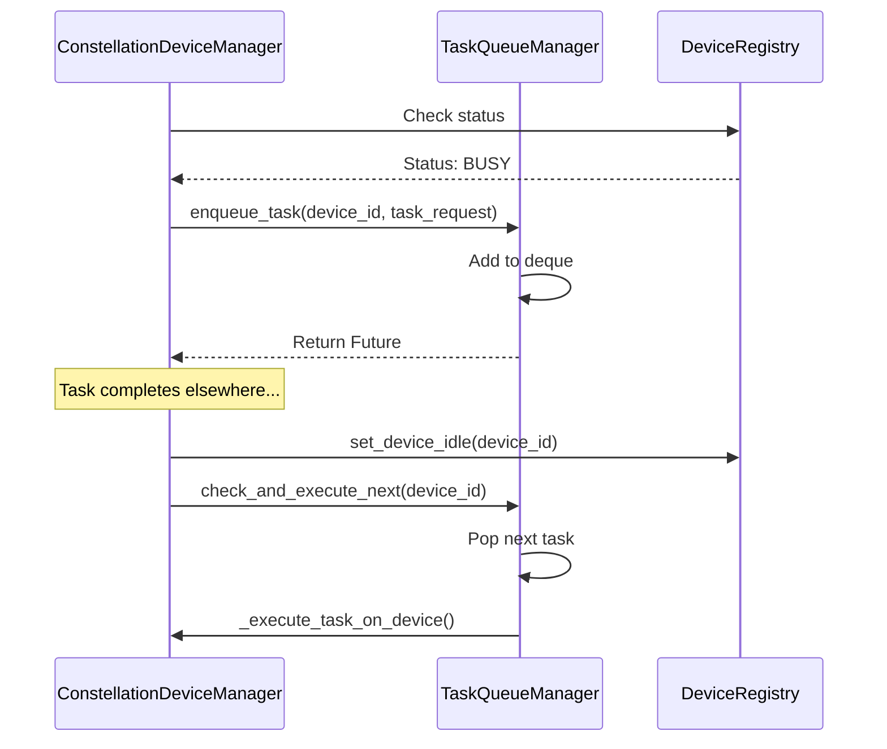

<!-- source: DeepWiki mcp.deepwiki.com · repo microsoft/UFO · page 4.5 Device Management · fetched 2026-10-26 -->

# Device Management

Relevant source files

The following files were used as context for generating this wiki page:

- [documents/docs/galaxy/client/aip_integration.md](documents/docs/galaxy/client/aip_integration.md)
- [documents/docs/galaxy/client/components.md](documents/docs/galaxy/client/components.md)
- [documents/docs/galaxy/client/constellation_client.md](documents/docs/galaxy/client/constellation_client.md)
- [documents/docs/galaxy/client/device_manager.md](documents/docs/galaxy/client/device_manager.md)
- [documents/docs/galaxy/client/galaxy_client.md](documents/docs/galaxy/client/galaxy_client.md)
- [documents/docs/galaxy/client/overview.md](documents/docs/galaxy/client/overview.md)
- [documents/docs/galaxy/observer/agent_output_observer.md](documents/docs/galaxy/observer/agent_output_observer.md)
- [documents/docs/galaxy/observer/event_system.md](documents/docs/galaxy/observer/event_system.md)
- [documents/docs/galaxy/observer/metrics_observer.md](documents/docs/galaxy/observer/metrics_observer.md)
- [documents/docs/galaxy/observer/overview.md](documents/docs/galaxy/observer/overview.md)
- [documents/docs/galaxy/observer/progress_observer.md](documents/docs/galaxy/observer/progress_observer.md)
- [documents/docs/galaxy/observer/synchronizer.md](documents/docs/galaxy/observer/synchronizer.md)
- [documents/docs/galaxy/observer/visualization_observer.md](documents/docs/galaxy/observer/visualization_observer.md)
- [galaxy/client/components/__init__.py](galaxy/client/components/__init__.py)
- [galaxy/client/components/connection_manager.py](galaxy/client/components/connection_manager.py)
- [galaxy/client/components/device_registry.py](galaxy/client/components/device_registry.py)
- [galaxy/client/components/heartbeat_manager.py](galaxy/client/components/heartbeat_manager.py)
- [galaxy/client/components/message_processor.py](galaxy/client/components/message_processor.py)
- [galaxy/client/components/task_queue_manager.py](galaxy/client/components/task_queue_manager.py)
- [galaxy/client/components/types.py](galaxy/client/components/types.py)
- [galaxy/client/constellation_client.py](galaxy/client/constellation_client.py)
- [galaxy/client/device_manager.py](galaxy/client/device_manager.py)
- [galaxy/constellation/orchestrator/orchestrator.py](galaxy/constellation/orchestrator/orchestrator.py)
- [galaxy/core/types.py](galaxy/core/types.py)
- [galaxy/galaxy_client.py](galaxy/galaxy_client.py)
- [galaxy/session/galaxy_session.py](galaxy/session/galaxy_session.py)
- [tests/galaxy/client/test_device_manager_assign_task.py](tests/galaxy/client/test_device_manager_assign_task.py)
- [tests/galaxy/client/test_task_response_mechanism.py](tests/galaxy/client/test_task_response_mechanism.py)
- [tests/integration/test_constellation_aip_communication.py](tests/integration/test_constellation_aip_communication.py)
- [tests/integration/test_constellation_aip_simple.py](tests/integration/test_constellation_aip_simple.py)
- [tests/integration/test_constellation_server_compatibility.py](tests/integration/test_constellation_server_compatibility.py)
- [tests/unit/test_constellation_aip_migration.py](tests/unit/test_constellation_aip_migration.py)

## Purpose and Scope

The Device Management system is a core component of the Galaxy Framework (UFO³) that manages distributed devices for multi-device task orchestration. It provides device registration, WebSocket connection management via Agent Interaction Protocol (AIP), health monitoring, task assignment, and automatic reconnection capabilities. [galaxy/client/device_manager.py:4-9]().

This document covers the `ConstellationDeviceManager` and its modular components. For information about the Agent Interaction Protocol itself, see [Protocol Architecture](#5.1). For task orchestration across devices, see [Task Orchestration](#4.4). For the overall Galaxy architecture, see [Galaxy Architecture](#4.1).

---

## Component Architecture

The device management system follows a modular architecture where `ConstellationDeviceManager` delegates responsibilities to specialized components: [galaxy/client/device_manager.py:33-43]().

### Diagram: Device Management Component Composition
This diagram associates the logical management layers with the specific Python classes implemented in the `galaxy.client.components` module.

**Sources:** [galaxy/client/device_manager.py:33-85](), [galaxy/client/components/connection_manager.py:37-66](), [documents/docs/galaxy/client/components.md:22-54]()

### Single Responsibility Principle

Each component has a single, well-defined responsibility:

| Component | Responsibility | Implementation File |
|-----------|---------------|---------------------|
| `DeviceRegistry` | Central repository for device state and `AgentProfile` storage. | [galaxy/client/components/device_registry.py]() |
| `WebSocketConnectionManager` | Low-level WebSocket lifecycle and AIP protocol instance management. | [galaxy/client/components/connection_manager.py]() |
| `HeartbeatManager` | Background health monitoring via periodic AIP heartbeat messages. | [galaxy/client/components/heartbeat_manager.py]() |
| `MessageProcessor` | Listens for incoming messages and routes them to completion handlers. | [galaxy/client/components/message_processor.py]() |
| `TaskQueueManager` | Manages per-device task queues when devices are in a `BUSY` state. | [galaxy/client/components/task_queue_manager.py]() |

**Sources:** [galaxy/client/device_manager.py:33-72](), [documents/docs/galaxy/client/components.md:70-120]()

---

## Device Registry

### AgentProfile Data Structure

`DeviceRegistry` stores device information using the `AgentProfile` dataclass. This serves as the "Single Source of Truth" for all other components. [documents/docs/galaxy/client/components.md:74-76]().

**Sources:** [galaxy/client/components/types.py](), [documents/docs/galaxy/client/components.md:78-94]()

### Registration and System Info Updates

Device registration occurs when the `ConstellationClient` initializes. It calls `register_device` which creates the profile in the registry before attempting a network connection. [galaxy/client/device_manager.py:194-202]().

| Method | Purpose | Implementation |
|--------|---------|----------------|
| `register_device` | Creates initial `AgentProfile` in the registry. | [galaxy/client/device_manager.py:194-202]() |
| `set_device_busy` | Updates status to `BUSY` and assigns `current_task_id`. | [galaxy/client/components/device_registry.py:88-98]() |
| `set_device_idle` | Updates status to `IDLE` and clears `current_task_id`. | [galaxy/client/components/device_registry.py:100-109]() |
| `update_heartbeat` | Refreshes the `last_heartbeat` timestamp. | [galaxy/client/components/device_registry.py:146-149]() |

**Sources:** [galaxy/client/device_manager.py:194-202](), [galaxy/client/components/device_registry.py:83-149]()

---

## WebSocket Connection Management

### AIP Protocol Integration

`WebSocketConnectionManager` manages `WebSocketTransport` objects and AIP protocol handlers (`RegistrationProtocol`, `TaskExecutionProtocol`, `DeviceInfoProtocol`) for every registered device. [galaxy/client/components/connection_manager.py:50-54]().

### Connection Establishment Flow

The connection process requires a specific sequence to ensure that the `MessageProcessor` is ready to receive the registration confirmation from the server. [galaxy/client/components/connection_manager.py:108-114]().

**Sources:** [galaxy/client/components/connection_manager.py:67-153](), [galaxy/client/components/message_processor.py:86-103]()

### Future-Based Task Execution

The system uses `asyncio.Future` to bridge the asynchronous nature of WebSockets with a synchronous-looking execution call. When `send_task_to_device` is called, it creates a future and waits for it. [galaxy/client/components/connection_manager.py:266-353]().

1. **Request**: `send_task_to_device` creates a `task_future` and stores it in `_pending_tasks`. [galaxy/client/components/connection_manager.py:321-322]().
2. **Waiting**: The function calls `await asyncio.wait_for(task_future, timeout)`. [galaxy/client/components/connection_manager.py:344]().
3. **Resolution**: `MessageProcessor` receives a `TASK_END` message and calls `complete_task_response`, which resolves the future. [galaxy/client/components/message_processor.py:287-341](), [galaxy/client/components/connection_manager.py:399-445]().

**Sources:** [galaxy/client/components/connection_manager.py:266-445](), [galaxy/client/components/message_processor.py:287-341]()

---

## Message Processing

### Routing Logic

The `MessageProcessor` runs a loop for each device, parsing incoming bytes into `ServerMessage` objects. [galaxy/client/components/message_processor.py:144-157]().

**Sources:** [galaxy/client/components/message_processor.py:121-215](), [galaxy/client/components/message_processor.py:216-286]()

---

## Automatic Reconnection

The `ConstellationDeviceManager` implements an automatic reconnection mechanism with exponential backoff. [galaxy/client/device_manager.py:461-542]().

1. **Detection**: `MessageProcessor` catches a `ConnectionClosed` exception and invokes the `_disconnection_handler`. [galaxy/client/components/message_processor.py:158-165]().
2. **Scheduling**: `DeviceManager` calls `_schedule_reconnection`, which creates a background task for `_reconnect_device`. [galaxy/client/device_manager.py:455-459]().
3. **Attempt Loop**: The loop attempts to call `connect_device` repeatedly until `max_retries` is reached or connection is restored. [galaxy/client/device_manager.py:461-542]().

**Sources:** [galaxy/client/device_manager.py:455-542](), [galaxy/client/components/message_processor.py:158-165]()

---

## Task Queue Management

When a task is assigned to a device that is already in the `BUSY` state, the `TaskQueueManager` enqueues the request. [galaxy/client/device_manager.py:588-592]().

**Sources:** [galaxy/client/device_manager.py:543-599](), [galaxy/client/components/task_queue_manager.py]()

---

## Device Lifecycle Summary

| Method | State Transition | Description |
|--------|------------------|-------------|
| `register_device` | `None` → `DISCONNECTED` | Entry in registry created. [galaxy/client/device_manager.py:195-197]() |
| `connect_device` | `DISCONNECTED` → `CONNECTED` | WebSocket and AIP registration successful. [galaxy/client/device_manager.py:221-358]() |
| `assign_task_to_device` | `IDLE` → `BUSY` | Task dispatched; device locked. [galaxy/client/device_manager.py:543-599]() |
| `_execute_task_on_device` | `BUSY` → `IDLE` | Task result received; device released. [galaxy/client/device_manager.py:600-731]() |
| `_handle_device_disconnection` | `Any` → `DISCONNECTED` | Connection lost; cleanup triggered. [galaxy/client/device_manager.py:380-453]() |

**Sources:** [galaxy/client/device_manager.py:174-731](), [galaxy/client/components/types.py]()

---

