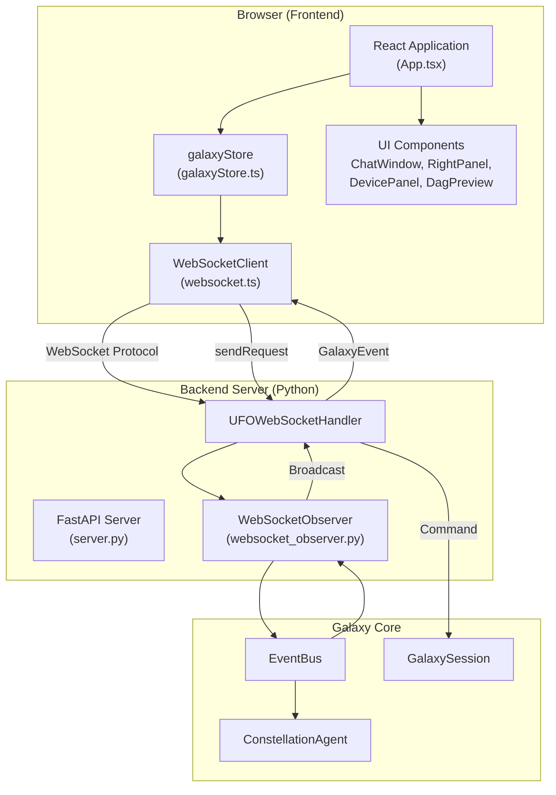
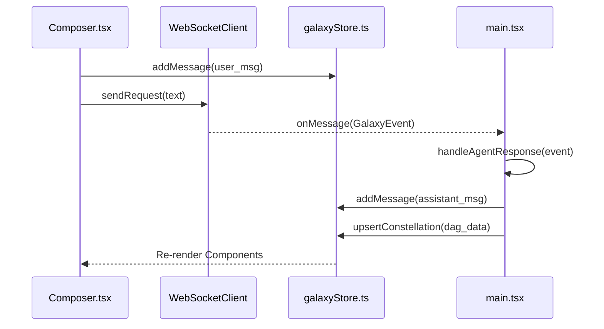

<!-- source: DeepWiki mcp.deepwiki.com · repo microsoft/UFO · page 4.6 Galaxy Web UI · fetched 2026-10-26 -->

# Galaxy Web UI

Relevant source files

The following files were used as context for generating this wiki page:

- [assets/webui.png](assets/webui.png)
- [documents/docs/galaxy/webui.md](documents/docs/galaxy/webui.md)
- [documents/docs/img/add_device.png](documents/docs/img/add_device.png)
- [documents/docs/img/webui.png](documents/docs/img/webui.png)
- [galaxy/constellation/enums.py](galaxy/constellation/enums.py)
- [galaxy/webui/frontend/dist/assets/index-Bthiy-Xd.js](galaxy/webui/frontend/dist/assets/index-Bthiy-Xd.js)
- [galaxy/webui/frontend/dist/assets/index-DixfhFjw.css](galaxy/webui/frontend/dist/assets/index-DixfhFjw.css)
- [galaxy/webui/frontend/dist/index.html](galaxy/webui/frontend/dist/index.html)
- [galaxy/webui/frontend/src/App.tsx](galaxy/webui/frontend/src/App.tsx)
- [galaxy/webui/frontend/src/components/chat/ChatWindow.tsx](galaxy/webui/frontend/src/components/chat/ChatWindow.tsx)
- [galaxy/webui/frontend/src/components/chat/Composer.tsx](galaxy/webui/frontend/src/components/chat/Composer.tsx)
- [galaxy/webui/frontend/src/components/chat/MessageBubble.tsx](galaxy/webui/frontend/src/components/chat/MessageBubble.tsx)
- [galaxy/webui/frontend/src/components/common/SearchFilterBar.tsx](galaxy/webui/frontend/src/components/common/SearchFilterBar.tsx)
- [galaxy/webui/frontend/src/components/constellation/ConstellationBlock.tsx](galaxy/webui/frontend/src/components/constellation/ConstellationBlock.tsx)
- [galaxy/webui/frontend/src/components/constellation/DagPreview.tsx](galaxy/webui/frontend/src/components/constellation/DagPreview.tsx)
- [galaxy/webui/frontend/src/components/devices/DevicePanel.tsx](galaxy/webui/frontend/src/components/devices/DevicePanel.tsx)
- [galaxy/webui/frontend/src/components/layout/NotificationCenter.tsx](galaxy/webui/frontend/src/components/layout/NotificationCenter.tsx)
- [galaxy/webui/frontend/src/components/layout/RightPanel.tsx](galaxy/webui/frontend/src/components/layout/RightPanel.tsx)
- [galaxy/webui/frontend/src/components/session/SessionControlBar.tsx](galaxy/webui/frontend/src/components/session/SessionControlBar.tsx)
- [galaxy/webui/frontend/src/components/tasks/TaskDetailPanel.tsx](galaxy/webui/frontend/src/components/tasks/TaskDetailPanel.tsx)
- [galaxy/webui/frontend/src/components/tasks/TaskList.tsx](galaxy/webui/frontend/src/components/tasks/TaskList.tsx)
- [galaxy/webui/frontend/src/index.css](galaxy/webui/frontend/src/index.css)
- [galaxy/webui/frontend/src/main.tsx](galaxy/webui/frontend/src/main.tsx)
- [galaxy/webui/frontend/src/services/websocket.ts](galaxy/webui/frontend/src/services/websocket.ts)
- [galaxy/webui/frontend/src/store/galaxyStore.ts](galaxy/webui/frontend/src/store/galaxyStore.ts)
- [galaxy/webui/server.py](galaxy/webui/server.py)
- [galaxy/webui/services/galaxy_service.py](galaxy/webui/services/galaxy_service.py)
- [galaxy/webui/websocket_observer.py](galaxy/webui/websocket_observer.py)

## Purpose and Scope

The Galaxy Web UI is a React-based web interface for the UFO³ Galaxy Framework that provides real-time visualization and control of multi-device orchestration workflows. It enables users to monitor Task Constellations (DAGs), view task execution status, manage devices, and interact with the ConstellationAgent through a browser-based interface. For information about the Galaxy orchestration layer itself, see [Galaxy Architecture](#4.1). For details on the Agent Interaction Protocol used by Galaxy, see [Protocol Architecture](#5.1).

This page covers:
- FastAPI backend server architecture and WebSocket integration
- React frontend architecture with Zustand state management (`galaxyStore`)
- Real-time event processing and UI updates via `WebSocketClient`
- DAG visualization with ReactFlow in `DagPreview`
- Component hierarchy including `ChatWindow`, `Composer`, and `MessageBubble`

---

## System Architecture

The Galaxy Web UI follows a client-server architecture with WebSocket-based real-time communication. The backend FastAPI server integrates with the Galaxy event bus to receive orchestration events and broadcasts them to connected web clients.

### Natural Language to Code Entity Mapping: Architecture

| Conceptual Component | Code Entity | File Path |
| :--- | :--- | :--- |
| **UI Root** | `App` component | [galaxy/webui/frontend/src/App.tsx:19-188]() |
| **State Store** | `useGalaxyStore` (Zustand) | [galaxy/webui/frontend/src/store/galaxyStore.ts:163-220]() |
| **Comm Link** | `WebSocketClient` | [galaxy/webui/frontend/src/services/websocket.ts:36-203]() |
| **Visualizer** | `DagPreview` | [galaxy/webui/frontend/src/components/constellation/DagPreview.tsx:21-512]() |
| **Event Bridge** | `WebSocketObserver` | [galaxy/webui/websocket_observer.py]() |

**Sources**: [galaxy/webui/server.py:1-189](), [galaxy/webui/frontend/src/App.tsx:1-189](), [galaxy/webui/frontend/src/store/galaxyStore.ts:1-220](), [galaxy/webui/frontend/src/services/websocket.ts:1-214]()

---

## Frontend Architecture

The Galaxy Web UI frontend is a React application built with TypeScript, using Zustand for state management and ReactFlow for DAG visualization. The main entry point is [galaxy/webui/frontend/src/main.tsx:1-497]().

### Component Hierarchy

| Component | Path | Purpose |
| :--- | :--- | :--- |
| `App` | [src/App.tsx:19-188]() | Root component, responsive layout with sidebars and `StarfieldOverlay`. |
| `ChatWindow` | [src/components/chat/ChatWindow.tsx:27-153]() | Message history with filtering via `SearchFilterBar`. |
| `MessageBubble` | [src/components/chat/MessageBubble.tsx:316-524]() | Renders `Message` objects with markdown and `ActionTreeNode` trees. |
| `Composer` | [src/components/chat/Composer.tsx:12-233]() | Input field with `/reset` and `/replay` command shortcuts. |
| `RightPanel` | [src/components/layout/RightPanel.tsx:18-149]() | Split view containing `ConstellationBlock` and `TaskList`. |
| `DagPreview` | [src/components/constellation/DagPreview.tsx:21-512]() | ReactFlow-based visualization of the Task Constellation DAG. |
| `DevicePanel` | [src/components/devices/DevicePanel.tsx:93-196]() | List of `Device` cards showing status, OS, and capabilities. |
| `SessionControlBar` | [src/components/session/SessionControlBar.tsx:6-63]() | Controls for `resetSessionState` and `next_session` triggers. |

**Sources**: [galaxy/webui/frontend/src/App.tsx:1-189](), [galaxy/webui/frontend/src/components/chat/ChatWindow.tsx:1-154](), [galaxy/webui/frontend/src/components/layout/RightPanel.tsx:1-150]()

---

## State Management with Zustand

The frontend uses Zustand for centralized state management in [galaxy/webui/frontend/src/store/galaxyStore.ts:1-878](). The store follows a normalized data structure with separate entities for messages, constellations, tasks, and devices.

### Store Schema and Types

The `GalaxyStore` interface [galaxy/webui/frontend/src/store/galaxyStore.ts:163-220]() defines the state and actions:

*   **`messages`**: An array of `Message` objects [galaxy/webui/frontend/src/store/galaxyStore.ts:28-40]() representing the chat history.
*   **`constellations`**: A record of `ConstellationSummary` [galaxy/webui/frontend/src/store/galaxyStore.ts:87-107]() containing DAG nodes and edges.
*   **`tasks`**: A record of `Task` objects [galaxy/webui/frontend/src/store/galaxyStore.ts:64-85]() mapping to `TaskStar` entities in the backend.
*   **`devices`**: A record of `Device` objects [galaxy/webui/frontend/src/store/galaxyStore.ts:109-125]() tracking UFO² agent status.

### Key Store Actions

| Action | Logic | Citation |
| :--- | :--- | :--- |
| `addMessage` | Appends a new message and limits to `MAX_MESSAGES`. | [galaxyStore.ts:394-406]() |
| `upsertConstellation` | Merges new constellation data into the existing record. | [galaxyStore.ts:419-457]() |
| `bulkUpsertTasks` | Updates multiple tasks and their dependency mappings. | [galaxyStore.ts:483-566]() |
| `updateTask` | Patches a specific task's status or results. | [galaxyStore.ts:568-609]() |
| `ensureSession` | Retrieves current session ID or initializes a new one. | [galaxyStore.ts:344-367]() |

**Sources**: [galaxy/webui/frontend/src/store/galaxyStore.ts:1-878]()

---

## WebSocket Communication

The frontend communicates with the backend via a WebSocket using the `WebSocketClient` singleton [galaxy/webui/frontend/src/services/websocket.ts:36-203]().

### Message Handling Flow

1.  **Connection**: The client connects to the `/ws` endpoint and monitors `onStatusChange` [galaxy/webui/frontend/src/main.tsx:16-32]().
2.  **Request**: `Composer` calls `sendRequest(trimmed)` [galaxy/webui/frontend/src/components/chat/Composer.tsx:131]() to send user input.
3.  **Reception**: Incoming `GalaxyEvent` messages are parsed in `main.tsx` [galaxy/webui/frontend/src/main.tsx:497]().
4.  **Dispatch**: Events are routed to handlers like `handleTaskEvent` [galaxy/webui/frontend/src/main.tsx:346-399]() or `handleDeviceEvent` [galaxy/webui/frontend/src/main.tsx:441-497]().

**Sources**: [galaxy/webui/frontend/src/services/websocket.ts:36-203](), [galaxy/webui/frontend/src/main.tsx:1-497](), [galaxy/webui/frontend/src/components/chat/Composer.tsx:78-140]()

---

## DAG Visualization

The `DagPreview` component [galaxy/webui/frontend/src/components/constellation/DagPreview.tsx:21-512]() provides a visual representation of the `TaskConstellation`.

### Implementation Details

*   **Layout Engine**: Uses a custom topological sort in `computeDagLayout` [galaxy/webui/frontend/src/components/constellation/DagPreview.tsx:168-351]() to calculate node levels and vertical positions.
*   **Custom Nodes**: The `nodeTypes` mapping [galaxy/webui/frontend/src/components/constellation/DagPreview.tsx:104-166]() defines a "star" node type that renders task status (pending, running, completed, failed) with dynamic colors and icons.
*   **Status Icons**: `getStatusIcon` [galaxy/webui/frontend/src/components/constellation/DagPreview.tsx:68-96]() returns animated Lucide icons (e.g., `Loader2` for spinning "running" state).
*   **Interactive Viewport**: Automatically fits the view to the graph bounds using `setViewport` [galaxy/webui/frontend/src/components/constellation/DagPreview.tsx:437-469]().

### Natural Language to Code Entity Mapping: DAG States

| Status | UI Color Variable | Icon Entity |
| :--- | :--- | :--- |
| **Running** | `statusColors.running` | `Loader2` (animate-spin) |
| **Completed** | `statusColors.completed` | `CheckCircle2` |
| **Failed** | `statusColors.failed` | `XCircle` |
| **Pending** | `statusColors.pending` | `Clock` (animate-pulse) |

**Sources**: [galaxy/webui/frontend/src/components/constellation/DagPreview.tsx:1-512](), [galaxy/webui/frontend/src/store/galaxyStore.ts:228-247]()

---

## Chat Interface Components

The chat interface is the primary interaction point for the user and the `ConstellationAgent`.

### MessageBubble and Action Trees
`MessageBubble` [galaxy/webui/frontend/src/components/chat/MessageBubble.tsx:316-524]() renders agent thoughts and plans using markdown. If a message contains constellation operations, it renders an `ActionTreeNode` [galaxy/webui/frontend/src/components/chat/MessageBubble.tsx:196-314](). 

The `formatConstellationOperation` function [galaxy/webui/frontend/src/components/chat/MessageBubble.tsx:78-173]() translates raw function calls (e.g., `add_task`, `add_dependency`) into human-readable strings.

### Composer and Shortcuts
The `Composer` [galaxy/webui/frontend/src/components/chat/Composer.tsx:12-233]() manages the input area. It includes:
*   **Command Handling**: Logic for `/reset` (clears all history) and `/replay` (starts next session and resends last request) [galaxy/webui/frontend/src/components/chat/Composer.tsx:26-76]().
*   **Execution Lock**: Disables the textarea when `ui.isTaskRunning` is true [galaxy/webui/frontend/src/components/chat/Composer.tsx:167]().
*   **Temporary Constellations**: Creates a placeholder constellation when a new request is sent to provide immediate visual feedback [galaxy/webui/frontend/src/components/chat/Composer.tsx:109-126]().

**Sources**: [galaxy/webui/frontend/src/components/chat/MessageBubble.tsx:1-524](), [galaxy/webui/frontend/src/components/chat/Composer.tsx:1-233]()

---

