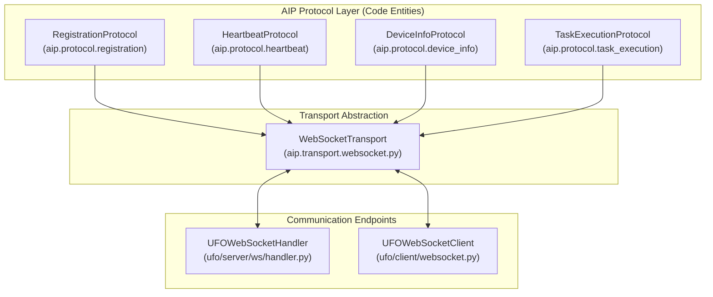
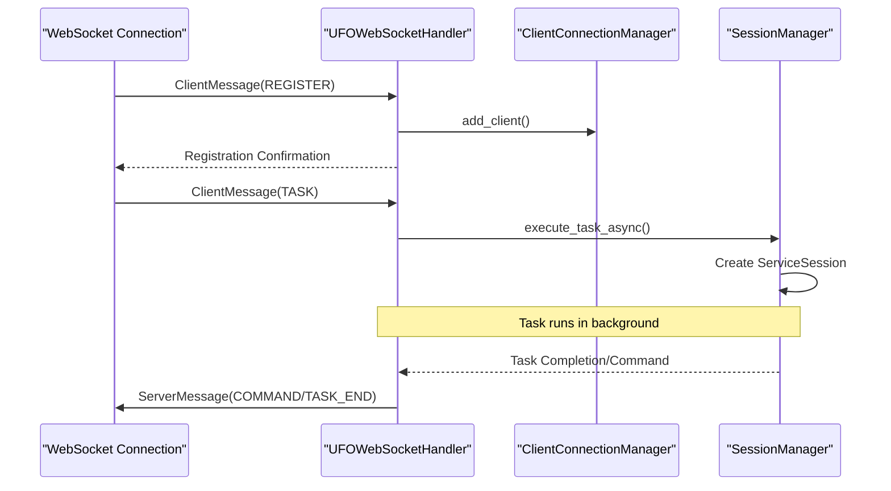

<!-- source: DeepWiki mcp.deepwiki.com · repo microsoft/UFO · page 5 Agent Interaction Protocol · fetched 2026-10-26 -->

# Agent Interaction Protocol

Relevant source files

The following files were used as context for generating this wiki page:

- [aip/endpoints/base.py](aip/endpoints/base.py)
- [aip/endpoints/client_endpoint.py](aip/endpoints/client_endpoint.py)
- [aip/messages.py](aip/messages.py)
- [aip/protocol/base.py](aip/protocol/base.py)
- [aip/protocol/heartbeat.py](aip/protocol/heartbeat.py)
- [aip/transport/adapters.py](aip/transport/adapters.py)
- [aip/transport/base.py](aip/transport/base.py)
- [aip/transport/websocket.py](aip/transport/websocket.py)
- [config/galaxy/devices.yaml](config/galaxy/devices.yaml)
- [documents/docs/aip/endpoints.md](documents/docs/aip/endpoints.md)
- [documents/docs/aip/messages.md](documents/docs/aip/messages.md)
- [documents/docs/aip/overview.md](documents/docs/aip/overview.md)
- [documents/docs/aip/protocols.md](documents/docs/aip/protocols.md)
- [documents/docs/aip/resilience.md](documents/docs/aip/resilience.md)
- [documents/docs/aip/transport.md](documents/docs/aip/transport.md)
- [documents/docs/server/monitoring.md](documents/docs/server/monitoring.md)
- [documents/docs/server/overview.md](documents/docs/server/overview.md)
- [documents/docs/server/quick_start.md](documents/docs/server/quick_start.md)
- [tests/aip/test_binary_transfer.py](tests/aip/test_binary_transfer.py)
- [ufo/client/client.py](ufo/client/client.py)
- [ufo/client/mcp/http_servers/hardware_mcp_server.py](ufo/client/mcp/http_servers/hardware_mcp_server.py)
- [ufo/client/mcp/mcp_registry.py](ufo/client/mcp/mcp_registry.py)
- [ufo/client/mcp/mcp_server_manager.py](ufo/client/mcp/mcp_server_manager.py)
- [ufo/client/ufo_client.py](ufo/client/ufo_client.py)
- [ufo/client/websocket.py](ufo/client/websocket.py)
- [ufo/module/context.py](ufo/module/context.py)
- [ufo/module/dispatcher.py](ufo/module/dispatcher.py)
- [ufo/module/sessions/service_session.py](ufo/module/sessions/service_session.py)
- [ufo/server/app.py](ufo/server/app.py)
- [ufo/server/services/api.py](ufo/server/services/api.py)
- [ufo/server/services/client_connection_manager.py](ufo/server/services/client_connection_manager.py)
- [ufo/server/services/session_manager.py](ufo/server/services/session_manager.py)
- [ufo/server/ws/handler.py](ufo/server/ws/handler.py)

## Purpose and Scope

The **Agent Interaction Protocol (AIP)** is the unified WebSocket-based communication layer that enables cross-device orchestration in UFO³. It provides structured, bidirectional messaging between the Galaxy orchestration tier and device agents (Windows, Linux, Mobile) with fault tolerance, automatic reconnection, and type-safe message handling.

AIP serves as the **nervous system** of the framework, connecting the ConstellationClient, device agent services, and device clients under a unified, event-driven control plane [documents/docs/aip/overview.md:5-7]().

This page provides an architectural overview of AIP's design and components. For implementation details:
- Protocol module internals: see [Protocol Architecture](#5.1)
- Server-side WebSocket handling: see [UFO² Server Implementation](#5.2)
- Client registration flow: see [Device Registration and Lifecycle](#5.3)
- Task dispatch and execution: see [Task Execution Protocol](#5.4)
- Client-side implementation: see [Client-Side Implementation](#5.5)

---

## Overview

AIP serves as the **critical abstraction layer** between Galaxy's global orchestration and local device execution. It enables the Galaxy framework to coordinate heterogeneous agents across different platforms without knowledge of platform-specific implementation details.

### Design Goals

*   **Persistent Sessions (G1)**: Maintain bidirectional sessions to eliminate per-request overhead [documents/docs/aip/overview.md:11-11]().
*   **Capability Discovery (G2)**: Unify heterogeneous capability discovery via multi-source profiling [documents/docs/aip/overview.md:12-12]().
*   **Reliability (G3)**: Ensure fine-grained reliability through heartbeats and timeout managers [documents/docs/aip/overview.md:13-13]().
*   **Deterministic Ordering (G4)**: Preserve command ordering within sessions [documents/docs/aip/overview.md:14-14]().
*   **Extensibility (G5)**: Support composable extensibility for new message types [documents/docs/aip/overview.md:15-15]().
*   **Transparent Reconnection (G6)**: Provide task continuity under transient failures [documents/docs/aip/overview.md:16-16]().

Sources: [documents/docs/aip/overview.md:1-120](), [ufo/server/ws/handler.py:19-23]()

---

## Protocol Stack Architecture

AIP is organized into **four protocol modules**, each handling a specific aspect of agent communication. All protocols operate over a shared `WebSocketTransport` abstraction [ufo/server/ws/handler.py:60-64]().

### Protocol Modules

*   **`RegistrationProtocol`**: Handles client handshake and connection establishment [ufo/server/ws/handler.py:61-61]().
*   **`TaskExecutionProtocol`**: Manages task dispatch, command execution, and result correlation [ufo/server/ws/handler.py:64-64]().
*   **`HeartbeatProtocol`**: Maintains connection health via periodic keepalive signals [ufo/server/ws/handler.py:62-62]().
*   **`DeviceInfoProtocol`**: Queries device capabilities and system information [ufo/server/ws/handler.py:63-63]().

### Message Flow Architecture

The following diagram maps the logical protocol layers to the primary code entities responsible for their execution.

**Diagram: AIP Protocol Entity Mapping**

Sources: [ufo/server/ws/handler.py:8-13](), [ufo/client/websocket.py:10-13](), [documents/docs/aip/overview.md:27-36]()

---

## Message Types

AIP uses strongly-typed messages defined with Pydantic models in `aip.messages` to ensure structural validity across all protocol operations [documents/docs/aip/overview.md:37-40]().

### ClientMessage
Messages sent **from device agents to server** [aip/messages.py](). Key types include:
*   `REGISTER`: Initial connection handshake with `client_id` and `client_type` [ufo/server/ws/handler.py:120-121]().
*   `HEARTBEAT`: Periodic keep-alive signal [ufo/client/websocket.py:252-252]().
*   `COMMAND_RESULTS`: Results of executed actions including `action_results` and `session_id` [ufo/module/dispatcher.py:204-207]().

### ServerMessage
Messages sent **from server to device agents** [aip/messages.py](). Key types include:
*   `TASK_ASSIGNMENT`: Dispatches a new task via `send_task_assignment` [ufo/server/services/api.py:84-89]().
*   `COMMAND`: Instructs the agent to execute specific `actions` [ufo/module/dispatcher.py:194-199]().
*   `TASK_END`: Notification that a task has finished with a specific `status` [aip/messages.py]().

### ClientType Enumeration
AIP distinguishes two client types [ufo/server/ws/handler.py:80-81]():
*   **`ClientType.DEVICE`**: Execution agents (Windows, Linux, Mobile) that perform local automation.
*   **`ClientType.CONSTELLATION`**: Orchestration clients (Galaxy) that submit and coordinate multi-device tasks.

Sources: [ufo/server/ws/handler.py:13, 69-91](), [ufo/client/websocket.py:14-20](), [aip/messages.py]()

---

## Communication Patterns

### Server-Side Implementation
The `UFOWebSocketHandler` manages the lifecycle of WebSocket connections [ufo/server/ws/handler.py:19-23](). It integrates with the `ClientConnectionManager` to track online devices and the `SessionManager` to execute background tasks [ufo/server/ws/handler.py:37-38]().

**Diagram: Server-Side Message Dispatching**

Sources: [ufo/server/ws/handler.py:49-99, 261-314](), [ufo/server/services/session_manager.py:151-181]()

### Client-Side Implementation
The `UFOWebSocketClient` maintains the connection to the server [ufo/client/websocket.py:26-31](). It uses an exponential backoff strategy for retries and delegates action execution to the `UFOClient` [ufo/client/websocket.py:48-51, 151-193]().

**Client Lifecycle**:
1.  **Connect**: Establish connection via `connect_and_listen()` [ufo/client/websocket.py:65-71]().
2.  **Register**: Send system info and `client_id` via `register_client()` [ufo/client/websocket.py:149-154]().
3.  **Listen**: Route incoming `ServerMessage` to appropriate handlers like `_handle_command()` [ufo/client/websocket.py:108, 177-180]().
4.  **Execute**: Use `UFOClient.execute_actions()` to drive local automation [ufo/client/ufo_client.py:69-74]().

Sources: [ufo/client/websocket.py:26-193](), [ufo/client/ufo_client.py:14-88]()

---

## Task Execution and Dispatch

### Command Dispatchers
Tasks are dispatched using the `BasicCommandDispatcher` hierarchy [ufo/module/dispatcher.py:25-29]():
*   **`LocalCommandDispatcher`**: Used for standalone local execution [ufo/module/dispatcher.py:67-71]().
*   **`WebSocketCommandDispatcher`**: Used in service mode to bridge the `Session` on the server to the `UFOClient` on the device via AIP [ufo/module/dispatcher.py:134-140]().

### Correlation and Futures
When the `WebSocketCommandDispatcher` sends a command, it creates an `asyncio.Future` and stores it in the `pending` dictionary [ufo/module/dispatcher.py:152, 219-222](). When the client returns a `COMMAND_RESULTS` message, the server resolves the Future, allowing the agent reasoning loop to continue [ufo/server/ws/handler.py:347-355]().

Sources: [ufo/module/dispatcher.py:134-222](), [ufo/server/ws/handler.py:347-410](), [ufo/module/sessions/service_session.py:50-53]()

---

## Summary of Protocol Layers

| Layer | Responsibility | Key Code Entities |
| :--- | :--- | :--- |
| **L1: Message Schema** | Pydantic contracts and validation | `ClientMessage`, `ServerMessage` in `aip.messages` |
| **L2: Transport** | WebSocket I/O and serialization | `WebSocketTransport` |
| **L3: Orchestration** | Registration, Task, Heartbeat logic | `RegistrationProtocol`, `TaskExecutionProtocol` |
| **L4: Resilience** | Reconnection and health management | `UFOWebSocketClient` retry logic, `HeartbeatProtocol` |
| **L5: Endpoints** | Deployable server/client facades | `UFOWebSocketHandler`, `UFOWebSocketClient` |

Sources: [documents/docs/aip/overview.md:27-108](), [ufo/server/ws/handler.py:8-13](), [ufo/client/websocket.py:10-13]()

---

