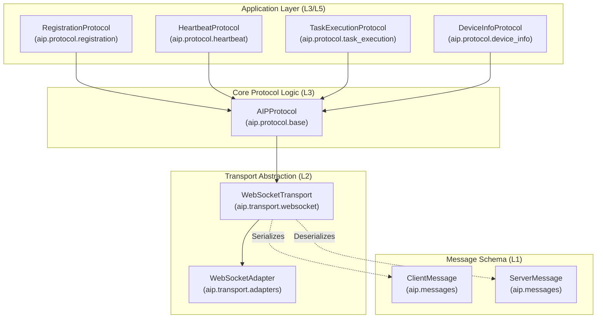
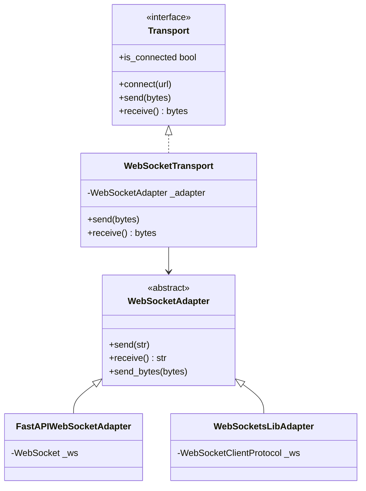
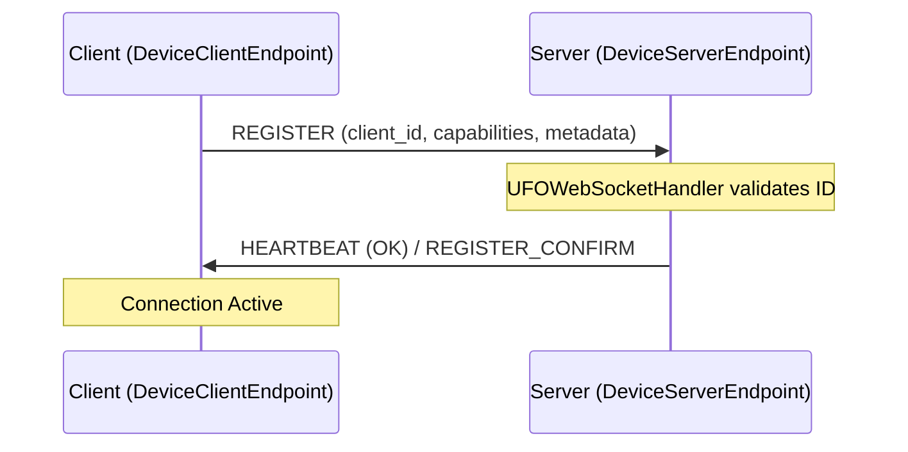

<!-- source: DeepWiki mcp.deepwiki.com · repo microsoft/UFO · page 5.1 Protocol Architecture · fetched 2026-10-26 -->

# Protocol Architecture

<details>
<summary>Relevant source files</summary>

The following files were used as context for generating this wiki page:

- [aip/endpoints/base.py](aip/endpoints/base.py)
- [aip/endpoints/client_endpoint.py](aip/endpoints/client_endpoint.py)
- [aip/messages.py](aip/messages.py)
- [aip/protocol/base.py](aip/protocol/base.py)
- [aip/protocol/heartbeat.py](aip/protocol/heartbeat.py)
- [aip/transport/adapters.py](aip/transport/adapters.py)
- [aip/transport/base.py](aip/transport/base.py)
- [aip/transport/websocket.py](aip/transport/websocket.py)
- [config/galaxy/devices.yaml](config/galaxy/devices.yaml)
- [documents/docs/aip/endpoints.md](documents/docs/aip/endpoints.md)
- [documents/docs/aip/messages.md](documents/docs/aip/messages.md)
- [documents/docs/aip/overview.md](documents/docs/aip/overview.md)
- [documents/docs/aip/protocols.md](documents/docs/aip/protocols.md)
- [documents/docs/aip/resilience.md](documents/docs/aip/resilience.md)
- [documents/docs/aip/transport.md](documents/docs/aip/transport.md)
- [documents/docs/server/monitoring.md](documents/docs/server/monitoring.md)
- [documents/docs/server/overview.md](documents/docs/server/overview.md)
- [documents/docs/server/quick_start.md](documents/docs/server/quick_start.md)
- [tests/aip/test_binary_transfer.py](tests/aip/test_binary_transfer.py)

</details>


## Purpose and Scope

This document describes the **Agent Interaction Protocol (AIP)** architecture, which provides the communication infrastructure for distributed agent coordination in the UFO system. AIP serves as the **nervous system** of UFO², connecting the `ConstellationClient`, device agent services, and device clients under a unified, event-driven control plane [documents/docs/aip/overview.md:1-7]().

**Scope:** This page covers the five-layer protocol architecture, message type definitions, transport abstractions, and bidirectional communication patterns. It details the implementation of the core protocol modules and how they bridge the gap between high-level orchestration and low-level execution.

---

## Five-Layer Protocol Architecture

AIP adopts a persistent, bidirectional WebSocket transport decomposed into five logical strata to ensure reliability and adaptability [documents/docs/aip/overview.md:27-29]().

| Layer | Name | Responsibility | Key Components |
|:---|:---|:---|:---|
| **L1** | **Message Schema** | Strongly-typed Pydantic contracts | `ClientMessage`, `ServerMessage` |
| **L2** | **Transport Abstraction** | Protocol-agnostic communication | `Transport`, `WebSocketTransport` |
| **L3** | **Protocol Orchestration** | Modular domain-specific handlers | `AIPProtocol`, `RegistrationProtocol` |
| **L4** | **Resilience & Health** | Operational continuity and recovery | `HeartbeatManager`, `ReconnectionStrategy` |
| **L5** | **Endpoint Orchestration** | Role-specific integration facades | `DeviceServerEndpoint`, `DeviceClientEndpoint` |

**Sources:** [documents/docs/aip/overview.md:31-98](), [documents/docs/aip/protocols.md:3-39]()

### Protocol Stack and Code Entity Mapping

The following diagram bridges the conceptual protocol layers to the specific classes and modules in the codebase.



**Sources:** [aip/protocol/base.py:22-39](), [aip/transport/websocket.py:24-50](), [documents/docs/aip/protocols.md:7-39]()

---

## Message Type System (Layer 1)

AIP uses **Pydantic-based messages** for automatic validation and type safety [documents/docs/aip/messages.md:1-3](). All communication flows via two primary models: `ClientMessage` and `ServerMessage`.

### ClientMessage Structure
Sent from Device Clients or Constellation Clients to the Server [documents/docs/aip/messages.md:14-21]().

| Field | Type | Purpose |
|:---|:---|:---|
| `client_id` | `str` | Unique identifier for the sending client |
| `client_type` | `ClientType` | `DEVICE` or `CONSTELLATION` |
| `type` | `ClientMessageType` | Enum (e.g., `REGISTER`, `COMMAND_RESULTS`, `HEARTBEAT`) |
| `metadata` | `dict` | Capabilities, OS info, and hardware specs |
| `action_results` | `List[Result]` | Outcomes of executed commands |

### ServerMessage Structure
Sent from the UFO² Server to Clients [documents/docs/aip/messages.md:23-27]().

| Field | Type | Purpose |
|:---|:---|:---|
| `type` | `ServerMessageType` | Enum (e.g., `TASK`, `COMMAND`, `TASK_END`) |
| `session_id` | `str` | Correlation ID for multi-turn tasks |
| `actions` | `List[Command]` | List of tools/actions for the client to execute |
| `status` | `TaskStatus` | Current lifecycle state (e.g., `RUNNING`, `COMPLETED`) |

**Sources:** [aip/protocol/base.py:14-15](), [documents/docs/aip/messages.md:37-55]()

---

## Transport Abstraction (Layer 2)

The `Transport` interface decouples protocol logic from network implementation [documents/docs/aip/transport.md:1-5]().

### WebSocketTransport and Adapters
`WebSocketTransport` provides persistent, full-duplex communication [aip/transport/websocket.py:24-34](). It utilizes the **Adapter Pattern** via `WebSocketAdapter` to unify different underlying libraries:
*   **`FastAPIWebSocketAdapter`**: Used on the server-side to wrap FastAPI's `WebSocket` [aip/transport/adapters.py:105-111]().
*   **`WebSocketsLibAdapter`**: Used on the client-side to wrap the `websockets` library [aip/transport/adapters.py:174-180]().



**Sources:** [aip/transport/base.py:21-82](), [aip/transport/websocket.py:74-87](), [aip/transport/adapters.py:21-27]()

---

## Core Protocol Implementation (Layer 3)

`AIPProtocol` is the foundation for message routing and middleware [aip/protocol/base.py:22-30]().

### Middleware Pipeline
AIP supports a middleware chain for cross-cutting concerns like logging or metrics.
*   **Outgoing**: Applied in the order they are added [aip/protocol/base.py:63-65]().
*   **Incoming**: Applied in reverse order [aip/protocol/base.py:121-123]().

### Registration and Handshake
The `RegistrationProtocol` handles the initial capability advertisement when agents join the constellation [documents/docs/aip/protocols.md:120-123]().



**Sources:** [documents/docs/aip/protocols.md:128-140](), [documents/docs/server/quick_start.md:131-148]()

---

## Task Execution and Multi-turn Flow

The `TaskExecutionProtocol` manages the iterative loop of command dispatch and result reporting [documents/docs/aip/protocols.md:200-203]().

### Multi-turn Command Loop
Unlike stateless HTTP, AIP supports a `CONTINUE` pattern where the agent evaluates results and requests more actions before finishing the task [documents/docs/aip/protocols.md:208-223]().

| Step | Message | Data Flow |
|:---|:---|:---|
| 1 | `TASK` | Server assigns high-level request to Device |
| 2 | `COMMAND` | Server sends specific tool calls (e.g., `click_button`) |
| 3 | `COMMAND_RESULTS` | Device reports outcome (Success/Failure) |
| 4 | `CONTINUE` | (Optional) Server sends next set of commands |
| 5 | `TASK_END` | Final result reported to Constellation |

**Sources:** [documents/docs/aip/protocols.md:208-223](), [documents/docs/aip/messages.md:13-33]()

---

## Endpoint Orchestration (Layer 5)

Endpoints provide role-specific facades that integrate the protocol, transport, and resilience layers into deployable components [documents/docs/aip/endpoints.md:1-4]().

*   **`DeviceServerEndpoint`**: Manages multiplexed connections, session mapping, and task routing for the server [documents/docs/aip/endpoints.md:82-85]().
*   **`DeviceClientEndpoint`**: Implements automatic reconnection with exponential backoff and heartbeat management for agents [documents/docs/aip/endpoints.md:138-141]().
*   **`ConstellationEndpoint`**: Enables the orchestrator to communicate with multiple devices simultaneously [documents/docs/aip/endpoints.md:197-199]().

```mermaid
graph TB
    subgraph "Endpoint Composition"
        EP[AIPEndpoint Base]
        EP --> Protocol[AIPProtocol]
        EP --> Transport[WebSocketTransport]
        EP --> Resilience[ReconnectionStrategy]
    end
    
    EP <|-- DeviceServer[DeviceServerEndpoint]
    EP <|-- DeviceClient[DeviceClientEndpoint]
    EP <|-- Constellation[ConstellationEndpoint]
```

**Sources:** [documents/docs/aip/endpoints.md:21-38](), [documents/docs/aip/overview.md:89-98]()

---

