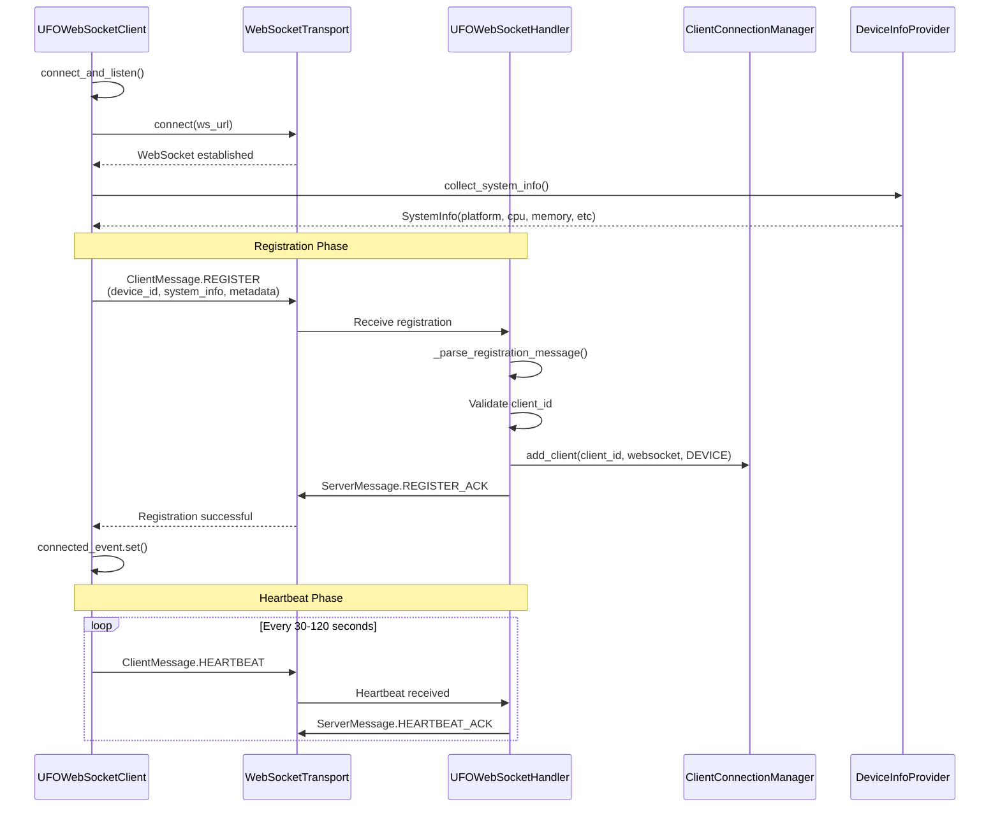
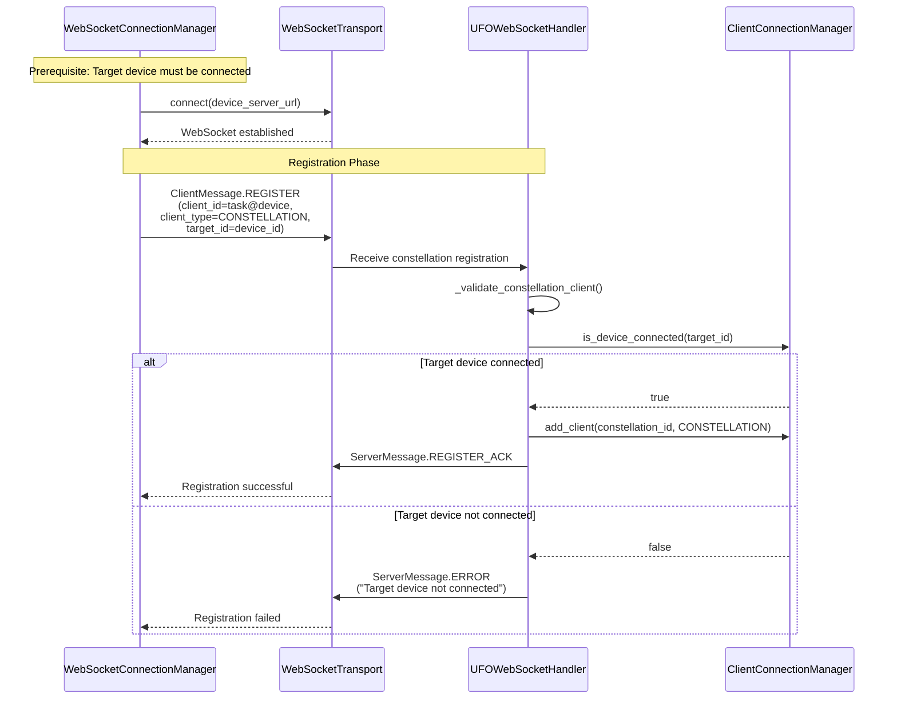

<!-- source: DeepWiki mcp.deepwiki.com · repo microsoft/UFO · page 5.3 Device Registration and Lifecycle · fetched 2026-10-26 -->

# Device Registration and Lifecycle

<details>
<summary>Relevant source files</summary>

The following files were used as context for generating this wiki page:

- [config/galaxy/agent.yaml.template](config/galaxy/agent.yaml.template)
- [documents/docs/client/computer.md](documents/docs/client/computer.md)
- [documents/docs/client/computer_manager.md](documents/docs/client/computer_manager.md)
- [documents/docs/client/device_info.md](documents/docs/client/device_info.md)
- [documents/docs/client/mcp_integration.md](documents/docs/client/mcp_integration.md)
- [documents/docs/client/overview.md](documents/docs/client/overview.md)
- [documents/docs/client/quick_start.md](documents/docs/client/quick_start.md)
- [documents/docs/client/ufo_client.md](documents/docs/client/ufo_client.md)
- [documents/docs/client/websocket_client.md](documents/docs/client/websocket_client.md)
- [documents/docs/configuration/system/galaxy_devices.md](documents/docs/configuration/system/galaxy_devices.md)
- [documents/docs/configuration/system/overview.md](documents/docs/configuration/system/overview.md)
- [documents/docs/galaxy/agent_registration/agent_profile.md](documents/docs/galaxy/agent_registration/agent_profile.md)
- [documents/docs/galaxy/agent_registration/device_registry.md](documents/docs/galaxy/agent_registration/device_registry.md)
- [documents/docs/galaxy/agent_registration/overview.md](documents/docs/galaxy/agent_registration/overview.md)
- [documents/docs/galaxy/agent_registration/registration_flow.md](documents/docs/galaxy/agent_registration/registration_flow.md)
- [documents/docs/getting_started/quick_start_mobile.md](documents/docs/getting_started/quick_start_mobile.md)
- [documents/docs/server/api.md](documents/docs/server/api.md)
- [tests/debug_observer_output.py](tests/debug_observer_output.py)
- [ufo/client/client.py](ufo/client/client.py)
- [ufo/client/mcp/http_servers/hardware_mcp_server.py](ufo/client/mcp/http_servers/hardware_mcp_server.py)
- [ufo/client/mcp/mcp_registry.py](ufo/client/mcp/mcp_registry.py)
- [ufo/client/mcp/mcp_server_manager.py](ufo/client/mcp/mcp_server_manager.py)
- [ufo/client/ufo_client.py](ufo/client/ufo_client.py)
- [ufo/client/websocket.py](ufo/client/websocket.py)
- [ufo/module/context.py](ufo/module/context.py)
- [ufo/module/dispatcher.py](ufo/module/dispatcher.py)
- [ufo/module/sessions/service_session.py](ufo/module/sessions/service_session.py)
- [ufo/server/app.py](ufo/server/app.py)
- [ufo/server/services/api.py](ufo/server/services/api.py)
- [ufo/server/services/client_connection_manager.py](ufo/server/services/client_connection_manager.py)
- [ufo/server/services/session_manager.py](ufo/server/services/session_manager.py)
- [ufo/server/ws/handler.py](ufo/server/ws/handler.py)

</details>


## Purpose and Scope

This page documents the device registration process and connection lifecycle management in the Agent Interaction Protocol (AIP). It covers how UFO² clients (devices) and Galaxy constellation clients register with UFO² servers, the device status state machine, heartbeat monitoring, and automatic reconnection mechanisms.

For information about the overall AIP architecture and message types, see [5.1 Protocol Architecture](). For information about task execution after registration, see [5.4 Task Execution Protocol]().

## Client Types

The AIP supports two distinct client types, each with different registration requirements:

| Client Type | Purpose | Required Fields | Target ID |
|-------------|---------|----------------|-----------|
| `ClientType.DEVICE` | UFO² client instance that executes tasks | `client_id`, `platform`, `system_info` | Not used |
| `ClientType.CONSTELLATION` | Galaxy orchestration client that dispatches tasks | `client_id`, `target_id` | Must reference a connected device |

The client type is specified in the `client_type` field of the `ClientMessage` during registration [aip/messages.py:10-30]().

**Sources:** [ufo/server/ws/handler.py:69-91](), [ufo/server/services/client_connection_manager.py:15-35]()

---

## Device Client Registration Flow

### Registration Process



**Device Registration Steps:**

1. **Connection Establishment** [ufo/client/websocket.py:91-98]()
   - Client creates WebSocket connection using `websockets.connect()`.
   - Initializes `WebSocketTransport` wrapper for AIP protocol [ufo/client/websocket.py:101-104]().
   - Configures `ping_interval` (20s) and `ping_timeout` (180s) [ufo/client/websocket.py:93-94]().

2. **System Information Collection** [ufo/client/websocket.py:157-186]()
   - `DeviceInfoProvider.collect_system_info()` gathers platform, CPU count, memory, and disk space.
   - Metadata includes registration timestamp and system information [ufo/client/websocket.py:165-170]().

3. **Registration Message Transmission** [ufo/client/websocket.py:189-197]()
   - Uses `RegistrationProtocol.register_as_device()` from AIP.
   - Sends `ClientMessage` with type `REGISTER`, `device_id`, and `platform`.
   - Server receives via `WebSocketTransport.receive()` [ufo/server/ws/handler.py:109-113]().

4. **Server-Side Validation** [ufo/server/ws/handler.py:101-124]()
   - Parses `ClientMessage.model_validate_json()` from raw bytes [ufo/server/ws/handler.py:113]().
   - Validates `client_id` is not empty [ufo/server/ws/handler.py:118]().
   - Validates message type is `ClientMessageType.REGISTER` [ufo/server/ws/handler.py:120]().

5. **Client Registration** [ufo/server/ws/handler.py:83-91]()
   - `ClientConnectionManager.add_client()` stores client information.
   - Creates `ClientInfo` dataclass with websocket, client_type, transport, and task_protocol [ufo/server/services/client_connection_manager.py:141-158]().

6. **Registration Confirmation** [ufo/server/ws/handler.py:147-153]()
   - Server sends `RegistrationProtocol.send_registration_confirmation()`.
   - Client receives confirmation and sets `connected_event` [ufo/client/websocket.py:107]().

**Sources:** [ufo/client/websocket.py:65-208](), [ufo/server/ws/handler.py:49-181](), [ufo/server/services/client_connection_manager.py:127-169]()

---

## Constellation Client Registration Flow

Galaxy constellation clients register differently because they act as orchestrators that dispatch tasks to devices rather than execute tasks themselves.



**Constellation Registration Steps:**

1. **Target Device Validation** [ufo/server/ws/handler.py:125-145]()
   - Server calls `_validate_constellation_client()`.
   - Checks if `claimed_device_id` exists in `ClientConnectionManager.is_device_connected(claimed_device_id)` [ufo/server/ws/handler.py:138]().
   - If device is not connected, sends error via `RegistrationProtocol.send_registration_error()` and closes transport [ufo/server/ws/handler.py:143-144]().

2. **Client Registration** [ufo/server/ws/handler.py:83-91]()
   - Once validated, the constellation client is added to the `ClientConnectionManager` with type `ClientType.CONSTELLATION`.

**Sources:** [ufo/server/ws/handler.py:125-181](), [ufo/server/services/client_connection_manager.py:220-235]()

---

## Heartbeat and Health Monitoring

### Client-Side Heartbeat Transmission

The client sends periodic heartbeat messages to maintain connection health [ufo/client/websocket.py:262-277]():

```python
async def heartbeat_loop(self, interval: float = 30) -> None:
    while True:
        await asyncio.sleep(interval)
        try:
            await self.heartbeat_protocol.send_heartbeat(self.ufo_client.client_id)
            self.logger.debug("[WS] [AIP] Heartbeat sent")
        except (ConnectionError, IOError) as e:
            self.logger.debug(f"[WS] [AIP] Heartbeat failed (connection closed): {e}")
            break 
```
[ufo/client/websocket.py:262-277]()

### Server-Side Heartbeat Processing

The server handles heartbeat messages and sends acknowledgments [ufo/server/ws/handler.py:315-328]():

1. Receives `ClientMessage.HEARTBEAT` via `handle_message()` [ufo/server/ws/handler.py:284]().
2. Calls `handle_heartbeat()` to process [ufo/server/ws/handler.py:315]().
3. Sends `HeartbeatProtocol.send_heartbeat_ack()` back to client [ufo/server/ws/handler.py:326]().

**Sources:** [ufo/client/websocket.py:262-277](), [ufo/server/ws/handler.py:315-328]()

---

## Connection State Management

### Client Connection Manager

The `ClientConnectionManager` on the UFO² server side tracks all connected clients and their sessions [ufo/server/services/client_connection_manager.py:30-253]().

**Key Data Structures:**

```python
@dataclass
class ClientInfo:
    websocket: WebSocket
    client_type: ClientType
    connected_at: datetime
    metadata: Dict
    platform: str = "windows"
    system_info: Dict = None
    transport: Optional[WebSocketTransport] = None
    task_protocol: Optional[TaskExecutionProtocol] = None
```
[ufo/server/services/client_connection_manager.py:15-28]()

**Session Tracking:**

1. **Constellation Sessions** [ufo/server/services/client_connection_manager.py:63-93]()
   - Maps `constellation_client_id` → `List[session_id]`.
   - Tracks sessions initiated by constellation clients.

2. **Device Sessions** [ufo/server/services/client_connection_manager.py:95-125]()
   - Maps `device_id` → `List[session_id]`.
   - Tracks sessions running on specific devices.

**Sources:** [ufo/server/services/client_connection_manager.py:14-253]()

---

## Disconnection Handling

### Server-Side Disconnection Logic

The server handles disconnections differently based on client type [ufo/server/ws/handler.py:183-236]():

**For Device Clients:**
1. Retrieve all sessions running on the device via `get_device_sessions(client_id)` [ufo/server/ws/handler.py:214]().
2. Cancel each session with reason `"device_disconnected"` [ufo/server/ws/handler.py:218]().
3. Clean up device session mappings [ufo/server/ws/handler.py:233]().

**For Constellation Clients:**
1. Retrieve all sessions initiated by constellation via `get_constellation_sessions(client_id)` [ufo/server/ws/handler.py:190]().
2. Cancel each session with reason `"constellation_disconnected"` [ufo/server/ws/handler.py:194]().
3. Clean up constellation session mappings [ufo/server/ws/handler.py:211]().

### Session Cancellation

The `SessionManager` handles task cancellation gracefully [ufo/server/services/session_manager.py:197-235]():

```python
async def cancel_task(self, session_id: str, reason: str) -> bool:
    task = self._running_tasks.get(session_id)
    if task and not task.done():
        self._cancellation_reasons[session_id] = reason
        task.cancel()
        # ... wait for cancellation ...
        self._running_tasks.pop(session_id, None)
        self.remove_session(session_id)
        return True
    return False
```
[ufo/server/services/session_manager.py:213-233]()

**Sources:** [ufo/server/ws/handler.py:183-236](), [ufo/server/services/session_manager.py:197-376]()

---

