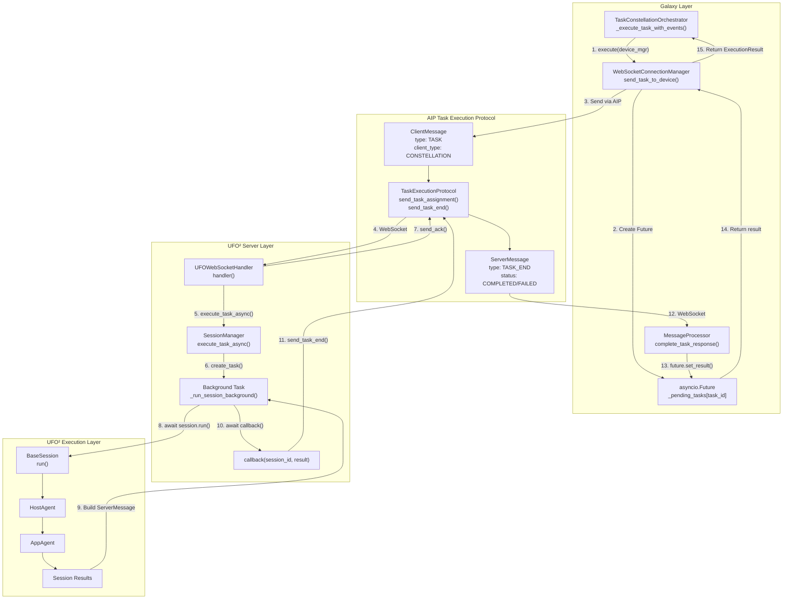

<!-- source: DeepWiki mcp.deepwiki.com · repo microsoft/UFO · page 5.4 Task Execution Protocol · fetched 2026-10-26 -->

# Task Execution Protocol

<details>
<summary>Relevant source files</summary>

The following files were used as context for generating this wiki page:

- [aip/endpoints/base.py](aip/endpoints/base.py)
- [aip/endpoints/client_endpoint.py](aip/endpoints/client_endpoint.py)
- [aip/messages.py](aip/messages.py)
- [aip/protocol/base.py](aip/protocol/base.py)
- [aip/protocol/heartbeat.py](aip/protocol/heartbeat.py)
- [aip/transport/adapters.py](aip/transport/adapters.py)
- [aip/transport/base.py](aip/transport/base.py)
- [aip/transport/websocket.py](aip/transport/websocket.py)
- [config/galaxy/devices.yaml](config/galaxy/devices.yaml)
- [tests/aip/test_binary_transfer.py](tests/aip/test_binary_transfer.py)
- [ufo/client/client.py](ufo/client/client.py)
- [ufo/client/mcp/http_servers/hardware_mcp_server.py](ufo/client/mcp/http_servers/hardware_mcp_server.py)
- [ufo/client/mcp/mcp_registry.py](ufo/client/mcp/mcp_registry.py)
- [ufo/client/mcp/mcp_server_manager.py](ufo/client/mcp/mcp_server_manager.py)
- [ufo/client/ufo_client.py](ufo/client/ufo_client.py)
- [ufo/client/websocket.py](ufo/client/websocket.py)
- [ufo/module/context.py](ufo/module/context.py)
- [ufo/module/dispatcher.py](ufo/module/dispatcher.py)
- [ufo/module/sessions/service_session.py](ufo/module/sessions/service_session.py)
- [ufo/server/app.py](ufo/server/app.py)
- [ufo/server/services/api.py](ufo/server/services/api.py)
- [ufo/server/services/client_connection_manager.py](ufo/server/services/client_connection_manager.py)
- [ufo/server/services/session_manager.py](ufo/server/services/session_manager.py)
- [ufo/server/ws/handler.py](ufo/server/ws/handler.py)

</details>


## Purpose and Scope

The **Task Execution Protocol** is a specialized component of the Agent Interaction Protocol (AIP) that manages task dispatch, execution coordination, and result aggregation between the Galaxy orchestration layer and UFO² execution layer. This protocol enables the Galaxy Framework to distribute tasks across heterogeneous devices and reliably collect execution results using a Future-based async pattern with timeout protection.

**Key Responsibilities:**
- Task dispatch from Galaxy to UFO² devices via WebSocket.
- Result aggregation using `asyncio.Future` for request-response handling over persistent connections.
- Timeout protection and error handling for long-running tasks.
- Background execution support in `SessionManager` to prevent blocking the WebSocket event loop.
- Session lifecycle coordination with callback mechanisms for status reporting.

## Protocol Architecture

The Task Execution Protocol operates as a layer within AIP, coordinating between Galaxy's `ConstellationDeviceManager`, UFO² Server's `UFOWebSocketHandler`, and the `SessionManager` that executes tasks.

### High-Level Task Execution Flow



**Sources:** [ufo/server/ws/handler.py:347-494](), [ufo/server/services/session_manager.py:151-196](), [aip/protocol/task_execution.py:1-50](), [ufo/client/websocket.py:304-360]()

## Message Types and Flow

### Task Assignment Message (Constellation → Device)

The Galaxy orchestration layer sends task assignments to UFO² devices using `ClientMessage` with type `TASK`. This message encapsulates the user request and task identification metadata.

**Implementation:** [ufo/server/ws/handler.py:347-388]()

```python
# UFOWebSocketHandler.handle_task_request implementation
# Extracts data from ClientMessage and initiates execution
task_name = data.task_name or str(uuid.uuid4())
session_id = data.session_id or str(uuid.uuid4())
request = data.request
```

**Sources:** [ufo/server/ws/handler.py:347-388](), [aip/messages.py:112-148]()

### Task Result Message (Device → Constellation)

UFO² devices send task completion results back using `ServerMessage` with type `TASK_END`. This includes the final execution status and any results or errors generated by the session.

**Implementation:** [ufo/server/services/session_manager.py:335-343]()

```python
# SessionManager._run_session_background building the result
result_message = ServerMessage(
    type=ServerMessageType.TASK_END,
    status=status,
    session_id=session_id,
    error=error,
    result=session.results,
    timestamp=datetime.datetime.now(datetime.timezone.utc).isoformat(),
    response_id=str(uuid.uuid4()),
)
```

**Sources:** [ufo/server/services/session_manager.py:335-343](), [aip/messages.py:151-185]()

### Command Execution Messages

During task execution, the UFO² Server sends `ServerMessage` with type `COMMAND` to the client for action execution (e.g., UI clicks), and receives `ClientMessage` with type `COMMAND_RESULTS` in response.

**Implementation:** [ufo/module/dispatcher.py:174-204]()

```python
# WebSocketCommandDispatcher.make_server_response
def make_server_response(self, commands: List[Command]) -> ServerMessage:
    # ...
    return ServerMessage(
        type=ServerMessageType.COMMAND,
        status=TaskStatus.CONTINUE,
        agent_name=agent_name,
        process_name=process_name,
        root_name=root_name,
        actions=commands,
        # ...
    )
```

**Sources:** [ufo/module/dispatcher.py:174-204](), [ufo/client/websocket.py:362-402](), [ufo/server/ws/handler.py:496-515]()

## Future-Based Request-Response Pattern

The protocol uses `asyncio.Future` to bridge the gap between asynchronous WebSocket messages and synchronous task logic.

### Future Lifecycle

1.  **Creation**: `WebSocketCommandDispatcher` creates a `Future` and stores it in a `pending` dictionary keyed by `response_id` [ufo/module/dispatcher.py:223-224]().
2.  **Dispatch**: The command is sent via `TaskExecutionProtocol` [ufo/module/dispatcher.py:227]().
3.  **Waiting**: The dispatcher awaits the `Future` with a timeout [ufo/module/dispatcher.py:230]().
4.  **Resolution**: When `UFOWebSocketHandler` receives `COMMAND_RESULTS`, it calls `dispatcher.set_result()`, which resolves the `Future` [ufo/module/dispatcher.py:241-263]().

**Sources:** [ufo/module/dispatcher.py:206-263](), [ufo/server/ws/handler.py:496-515]()

## Background Task Execution

The `SessionManager` executes tasks in background asyncio tasks to prevent blocking the WebSocket event loop, ensuring heartbeats and ping/pong messages are still processed.

**Implementation:** [ufo/server/services/session_manager.py:151-196]()

```python
# SessionManager.execute_task_async
task = asyncio.create_task(
    self._run_session_background(session_id, session, callback)
)
self._running_tasks[session_id] = task
```

The `_run_session_background` method handles the actual execution loop of the session and ensures that the provided `callback` is executed upon completion or failure [ufo/server/services/session_manager.py:237-376]().

**Sources:** [ufo/server/services/session_manager.py:151-196](), [ufo/server/services/session_manager.py:237-376]()

## Callback Mechanism

The `UFOWebSocketHandler` defines a `send_result` callback during task dispatch. This callback uses the captured `TaskExecutionProtocol` to transmit the final `TASK_END` message back to the requester [ufo/server/ws/handler.py:390-465]().

**Sources:** [ufo/server/ws/handler.py:390-465](), [ufo/server/services/session_manager.py:352-366]()

## Task Cancellation

Task cancellation is handled by `SessionManager.cancel_task()`. It marks a session with a cancellation reason and calls `task.cancel()` on the background asyncio task [ufo/server/services/session_manager.py:197-235]().

When a client disconnects, the `UFOWebSocketHandler.disconnect()` method identifies all active sessions for that client and triggers their cancellation [ufo/server/ws/handler.py:183-236]().

**Sources:** [ufo/server/services/session_manager.py:197-235](), [ufo/server/ws/handler.py:183-236](), [ufo/server/services/session_manager.py:292-320]()

## Command Execution Sub-Protocol

The `WebSocketCommandDispatcher` facilitates communication between the server-side session and the client-side `UFOClient`.

| Entity | Role | File |
| :--- | :--- | :--- |
| `WebSocketCommandDispatcher` | Server-side manager of command futures. | [ufo/module/dispatcher.py:134-160]() |
| `UFOWebSocketClient` | Client-side receiver that routes commands to the local `UFOClient`. | [ufo/client/websocket.py:362-402]() |
| `UFOClient` | Client-side executor using `CommandRouter`. | [ufo/client/ufo_client.py:69-88]() |
| `CommandRouter` | Routes commands to specific `Computer` or `MCP` instances. | [ufo/client/ufo_client.py:36-38]() |

**Sources:** [ufo/module/dispatcher.py:134-263](), [ufo/client/websocket.py:362-402](), [ufo/client/ufo_client.py:53-88]()

---

