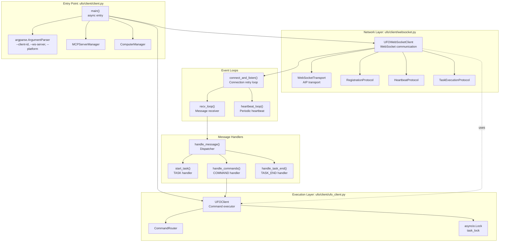
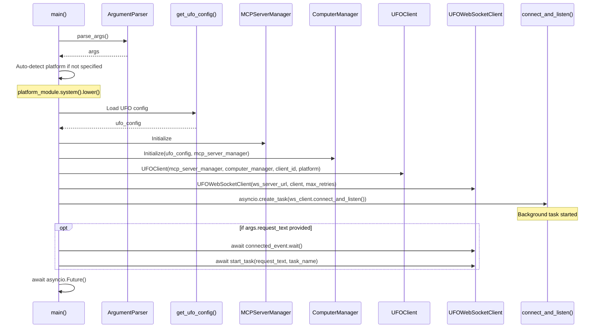
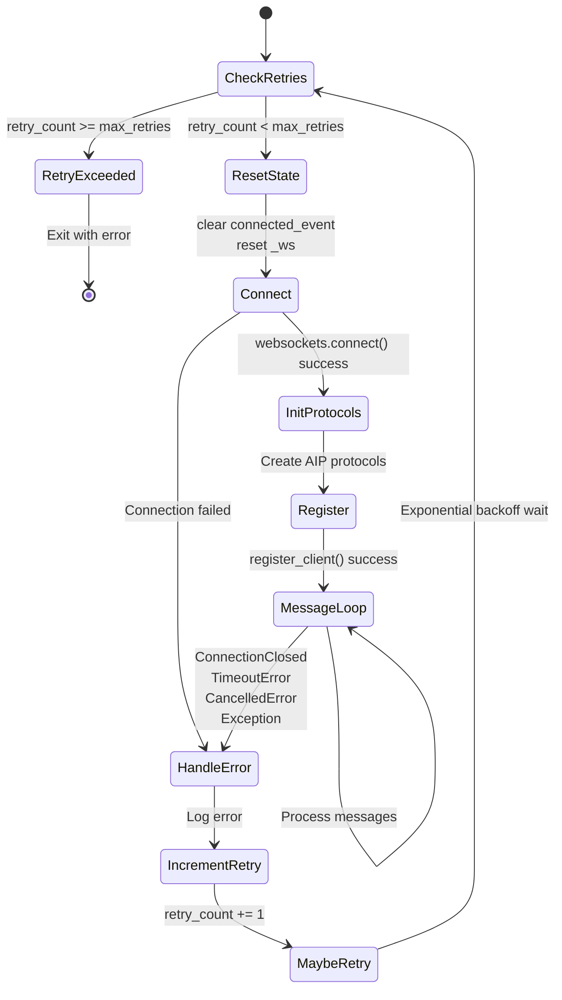
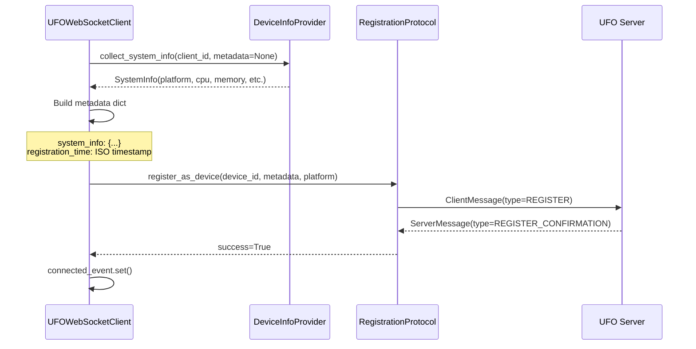
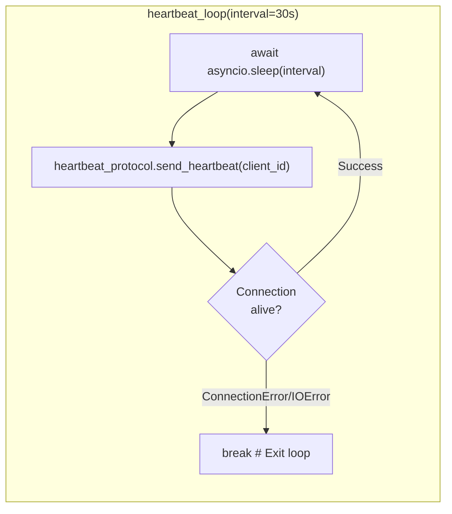
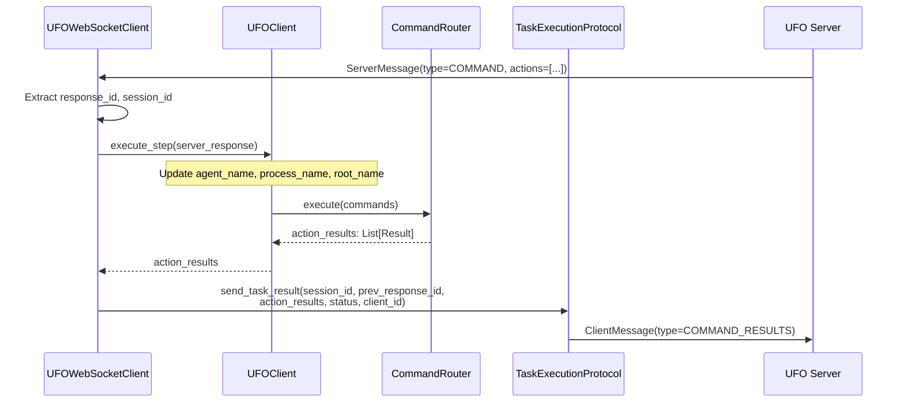
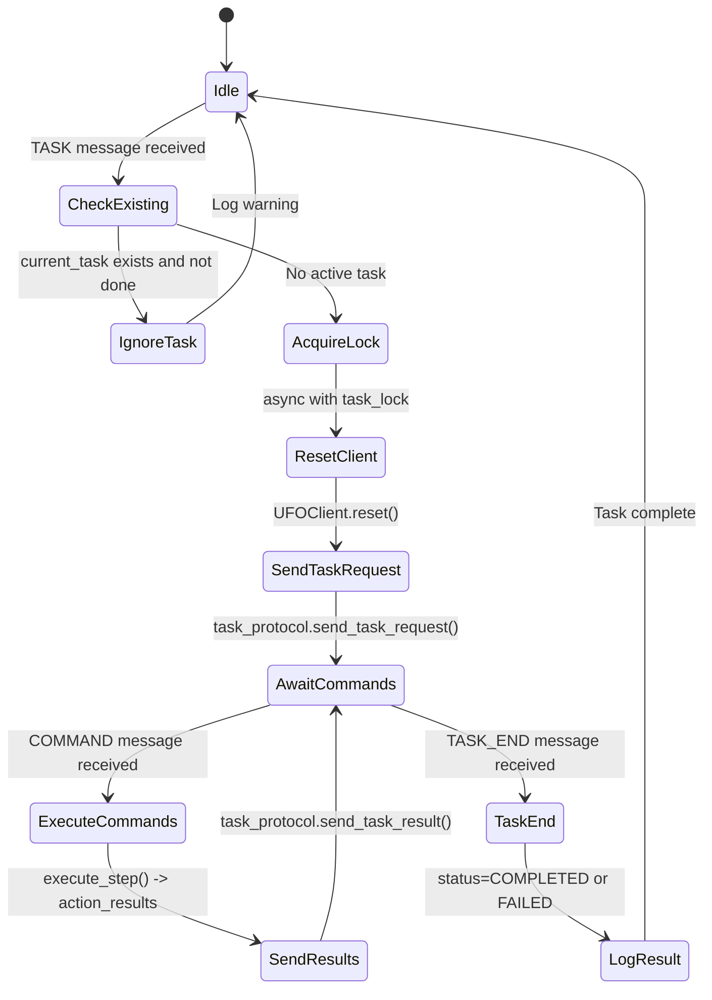

<!-- source: DeepWiki mcp.deepwiki.com · repo microsoft/UFO · page 5.5 Client-Side Implementation · fetched 2026-10-26 -->

# Client-Side Implementation

Relevant source files

The following files were used as context for generating this wiki page:

- [documents/docs/client/computer.md](documents/docs/client/computer.md)
- [documents/docs/client/computer_manager.md](documents/docs/client/computer_manager.md)
- [documents/docs/client/device_info.md](documents/docs/client/device_info.md)
- [documents/docs/client/mcp_integration.md](documents/docs/client/mcp_integration.md)
- [documents/docs/client/overview.md](documents/docs/client/overview.md)
- [documents/docs/client/quick_start.md](documents/docs/client/quick_start.md)
- [documents/docs/client/ufo_client.md](documents/docs/client/ufo_client.md)
- [documents/docs/client/websocket_client.md](documents/docs/client/websocket_client.md)
- [documents/docs/configuration/system/galaxy_devices.md](documents/docs/configuration/system/galaxy_devices.md)
- [documents/docs/getting_started/quick_start_mobile.md](documents/docs/getting_started/quick_start_mobile.md)
- [documents/docs/server/api.md](documents/docs/server/api.md)
- [tests/debug_observer_output.py](tests/debug_observer_output.py)
- [ufo/client/client.py](ufo/client/client.py)
- [ufo/client/mcp/http_servers/hardware_mcp_server.py](ufo/client/mcp/http_servers/hardware_mcp_server.py)
- [ufo/client/mcp/mcp_registry.py](ufo/client/mcp/mcp_registry.py)
- [ufo/client/mcp/mcp_server_manager.py](ufo/client/mcp/mcp_server_manager.py)
- [ufo/client/ufo_client.py](ufo/client/ufo_client.py)
- [ufo/client/websocket.py](ufo/client/websocket.py)
- [ufo/module/context.py](ufo/module/context.py)
- [ufo/module/dispatcher.py](ufo/module/dispatcher.py)
- [ufo/module/sessions/service_session.py](ufo/module/sessions/service_session.py)
- [ufo/server/app.py](ufo/server/app.py)
- [ufo/server/services/api.py](ufo/server/services/api.py)
- [ufo/server/services/client_connection_manager.py](ufo/server/services/client_connection_manager.py)
- [ufo/server/services/session_manager.py](ufo/server/services/session_manager.py)
- [ufo/server/ws/handler.py](ufo/server/ws/handler.py)

This page documents the client-side implementation of the Agent Interaction Protocol (AIP) in UFO. It covers the `UFOWebSocketClient` for WebSocket communication, connection management with exponential backoff retry, heartbeat mechanism, event handling, and integration with `UFOClient` for command execution. For server-side implementation, see [5.2 UFO² Server Implementation](). For task execution protocol details, see [5.4 Task Execution Protocol]().

## Architecture Overview

The client-side implementation consists of two primary components: `UFOWebSocketClient` for network communication and `UFOClient` for command execution. The WebSocket client manages the AIP protocol stack and delegates command execution to the UFO client.

### Bridge: Natural Language to Code Entity Space (Architecture)

| System Concept | Code Entity | File Path |
| :--- | :--- | :--- |
| **WebSocket Client** | `UFOWebSocketClient` | [ufo/client/websocket.py:26-31]() |
| **Command Executor** | `UFOClient` | [ufo/client/ufo_client.py:14-18]() |
| **AIP Transport** | `WebSocketTransport` | [ufo/server/ws/handler.py:12-12]() |
| **Command Routing** | `CommandRouter` | [ufo/client/ufo_client.py:7-7]() |
| **Task Locking** | `asyncio.Lock` | [ufo/client/ufo_client.py:41-41]() |

**Sources:** [ufo/client/websocket.py:26-444](), [ufo/client/client.py:81-121](), [ufo/client/ufo_client.py:14-179]()

## Client Entry Point

The client application is launched via `ufo/client/client.py`, which provides command-line argument parsing and initialization of core components [ufo/client/client.py:17-63]().

### Command-Line Arguments

| Argument | Default | Description |
|----------|---------|-------------|
| `--client-id` | `"client_001"` | Unique identifier for the client device [ufo/client/client.py:19-23]() |
| `--ws-server` | `"ws://localhost:5000/ws"` | WebSocket server URL [ufo/client/client.py:25-29]() |
| `--ws` | `False` | Run in WebSocket mode [ufo/client/client.py:30-30]() |
| `--max-retries` | `5` | Maximum connection retry attempts [ufo/client/client.py:32-37]() |
| `--request` | `None` | Optional task request text for immediate execution [ufo/client/client.py:39-43]() |
| `--task_name` | `None` | Optional task name [ufo/client/client.py:45-49]() |
| `--log-level` | `"WARNING"` | Logging level [ufo/client/client.py:51-55]() |
| `--platform` | Auto-detected | Platform override (windows, linux, mobile) [ufo/client/client.py:57-62]() |

**Sources:** [ufo/client/client.py:17-63]()

### Initialization Sequence

The `main()` function coordinates the setup of the MCP manager, computer manager, and the dual-client architecture [ufo/client/client.py:81-116]().

**Sources:** [ufo/client/client.py:81-121](), [ufo/client/ufo_client.py:20-33]()

## UFOWebSocketClient Components

The `UFOWebSocketClient` class implements the client-side AIP protocol handling using specialized protocol instances [ufo/client/websocket.py:26-63]().

### Connection Management with Retry Logic

The `connect_and_listen()` method implements an infinite retry loop with exponential backoff [ufo/client/websocket.py:65-148]().

The retry logic uses exponential backoff to avoid overwhelming the server [ufo/client/websocket.py:405-420]():
- `wait_time = 2**self.retry_count` (1s, 2s, 4s, 8s, 16s).

**Sources:** [ufo/client/websocket.py:65-148](), [ufo/client/websocket.py:405-420]()

### WebSocket Configuration

The WebSocket connection is configured for stability during long-running agent operations [ufo/client/websocket.py:91-97]():

| Parameter | Value | Purpose |
|-----------|-------|---------|
| `ping_interval` | 20 seconds | Frequent keepalive for connection monitoring |
| `ping_timeout` | 180 seconds | 3-minute timeout for long-running AI operations |
| `close_timeout` | 10 seconds | Graceful closure |
| `max_size` | 100 MB | Support for high-res screenshots and large results |

**Sources:** [ufo/client/websocket.py:91-97]()

## Device Registration Flow

Registration utilizes the `RegistrationProtocol` to transmit device capabilities and system health [ufo/client/websocket.py:149-208]().

**Sources:** [ufo/client/websocket.py:149-208](), [ufo/server/ws/handler.py:101-123]()

## Heartbeat Mechanism

The heartbeat loop maintains connection health by sending periodic signals [ufo/client/websocket.py:262-278]().

**Sources:** [ufo/client/websocket.py:262-278]()

## Command Execution Integration

The `handle_commands()` method bridges the WebSocket layer and the `UFOClient` execution layer [ufo/client/websocket.py:358-385]().

### Bridge: Message to Execution Space

| Protocol Message | Execution Component | File Path |
| :--- | :--- | :--- |
| `ServerMessageType.COMMAND` | `UFOClient.execute_step` | [ufo/client/ufo_client.py:53-53]() |
| `Command` (List) | `CommandRouter.execute` | [ufo/client/ufo_client.py:81-86]() |
| `Result` (List) | `TaskExecutionProtocol.send_task_result` | [ufo/client/websocket.py:373-379]() |

**Sources:** [ufo/client/websocket.py:358-385](), [ufo/client/ufo_client.py:53-88]()

## Task Lifecycle Management

The client supports task execution with a locking mechanism to prevent race conditions during concurrent requests [ufo/client/websocket.py:322-337]().

**Sources:** [ufo/client/websocket.py:305-404](), [ufo/client/ufo_client.py:166-178]()

## Error Handling and Resilience

The client implements multiple layers of resilience [ufo/client/websocket.py:110-148]():

1.  **Connection Errors**: Handled by `connect_and_listen()` with specific logic for `ConnectionRefusedError` and `ConnectionClosed` [ufo/client/websocket.py:110-140]().
2.  **Task Execution Errors**: Exceptions during `execute_step` are caught in the task loop and reported back to the server as an AIP `ERROR` message [ufo/client/websocket.py:342-355]().
3.  **Timeout Handling**: The client respects the server's `timeout` parameters for command execution [ufo/client/websocket.py:38-38]().

**Sources:** [ufo/client/websocket.py:110-148](), [ufo/client/websocket.py:342-355]()

---

