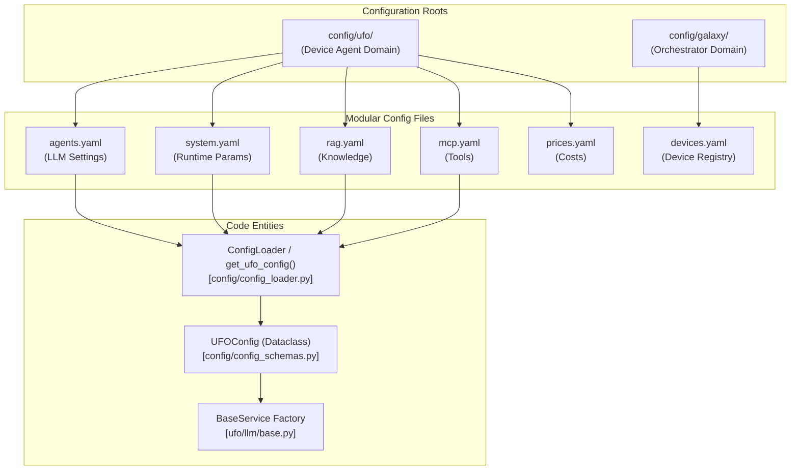
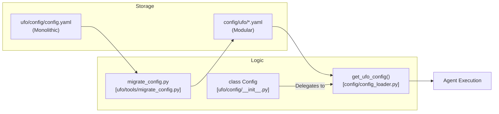

<!-- source: DeepWiki mcp.deepwiki.com · repo microsoft/UFO · page 6 Configuration System · fetched 2026-10-26 -->

# Configuration System

Relevant source files

The following files were used as context for generating this wiki page:

- [.gitignore](.gitignore)
- [assets/ufo.png](assets/ufo.png)
- [config/galaxy/constellation.yaml](config/galaxy/constellation.yaml)
- [config/ufo/mcp.yaml](config/ufo/mcp.yaml)
- [config/ufo/prices.yaml](config/ufo/prices.yaml)
- [config/ufo/third_party.yaml](config/ufo/third_party.yaml)
- [documents/docs/configuration/system/agents_config.md](documents/docs/configuration/system/agents_config.md)
- [documents/docs/configuration/system/extending.md](documents/docs/configuration/system/extending.md)
- [documents/docs/configuration/system/galaxy_agent.md](documents/docs/configuration/system/galaxy_agent.md)
- [documents/docs/configuration/system/galaxy_constellation.md](documents/docs/configuration/system/galaxy_constellation.md)
- [documents/docs/configuration/system/mcp_reference.md](documents/docs/configuration/system/mcp_reference.md)
- [documents/docs/configuration/system/migration.md](documents/docs/configuration/system/migration.md)
- [documents/docs/configuration/system/prices_config.md](documents/docs/configuration/system/prices_config.md)
- [documents/docs/configuration/system/rag_config.md](documents/docs/configuration/system/rag_config.md)
- [documents/docs/configuration/system/system_config.md](documents/docs/configuration/system/system_config.md)
- [documents/docs/configuration/system/third_party_config.md](documents/docs/configuration/system/third_party_config.md)
- [tests/image.png](tests/image.png)
- [ufo/client/computer.py](ufo/client/computer.py)
- [ufo/config/__init__.py](ufo/config/__init__.py)

The Configuration System provides a modular, YAML-based architecture for managing settings across the UFO framework. It supports the separation of concerns between agent LLM parameters, system-wide runtime settings, Retrieval-Augmented Generation (RAG) knowledge sources, Model Context Protocol (MCP) tool servers, and cost estimation pricing. 

The system has migrated from a monolithic `ufo/config/config.yaml` to a domain-specific structure under the `config/` root directory to improve maintainability and type safety.

---

## Configuration Architecture

The configuration system is organized into two primary domains: `ufo/` for individual device agents and `galaxy/` for the multi-device orchestrator.

Title: Configuration System Architecture

**Sources**: [ufo/config/__init__.py:64-74](), [documents/docs/configuration/system/migration.md:3-20](), [documents/docs/configuration/system/extending.md:45-76]()

---

## Modular Configuration Structure

The system utilizes `.template` files for version control while ignoring the actual `.yaml` files that contain sensitive API keys.

### Directory Layout
*   **`config/ufo/`**: Contains configurations for the Desktop AgentOS.
    *   `agents.yaml`: Defines LLM providers and models for `HOST_AGENT`, `APP_AGENT`, etc. [documents/docs/configuration/system/agents_config.md:9-21]()
    *   `system.yaml`: Controls runtime limits like `MAX_STEP` and `TEMPERATURE`. [documents/docs/configuration/system/migration.md:107-113]()
    *   `rag.yaml`: Configures offline docs, online search, and experience learning. [documents/docs/configuration/system/rag_config.md:1-15]()
    *   `mcp.yaml`: Configures tool servers (Local, HTTP, Stdio). [ufo/config/__init__.py:64-69]()
    *   `prices.yaml`: Stores USD cost per 1K tokens for various models. [documents/docs/configuration/system/prices_config.md:1-12]()
*   **`config/galaxy/`**: Contains configurations for the Galaxy orchestration tier.
    *   `agent.yaml`: LLM settings specifically for the `CONSTELLATION_AGENT`. [documents/docs/configuration/system/galaxy_agent.md:1-20]()
    *   `devices.yaml`: The registry of available device agents. [documents/docs/configuration/system/galaxy_constellation.md:101-103]()

For a detailed breakdown of file roles and device matching, see [Configuration Files Structure](#6.1).

**Sources**: [.gitignore:58-72](), [ufo/config/__init__.py:49-74](), [documents/docs/configuration/system/migration.md:91-121]()

---

## Configuration Loading and Migration

The framework provides a `ConfigLoader` (via `get_ufo_config()`) that dynamically merges YAML files and environment variables into a type-safe Python object.

### The Migration Path
UFO has transitioned from a monolithic configuration to a modular one. While legacy loading via the `Config` class in `ufo/config/__init__.py` is maintained for backward compatibility, it now delegates to the new `ConfigLoader`.

Title: Config Loading Flow (Legacy to Modular)

**Sources**: [ufo/config/__init__.py:151-167](), [documents/docs/configuration/system/migration.md:22-42](), [documents/docs/configuration/system/extending.md:80-140]()

---

## Core Configuration Domains

### Agent Configuration
Each agent type (`HOST_AGENT`, `APP_AGENT`, `EVALUATION_AGENT`, `BACKUP_AGENT`) can be configured with independent LLM providers (OpenAI, Azure, Gemini, Claude, Ollama, etc.). This allows for cost optimization, such as using a powerful model for planning and a cheaper model for execution.

For schema details and provider setup, see [Agent Configuration](#6.2).

**Sources**: [documents/docs/configuration/system/agents_config.md:109-126](), [ufo/config/__init__.py:83-117]()

### Device and Galaxy Configuration
Galaxy orchestration relies on `devices.yaml` to define the available pool of agents. Each entry must specify a `device_id` and `server_url` that matches the physical agent's startup parameters.

For details on device profiles and orchestration settings, see [Device and Galaxy Configuration](#6.3).

**Sources**: [documents/docs/configuration/system/galaxy_constellation.md:1-20](), [documents/docs/configuration/system/galaxy_devices.md:1-10]()

### Tooling and Knowledge (MCP & RAG)
*   **MCP**: Tools are managed via `mcp.yaml`, which maps agent types to specific tool namespaces (e.g., `WINWORD.EXE` maps to `WordCOMExecutor`). [ufo/client/computer.py:111-154]()
*   **RAG**: The `rag.yaml` file enables the `RetrieverFactory` to load indices from `vectordb/` for experience and demonstration learning. [documents/docs/configuration/system/rag_config.md:158-204]()

**Sources**: [ufo/config/__init__.py:64-74](), [ufo/client/computer.py:30-78](), [documents/docs/configuration/system/mcp_reference.md:12-27]()

---

## Child Pages
- [Configuration Files Structure](#6.1) — Detailed YAML schemas for all modular files and the role of `.template` files.
- [Agent Configuration](#6.2) — LLM settings, API key management, and agent-specific model selection.
- [Device and Galaxy Configuration](#6.3) — Device registry, capability profiles, and constellation runtime settings.

---

