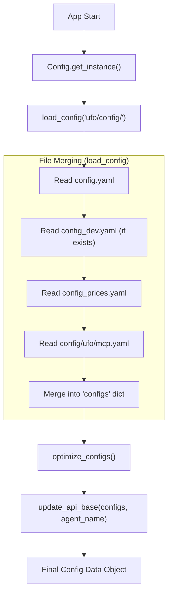

<!-- source: DeepWiki mcp.deepwiki.com · repo microsoft/UFO · page 6.2 Agent Configuration · fetched 2026-10-26 -->

# Agent Configuration

<details>
<summary>Relevant source files</summary>

The following files were used as context for generating this wiki page:

- [config/galaxy/agent.yaml.template](config/galaxy/agent.yaml.template)
- [documents/docs/configuration/system/agents_config.md](documents/docs/configuration/system/agents_config.md)
- [documents/docs/configuration/system/extending.md](documents/docs/configuration/system/extending.md)
- [documents/docs/configuration/system/galaxy_agent.md](documents/docs/configuration/system/galaxy_agent.md)
- [documents/docs/configuration/system/galaxy_constellation.md](documents/docs/configuration/system/galaxy_constellation.md)
- [documents/docs/configuration/system/mcp_reference.md](documents/docs/configuration/system/mcp_reference.md)
- [documents/docs/configuration/system/migration.md](documents/docs/configuration/system/migration.md)
- [documents/docs/configuration/system/overview.md](documents/docs/configuration/system/overview.md)
- [documents/docs/configuration/system/prices_config.md](documents/docs/configuration/system/prices_config.md)
- [documents/docs/configuration/system/rag_config.md](documents/docs/configuration/system/rag_config.md)
- [documents/docs/configuration/system/system_config.md](documents/docs/configuration/system/system_config.md)
- [documents/docs/configuration/system/third_party_config.md](documents/docs/configuration/system/third_party_config.md)
- [documents/docs/galaxy/agent_registration/agent_profile.md](documents/docs/galaxy/agent_registration/agent_profile.md)
- [documents/docs/galaxy/agent_registration/device_registry.md](documents/docs/galaxy/agent_registration/device_registry.md)
- [documents/docs/galaxy/agent_registration/overview.md](documents/docs/galaxy/agent_registration/overview.md)
- [documents/docs/galaxy/agent_registration/registration_flow.md](documents/docs/galaxy/agent_registration/registration_flow.md)
- [tests/image.png](tests/image.png)
- [ufo/client/computer.py](ufo/client/computer.py)
- [ufo/config/__init__.py](ufo/config/__init__.py)

</details>


## Purpose and Scope

This page documents the agent-specific LLM configuration system in UFO. It covers how different agent types (HOST, APP, BACKUP, EVALUATION, CONSTELLATION) are routed to their respective configuration files, the configuration hierarchy that allows agent-level settings to override system-level defaults, and the management of sensitive API credentials.

For information about the overall configuration file structure and locations, see [Configuration Files Structure](#6.1). For details on LLM provider implementations and service factory patterns, see [LLM Service Architecture](#7.1).

## Configuration Architecture Overview

The UFO system uses a **per-agent configuration model** where each agent type can be configured with its own LLM provider, model, and parameters. This allows cost optimization (e.g., expensive GPT-4 for planning, cheaper models for routine tasks) and provider flexibility (e.g., local Ollama for development, cloud APIs for production).

The configuration system implements a modular architecture where configurations are split into domain-specific YAML files:
1. **Agent-level settings** - Defined in `agents.yaml` (UFO²) or `agent.yaml` (Galaxy).
2. **System-level settings** - Defined in `system.yaml`, providing defaults for all agents.
3. **Knowledge settings** - Defined in `rag.yaml` for retrieval augmentation.
4. **Tooling settings** - Defined in `mcp.yaml` for Model Context Protocol servers.

### Agent Configuration Routing Diagram

This diagram shows how the `ConfigLoader` and `get_ufo_config` mechanism associates logical agent types with specific code entities and configuration files.

```mermaid
graph TB
    subgraph "Agent Types (Logical)"
        HOST["HOST_AGENT"]
        APP["APP_AGENT"]
        BACKUP["BACKUP_AGENT"]
        EVAL["EVALUATION_AGENT"]
        OPERATOR["OPERATOR"]
        CONSTELLATION["CONSTELLATION_AGENT"]
    end
    
    subgraph "Code Entities (config_loader.py)"
        UFOConfig["UFOConfig Class"]
        GalaxyConfig["GalaxyConfig Class"]
        AgentConfig["AgentConfig (Dataclass)"]
    end

    subgraph "Configuration Files"
        UFOAgentsYAML["config/ufo/agents.yaml"]
        GalaxyAgentYAML["config/galaxy/agent.yaml"]
        UFOSystemYAML["config/ufo/system.yaml"]
        GalaxyConstYAML["config/galaxy/constellation.yaml"]
    end
    
    HOST -->|mapped to| AgentConfig
    APP -->|mapped to| AgentConfig
    CONSTELLATION -->|mapped to| AgentConfig
    
    UFOConfig -->|contains| AgentConfig
    UFOConfig -.->|loads from| UFOAgentsYAML
    UFOConfig -.->|loads from| UFOSystemYAML
    
    GalaxyConfig -->|contains| AgentConfig
    GalaxyConfig -.->|loads from| GalaxyAgentYAML
    GalaxyConfig -.->|loads from| GalaxyConstYAML
```



**Sources:** [ufo/config/__init__.py:14-81](), [documents/docs/configuration/system/agents_config.md:1-10](), [documents/docs/configuration/system/galaxy_agent.md:1-20]()

## Agent Types and Configuration Routing

The configuration system routes agent types to their appropriate configuration sources via the `Config` singleton and the newer `ConfigLoader`.

### UFO² Agents (config/ufo/agents.yaml)

| Agent Type | Config Attribute | Purpose | Recommended Model |
|------------|-----------------|---------|-------------------|
| `HOST_AGENT` | `config.host_agent` | Task planning, app coordination | GPT-4o |
| `APP_AGENT` | `config.app_agent` | Action execution, UI interaction | GPT-4o-mini |
| `BACKUP_AGENT` | `config.backup_agent` | Fallback when others fail | GPT-4o |
| `EVALUATION_AGENT` | `config.evaluation_agent` | Task completion evaluation | GPT-4o |
| `OPERATOR` | `config.operator` | CUA-based automation | computer-use-preview |

**Sources:** [documents/docs/configuration/system/agents_config.md:109-126](), [ufo/config/__init__.py:119-132]()

### Galaxy Agents (config/galaxy/agent.yaml)

| Agent Type | Config Attribute | Purpose |
|------------|-----------------|---------|
| `CONSTELLATION_AGENT` | `config.constellation_agent` | Multi-device task decomposition and editing |

**Sources:** [documents/docs/configuration/system/galaxy_agent.md:1-15](), [config/galaxy/agent.yaml.template:1-3]()

## Configuration Structure

### Agent-Level Configuration Schema

The `agents.yaml` schema defines how individual agents connect to LLM providers.

| Field | Type | Description |
|-------|------|-------------|
| `VISUAL_MODE` | Boolean | Enable vision capabilities (screenshot understanding) |
| `REASONING_MODEL` | Boolean | Whether the model is a reasoning model (e.g., o1, o3) |
| `API_TYPE` | String | Provider type: `openai`, `aoai`, `azure_ad`, `gemini`, `claude`, `qwen`, `ollama` |
| `API_BASE` | String | API endpoint URL |
| `API_KEY` | String | API authentication key |
| `API_MODEL` | String | Model identifier (e.g., `gpt-4o`) |
| `API_DEPLOYMENT_ID` | String | Azure deployment name (required for `aoai`) |

**Sources:** [documents/docs/configuration/system/agents_config.md:135-163](), [config/galaxy/agent.yaml.template:3-14]()

### System and Runtime Configuration

System-wide settings apply to the environment and execution limits:

| Field | File | Description |
|-------|------|-------------|
| `MAX_STEP` | `system.yaml` | Maximum steps allowed per session |
| `MAX_RETRY` | `system.yaml` | Max LLM API retry attempts |
| `CONTROL_BACKEND` | `system.yaml` | UI automation backend (UIA/Win32) |
| `HEARTBEAT_INTERVAL` | `constellation.yaml` | Galaxy device health check interval |

**Sources:** [documents/docs/configuration/system/galaxy_constellation.md:85-103](), [ufo/config/__init__.py:129-131]()

## Configuration Loading Mechanism

The `Config` class and `get_config()` function handle the merging of YAML files and environment variables.

### Implementation Flow: get_agent_config

This diagram illustrates the code flow from the `Config` singleton to the initialization of an agent's specific environment.



**Sources:** [ufo/config/__init__.py:14-81](), [ufo/config/__init__.py:119-132](), [ufo/config/__init__.py:161-167]()

## API Credential Management

### Sensitive Data Protection

UFO uses a template-based approach to protect secrets. Users must copy `.template` files to actual `.yaml` files, which are excluded from Git.

| File Pattern | Status | Contains |
|--------------|--------|----------|
| `config/ufo/agents.yaml` | **Ignored** | Sensitive API keys for UFO² agents |
| `config/galaxy/agent.yaml` | **Ignored** | Sensitive API keys for Galaxy |
| `*.template` | **Tracked** | Example structures for users to fill |

**Sources:** [documents/docs/configuration/system/agents_config.md:11-21](), [documents/docs/configuration/system/galaxy_agent.md:54-58]()

### Cost and Pricing Management

The `prices.yaml` file allows the system to estimate the cost of task execution by mapping models to their token rates.

```yaml
# config/ufo/prices.yaml
gpt-4o:
  prompt: 0.0025      # USD per 1K tokens
  completion: 0.01    # USD per 1K tokens
```

**Sources:** [documents/docs/configuration/system/prices_config.md:27-39](), [ufo/config/__init__.py:59-62]()

## MCP Tool Configuration

Agents can be configured with specific Model Context Protocol (MCP) servers for data collection and action execution.

| Agent | Server Type | Example Namespace | Purpose |
|-------|-------------|-------------------|---------|
| `HostAgent` | `local` | `UICollector` | Inspect system UI |
| `AppAgent` | `local` | `WordCOMExecutor` | Control Word via COM |
| `LinuxAgent` | `http` | `BashExecutor` | Execute CLI commands |

**Sources:** [documents/docs/configuration/system/mcp_reference.md:89-118](), [ufo/client/computer.py:111-154]()

## Migration from Legacy Configuration

UFO has transitioned from a monolithic `ufo/config/config.yaml` to a modular structure in `config/ufo/`.

| Feature | Legacy (`ufo/config/`) | New (`config/ufo/`) |
|---------|----------------------|-------------------|
| **Structure** | Monolithic YAML | Modular domain files |
| **Access** | Dictionary only | Typed Dataclasses |
| **Location** | `ufo/config/` | `config/ufo/` |

**Sources:** [documents/docs/configuration/system/migration.md:1-19](), [ufo/config/__init__.py:64-75]()

---

**Key Takeaways:**

1. **Modular YAMLs**: Configurations are separated by concern (agents, system, RAG, MCP, prices).
2. **Environment Overrides**: `config_dev.yaml` can override base settings for local development.
3. **Azure Integration**: Special handling for `aoai` and `azure_ad` API types, including automated endpoint construction.
4. **Agent Specialization**: Each agent (Host, App, Evaluation) can use a different model to balance cost and performance.
5. **Secret Safety**: Always use `.template` files as a base and never commit files containing `API_KEY`.

**Sources:** [ufo/config/__init__.py:1-167](), [documents/docs/configuration/system/agents_config.md:1-126](), [documents/docs/configuration/system/migration.md:1-50]()

---

