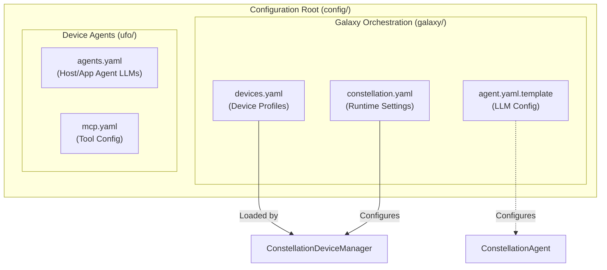
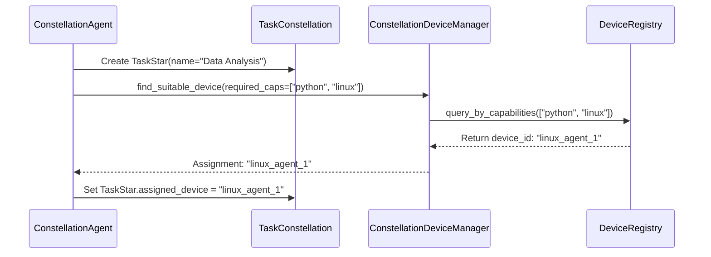
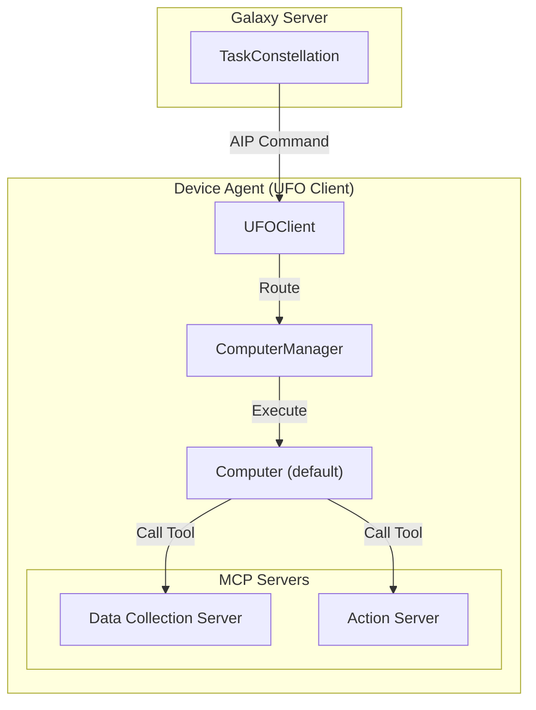

<!-- source: DeepWiki mcp.deepwiki.com · repo microsoft/UFO · page 6.3 Device and Galaxy Configuration · fetched 2026-10-26 -->

# Device and Galaxy Configuration

<details>
<summary>Relevant source files</summary>

The following files were used as context for generating this wiki page:

- [.gitignore](.gitignore)
- [aip/endpoints/base.py](aip/endpoints/base.py)
- [aip/endpoints/client_endpoint.py](aip/endpoints/client_endpoint.py)
- [aip/messages.py](aip/messages.py)
- [aip/protocol/base.py](aip/protocol/base.py)
- [aip/protocol/heartbeat.py](aip/protocol/heartbeat.py)
- [aip/transport/adapters.py](aip/transport/adapters.py)
- [aip/transport/base.py](aip/transport/base.py)
- [aip/transport/websocket.py](aip/transport/websocket.py)
- [assets/ufo.png](assets/ufo.png)
- [config/galaxy/constellation.yaml](config/galaxy/constellation.yaml)
- [config/galaxy/devices.yaml](config/galaxy/devices.yaml)
- [config/ufo/mcp.yaml](config/ufo/mcp.yaml)
- [config/ufo/prices.yaml](config/ufo/prices.yaml)
- [config/ufo/third_party.yaml](config/ufo/third_party.yaml)
- [documents/docs/client/computer.md](documents/docs/client/computer.md)
- [documents/docs/client/computer_manager.md](documents/docs/client/computer_manager.md)
- [documents/docs/client/device_info.md](documents/docs/client/device_info.md)
- [documents/docs/client/mcp_integration.md](documents/docs/client/mcp_integration.md)
- [documents/docs/client/overview.md](documents/docs/client/overview.md)
- [documents/docs/client/quick_start.md](documents/docs/client/quick_start.md)
- [documents/docs/client/ufo_client.md](documents/docs/client/ufo_client.md)
- [documents/docs/client/websocket_client.md](documents/docs/client/websocket_client.md)
- [documents/docs/configuration/system/galaxy_devices.md](documents/docs/configuration/system/galaxy_devices.md)
- [documents/docs/getting_started/quick_start_mobile.md](documents/docs/getting_started/quick_start_mobile.md)
- [documents/docs/server/api.md](documents/docs/server/api.md)
- [tests/aip/test_binary_transfer.py](tests/aip/test_binary_transfer.py)
- [tests/debug_observer_output.py](tests/debug_observer_output.py)

</details>


This page documents the configuration system for UFO³ Galaxy's multi-device orchestration, focusing on the device profile schema (`devices.yaml`), Galaxy-level settings (`constellation.yaml`), and the coordination between the ConstellationAgent and device assignments. These configurations enable the system to manage device identities, capabilities, and connection parameters for cross-platform task execution.

---

## Configuration Directory Structure

Galaxy configurations are located in the `config/galaxy/` directory. This separates the multi-device orchestration logic from the single-device agent configurations found in `config/ufo/`.



**Key Files:**
- **`devices.yaml`**: Defines individual device agents, their identities, and capabilities [[documents/docs/configuration/system/galaxy_devices.md:3-15]]().
- **`constellation.yaml`**: Defines constellation-wide runtime settings like heartbeat intervals and reconnect delays [[documents/docs/configuration/system/galaxy_devices.md:19-20]]().
- **`agent.yaml`**: Configures the LLM for the `ConstellationAgent` responsible for DAG generation.

Sources: [documents/docs/configuration/system/galaxy_devices.md:40-51](), [.gitignore:64-72]()

---

## Device Profile Schema

The `devices.yaml` file defines the `devices` array. Each entry represents a device agent that the `ConstellationDeviceManager` will attempt to register and connect to via the Agent Interaction Protocol (AIP).

### Data Flow: Registration to Profile

```mermaid
graph LR
    A["devices.yaml"] -->|"Load"| B["ConstellationDeviceManager"]
    B -->|"Parse"| C["Device Entries"]
    C -->|"For Each Device"| D["DeviceRegistry.register_device"]
    D -->|"Create"| E["AgentProfile"]
    E -->|"auto_connect=true"| F["Connection Process (AIP)"]
    F -->|"Update Status"| G["Active AgentProfile"]
```


### Schema Fields

| Field | Type | Required | Description |
|-------|------|----------|-------------|
| `device_id` | `string` | ✅ | Unique identifier (e.g., `"linux_agent_1"`) [[documents/docs/configuration/system/galaxy_devices.md:116-116]](). |
| `server_url` | `string` | ✅ | WebSocket endpoint URL (e.g., `"ws://localhost:5001/ws"`) [[documents/docs/configuration/system/galaxy_devices.md:117-117]](). |
| `os` | `string` | ❌ | Operating system type: `"windows"`, `"linux"`, `"darwin"` [[documents/docs/configuration/system/galaxy_devices.md:126-126]](). |
| `capabilities` | `list[string]` | ❌ | List of functional tags (e.g., `["web_browsing", "server"]`) [[documents/docs/configuration/system/galaxy_devices.md:127-127]](). |
| `metadata` | `dict` | ❌ | Custom key-value pairs for application-specific logic [[documents/docs/configuration/system/galaxy_devices.md:139-141]](). |
| `max_retries` | `int` | ❌ | Connection retry limit (Default: 5) [[documents/docs/configuration/system/galaxy_devices.md:129-129]](). |
| `auto_connect` | `bool` | ❌ | If true, connects immediately upon registration [[documents/docs/configuration/system/galaxy_devices.md:130-130]](). |

Sources: [documents/docs/configuration/system/galaxy_devices.md:89-130](), [config/galaxy/devices.yaml:28-41]()

---

## Galaxy Configuration and Device Assignment

### Constellation Runtime Settings
The `constellation.yaml` file controls the behavior of the `ConstellationDeviceManager` and the `TaskConstellationOrchestrator`.

```python
# Logic used in ConstellationDeviceManager initialization
manager = ConstellationDeviceManager(
    task_name=constellation_config.get("CONSTELLATION_ID", "default"),
    heartbeat_interval=constellation_config.get("HEARTBEAT_INTERVAL", 30.0),
    reconnect_delay=constellation_config.get("RECONNECT_DELAY", 5.0)
)
```
Sources: [documents/docs/configuration/system/galaxy_devices.md:68-72]()

### Device Assignment in TaskConstellation
In UFO³ Galaxy, tasks are represented as `TaskStar` nodes within a `TaskConstellation` DAG. Device assignment happens based on the `capabilities` defined in `devices.yaml`.



Sources: [tests/debug_observer_output.py:28-45](), [documents/docs/configuration/system/galaxy_devices.md:26-31]()

---

## Implementation Details: Device Management

### The `ConstellationDeviceManager`
The `ConstellationDeviceManager` is the central hub for device lifecycle. It uses several sub-components to manage the state of the Galaxy:

1.  **`DeviceRegistry`**: Stores `AgentProfile` objects created from `devices.yaml`.
2.  **`ConnectionManager`**: Manages the `WebSocketTransport` for each device.
3.  **`HeartbeatManager`**: Sends periodic pings to ensure devices are still online.

### Connection Protocol (AIP)
Devices communicate with the Galaxy server using the **Agent Interaction Protocol (AIP)**. The `AIPProtocol` class handles serialization via `Pydantic` models and routes messages through a `middleware_chain`.

```python
# aip/protocol/base.py
async def send_message(self, msg: Any) -> None:
    # Apply outgoing middleware
    for middleware in self.middleware_chain:
        msg = await middleware.process_outgoing(msg)
    # Serialize Pydantic model
    serialized = msg.model_dump_json().encode("utf-8")
    await self.transport.send(serialized)
```

Sources: [aip/protocol/base.py:22-50](), [aip/protocol/base.py:52-81](), [documents/docs/client/overview.md:101-110]()

---

## Configuration Examples

### Linux Agent with Metadata
Metadata allows the Galaxy to pass environment-specific paths to the agent during task execution.

```yaml
# config/galaxy/devices.yaml
- device_id: "linux_agent_1"
  server_url: "ws://localhost:5001/ws"
  os: "linux"
  capabilities:
    - "server"
  metadata:
    os: "linux"
    performance: "medium"
    logs_file_path: "/root/log/log1.txt"
    dev_path: "/root/dev1/"
    warning_log_pattern: "WARN"
    error_log_pattern: "ERROR or FATAL"
  auto_connect: true
```
Sources: [config/galaxy/devices.yaml:28-41]()

### Windows Agent with App Metadata
```yaml
# documents/docs/configuration/system/galaxy_devices.md example
- device_id: "windowsagent"
  capabilities:
    - "web_browsing"
    - "office_applications"
  metadata:
    location: "office_desktop"
    app_log_file: "automation_log.xlsx"
    sheet_name_for_writing_log_in_excel: "report"
```
Sources: [documents/docs/configuration/system/galaxy_devices.md:191-208]()

---

## Device and Tooling Integration

Devices in the Galaxy are not just connection points; they are execution environments managed by a `ComputerManager`. Each device agent initializes its own `Computer` instances which host **MCP (Model Context Protocol)** servers.



Sources: [documents/docs/client/overview.md:67-99](), [documents/docs/client/mcp_integration.md:19-41](), [documents/docs/client/computer_manager.md:36-67]()

---

