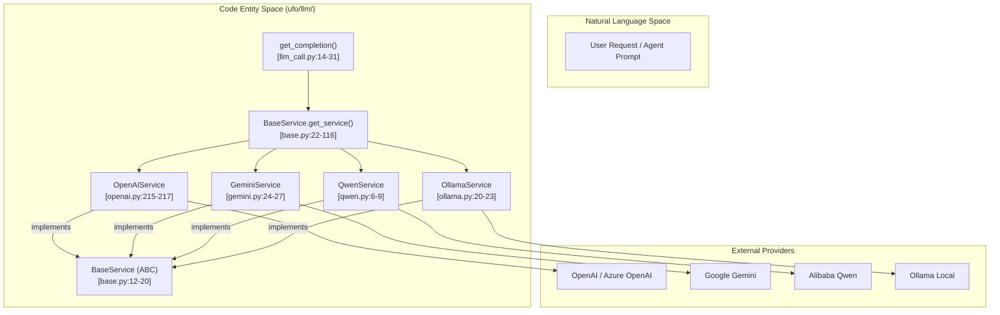
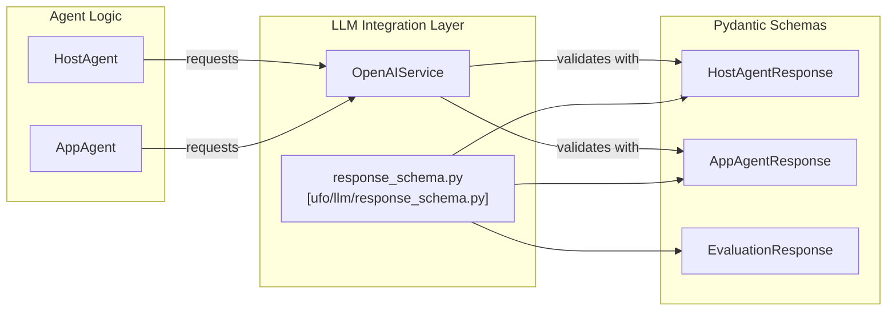

<!-- source: DeepWiki mcp.deepwiki.com · repo microsoft/UFO · page 7 LLM Integration · fetched 2026-10-26 -->

# LLM Integration

Relevant source files

The following files were used as context for generating this wiki page:

- [dataflow/config/config.py](dataflow/config/config.py)
- [learner/README.md](learner/README.md)
- [learner/doc_example/ppt-copilot.xml](learner/doc_example/ppt-copilot.xml)
- [learner/doc_example/ppt-copilot.xml.meta](learner/doc_example/ppt-copilot.xml.meta)
- [model_worker/README.md](model_worker/README.md)
- [requirements.txt](requirements.txt)
- [ufo/__main__.py](ufo/__main__.py)
- [ufo/llm/base.py](ufo/llm/base.py)
- [ufo/llm/config_helper.py](ufo/llm/config_helper.py)
- [ufo/llm/gemini.py](ufo/llm/gemini.py)
- [ufo/llm/llm_call.py](ufo/llm/llm_call.py)
- [ufo/llm/ollama.py](ufo/llm/ollama.py)
- [ufo/llm/openai.py](ufo/llm/openai.py)
- [ufo/llm/placeholder.py](ufo/llm/placeholder.py)
- [ufo/llm/qwen.py](ufo/llm/qwen.py)
- [ufo/rag/retriever.py](ufo/rag/retriever.py)
- [ufo/ufo.py](ufo/ufo.py)

UFO's LLM integration layer provides a provider-agnostic abstraction for interacting with language models. The system implements a factory pattern (`BaseService.get_service()`) that dynamically instantiates provider-specific implementations based on configuration. All providers implement the `BaseService` abstract interface, exposing a unified `chat_completion()` method regardless of underlying API differences.

Key architectural principles:
- **Provider Abstraction**: `BaseService` abstract class defines the interface; concrete implementations (`OpenAIService`, `GeminiService`, etc.) handle provider-specific details. [ufo/llm/base.py:12-20]()
- **Configuration-Driven Selection**: Agent type determines which configuration section to load from `config/ufo/agents.yaml` or `config/galaxy/agent.yaml`. [ufo/llm/config_helper.py:13-69]()
- **Factory Pattern**: `BaseService.get_service(api_type, agent_type, model_name)` dynamically imports and instantiates the appropriate service class. [ufo/llm/base.py:22-116]()
- **Cost Tracking**: Unified `get_cost_estimator()` method calculates token usage costs across all providers using `config/ufo/prices.yaml`. [ufo/llm/base.py:118-158]()
- **Backup Mechanism**: Automatic failover to `BACKUP_AGENT` configuration when primary service fails. [ufo/llm/llm_call.py:99-111]()

For details on how agents consume these services, see page 3 (UFO² Desktop AgentOS). For configuration file structure, see page 6 (Configuration System).

## Service Architecture

The architecture separates the high-level request from the low-level provider implementation. The `llm_call.py` module acts as the entry point for agents, while `BaseService` manages the concrete provider lifecycle.

### LLM Service Hierarchy

Sources: [ufo/llm/llm_call.py:14-31](), [ufo/llm/base.py:12-116](), [ufo/llm/openai.py:215-217](), [ufo/llm/gemini.py:24-27]()

### LLM Service Architecture
This section details the `BaseService` abstract interface, the `get_service` factory method, and the dynamic module importing system that allows UFO to support diverse LLM backends without hard-coding dependencies.
For details, see [LLM Service Architecture](#7.1).

## Supported LLM Providers

UFO includes native support for major LLM providers. Each implementation handles specific authentication flows (like Azure AD or API Keys), retry logic with exponential backoff, and specific API endpoint configurations.

| Provider | Implementation Class | API Type Key | File |
| :--- | :--- | :--- | :--- |
| **OpenAI** | `OpenAIService` | `openai`, `aoai`, `azure_ad` | [ufo/llm/openai.py:215-217]() |
| **Gemini** | `GeminiService` | `gemini` | [ufo/llm/gemini.py:24-27]() |
| **Qwen** | `QwenService` | `qwen` | [ufo/llm/qwen.py:6-9]() |
| **Ollama** | `OllamaService` | `ollama` | [ufo/llm/ollama.py:20-23]() |
| **Operator** | `OperatorServicePreview` | `operator` | [ufo/llm/openai.py:479-481]() |

For details, see [Supported LLM Providers](#7.2).

## Structured Output and Response Formats

UFO relies on structured JSON responses to drive its agent logic. The system uses Pydantic schemas to define the expected format for different agent types and attempts to use native "JSON Schema" or "Structured Output" modes provided by LLM vendors.

**Response Flow to Code Entities**

Sources: [ufo/llm/openai.py:137-149](), [ufo/llm/gemini.py:89-95]()

For details, see [Structured Output and Response Formats](#7.3).

## Custom Model Integration

UFO is designed to be extensible. Users can integrate custom LLMs (such as local LLaVA or CogAgent models) by implementing a new `BaseService` subclass and registering it within the factory map. This allows the use of fine-tuned models or specialized local inference servers.

**Integration Requirements:**
1. Inherit from `BaseService`. [ufo/llm/base.py:12-20]()
2. Implement `__init__` to handle custom endpoints (`API_BASE`). [ufo/llm/base.py:14-15]()
3. Implement `chat_completion` to handle the specific model's request/response format. [ufo/llm/base.py:17-19]()
4. Add the model to the `service_map` or `custom_service_map` in `BaseService.get_service()`. [ufo/llm/base.py:33-49]()

For details, see [Custom Model Integration](#7.4).

## Cost Estimation Mechanisms

The `BaseService` class provides a concrete implementation of `get_cost_estimator`. It uses a pricing dictionary (typically loaded from `config/ufo/prices.yaml`) to calculate the cost of a request based on `prompt_tokens` and `completion_tokens`.

- **Calculation Formula**: `(prompt_tokens * input_price / 1000) + (completion_tokens * output_price / 1000)`. [ufo/llm/base.py:152-155]()
- **Provider Mapping**: The system maps provider-specific model names to pricing keys (e.g., `openai/gpt-4o`, `azure/gpt-4o`, `gemini/gemini-1.5-pro`). [ufo/llm/base.py:136-150]()

Sources: [ufo/llm/base.py:118-158]()

---

