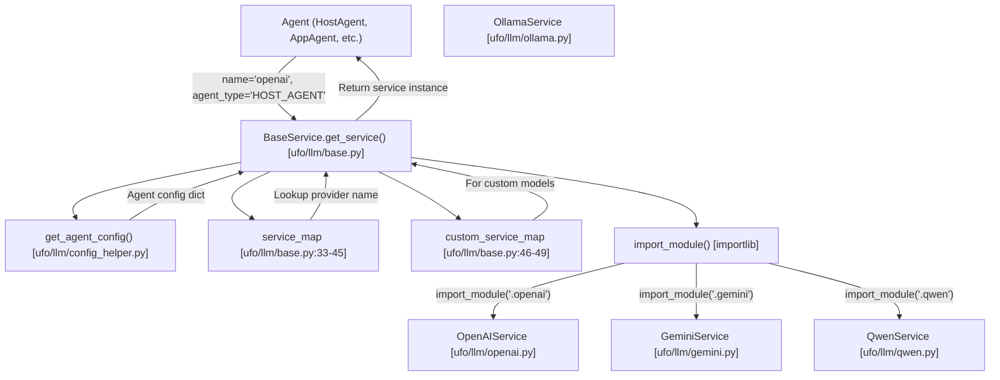
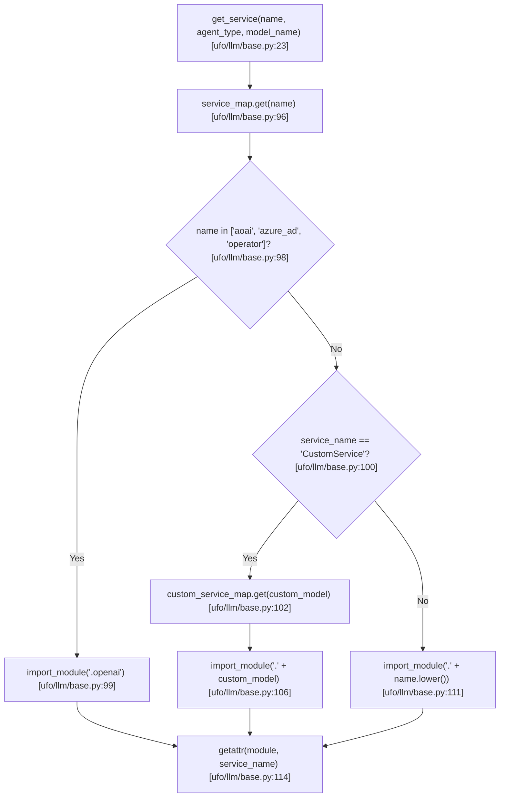
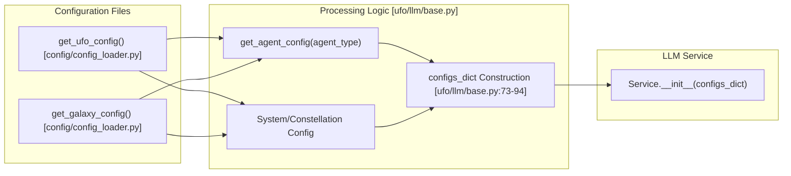
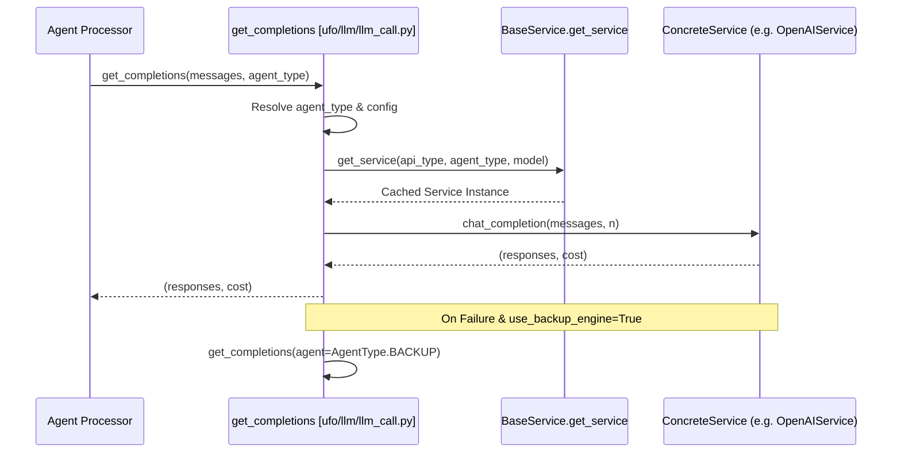

<!-- source: DeepWiki mcp.deepwiki.com · repo microsoft/UFO · page 7.1 LLM Service Architecture · fetched 2026-10-26 -->

# LLM Service Architecture

<details>
<summary>Relevant source files</summary>

The following files were used as context for generating this wiki page:

- [learner/README.md](learner/README.md)
- [learner/doc_example/ppt-copilot.xml](learner/doc_example/ppt-copilot.xml)
- [learner/doc_example/ppt-copilot.xml.meta](learner/doc_example/ppt-copilot.xml.meta)
- [model_worker/README.md](model_worker/README.md)
- [requirements.txt](requirements.txt)
- [ufo/__main__.py](ufo/__main__.py)
- [ufo/llm/base.py](ufo/llm/base.py)
- [ufo/llm/config_helper.py](ufo/llm/config_helper.py)
- [ufo/llm/gemini.py](ufo/llm/gemini.py)
- [ufo/llm/llm_call.py](ufo/llm/llm_call.py)
- [ufo/llm/ollama.py](ufo/llm/ollama.py)
- [ufo/llm/openai.py](ufo/llm/openai.py)
- [ufo/llm/placeholder.py](ufo/llm/placeholder.py)
- [ufo/llm/qwen.py](ufo/llm/qwen.py)
- [ufo/rag/retriever.py](ufo/rag/retriever.py)
- [ufo/ufo.py](ufo/ufo.py)

</details>


## Purpose and Scope

This document describes the LLM service architecture in UFO, which provides a unified abstraction layer for interacting with multiple LLM providers. The architecture is centered around the `BaseService` abstract class and a factory pattern that enables dynamic selection and instantiation of provider-specific implementations. This page focuses on the architectural patterns, service factory mechanism, configuration system integration, and cost estimation infrastructure.

For details on specific LLM provider implementations and their authentication mechanisms, see [7.2 Supported LLM Providers](). For information on structured output schemas and response parsing, see [7.3 Structured Output and Response Formats](). For guidance on adding custom LLM integrations, see [7.4 Custom Model Integration]().

---

## BaseService Abstract Interface

The `BaseService` class defines the contract that all LLM service implementations must fulfill. It provides two abstract methods and a static factory method for service instantiation.

### Abstract Methods

**Constructor:**
[ufo/llm/base.py:13-15]()
```python
@abc.abstractmethod
def __init__(self, *args, **kwargs):
    pass
```

All concrete service implementations must define an `__init__` method that:
- Accepts a `config` dictionary containing agent-specific and system-wide configuration [ufo/llm/base.py:114]()
- Accepts an `agent_type` string identifying which agent is requesting the service [ufo/llm/base.py:24]()
- Initializes provider-specific clients, API keys, endpoints, and retry parameters [ufo/llm/openai.py:32-60]()

**Chat Completion:**
[ufo/llm/base.py:17-19]()
```python
@abc.abstractmethod
def chat_completion(self, *args, **kwargs):
    pass
```

The `chat_completion` method is the primary interface for generating LLM responses. Implementations must:
- Accept a `messages` list in OpenAI chat format [ufo/llm/openai.py:93-95]()
- Support parameters like `temperature`, `max_tokens`, `top_p`, and `n` [ufo/llm/gemini.py:47-54]()
- Return a tuple of `(response_list, cost_estimate)` [ufo/llm/openai.py:101-111]()
- Handle retries, rate limiting, and error recovery [ufo/llm/gemini.py:87-127]()
- Support both text and image inputs for multimodal models [ufo/llm/gemini.py:130-157]()

### Cost Estimation

The base class provides a shared cost estimation utility:
[ufo/llm/base.py:118-158]()

```python
def get_cost_estimator(
    self,
    api_type: str,
    model: str,
    prices: Dict[str, float],
    prompt_tokens: int,
    completion_tokens: int,
) -> float
```

This method:
- Maps provider-specific model names to standardized keys in the pricing configuration (e.g., `azure/model` or `openai/model`) [ufo/llm/base.py:136-150]()
- Calculates cost based on input and output token counts [ufo/llm/base.py:152-155]()
- Returns 0 for models without pricing information [ufo/llm/base.py:157]()

**Sources:** [ufo/llm/base.py:12-159](), [ufo/llm/openai.py:28-111](), [ufo/llm/gemini.py:47-157]()

---

## Service Factory Pattern

The `get_service` static method implements a factory pattern that dynamically instantiates the appropriate service implementation based on configuration.

### LLM Service Entity Mapping
The following diagram bridges the high-level request to the specific code entities responsible for LLM interaction.



### Service Mapping Tables

The factory maintains two mapping dictionaries: [ufo/llm/base.py:33-49]()

**service_map** (Standard Providers):
| Key | Service Class | Module |
|-----|--------------|--------|
| `"openai"`, `"aoai"`, `"azure_ad"` | `OpenAIService` | `ufo.llm.openai` |
| `"qwen"` | `QwenService` | `ufo.llm.qwen` |
| `"deepseek"` | `DeepSeekService` | `ufo.llm.deepseek` |
| `"ollama"` | `OllamaService` | `ufo.llm.ollama` |
| `"gemini"` | `GeminiService` | `ufo.llm.gemini` |
| `"claude"` | `ClaudeService` | `ufo.llm.claude` |
| `"operator"` | `OperatorServicePreview` | `ufo.llm.openai` |
| `"placeholder"` | `PlaceHolderService` | `ufo.llm.placeholder` |

**custom_service_map** (Custom Models):
| Key | Service Class | Module |
|-----|--------------|--------|
| `"llava"` | `LlavaService` | `ufo.llm.llava` |
| `"cogagent"` | `CogAgentService` | `ufo.llm.cogagent` |

**Sources:** [ufo/llm/base.py:22-117](), [ufo/llm/openai.py:15-22](), [ufo/llm/qwen.py:6-9](), [ufo/llm/ollama.py:20-23]()

---

## Dynamic Module Loading

The factory implements dynamic module loading using Python's `importlib.import_module` [ufo/llm/base.py:5]().



### Module Import Logic

The factory applies special rules for certain providers:

1. **Azure OpenAI Variants**: `aoai`, `azure_ad`, and `operator` all map to the `openai` module [ufo/llm/base.py:98-99]().
2. **Custom Models**: If `service_name == "CustomService"`, the factory extracts the model name (e.g., `llava`) and looks up the custom service class in `custom_service_map` [ufo/llm/base.py:100-109]().
3. **Standard Providers**: Imports the module named after the provider (e.g., `gemini`, `qwen`, `ollama`) [ufo/llm/base.py:111]().

**Sources:** [ufo/llm/base.py:96-116]()

---

## Configuration System Integration

The service factory integrates with UFO's modular configuration system through `get_agent_config` [ufo/llm/base.py:52]().

### Configuration Data Flow
This diagram shows how system configurations from YAML files are transformed into the `configs_dict` used by LLM services.



### Configuration Structure

The factory constructs a `configs_dict` with two levels: [ufo/llm/base.py:73-94]()

1. **Agent-Specific Configuration** (keyed by `agent_type`): Contains `API_TYPE`, `API_KEY`, `API_MODEL`, and `API_BASE` [ufo/llm/base.py:74]().
2. **System-Wide Configuration** (top-level keys):
   - `MAX_RETRY`: Default 20 [ufo/llm/base.py:76-78]().
   - `TIMEOUT`: Default 60 [ufo/llm/base.py:79-81]().
   - `PRICES`: Token pricing dictionary [ufo/llm/base.py:82-84]().
   - `TEMPERATURE`, `TOP_P`, `MAX_TOKENS`: Generation parameters [ufo/llm/base.py:85-93]().

**Sources:** [ufo/llm/base.py:51-95](), [ufo/llm/config_helper.py:13-93]()

---

## Service Lifecycle and Execution Flow

The `get_completions` function in `ufo/llm/llm_call.py` acts as the entry point for agents to request LLM outputs.

1. **Agent Request**: An agent (Host/App) calls `get_completions(messages, agent=AgentType.APP)` [ufo/llm/llm_call.py:34-40]().
2. **Agent Type Resolution**: The function determines the correct `agent_type` and fetches its config [ufo/llm/llm_call.py:51-90]().
3. **Service Retrieval**: It calls `BaseService.get_service(api_type, agent_type, api_model)` [ufo/llm/llm_call.py:93]().
4. **Completion Execution**: The service's `chat_completion` method is invoked [ufo/llm/llm_call.py:95]().
5. **Backup Logic**: If the primary API request fails, it automatically switches to the `BACKUP` agent if `use_backup_engine` is enabled [ufo/llm/llm_call.py:100-109]().

### LLM Call Flow Diagram



**Sources:** [ufo/llm/llm_call.py:14-111](), [ufo/llm/base.py:22-117]()

---

## Supported LLM Implementations

Concrete service classes inherit from `BaseService` or intermediate base classes.

| Service Class | Base Class | Special Behavior |
|---------------|------------|------------------|
| `OpenAIService` | `BaseOpenAIService` | Supports structured JSON output via Pydantic schemas [ufo/llm/openai.py:137-149](). |
| `GeminiService` | `BaseService` | Uses `google.genai` client and handles base64 image processing [ufo/llm/gemini.py:41, 159-172](). |
| `QwenService` | `BaseOpenAIService` | Forces `stream=True` and text response format for compatibility [ufo/llm/qwen.py:46-54](). |
| `OllamaService` | `BaseOpenAIService` | Routes requests to a local endpoint provided in `API_BASE` [ufo/llm/ollama.py:31-33](). |

**Sources:** [ufo/llm/openai.py:28-60](), [ufo/llm/gemini.py:24-46](), [ufo/llm/qwen.py:6-21](), [ufo/llm/ollama.py:20-34]()

---

