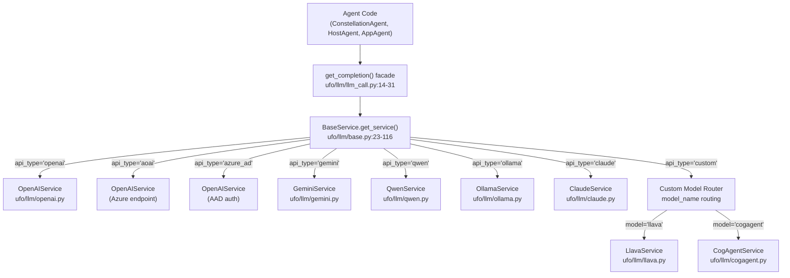
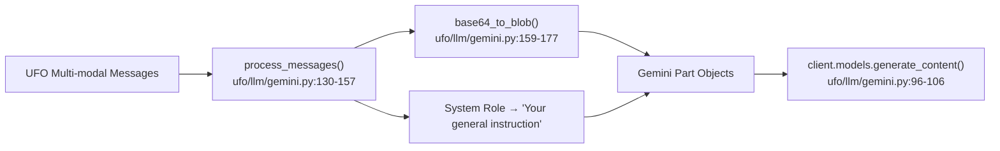

<!-- source: DeepWiki mcp.deepwiki.com · repo microsoft/UFO · page 7.2 Supported LLM Providers · fetched 2026-10-26 -->

# Supported LLM Providers

<details>
<summary>Relevant source files</summary>

The following files were used as context for generating this wiki page:

- [dataflow/config/config.py](dataflow/config/config.py)
- [learner/README.md](learner/README.md)
- [learner/doc_example/ppt-copilot.xml](learner/doc_example/ppt-copilot.xml)
- [learner/doc_example/ppt-copilot.xml.meta](learner/doc_example/ppt-copilot.xml.meta)
- [model_worker/README.md](model_worker/README.md)
- [requirements.txt](requirements.txt)
- [ufo/__main__.py](ufo/__main__.py)
- [ufo/llm/base.py](ufo/llm/base.py)
- [ufo/llm/claude.py](ufo/llm/claude.py)
- [ufo/llm/config_helper.py](ufo/llm/config_helper.py)
- [ufo/llm/gemini.py](ufo/llm/gemini.py)
- [ufo/llm/llm_call.py](ufo/llm/llm_call.py)
- [ufo/llm/ollama.py](ufo/llm/ollama.py)
- [ufo/llm/openai.py](ufo/llm/openai.py)
- [ufo/llm/placeholder.py](ufo/llm/placeholder.py)
- [ufo/llm/qwen.py](ufo/llm/qwen.py)
- [ufo/rag/retriever.py](ufo/rag/retriever.py)
- [ufo/ufo.py](ufo/ufo.py)

</details>


## Purpose and Scope

This document provides a comprehensive reference for all Large Language Model (LLM) providers supported by UFO. It covers the provider abstraction architecture, individual provider implementations, provider-specific features (JSON schema support, vision capabilities, streaming), and configuration requirements. For information about how agents route to specific LLM configurations, see [Agent Configuration](#6.2). For details on the service factory and routing logic, see [LLM Service Architecture](#7.1).

---

## Provider Abstraction Architecture

UFO implements a multi-provider LLM architecture using the Strategy pattern via the `BaseService` abstract class [ufo/llm/base.py:12-20](). This design allows seamless switching between different LLM providers without changing agent code.

### Provider Factory Pattern

The `BaseService.get_service()` factory method routes API type strings to concrete service implementations. It dynamically imports the required modules based on the `service_map` and `custom_service_map` [ufo/llm/base.py:23-116]().



**Sources:** [ufo/llm/base.py:22-116](), [ufo/llm/llm_call.py:14-31](), [model_worker/README.md:1-200]()

---

## Service Mapping and Dynamic Import

The service factory uses two mapping dictionaries for provider routing [ufo/llm/base.py:33-49]():

| API Type | Service Class | Module | Notes |
|----------|--------------|---------|-------|
| `openai` | `OpenAIService` | `ufo.llm.openai` | Standard OpenAI API |
| `aoai` | `OpenAIService` | `ufo.llm.openai` | Azure OpenAI with endpoint |
| `azure_ad` | `OpenAIService` | `ufo.llm.openai` | Azure OpenAI with AAD authentication |
| `qwen` | `QwenService` | `ufo.llm.qwen` | Alibaba Qwen/Tongyi Qianwen |
| `ollama` | `OllamaService` | `ufo.llm.ollama` | Local Ollama server |
| `gemini` | `GeminiService` | `ufo.llm.gemini` | Google Gemini API |
| `claude` | `ClaudeService` | `ufo.llm.claude` | Anthropic Claude |
| `custom` | `CustomService` | Dynamic based on `model_name` | Custom VLMs (LLaVA, CogAgent) |
| `operator` | `OperatorServicePreview` | `ufo.llm.openai` | OpenAI Operator preview |
| `placeholder` | `PlaceHolderService` | `ufo.llm.placeholder` | Template for new providers |

**Sources:** [ufo/llm/base.py:33-49](), [ufo/llm/base.py:96-116]()

---

## OpenAI and Azure OpenAI

### Standard OpenAI Configuration

OpenAI is the primary LLM provider with support for GPT-4, GPT-4o, and other models.

**Configuration in `config/ufo/agents.yaml`:**
```yaml
HOST_AGENT:
  API_TYPE: "openai"
  API_KEY: "YOUR_OPENAI_API_KEY"
  API_MODEL: "gpt-4o"
  API_BASE: "https://api.openai.com/v1"
```

### Azure OpenAI Configuration

Azure OpenAI provides enterprise-grade deployment with two authentication modes [ufo/llm/openai.py:50-60]():

#### Mode 1: API Key Authentication (`aoai`)
```yaml
HOST_AGENT:
  API_TYPE: "aoai"
  API_KEY: "YOUR_AZURE_OPENAI_API_KEY"
  API_MODEL: "gpt-4o"
  API_BASE: "https://YOUR_RESOURCE.openai.azure.com/"
  API_VERSION: "2024-02-15-preview"
```

#### Mode 2: Azure AD Authentication (`azure_ad`)
Azure AD mode uses `azure-identity` for authentication via managed identity or browser-based login. Required packages include `azure-identity` and `azure-identity-broker` [requirements.txt:34-35]().

### OpenAI-Specific Features

| Feature | Support | Implementation |
|---------|---------|----------------|
| JSON Schema | ✓ Yes | `self.client.beta.chat.completions.parse` or `response_format` [ufo/llm/openai.py:68-73]() |
| Streaming | ✓ Yes | `stream=True` with `include_usage` [ufo/llm/openai.py:162-168]() |
| Vision (Images) | ✓ Yes | Multi-modal message format [ufo/llm/openai.py:265-288]() |
| Retry Logic | ✓ Yes | `max_retry` from config [ufo/llm/openai.py:42]() |

**Sources:** [ufo/llm/openai.py:28-170](), [requirements.txt:7, 34-35]()

---

## Google Gemini

### Overview

Gemini provides Google's advanced AI models with strong vision capabilities via the `google-genai` SDK [ufo/llm/gemini.py:9-10]().

### Configuration

```yaml
HOST_AGENT:
  API_TYPE: "gemini"
  API_KEY: "YOUR_GEMINI_API_KEY"
  API_MODEL: "gemini-1.5-pro"
  JSON_SCHEMA: true
```

**Sources:** [model_worker/README.md:4-21](), [ufo/llm/gemini.py:24-46]()

### Gemini Implementation Details

The `GeminiService` class implements specialized message processing to convert UFO's internal multi-modal format into Gemini `Part` objects [ufo/llm/gemini.py:130-157]().



**Rate Limiting and Retry:** Gemini implements exponential backoff with jitter to handle `429` errors [ufo/llm/gemini.py:82-126]().

**Sources:** [ufo/llm/gemini.py:1-246]()

---

## Qwen (Alibaba Tongyi Qianwen)

### Overview

Qwen models from Alibaba Cloud use OpenAI-compatible API endpoints, implemented as a subclass of `BaseOpenAIService` [ufo/llm/qwen.py:6-21]().

### Configuration

```yaml
HOST_AGENT:
  API_TYPE: "qwen"
  API_KEY: "YOUR_DASHSCOPE_API_KEY"
  API_MODEL: "qwen-turbo"
```

### Implementation

The `QwenService` forces `stream=True` as it is required for most Qwen models and sets `response_format={"type": "text"}` due to limited JSON support in some Qwen series [ufo/llm/qwen.py:46-56]().

**Sources:** [ufo/llm/qwen.py:1-57](), [model_worker/README.md:40-56]()

---

## Ollama (Local Models)

### Overview

Ollama enables running open-source LLMs locally with an OpenAI-compatible API [ufo/llm/ollama.py:20-33]().

### Configuration

```yaml
HOST_AGENT:
  API_TYPE: "ollama"
  API_BASE: "http://localhost:11434"
  API_MODEL: "llama3"
```

**Implementation:** `OllamaService` inherits from `BaseOpenAIService` and routes requests to the local endpoint suffix `/v1` [ufo/llm/ollama.py:33]().

**Sources:** [ufo/llm/ollama.py:1-65](), [model_worker/README.md:58-86]()

---

## Claude (Anthropic)

### Configuration

```yaml
HOST_AGENT:
  API_TYPE: "claude"
  API_KEY: "YOUR_ANTHROPIC_API_KEY"
  API_MODEL: "claude-3-5-sonnet-20241022"
```

**Implementation:** `ClaudeService` uses the `anthropic` SDK [ufo/llm/claude.py:31](). It separates the system prompt from user messages as required by the Anthropic Messages API [ufo/llm/claude.py:96-134]().

**Sources:** [ufo/llm/claude.py:1-135](), [model_worker/README.md:22-38]()

---

## Custom VLM Models

UFO supports custom models like LLaVA and CogAgent. These require a local model worker server that implements a `/chat/completions` endpoint [model_worker/README.md:87-189]().

### Creating Custom Provider Implementations

To add a new custom model, implement a service class that inherits from `BaseService` and register it in `BaseService.get_service()` [ufo/llm/base.py:100-109](). A template is provided in `PlaceHolderService` [ufo/llm/placeholder.py:1-42]().

---

## Cost Estimation

The `get_cost_estimator()` method calculates API costs based on token usage and price definitions [ufo/llm/base.py:118-158]().

```python
# ufo/llm/base.py:152-155
cost = (
    prompt_tokens * prices[name]["input"] / 1000
    + completion_tokens * prices[name]["output"] / 1000
)
```

**Price Mapping ([ufo/llm/base.py:136-149]()):**
- OpenAI: `"openai/{model}"`
- Azure: `"azure/{model}"`
- Gemini: `"gemini/{model}"`
- Claude: `"claude/{model}"`

**Sources:** [ufo/llm/base.py:118-158]()

---

## Provider Feature Matrix

| Provider | JSON Schema | Vision | Auth Types | Local/Remote |
|----------|-------------|--------|------------|--------------|
| **OpenAI** | ✓ Full [ufo/llm/openai.py:68]() | ✓ | API Key | Remote |
| **Azure OpenAI** | ✓ Full | ✓ | API Key, AAD | Remote |
| **Gemini** | ✓ Full [ufo/llm/gemini.py:89]() | ✓ | API Key | Remote |
| **Qwen** | ✗ Limited [ufo/llm/qwen.py:52]() | ✓ | API Key | Remote |
| **Ollama** | ✓ [ufo/llm/ollama.py:62]() | ✓ | None | Local |
| **Claude** | ✓ | ✓ | API Key | Remote |

**Sources:** [ufo/llm/openai.py:1-300](), [ufo/llm/gemini.py:1-130](), [ufo/llm/qwen.py:1-57](), [ufo/llm/ollama.py:1-65]()

---

