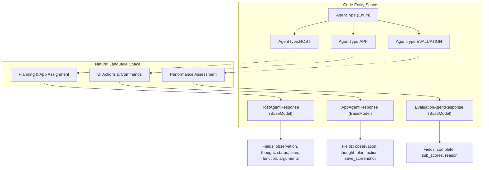
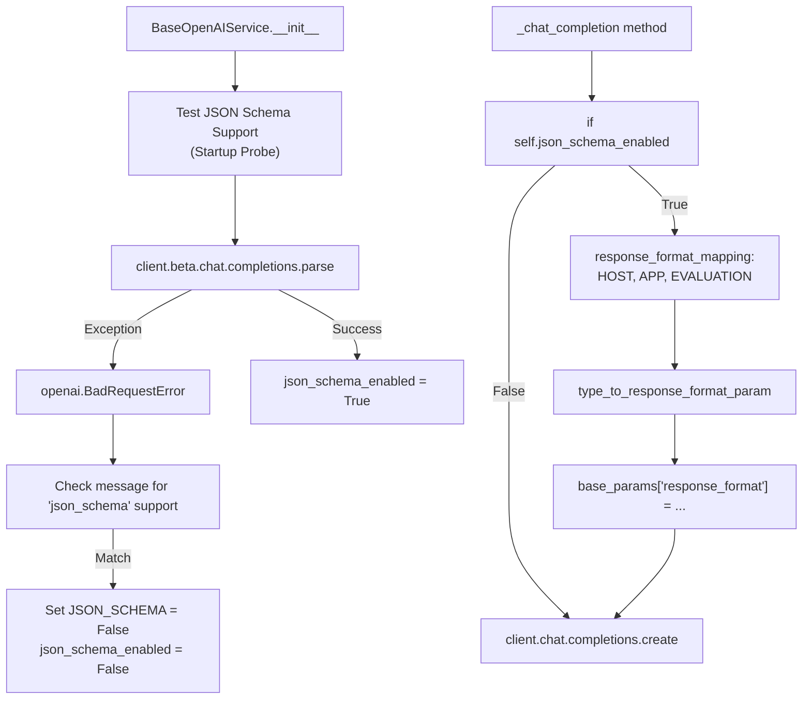
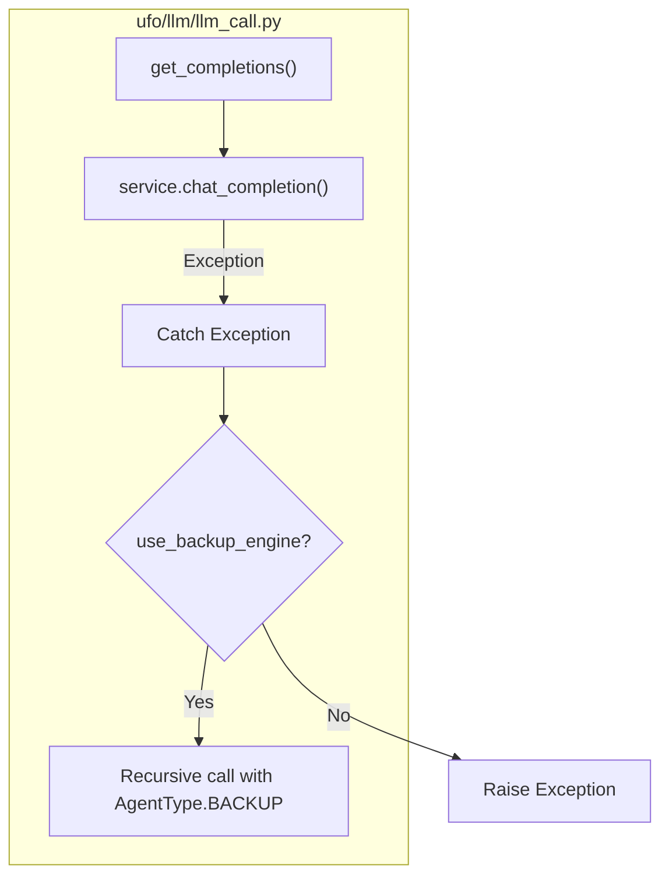

<!-- source: DeepWiki mcp.deepwiki.com · repo microsoft/UFO · page 7.3 Structured Output and Response Formats · fetched 2026-10-26 -->

# Structured Output and Response Formats

<details>
<summary>Relevant source files</summary>

The following files were used as context for generating this wiki page:

- [ufo/__main__.py](ufo/__main__.py)
- [ufo/agents/processors/context/app_agent_processing_context.py](ufo/agents/processors/context/app_agent_processing_context.py)
- [ufo/agents/processors/context/host_agent_processing_context.py](ufo/agents/processors/context/host_agent_processing_context.py)
- [ufo/agents/processors/context/processing_context.py](ufo/agents/processors/context/processing_context.py)
- [ufo/agents/processors/schemas/response_schema.py](ufo/agents/processors/schemas/response_schema.py)
- [ufo/llm/llm_call.py](ufo/llm/llm_call.py)
- [ufo/llm/openai.py](ufo/llm/openai.py)
- [ufo/rag/retriever.py](ufo/rag/retriever.py)
- [ufo/ufo.py](ufo/ufo.py)

</details>


## Purpose and Scope

This document describes the structured output system in UFO that enables LLM responses to conform to predefined JSON schemas. When LLM providers support structured output (also called JSON schema or response format), UFO can enforce that responses match specific formats, reducing parsing errors and improving reliability. This page covers the Pydantic response schema classes used by different agent types, provider support for structured output, configuration options, and fallback mechanisms.

For information about the overall LLM integration architecture and service factory pattern, see [LLM Service Architecture](7.1). For details on specific provider implementations, see [Supported LLM Providers](7.2).

---

## Response Schema Classes

UFO defines primary response schema classes implemented as Pydantic models. These schemas define the expected structure of LLM responses for the Host Agent, App Agent, and Evaluation Agent.

### Schema Type Mapping



**Sources**: [ufo/llm/openai.py:18-23](), [ufo/agents/processors/schemas/response_schema.py:8-48]()

### HostAgentResponse
Defined in `ufo/agents/processors/schemas/response_schema.py`, the `HostAgentResponse` is used for desktop-level orchestration.
- **`observation`**: Visual analysis of the desktop state.
- **`thought`**: Reasoning about the task and available applications.
- **`status`**: Current state of the agent (e.g., CONTINUE, FINISH).
- **`plan`**: Step-by-step plan for task completion.
- **`function` / `arguments`**: Fields used when the agent decides to call a specific tool or application function.

**Sources**: [ufo/agents/processors/schemas/response_schema.py:8-24]()

### AppAgentResponse
The `AppAgentResponse` handles application-specific UI automation.
- **`action`**: Can be a single `ActionCommandInfo` or a list of them, allowing for multi-action sequences.
- **`save_screenshot`**: Configuration for capturing specific UI states.
- **`plan`**: Detailed action plan within the specific application.

**Sources**: [ufo/agents/processors/schemas/response_schema.py:26-38]()

### EvaluationAgentResponse
Used by the `EvaluationAgent` to assess task success.
- **`complete`**: String indicating if the task is finished.
- **`sub_scores`**: A list of dictionaries containing specific metric scores.
- **`reason`**: Detailed explanation for the evaluation result.

**Sources**: [ufo/agents/processors/schemas/response_schema.py:40-48]()

---

## JSON Schema Support Implementation

JSON schema support enables LLM providers to enforce response structure at the API level.

### OpenAI JSON Schema Flow



**Sources**: [ufo/llm/openai.py:64-91](), [ufo/llm/openai.py:137-150]()

### Implementation Details

1. **Startup Probe**: During `BaseOpenAIService` initialization, UFO performs a "startup probe" by attempting a small parse call with `HostAgentResponse` [ufo/llm/openai.py:65-73](). If the model returns a `BadRequestError` indicating `json_schema` is not supported, UFO automatically sets `self.json_schema_enabled = False` [ufo/llm/openai.py:74-83]().
2. **Agent Mapping**: The system maps the `self.agent_type` to the appropriate Pydantic class [ufo/llm/openai.py:138-145]().
3. **Format Conversion**: It uses `type_to_response_format_param` from the OpenAI library to convert the Pydantic class into a format the API accepts [ufo/llm/openai.py:147-149]().

**Sources**: [ufo/llm/openai.py:64-91](), [ufo/llm/openai.py:137-150]()

---

## Provider Support Matrix

| Provider | JSON Schema Support | Implementation |
|----------|-------------------|----------------|
| OpenAI | ✅ Full | `beta.chat.completions.parse` |
| Azure OpenAI | ✅ Full | Same as OpenAI |
| Google Gemini | ✅ Full | `response_schema` parameter |
| Qwen | ⚠️ Partial | Text mode used by default |
| Ollama | ⚠️ Partial | `json_object` format hint |

### Provider-Specific Implementations

- **OpenAI/Azure**: Uses the `response_format` parameter in the completion request [ufo/llm/openai.py:147-149]().
- **Gemini**: Configures `response_mime_type="application/json"` and passes the schema to the `GenerateContentConfig` [ufo/llm/gemini.py:72-106]().
- **Qwen**: Explicitly disables structured output in the service implementation due to poor model support [ufo/llm/qwen.py:52-54]().
- **Ollama**: Uses `response_format={"type": "json_object"}` which ensures valid JSON but doesn't strictly enforce the Pydantic schema structure [ufo/llm/ollama.py:62]().

**Sources**: [ufo/llm/openai.py:119-132](), [ufo/llm/gemini.py:72-106](), [ufo/llm/qwen.py:46-56](), [ufo/llm/ollama.py:56-64]()

---

## Fallback Mechanisms

UFO implements multiple layers of fallback to ensure robustness.

### Text Mode Fallback
If `json_schema_enabled` is false, the service defaults to standard chat completion. The `_chat_completion` method handles this by omitting the `response_format` parameter [ufo/llm/openai.py:151-160](). The resulting text is then manually parsed in the agent's processor.

### Backup Engine Fallback
The `get_completions` function in `ufo/llm/llm_call.py` provides a global fallback mechanism. If a primary LLM request fails (due to parsing, timeout, or API errors), it automatically switches to the `AgentType.BACKUP` engine if `use_backup_engine` is set to `True`.



**Sources**: [ufo/llm/llm_call.py:91-111](), [ufo/llm/openai.py:151-160]()

---

## Configuration

Structured output behavior is primarily controlled via the `JSON_SCHEMA` key in the agent configuration.

### Agent Configuration Example
In `config/ufo/agents.yaml`:
```yaml
HOST_AGENT:
  API_TYPE: "openai"
  JSON_SCHEMA: true  # Enables the structured output path

APP_AGENT:
  API_TYPE: "ollama"
  JSON_SCHEMA: false # Forces text mode parsing
```

The `BaseOpenAIService` reads this via `self.config_llm.get("JSON_SCHEMA", False)` and uses it to set the internal `json_schema_enabled` flag, subject to the startup probe results [ufo/llm/openai.py:82-90]().

**Sources**: [ufo/llm/openai.py:39-45](), [ufo/llm/config_helper.py:13-68]()

---

