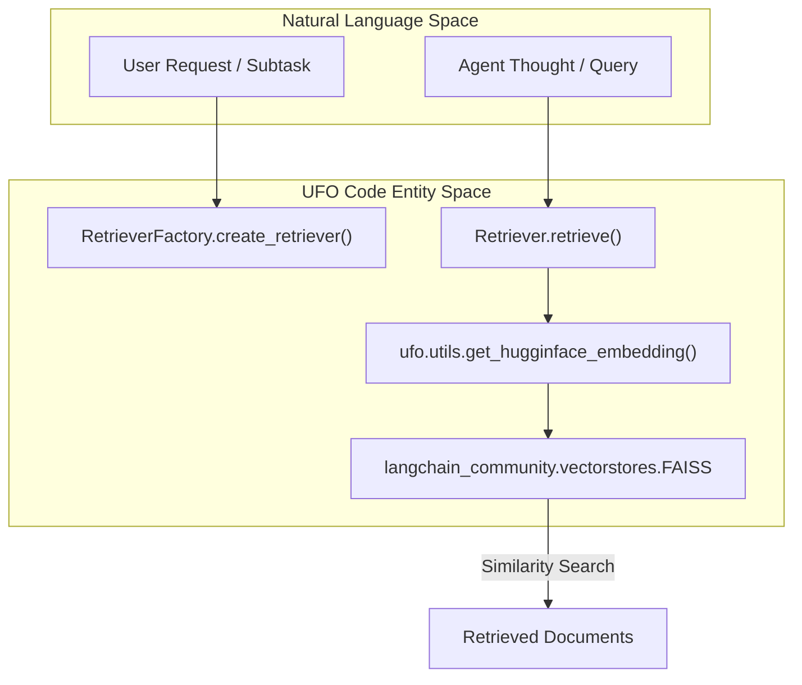
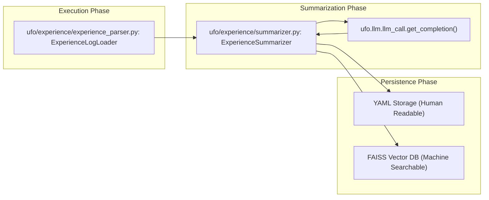

<!-- source: DeepWiki mcp.deepwiki.com · repo microsoft/UFO · page 8 Knowledge Infrastructure · fetched 2026-10-26 -->

# Knowledge Infrastructure

Relevant source files

The following files were used as context for generating this wiki page:

- [learner/__init__.py](learner/__init__.py)
- [learner/__main__.py](learner/__main__.py)
- [learner/basic.py](learner/basic.py)
- [learner/indexer.py](learner/indexer.py)
- [learner/learner.py](learner/learner.py)
- [learner/xml_loader.py](learner/xml_loader.py)
- [ufo/__main__.py](ufo/__main__.py)
- [ufo/automator/ui_control/grounding/basic.py](ufo/automator/ui_control/grounding/basic.py)
- [ufo/automator/ui_control/grounding/omniparser.py](ufo/automator/ui_control/grounding/omniparser.py)
- [ufo/automator/ui_control/inspector.py](ufo/automator/ui_control/inspector.py)
- [ufo/experience/summarizer.py](ufo/experience/summarizer.py)
- [ufo/llm/grounding_model/omniparser_service.py](ufo/llm/grounding_model/omniparser_service.py)
- [ufo/llm/llm_call.py](ufo/llm/llm_call.py)
- [ufo/llm/openai.py](ufo/llm/openai.py)
- [ufo/rag/__init__.py](ufo/rag/__init__.py)
- [ufo/rag/retriever.py](ufo/rag/retriever.py)
- [ufo/rag/web_search.py](ufo/rag/web_search.py)
- [ufo/ufo.py](ufo/ufo.py)

This page introduces the Knowledge Infrastructure of the UFO framework, which leverages Retrieval-Augmented Generation (RAG) to provide agents with external context, past experiences, and real-time information. The system is designed to bridge the gap between an LLM's static training data and the dynamic, application-specific requirements of desktop automation.

For a deep dive into the underlying components, see the following child pages:
* [RAG System Architecture](#8.1) — Details the `RetrieverFactory` pattern, embedding models, and agent integration.
* [Vector Databases](#8.2) — Explains FAISS indexing, similarity search, and the offline/online dichotomy.
* [Creating and Managing Knowledge](#8.3) — Documents the learner module, `ExperienceSummarizer`, and demonstration capture.

## Overview

The Knowledge Infrastructure centers around a multi-source retrieval system that allows agents to pull relevant information based on the current task and application context. This is primarily managed by the `RetrieverFactory` [ufo/rag/retriever.py:16-38](), which instantiates specialized retrievers.

### Knowledge Source Types

UFO utilizes four primary types of knowledge to augment agent prompts:

| Source Type | Retriever Class | Purpose |
| :--- | :--- | :--- |
| **Offline Docs** | `OfflineDocRetriever` | Application-specific help manuals and API documentation [ufo/rag/retriever.py:81-130](). |
| **Online Search** | `OnlineDocRetriever` | Real-time information fetched via Bing Search for unknown tasks [ufo/rag/retriever.py:163-200](). |
| **Experience** | `ExperienceRetriever` | Success/failure patterns learned from previous agent trajectories [ufo/rag/retriever.py:131-162](). |
| **Demonstration** | `DemonstrationRetriever` | Curated step-by-step examples of specific workflows [ufo/rag/retriever.py:201-231](). |

Sources: [ufo/rag/retriever.py:16-38](), [ufo/rag/retriever.py:81-231]()

## RAG System Architecture

The architecture follows a modular pattern where the `Retriever` abstract base class defines the interface for similarity search using FAISS vector stores [ufo/rag/retriever.py:40-80](). 

### Logic Flow: Natural Language to Vector Search

The following diagram illustrates how natural language queries from the agent are translated into vector space searches within the system's code entities.

Sources: [ufo/rag/retriever.py:16-80](), [ufo/utils.py:1-20]() (implied by usage in retriever)

For details, see [RAG System Architecture](#8.1).

## Vector Databases and Indexing

UFO uses **FAISS** (Facebook AI Similarity Search) as its primary vector database engine. Indexes are organized by `app_name` to ensure that an agent automating "Excel" only retrieves documentation relevant to that application [ufo/rag/retriever.py:91-105]().

*   **Embeddings:** The system uses `sentence-transformers` via `get_hugginface_embedding()` to generate vector representations of text [ufo/rag/retriever.py:121-123]().
*   **Offline Indexing:** Pre-processed documents (XML/JSON) are converted into FAISS indexes during a "learning" phase [learner/indexer.py:13-87]().
*   **Online Indexing:** For web searches, the `BingSearchWeb` class crawls URLs and builds a volatile, in-memory FAISS index on-the-fly [ufo/rag/web_search.py:100-110]().

Sources: [ufo/rag/retriever.py:81-130](), [ufo/rag/web_search.py:17-110](), [learner/indexer.py:13-87]()

For details, see [Vector Databases](#8.2).

## Creating and Managing Knowledge

Knowledge is not static; the system includes a `learner` module and an `ExperienceSummarizer` to grow the knowledge base over time.

### The Experience Learning Pipeline

The `ExperienceSummarizer` is responsible for "Trajectory Learning." It takes the raw logs of a completed session, identifies successful subtasks, and uses an LLM to summarize them into a "Tip" or "Example" for future use [ufo/experience/summarizer.py:18-117]().

Sources: [ufo/experience/summarizer.py:100-191](), [ufo/experience/experience_parser.py:12-127]()

### Knowledge Management Roles
*   **Indexer:** `DocumentsIndexer` handles bulk loading of technical manuals [learner/indexer.py:13-22]().
*   **Summarizer:** `ExperienceSummarizer` converts agent history into reusable "experiences" [ufo/experience/summarizer.py:18-40]().
*   **Demonstrator:** Captures manual user demonstrations to guide agents through complex UI patterns [ufo/rag/retriever.py:201-231]().

For details, see [Creating and Managing Knowledge](#8.3).

---

