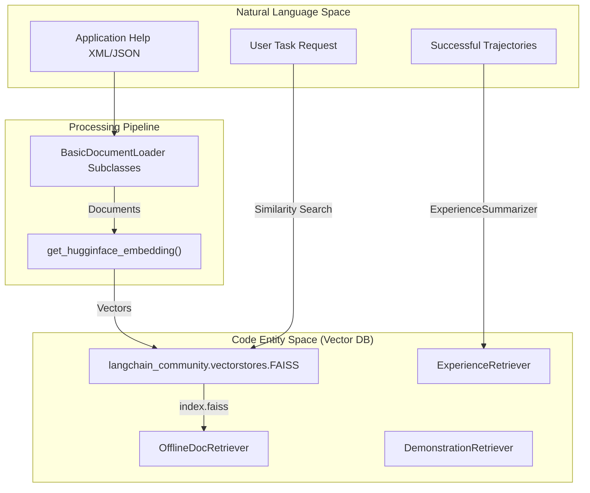
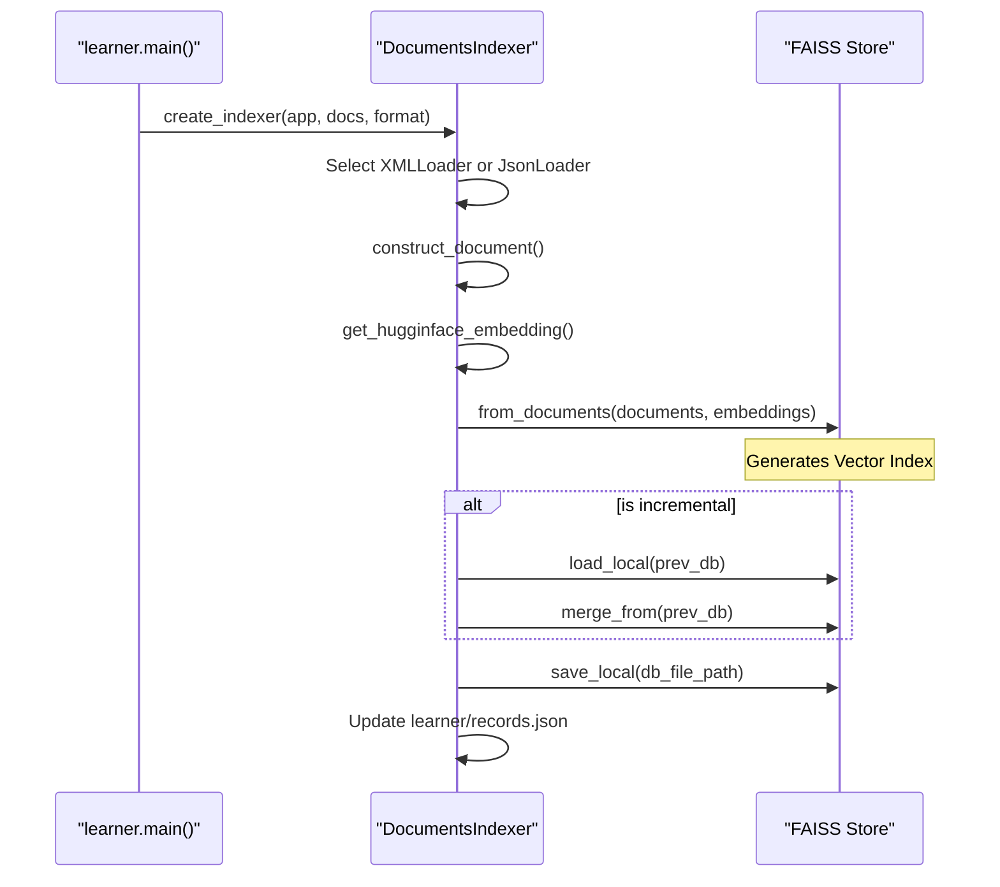

<!-- source: DeepWiki mcp.deepwiki.com · repo microsoft/UFO · page 8.2 Vector Databases · fetched 2026-10-26 -->

# Vector Databases

Relevant source files

The following files were used as context for generating this wiki page:

- [learner/__init__.py](learner/__init__.py)
- [learner/__main__.py](learner/__main__.py)
- [learner/basic.py](learner/basic.py)
- [learner/indexer.py](learner/indexer.py)
- [learner/learner.py](learner/learner.py)
- [learner/xml_loader.py](learner/xml_loader.py)
- [ufo/__main__.py](ufo/__main__.py)
- [ufo/llm/llm_call.py](ufo/llm/llm_call.py)
- [ufo/llm/openai.py](ufo/llm/openai.py)
- [ufo/rag/__init__.py](ufo/rag/__init__.py)
- [ufo/rag/retriever.py](ufo/rag/retriever.py)
- [ufo/ufo.py](ufo/ufo.py)

## Purpose and Scope

This document details the technical implementation of vector databases within the UFO framework. It explains the integration of **FAISS** (Facebook AI Similarity Search) for high-performance vector storage, the pipeline for generating embeddings using `sentence-transformers`, and the architectural split between offline document indexing and online search retrieval. These databases form the backbone of UFO's RAG (Retrieval-Augmented Generation) system, allowing agents to access application-specific help, past experiences, and human demonstrations.

## Vector Database Architecture

UFO utilizes a decentralized vector database approach where indexes are partitioned by application name and knowledge type. This ensures high retrieval precision and minimizes noise from irrelevant application contexts.

### Knowledge-to-Code Mapping
The following diagram illustrates how natural language knowledge sources are transformed into searchable vector entities within the codebase.

**Sources:** [ufo/rag/retriever.py:16-37](), [learner/indexer.py:13-87](), [ufo/utils.py:11-11]() (inferred from imports)

## FAISS Index Structure and Management

UFO relies on the `FAISS` library via `langchain_community` to manage vector indexes. Indexes are persisted locally as `.faiss` and `.pkl` files.

### Implementation Details
*   **Indexing Class**: `DocumentsIndexer` handles the creation and merging of indexes [learner/indexer.py:13-14]().
*   **Merging Logic**: The system supports incremental updates using `db.merge_from(prev_db)`, allowing new documentation to be added to existing application indexes without full re-indexing [learner/indexer.py:63-69]().
*   **Storage Pathing**: Indexes are saved in subdirectories named after the application (e.g., `vectordb/docs/Excel/`) to maintain context isolation [learner/indexer.py:71-75]().

### Data Flow: Indexing Pipeline

**Sources:** [learner/learner.py:32-43](), [learner/indexer.py:24-86](), [learner/xml_loader.py:67-86]()

## Retriever Dichotomy: Offline vs. Online

UFO distinguishes between static knowledge (Offline) and dynamic web-based knowledge (Online).

### 1. Offline Retrievers
These retrievers load pre-computed FAISS indexes from disk.
*   **`OfflineDocRetriever`**: Loads application help documents based on the `app_name` [ufo/rag/retriever.py:81-94](). It uses a configuration lookup to find the correct local path [ufo/rag/retriever.py:100-105]().
*   **`ExperienceRetriever`**: Retrieves summarized "lessons learned" from previous successful sessions stored in `vectordb/experience/` [ufo/rag/retriever.py:131-141]().
*   **`DemonstrationRetriever`**: Retrieves step-by-step examples provided by users [ufo/rag/retriever.py:201-211]().

### 2. Online Retrievers
The `OnlineDocRetriever` handles "Just-in-Time" (JIT) indexing.
*   **Mechanism**: When a query cannot be satisfied by offline knowledge, the system triggers a `BingSearchWeb` query [ufo/rag/retriever.py:184-185]().
*   **Volatile Indexing**: Search results are converted into temporary `Document` objects and a transient FAISS index is created on-the-fly for that specific session [ufo/rag/retriever.py:186-190]().

**Sources:** [ufo/rag/retriever.py:16-212]()

## Similarity Search Mechanisms

Similarity search is encapsulated in the `Retriever.retrieve()` method [ufo/rag/retriever.py:62-79]().

| Feature | Implementation | Code Reference |
| :--- | :--- | :--- |
| **Search Algorithm** | L2 Distance / Cosine Similarity (FAISS Default) | [ufo/rag/retriever.py:73-73]() |
| **Top-K Retrieval** | Configurable parameter passed to `similarity_search` | [ufo/rag/retriever.py:62-62]() |
| **Metadata Filtering** | Optional `filter` dictionary applied during search | [ufo/rag/retriever.py:73-73]() |
| **Serialization** | `allow_dangerous_deserialization=True` for local loading | [ufo/rag/retriever.py:121-121]() |

### Embedding Generation
The system uses a unified embedding utility `get_hugginface_embedding()` to ensure that queries and stored documents share the same vector space [ufo/rag/retriever.py:121](), [learner/indexer.py:59](). This typically points to a local `sentence-transformers` model to ensure privacy and offline capability.

**Sources:** [ufo/rag/retriever.py:62-79](), [learner/indexer.py:59-61]()

## Integration with Agent Prompts

Retrievers are instantiated via the `RetrieverFactory` [ufo/rag/retriever.py:16-21](). Once an agent (like `AppAgent`) identifies the active application, it calls the retriever to find relevant context.

1.  **Query Formulation**: The agent uses the user's current request as the search query.
2.  **Vector Search**: The `Retriever` performs `similarity_search` against the FAISS index [ufo/rag/retriever.py:73]().
3.  **Context Augmentation**: The retrieved document content (e.g., XML snippets or experience summaries) is injected into the LLM's system or user prompt to provide specific guidance on UI elements or workflows.

**Sources:** [ufo/rag/retriever.py:16-37](), [ufo/rag/retriever.py:62-79]()

---

