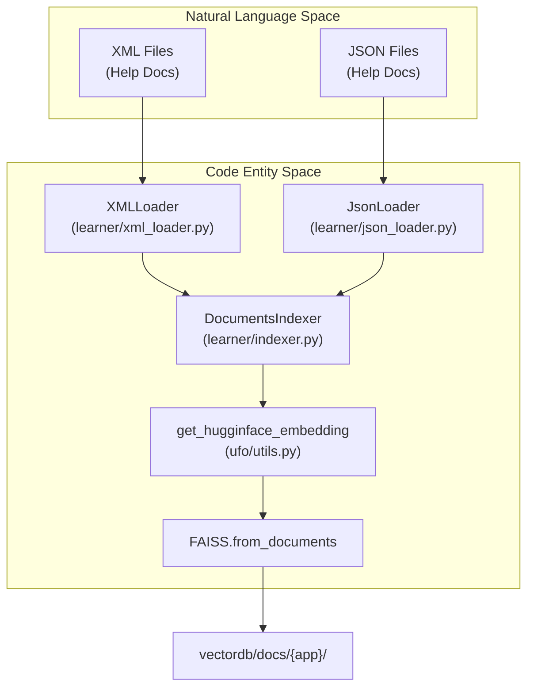
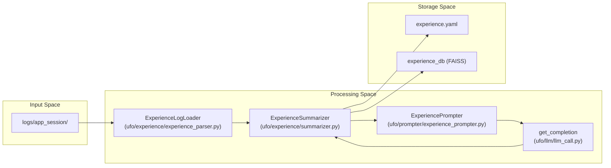

<!-- source: DeepWiki mcp.deepwiki.com · repo microsoft/UFO · page 8.3 Creating and Managing Knowledge · fetched 2026-10-26 -->

# Creating and Managing Knowledge

<details>
<summary>Relevant source files</summary>

The following files were used as context for generating this wiki page:

- [assets/record_processor/add_comment.png](assets/record_processor/add_comment.png)
- [learner/__init__.py](learner/__init__.py)
- [learner/__main__.py](learner/__main__.py)
- [learner/basic.py](learner/basic.py)
- [learner/indexer.py](learner/indexer.py)
- [learner/learner.py](learner/learner.py)
- [learner/xml_loader.py](learner/xml_loader.py)
- [record_processor/README.md](record_processor/README.md)
- [record_processor/__init__.py](record_processor/__init__.py)
- [record_processor/__main__.py](record_processor/__main__.py)
- [record_processor/example/sample_record.zip](record_processor/example/sample_record.zip)
- [record_processor/parser/demonstration_record.py](record_processor/parser/demonstration_record.py)
- [record_processor/parser/psr_record_parser.py](record_processor/parser/psr_record_parser.py)
- [record_processor/record_processor.py](record_processor/record_processor.py)
- [record_processor/summarizer/summarizer.py](record_processor/summarizer/summarizer.py)
- [record_processor/utils/__init__.py](record_processor/utils/__init__.py)
- [ufo/automator/ui_control/grounding/basic.py](ufo/automator/ui_control/grounding/basic.py)
- [ufo/automator/ui_control/grounding/omniparser.py](ufo/automator/ui_control/grounding/omniparser.py)
- [ufo/automator/ui_control/inspector.py](ufo/automator/ui_control/inspector.py)
- [ufo/experience/summarizer.py](ufo/experience/summarizer.py)
- [ufo/llm/grounding_model/omniparser_service.py](ufo/llm/grounding_model/omniparser_service.py)
- [ufo/rag/__init__.py](ufo/rag/__init__.py)
- [ufo/rag/web_search.py](ufo/rag/web_search.py)

</details>


## Purpose and Scope

This document explains how to create, format, and manage knowledge bases that enhance UFO's automation capabilities through Retrieval-Augmented Generation (RAG). It covers the document format requirements, indexing process via the `learner` module, experience learning through `ExperienceSummarizer`, and demonstration capture via the `record_processor`.

**Sources:** [learner/indexer.py:13-16](), [ufo/experience/summarizer.py:18-21](), [record_processor/record_processor.py:33-40]()

---

## Knowledge Base Types

UFO maintains three specialized knowledge bases, organized by application name (`app_name`):

| Knowledge Base | Directory | Purpose | Implementation Class |
|---|---|---|---|
| **Help Documents** | `vectordb/docs/` | Application-specific guidance | `DocumentsIndexer` |
| **Experience** | `vectordb/experience/` | Historical execution traces | `ExperienceSummarizer` |
| **Demonstration** | `vectordb/demonstration/` | User-provided examples | `DemonstrationSummarizer` |

**Sources:** [learner/indexer.py:71-75](), [ufo/experience/summarizer.py:165-191](), [record_processor/record_processor.py:58-76]()

---

## Help Document Indexing

The `learner` module handles the ingestion of static help documents (XML or JSON) into FAISS vector databases.

### Document Ingestion Flow


**Sources:** [learner/indexer.py:18-34](), [learner/xml_loader.py:11-14](), [learner/indexer.py:59-61]()

### Key Functions
- `DocumentsIndexer.create_indexer`: Orchestrates the loading, embedding, and saving of documents. It supports incremental updates by merging with existing indexes if the `--incremental` flag is used [learner/indexer.py:23-86]().
- `XMLLoader.get_microsoft_document_metadata`: Specifically extracts `title` and `Content-Summary` from Microsoft-formatted XML help files [learner/xml_loader.py:25-51]().

---

## Experience Learning

The `ExperienceSummarizer` transforms execution logs into "Experiences" that the agent can retrieve to avoid repeating past mistakes or to replicate successful trajectories.

### Experience Summarization Pipeline


**Sources:** [ufo/experience/summarizer.py:100-117](), [ufo/experience/summarizer.py:129-162](), [ufo/experience/summarizer.py:165-191]()

### Data Transformation
1. **Partitioning**: Logs are partitioned by subtasks using `ExperienceLogLoader` [ufo/experience/summarizer.py:125-126]().
2. **Summarization**: The `ExperienceSummarizer` uses the `APPAGENT` config to call the LLM and extract key fields: `Observation`, `Thought`, `ControlLabel`, `Function`, `Args`, and `Status` [ufo/experience/summarizer.py:72-96]().
3. **Persistence**: Summaries are saved both to a human-readable YAML file and a FAISS vector database for RAG [ufo/experience/summarizer.py:129-191]().

---

## User Demonstration Capture

The `record_processor` allows UFO to learn from Windows Steps Recorder (`.mht`) files.

### record_processor Workflow
1. **Unzip & Parse**: `PSRRecordParser` extracts screenshots and user actions from the `.mht` file [record_processor/parser/psr_record_parser.py:27-45]().
2. **Summarize**: `DemonstrationSummarizer` builds a prompt for the LLM to convert the recorded UI steps into a clean execution plan [record_processor/summarizer/summarizer.py:61-80]().
3. **User Validation**: The system presents the summarized plans to the user for approval via `__asker` [record_processor/record_processor.py:85-108]().
4. **Indexing**: Approved plans are saved to `vectordb/demonstration/` [record_processor/record_processor.py:57-76]().

**Sources:** [record_processor/record_processor.py:41-80](), [record_processor/summarizer/summarizer.py:18-38]()

---

## App-Based Index Organization

All knowledge is strictly partitioned by the application name (`app_name`). This ensures that when an agent is working in "Excel", it only retrieves knowledge relevant to Excel.

### Storage Hierarchy
```
vectordb/
├── docs/
│   ├── excel/
│   │   ├── index.faiss
│   │   └── index.pkl
│   └── winword/
├── experience/
│   └── {app_name}/
└── demonstration/
    ├── demonstration.yaml
    └── demonstration_db/
```

### Vector Database Management
Both `ExperienceSummarizer` and `DemonstrationSummarizer` implement `create_or_update_vector_db`. This method:
1. Generates embeddings for the `request` or `subtask` string [ufo/experience/summarizer.py:174-178]().
2. Loads the existing FAISS index if it exists [ufo/experience/summarizer.py:182-187]().
3. Merges the new documents into the existing index using `db.merge_from(prev_db)` [ufo/experience/summarizer.py:187]().
4. Saves the updated index locally [ufo/experience/summarizer.py:189]().

**Sources:** [ufo/experience/summarizer.py:165-191](), [record_processor/summarizer/summarizer.py:173-196](), [learner/indexer.py:63-70]()

---

## Implementation Details: Summarization Schema

When summarizing experiences or demonstrations, the LLM is prompted to produce a standardized JSON object:

| Key | Description |
|---|---|
| `Observation` | What was visible on screen |
| `Thought` | The reasoning behind the action |
| `ControlLabel` | The numeric label of the UI element interacted with |
| `Function` | The Puppeteer/API function called |
| `Status` | Success or Failure of the step |
| `Tips` | General advice extracted from the trajectory |

**Sources:** [ufo/experience/summarizer.py:84-96](), [record_processor/summarizer/summarizer.py:121-133]()

---

