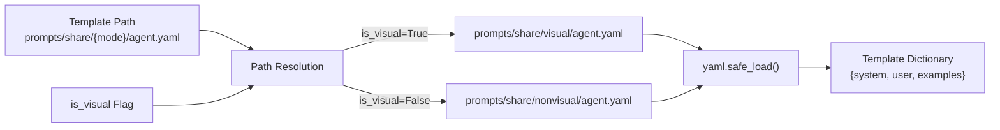
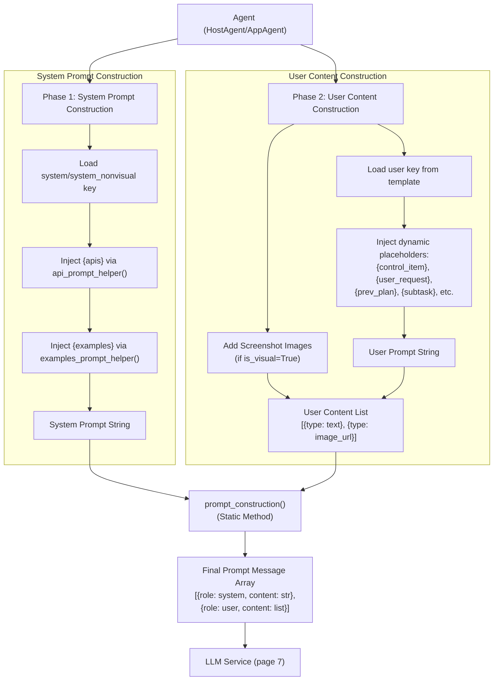

<!-- source: DeepWiki mcp.deepwiki.com · repo microsoft/UFO · page 9 Prompt System · fetched 2026-10-26 -->

# Prompt System

<details>
<summary>Relevant source files</summary>

The following files were used as context for generating this wiki page:

- [dataflow/prompter/instantiation/filter_prompter.py](dataflow/prompter/instantiation/filter_prompter.py)
- [dataflow/prompter/instantiation/prefill_prompter.py](dataflow/prompter/instantiation/prefill_prompter.py)
- [dataflow/prompter/instantiation/template_prompter.py](dataflow/prompter/instantiation/template_prompter.py)
- [galaxy/agents/prompters/base_constellation_prompter.py](galaxy/agents/prompters/base_constellation_prompter.py)
- [tests/test_agents_config_migration.py](tests/test_agents_config_migration.py)
- [tests/test_prompt_sanitizer.py](tests/test_prompt_sanitizer.py)
- [ufo/agents/processors/core/processor_framework.py](ufo/agents/processors/core/processor_framework.py)
- [ufo/agents/processors/customized/customized_agent_processor.py](ufo/agents/processors/customized/customized_agent_processor.py)
- [ufo/agents/processors/strategies/customized_agent_processing_strategy.py](ufo/agents/processors/strategies/customized_agent_processing_strategy.py)
- [ufo/prompter/agent_prompter.py](ufo/prompter/agent_prompter.py)
- [ufo/prompter/basic.py](ufo/prompter/basic.py)
- [ufo/prompter/customized/linux_agent_prompter.py](ufo/prompter/customized/linux_agent_prompter.py)
- [ufo/prompter/customized/mobile_agent_prompter.py](ufo/prompter/customized/mobile_agent_prompter.py)
- [ufo/prompter/demonstration_prompter.py](ufo/prompter/demonstration_prompter.py)
- [ufo/prompter/eva_prompter.py](ufo/prompter/eva_prompter.py)
- [ufo/prompter/experience_prompter.py](ufo/prompter/experience_prompter.py)
- [ufo/prompter/prompt_sanitizer.py](ufo/prompter/prompt_sanitizer.py)
- [ufo/prompts/examples/nonvisual/app_agent_example.yaml](ufo/prompts/examples/nonvisual/app_agent_example.yaml)
- [ufo/prompts/examples/nonvisual/host_agent_example.yaml](ufo/prompts/examples/nonvisual/host_agent_example.yaml)
- [ufo/prompts/examples/visual/app_agent_example.yaml](ufo/prompts/examples/visual/app_agent_example.yaml)
- [ufo/prompts/examples/visual/host_agent_example.yaml](ufo/prompts/examples/visual/host_agent_example.yaml)
- [ufo/prompts/share/base/app_agent.yaml](ufo/prompts/share/base/app_agent.yaml)
- [ufo/prompts/share/base/host_agent.yaml](ufo/prompts/share/base/host_agent.yaml)
- [ufo/prompts/third_party/linux_agent.yaml](ufo/prompts/third_party/linux_agent.yaml)
- [ufo/prompts/third_party/linux_agent_example.yaml](ufo/prompts/third_party/linux_agent_example.yaml)

</details>


The Prompt System provides the abstraction layer for constructing LLM prompts across different agent types in UFO. The system is built on a hierarchy of prompter classes that load YAML templates, inject dynamic context, and format messages for LLM consumption. Each agent type has a specialized prompter that handles its specific prompt construction requirements.

The prompter system integrates with the LLM Service Layer (page 7) for model invocation and the Configuration System (page 6) for template paths. Agent processing flows (page 3.1) use prompters during the `LLM_INTERACTION` phase.

## Prompter Hierarchy

The prompt system is implemented through a class hierarchy rooted in `BasicPrompter`, an abstract base class that defines the common interface for prompt construction. Agent-specific prompters inherit from this base and implement specialized logic for their respective agent types.

```mermaid
graph TB
    BasicPrompter["BasicPrompter<br/>(Abstract Base Class)"]
    
    HostAgentPrompter["HostAgentPrompter<br/>Desktop-level Prompts"]
    AppAgentPrompter["AppAgentPrompter<br/>App-level Prompts"]
    EvaluationAgentPrompter["EvaluationAgentPrompter<br/>Evaluation Prompts"]
    ExperiencePrompter["ExperiencePrompter<br/>Learning Prompts"]
    BaseConstellationPrompter["BaseConstellationPrompter<br/>Galaxy Multi-device Prompts"]
    
    BasicPrompter -->|"inherits"| HostAgentPrompter
    BasicPrompter -->|"inherits"| AppAgentPrompter
    BasicPrompter -->|"inherits"| EvaluationAgentPrompter
    BasicPrompter -->|"inherits"| ExperiencePrompter
    BasicPrompter -->|"inherits"| BaseConstellationPrompter
    
    subgraph "BasicPrompter Abstract Methods"
        AbstractMethods["system_prompt_construction()<br/>user_prompt_construction()<br/>user_content_construction()"]
    end
    
    subgraph "BasicPrompter Static Methods"
        StaticMethods["load_prompt_template()<br/>prompt_construction()<br/>tools_to_llm_prompt()<br/>retrieved_documents_prompt_helper()"]
    end
    
    BasicPrompter --> AbstractMethods
    BasicPrompter --> StaticMethods
    
    subgraph "Concrete Implementations"
        HostImpl["system_prompt_construction():<br/>APIs + Examples + Instructions"]
        HostUser["user_content_construction():<br/>Screenshots + Control Items"]
        
        AppImpl["system_prompt_construction():<br/>APIs + Examples + Action Mode"]
        AppUser["user_content_construction():<br/>Multi-screenshot Support"]
        
        GalaxyImpl["_format_agent_profile():<br/>Device Capabilities"]
        GalaxyConst["_format_constellation():<br/>Task DAG state"]
    end
    
    HostAgentPrompter --> HostImpl
    HostAgentPrompter --> HostUser
    AppAgentPrompter --> AppImpl
    AppAgentPrompter --> AppUser
    BaseConstellationPrompter --> GalaxyImpl
    BaseConstellationPrompter --> GalaxyConst
```



Sources: [ufo/prompter/basic.py:16-208](), [ufo/prompter/agent_prompter.py:13-429](), [ufo/prompter/eva_prompter.py:16-314](), [ufo/prompter/experience_prompter.py:15-207](), [galaxy/agents/prompters/base_constellation_prompter.py:27-240]()

### BasicPrompter Abstract Class

The `BasicPrompter` class defines the contract that all prompters must implement:

| Method | Type | Purpose |
|--------|------|---------|
| `__init__(is_visual, prompt_template, example_prompt_template)` | Constructor | Initialize prompter with template paths [ufo/prompter/basic.py:21-42]() |
| `load_prompt_template(template_path, is_visual)` | Static | Load YAML templates from file system [ufo/prompter/basic.py:44-69]() |
| `system_prompt_construction()` | Abstract | Construct system message with role and instructions [ufo/prompter/basic.py:171-178]() |
| `user_prompt_construction()` | Abstract | Construct textual user prompt (without images) [ufo/prompter/basic.py:179-186]() |
| `user_content_construction()` | Abstract | Construct full user content including images [ufo/prompter/basic.py:187-194]() |
| `examples_prompt_helper()` | Concrete | Format few-shot examples for in-context learning [ufo/prompter/basic.py:195-201]() |
| `api_prompt_helper()` | Concrete | Format API/tool descriptions [ufo/prompter/basic.py:202-208]() |
| `prompt_construction(system_prompt, user_content)` | Static | Assemble final message array [ufo/prompter/basic.py:71-87]() |
| `tools_to_llm_prompt(tools)` | Static | Convert `MCPToolInfo` list to formatted text [ufo/prompter/basic.py:157-169]() |

Sources: [ufo/prompter/basic.py:16-208]()

### Prompter Instantiation

Each agent type instantiates its prompter with configuration-driven template paths. For example, the `HostAgent` and `AppAgent` use their respective prompters to handle task decomposition and UI interaction logic.

```python
# HostAgent creates HostAgentPrompter
prompter = HostAgentPrompter(
    is_visual=config.visual_mode,
    prompt_template="prompts/share/base/host_agent.yaml",
    example_prompt_template="prompts/examples/visual/host_agent_example.yaml",
    api_prompt_template="prompts/api/apis.yaml"
)

# AppAgent creates AppAgentPrompter
prompter = AppAgentPrompter(
    is_visual=config.visual_mode,
    prompt_template="prompts/share/base/app_agent.yaml",
    example_prompt_template="prompts/examples/visual/app_agent_example.yaml"
)
```

Sources: [ufo/prompter/agent_prompter.py:18-33](), [ufo/prompter/agent_prompter.py:197-210]()

## Template Loading and Structure

Prompters load YAML templates using the `load_prompt_template()` static method, which supports mode-based template selection. The method resolves paths with `{mode}` placeholders to load visual or non-visual variants.



Sources: [ufo/prompter/basic.py:44-69]()

### YAML Template Structure

Each template file contains multiple keys for different prompt components. For instance, the `app_agent.yaml` template includes detailed instructions on screenshot interpretation and UI control interaction.

| YAML Key | Description | Usage |
|----------|-------------|-------|
| `version` | Template version number | Version tracking [ufo/prompts/share/base/app_agent.yaml:1]() |
| `system` | System prompt for visual mode | Role definition, capabilities, output format [ufo/prompts/share/base/app_agent.yaml:3-54]() |
| `system_nonvisual` | System prompt for non-visual mode | Text-only operation instructions [ufo/prompter/agent_prompter.py:52]() |
| `user` | User prompt template with placeholders | Request context, control items, history [ufo/prompts/share/base/app_agent.yaml:55-73]() |

Sources: [ufo/prompts/share/base/app_agent.yaml:1-73](), [ufo/prompter/agent_prompter.py:52-58]()

## Prompt Construction Flow

Prompters construct prompts through a two-phase process: system prompt construction (static instructions) and user content construction (dynamic context). The final prompt is assembled by `prompt_construction()` into the message array expected by LLM APIs.



Sources: [ufo/prompter/agent_prompter.py:42-58](), [ufo/prompter/agent_prompter.py:106-148](), [ufo/prompter/agent_prompter.py:281-340](), [ufo/prompter/basic.py:71-87]()

### System Prompt Construction

The `system_prompt_construction()` method builds the system message by formatting the template with helper method outputs. It injects API descriptions, few-shot examples, and instructions for third-party agents.

**HostAgentPrompter Implementation**:
```python
def system_prompt_construction(self) -> str:
    apis = self.api_prompt_helper(verbose=0)
    examples = self.examples_prompt_helper()
    third_party_instructions = self.third_party_agent_instruction()
    
    system_key = "system" if self.is_visual else "system_nonvisual"
    
    return self.prompt_template[system_key].format(
        apis=apis,
        examples=examples,
        third_party_instructions=third_party_instructions,
    )
```

Sources: [ufo/prompter/agent_prompter.py:42-58](), [ufo/prompter/agent_prompter.py:87-104]()

### User Content Construction

The `user_content_construction()` method assembles the user message with optional image attachments. It supports multi-modal models by interleaving text and image URLs.

**HostAgentPrompter Multi-Modal Construction**:
```python
def user_content_construction(
    self,
    image_list: List[str],
    control_item: List[str],
    prev_subtask: List[Dict[str, str]],
    prev_plan: str,
    user_request: str,
    retrieved_docs: str = "",
) -> List[Dict[str, str]]:
    user_content = []

    if self.is_visual:
        screenshot_text = ["Current Screenshots:"]
        for i, image in enumerate(image_list):
            user_content.append({"type": "text", "text": screenshot_text[i]})
            user_content.append({"type": "image_url", "image_url": {"url": image}})

    user_content.append({
        "type": "text",
        "text": self.user_prompt_construction(
            control_item=control_item,
            prev_subtask=prev_subtask,
            prev_plan=prev_plan,
            user_request=user_request,
            retrieved_docs=retrieved_docs,
        ),
    })

    return user_content
```

Sources: [ufo/prompter/agent_prompter.py:106-148]()

## Prompt Components and Assembly

Prompts are composed of multiple components that are injected into templates during construction. These components provide context, instructions, examples, and dynamic data to guide LLM behavior.

### Component Types

| Component | Source Method | Purpose |
|-----------|---------------|---------|
| API Descriptions | `api_prompt_helper()` | Available tool/action descriptions [ufo/prompter/agent_prompter.py:178-189]() |
| Examples | `examples_prompt_helper()` | Few-shot learning demonstrations [ufo/prompter/agent_prompter.py:150-176]() |
| Control Items | `control_item` parameter | Available UI elements or applications [ufo/prompter/agent_prompter.py:62]() |
| User Request | `user_request` parameter | Task description [ufo/prompter/agent_prompter.py:65]() |
| Trajectory | `trajectory` parameter | Execution history (Evaluation) [ufo/prompter/eva_prompter.py:63]() |
| Screenshots | `image_list` parameter | Visual context [ufo/prompter/agent_prompter.py:108]() |

Sources: [ufo/prompter/agent_prompter.py:13-189](), [ufo/prompter/eva_prompter.py:60-76]()

## Multi-Modal Prompt Support

For agents operating with vision-capable LLMs, prompters support multi-modal content construction by encoding screenshots as base64 image URLs and interleaving them with text in the user content array.

For details, see [Multi-Modal Prompt Support](#9.2).

### EvaluationAgentPrompter Multi-Modal Support

The `EvaluationAgentPrompter` supports two screenshot inclusion strategies: `screenshots_all` and `screenshots_head_tail`.

**Head-Tail Mode**: Only initial and final screenshots
```python
def user_content_construction_head_tail(self, log_path: str, request: str):
    # ... loads logs and encodes first/last screenshots ...
    if self.is_visual:
        screenshot_text = ["Initial Screenshot:", "Final Screenshot:"]
        for i, image in enumerate(head_tail_screenshots):
            if self._is_valid_screenshot_str(image):
                user_content.append({"type": "text", "text": screenshot_text[i]})
                user_content.append({"type": "image_url", "image_url": {"url": image}})
```

Sources: [ufo/prompter/eva_prompter.py:93-144](), [ufo/prompter/eva_prompter.py:188-245]()

## Prompt Construction Details

For a detailed breakdown of prompt components like YAML templates, retrieved docs, and the specific assembly logic in `system_prompt_construction` and `user_content_construction`, see [Prompt Components and Construction](#9.1).

For details on image encoding, control annotation overlays, and visual model specific logic, see [Multi-Modal Prompt Support](#9.2).

## Galaxy (Multi-Device) Prompter Support

The `BaseConstellationPrompter` provides specialized methods for the multi-device Galaxy framework, formatting device agent profiles and task constellations (DAGs) into the prompt context.

```python
# Formatting device info for Galaxy
def _format_agent_profile(self, device_info: Dict[str, AgentProfile]) -> str:
    # ... iterates through devices and formats capabilities/OS ...
    return "Available Device Agent Profiles:\n\n" + "\n\n".join(formatted_agent_profiles)

# Formatting the Task Constellation DAG
def _format_constellation(self, constellation: TaskConstellation) -> str:
    # ... serializes task states, dependencies, and modification hints ...
    return f"Task Constellation: {constellation_dict.get('name')}"
```

Sources: [galaxy/agents/prompters/base_constellation_prompter.py:45-85](), [galaxy/agents/prompters/base_constellation_prompter.py:87-174]()

---

