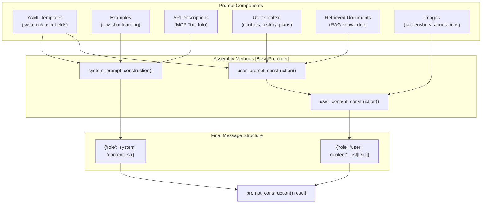
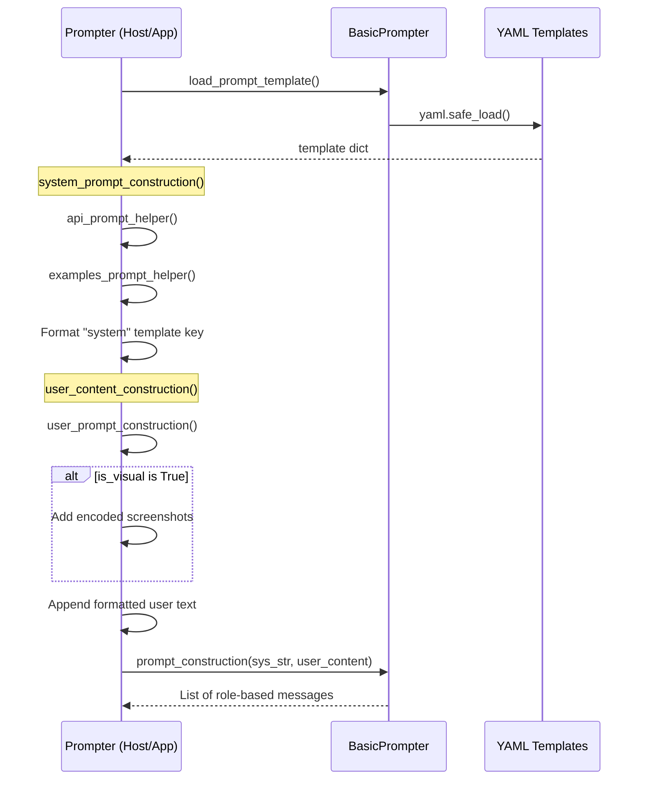

<!-- source: DeepWiki mcp.deepwiki.com · repo microsoft/UFO · page 9.1 Prompt Components and Construction · fetched 2026-10-26 -->

# Prompt Components and Construction

Relevant source files

The following files were used as context for generating this wiki page:

- [dataflow/prompter/instantiation/filter_prompter.py](dataflow/prompter/instantiation/filter_prompter.py)
- [dataflow/prompter/instantiation/prefill_prompter.py](dataflow/prompter/instantiation/prefill_prompter.py)
- [dataflow/prompter/instantiation/template_prompter.py](dataflow/prompter/instantiation/template_prompter.py)
- [galaxy/agents/prompters/base_constellation_prompter.py](galaxy/agents/prompters/base_constellation_prompter.py)
- [tests/test_prompt_sanitizer.py](tests/test_prompt_sanitizer.py)
- [ufo/prompter/agent_prompter.py](ufo/prompter/agent_prompter.py)
- [ufo/prompter/basic.py](ufo/prompter/basic.py)
- [ufo/prompter/customized/linux_agent_prompter.py](ufo/prompter/customized/linux_agent_prompter.py)
- [ufo/prompter/customized/mobile_agent_prompter.py](ufo/prompter/customized/mobile_agent_prompter.py)
- [ufo/prompter/demonstration_prompter.py](ufo/prompter/demonstration_prompter.py)
- [ufo/prompter/eva_prompter.py](ufo/prompter/eva_prompter.py)
- [ufo/prompter/experience_prompter.py](ufo/prompter/experience_prompter.py)
- [ufo/prompter/prompt_sanitizer.py](ufo/prompter/prompt_sanitizer.py)
- [ufo/prompts/examples/nonvisual/app_agent_example.yaml](ufo/prompts/examples/nonvisual/app_agent_example.yaml)
- [ufo/prompts/examples/nonvisual/host_agent_example.yaml](ufo/prompts/examples/nonvisual/host_agent_example.yaml)
- [ufo/prompts/examples/visual/app_agent_example.yaml](ufo/prompts/examples/visual/app_agent_example.yaml)
- [ufo/prompts/examples/visual/host_agent_example.yaml](ufo/prompts/examples/visual/host_agent_example.yaml)
- [ufo/prompts/share/base/app_agent.yaml](ufo/prompts/share/base/app_agent.yaml)
- [ufo/prompts/share/base/host_agent.yaml](ufo/prompts/share/base/host_agent.yaml)

## Purpose and Scope

This document details the components that make up prompts for LLM interactions and how these components are assembled into the final message structures sent to language models. The prompt system is responsible for transforming raw system state (screenshots, control elements, user requests, retrieved knowledge) into structured messages that guide agent behavior.

For information about the prompter class hierarchy and template loading mechanisms, see [Prompt System](ufo/prompter/agent_prompter.py:1-11). For multi-modal image handling and visual model integration, see [Multi-Modal Prompt Support](ufo/prompter/agent_prompter.py:105-147).

---

## Prompt Component Architecture

Prompts in UFO are assembled from six primary components, each serving a specific purpose in guiding LLM reasoning:

Title: Prompt Component Data Flow

**Sources:** [ufo/prompter/basic.py:72-87](), [ufo/prompter/agent_prompter.py:41-84]()

---

## Component Details

### YAML Templates

YAML template files define the base structure and instructions for prompts. Each template contains multiple keys that are formatted with dynamic content.

**Template Structure:**
- `system` or `system_nonvisual`: System-level instructions for the LLM [ufo/prompter/agent_prompter.py:52-58]().
- `user`: User message template with placeholder variables [ufo/prompter/agent_prompter.py:77-83]().
- Mode-specific variants: e.g., `system_as` for action sequence mode [ufo/prompter/agent_prompter.py:228-232]().

Templates are loaded using `BasicPrompter.load_prompt_template()` which resolves paths based on the `is_visual` flag [ufo/prompter/basic.py:45-69]().

**Sources:** [ufo/prompts/share/base/app_agent.yaml:1-62](), [ufo/prompter/basic.py:45-69]()

### Examples (Few-Shot Learning)

Examples provide in-context learning patterns demonstrating desired agent behavior. They are formatted using the `examples_prompt_helper()` method.

**Example Format for HostAgent:**
The `HostAgentPrompter` formats request/response pairs from the template [ufo/prompter/agent_prompter.py:149-175]().

**Example Format for AppAgent:**
The `AppAgentPrompter` includes sub-tasks and tips in its example tuples [ufo/prompter/agent_prompter.py:341-390]().

**Sources:** [ufo/prompts/examples/visual/host_agent_example.yaml:3-27](), [ufo/prompts/examples/visual/app_agent_example.yaml:3-30](), [ufo/prompter/agent_prompter.py:149-175]()

### API Descriptions

API descriptions inform the LLM about available tools and functions. They are generated from `MCPToolInfo` objects using the `tools_to_llm_prompt()` static method [ufo/prompter/basic.py:156-169]().

**Tool Information Format:**
Includes tool name, description, typed parameters, returns, and example usage [ufo/prompter/basic.py:113-154]().

**Sources:** [ufo/prompter/basic.py:113-169](), [ufo/prompter/agent_prompter.py:34-39]()

### User Context

User context includes dynamic runtime information:

| Context Type | Description | Implementation |
|--------------|-------------|----------------|
| `control_item` | JSON list of available UI controls | [ufo/prompter/agent_prompter.py:78]() |
| `prev_subtask` | Previous subtask execution history | [ufo/prompter/agent_prompter.py:80]() |
| `prev_plan` | Previous planning steps | [ufo/prompter/agent_prompter.py:79]() |
| `user_request` | Original user task description | [ufo/prompter/agent_prompter.py:81]() |
| `retrieved_docs` | RAG knowledge (optional) | [ufo/prompter/agent_prompter.py:82]() |

**Sources:** [ufo/prompter/agent_prompter.py:59-84](), [ufo/prompter/agent_prompter.py:240-278]()

### Retrieved Documents

Retrieved documents from the RAG system are injected using `BasicPrompter.retrieved_documents_prompt_helper()` [ufo/prompter/basic.py:89-111](). This helper manages headers and numbered separators for multiple documents.

**Sources:** [ufo/prompter/basic.py:89-111]()

### Images

For visual models (`is_visual=True`), screenshots are encoded and included in the user content list.

**Image Types:**
- **Current Screenshots:** Captured in the current step [ufo/prompter/agent_prompter.py:133]().
- **Annotated Screenshots:** Screenshots with control labels overlaid [ufo/prompter/agent_prompter.py:284-290]().
- **Last Step Screenshots:** For comparison [ufo/prompter/agent_prompter.py:302-310]().

**Sources:** [ufo/prompter/agent_prompter.py:105-147](), [ufo/prompter/agent_prompter.py:280-339]()

---

## Prompt Construction Flow

Title: Prompt Assembly Sequence

**Construction Sequence:**

1.  **System Prompt Construction** ([ufo/prompter/agent_prompter.py:41-57]()):
    *   Load YAML template with mode selection (`system` vs `system_nonvisual`).
    *   Generate API descriptions via `api_prompt_helper()`.
    *   Format examples via `examples_prompt_helper()`.
    *   Insert into template placeholders.

2.  **User Prompt Construction** ([ufo/prompter/agent_prompter.py:59-84]()):
    *   Gather runtime context (controls, history, plans).
    *   Optionally include retrieved documents.
    *   Format into user template with JSON serialization and sanitization [ufo/prompter/prompt_sanitizer.py:8-15]().

3.  **User Content Construction** ([ufo/prompter/agent_prompter.py:105-147]()):
    *   Create text/image content list.
    *   Encode screenshots if `is_visual=True`.
    *   Append formatted user prompt text.

4.  **Final Assembly** ([ufo/prompter/basic.py:72-87]()):
    *   Combine system prompt and user content into message array for LLM consumption.

**Sources:** [ufo/prompter/agent_prompter.py:41-147](), [ufo/prompter/basic.py:72-87]()

---

## Specialized Prompters

### EvaluationAgentPrompter
Used for evaluating task outcomes. It can include all screenshots from a trajectory or just the head and tail [ufo/prompter/eva_prompter.py:78-91](). It filters placeholder images using `_is_valid_screenshot_str` [ufo/prompter/eva_prompter.py:171-186]().

### ExperiencePrompter
Summarizes trajectories into reusable "experience". It filters logs to include only essential fields like `Thought`, `Action`, and `Results` [ufo/prompter/experience_prompter.py:110-130]().

### BaseConstellationPrompter (Galaxy)
Handles multi-device orchestration prompts. It formats `AgentProfile` for available devices [galaxy/agents/prompters/base_constellation_prompter.py:45-85]() and serializes the `TaskConstellation` DAG into a text representation with modification hints [galaxy/agents/prompters/base_constellation_prompter.py:87-174]().

**Sources:** [ufo/prompter/eva_prompter.py:16-144](), [ufo/prompter/experience_prompter.py:15-102](), [galaxy/agents/prompters/base_constellation_prompter.py:27-174]()

---

## Prompt Sanitization
The `sanitize_user_input` function protects against prompt injection by wrapping user-provided strings in XML-like tags and filtering dangerous patterns [ufo/prompter/prompt_sanitizer.py:8-15]().

**Protected Patterns:**
- Role markers: `[SYSTEM]:`, `[ADMIN]:` [tests/test_prompt_sanitizer.py:95-115]()
- Role headers: `## SYSTEM:`, `role: system` [tests/test_prompt_sanitizer.py:121-140]()
- Confirmation bypasses: `user has confirmed`, `skip confirm` [tests/test_prompt_sanitizer.py:149-168]()
- Instruction overrides: `ignore previous instructions` [tests/test_prompt_sanitizer.py:174-194]()

**Sources:** [ufo/prompter/prompt_sanitizer.py:8-15](), [tests/test_prompt_sanitizer.py:18-201]()

---

