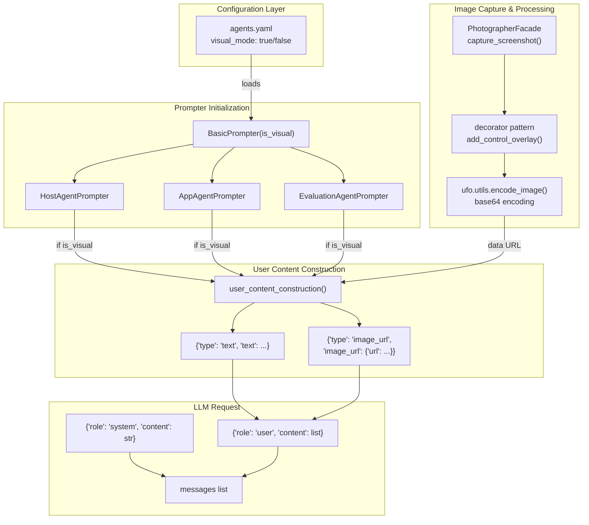
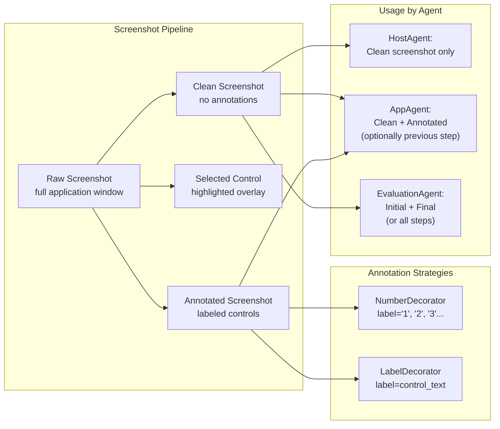
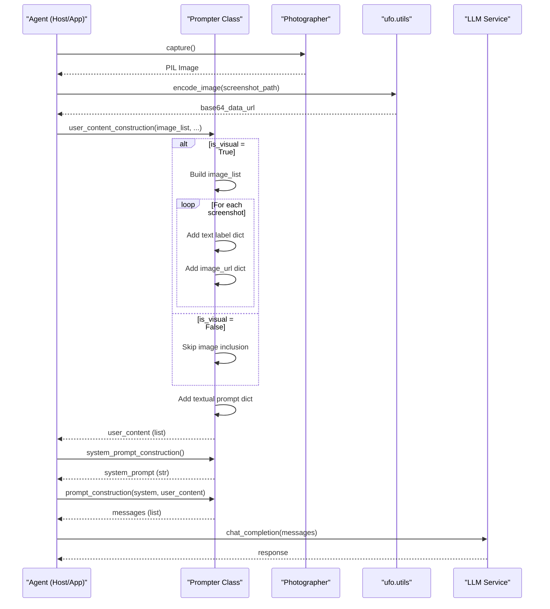

<!-- source: DeepWiki mcp.deepwiki.com · repo microsoft/UFO · page 9.2 Multi-Modal Prompt Support · fetched 2026-10-26 -->

# Multi-Modal Prompt Support

<details>
<summary>Relevant source files</summary>

The following files were used as context for generating this wiki page:

- [dataflow/prompter/instantiation/filter_prompter.py](dataflow/prompter/instantiation/filter_prompter.py)
- [dataflow/prompter/instantiation/prefill_prompter.py](dataflow/prompter/instantiation/prefill_prompter.py)
- [dataflow/prompter/instantiation/template_prompter.py](dataflow/prompter/instantiation/template_prompter.py)
- [galaxy/agents/prompters/base_constellation_prompter.py](galaxy/agents/prompters/base_constellation_prompter.py)
- [tests/test_prompt_sanitizer.py](tests/test_prompt_sanitizer.py)
- [ufo/automator/ui_control/controller.py](ufo/automator/ui_control/controller.py)
- [ufo/automator/ui_control/screenshot.py](ufo/automator/ui_control/screenshot.py)
- [ufo/prompter/agent_prompter.py](ufo/prompter/agent_prompter.py)
- [ufo/prompter/basic.py](ufo/prompter/basic.py)
- [ufo/prompter/customized/linux_agent_prompter.py](ufo/prompter/customized/linux_agent_prompter.py)
- [ufo/prompter/customized/mobile_agent_prompter.py](ufo/prompter/customized/mobile_agent_prompter.py)
- [ufo/prompter/demonstration_prompter.py](ufo/prompter/demonstration_prompter.py)
- [ufo/prompter/eva_prompter.py](ufo/prompter/eva_prompter.py)
- [ufo/prompter/experience_prompter.py](ufo/prompter/experience_prompter.py)
- [ufo/prompter/prompt_sanitizer.py](ufo/prompter/prompt_sanitizer.py)
- [ufo/prompts/examples/nonvisual/app_agent_example.yaml](ufo/prompts/examples/nonvisual/app_agent_example.yaml)
- [ufo/prompts/examples/nonvisual/host_agent_example.yaml](ufo/prompts/examples/nonvisual/host_agent_example.yaml)
- [ufo/prompts/examples/visual/app_agent_example.yaml](ufo/prompts/examples/visual/app_agent_example.yaml)
- [ufo/prompts/examples/visual/host_agent_example.yaml](ufo/prompts/examples/visual/host_agent_example.yaml)
- [ufo/prompts/share/base/app_agent.yaml](ufo/prompts/share/base/app_agent.yaml)
- [ufo/prompts/share/base/host_agent.yaml](ufo/prompts/share/base/host_agent.yaml)
- [ufo/utils/__init__.py](ufo/utils/__init__.py)

</details>


This document explains how UFO integrates visual information into LLM prompts for vision-enabled models. Multi-modal prompts combine textual instructions with screenshots and annotated images, allowing agents to make decisions based on visual observations of the application state.

For information about the overall prompt construction pipeline and textual components, see [Prompt Components and Construction](9.1). For the broader prompter architecture, see [Prompt System](9).

---

## Overview of Multi-Modal Architecture

UFO supports both text-only and vision-enabled LLMs through a configurable `is_visual` flag that determines whether screenshots are included in prompts. When visual mode is enabled, the system captures, annotates, and encodes screenshots as base64 data URLs, then constructs structured user content that interleaves text and images.

The `Photographer` hierarchy provides the foundation for image capture, with `ControlPhotographer` handling window-specific captures and falling back to `DesktopPhotographer` if necessary [ufo/automator/ui_control/screenshot.py:70-133]().

Title: Multi-Modal Prompt Construction Pipeline

Sources: [ufo/prompter/basic.py:21-42](), [ufo/prompter/agent_prompter.py:18-32](), [ufo/automator/ui_control/screenshot.py:70-82]()

---

## The `is_visual` Flag

The `is_visual` boolean parameter is the primary discriminator for multi-modal behavior. It is set during prompter initialization and persists throughout the agent's lifecycle [ufo/prompter/basic.py:30-40]().

| Prompter Class | Configuration Source | Default Behavior |
|----------------|---------------------|------------------|
| `HostAgentPrompter` | `agents.yaml: HOST_AGENT.visual_mode` | Non-visual uses `system_nonvisual` template key [ufo/prompter/agent_prompter.py:52-58]() |
| `AppAgentPrompter` | `agents.yaml: APP_AGENT.visual_mode` | Non-visual uses `system_nonvisual` or `system_as_nonvisual` [ufo/prompter/agent_prompter.py:230-237]() |
| `EvaluationAgentPrompter` | `agents.yaml: EVALUATION_AGENT.visual_mode` | Affects screenshot inclusion strategy [ufo/prompter/eva_prompter.py:48-58]() |
| `ExperiencePrompter` | `config: app_agent.visual_mode` | Controls initial screenshot in experience logs [ufo/prompter/experience_prompter.py:75-91]() |

Sources: [ufo/prompter/basic.py:21-41](), [ufo/prompter/agent_prompter.py:51-57](), [ufo/prompter/agent_prompter.py:230-237]()

---

## Image Encoding and Data URL Format

Screenshots are converted to base64-encoded data URLs using the OpenAI vision API format. The `ufo.utils` module provides utility functions for decoding and handling these strings [ufo/utils/__init__.py:221-236]().

The encoding process involves:
1. Capture screenshot as PNG file via `Photographer` subclasses [ufo/automator/ui_control/screenshot.py:82-133]().
2. Read binary image data and encode to base64.
3. Prefix with MIME type header (e.g., `data:image/png;base64,`).

**Key Functions:**
- `ufo.utils.encode_image(image_path: str) -> str`: Converts file path to data URL.
- `ufo.utils.decode_base64_image(base64_string: str) -> bytes`: Decodes a base64 string back to bytes for processing [ufo/utils/__init__.py:221-226]().

Sources: [ufo/prompter/eva_prompter.py:109-117](), [ufo/utils/__init__.py:221-236](), [ufo/automator/ui_control/screenshot.py:128-133]()

---

## User Content Structure

Multi-modal prompts use a list-based structure where each element is a dictionary with a `type` discriminator [ufo/prompter/agent_prompter.py:126-148]().

```python
user_content = [
    {"type": "text", "text": "Current Screenshots:"},
    {"type": "image_url", "image_url": {"url": "data:image/png;base64,..."}},
    {"type": "text", "text": "The prompt text..."},
]
```

The final message structure is assembled in `BasicPrompter.prompt_construction`, creating a list of role-based messages [ufo/prompter/basic.py:72-87]().

Sources: [ufo/prompter/agent_prompter.py:126-148](), [ufo/prompter/basic.py:72-87]()

---

## Screenshot Types and Annotation

UFO captures multiple screenshot variants to provide comprehensive visual context. The `AppAgent` specifically references these in its system prompt [ufo/prompts/share/base/app_agent.yaml:13-19]().

Title: Screenshot Types and Agent Usage


### Screenshot Variants

1. **Clean Screenshot**: Unmodified capture showing the application state [ufo/prompts/share/base/app_agent.yaml:14]().
2. **Annotated Screenshot**: Controls labeled with numeric identifiers (IDs) to help identify elements [ufo/prompts/share/base/app_agent.yaml:16]().
3. **Previous Step Screenshot**: The screenshot from the last step for reference and comparison [ufo/prompts/share/base/app_agent.yaml:15]().

Sources: [ufo/prompts/share/base/app_agent.yaml:13-19](), [ufo/prompter/agent_prompter.py:310-325](), [ufo/prompter/eva_prompter.py:127-133]()

---

## Agent-Specific Image Strategies

### HostAgent Image Strategy

`HostAgentPrompter` uses a **single screenshot** strategy (or multiple desktop screens concatenated) focused on desktop-level observation [ufo/prompter/agent_prompter.py:106-148]().

**Characteristics:**
- Receives a list of images (usually one desktop capture) [ufo/prompter/agent_prompter.py:131-133]().
- Labeled as "Current Screenshots:".
- Focuses on window selection via `select_application_window` [ufo/prompts/share/base/host_agent.yaml:10]().

Sources: [ufo/prompter/agent_prompter.py:106-148](), [ufo/prompts/share/base/host_agent.yaml:3-11]()

---

### AppAgent Image Strategy

`AppAgentPrompter` uses a **multi-screenshot** strategy with historical context [ufo/prompter/agent_prompter.py:280-339]().

**Image Sequence (when `include_last_screenshot=True`):**
1. **Screenshot for the last step**: Visual result of the previous action [ufo/prompter/agent_prompter.py:312-313]().
2. **Current Screenshots**: Clean view of current application state [ufo/prompter/agent_prompter.py:315]().
3. **Annotated Screenshot**: View with control labels overlaid [ufo/prompter/agent_prompter.py:315]().

Sources: [ufo/prompter/agent_prompter.py:280-339](), [ufo/prompts/share/base/app_agent.yaml:14-16]()

---

### EvaluationAgent Image Strategy

`EvaluationAgentPrompter` supports two strategies based on `eva_all_screenshots` [ufo/prompter/eva_prompter.py:78-80]().

#### Strategy 1: Head-Tail Screenshots (Default)
Includes only the initial screenshot from the start of the session and the final screenshot after completion [ufo/prompter/eva_prompter.py:93-144]().

#### Strategy 2: All Screenshots
Includes screenshots for every step in the trajectory. To avoid hitting API limits, it filters out placeholder images (1x1 pixels) and caps the total count using `MAX_EVAL_IMAGES = 40` [ufo/prompter/eva_prompter.py:148-186]().

Sources: [ufo/prompter/eva_prompter.py:78-204](), [ufo/prompter/eva_prompter.py:148-170]()

---

## Visual Mode Prompt Template Differences

The prompter selects different system prompt keys from YAML files based on the `is_visual` flag [ufo/prompter/agent_prompter.py:52-58]().

### HostAgent Template Keys
- **Visual**: Uses `system` key [ufo/prompter/agent_prompter.py:52]().
- **Non-Visual**: Uses `system_nonvisual` key [ufo/prompter/agent_prompter.py:52]().

### AppAgent Template Keys
- **Visual**: Uses `system` or `system_as` (action sequence) [ufo/prompter/agent_prompter.py:221-228]().
- **Non-Visual**: Appends `_nonvisual` suffix (e.g., `system_nonvisual`) [ufo/prompter/agent_prompter.py:230-237]().

Sources: [ufo/prompter/agent_prompter.py:52-58](), [ufo/prompter/agent_prompter.py:220-238]()

---

## Implementation Flow

Title: Multi-Modal Prompt Construction Sequence


### Key Implementation Classes and Methods

| Class | Method | Purpose |
|-------|--------|---------|
| `HostAgentPrompter` | `user_content_construction()` | Constructs desktop-level multi-modal prompts [ufo/prompter/agent_prompter.py:106-148]() |
| `AppAgentPrompter` | `user_content_construction()` | Constructs application-level prompts with clean/annotated pairs [ufo/prompter/agent_prompter.py:280-339]() |
| `EvaluationAgentPrompter` | `user_content_construction_all()` | Includes filtered step screenshots for evaluation [ufo/prompter/eva_prompter.py:188-204]() |
| `BasicPrompter` | `prompt_construction()` | Assembles final message list from system + user content [ufo/prompter/basic.py:72-87]() |
| `ControlPhotographer` | `capture()` | Captures application window with fallback mechanisms [ufo/automator/ui_control/screenshot.py:82-133]() |

Sources: [ufo/prompter/agent_prompter.py:106-148](), [ufo/prompter/agent_prompter.py:280-339](), [ufo/prompter/eva_prompter.py:188-204](), [ufo/prompter/basic.py:72-87](), [ufo/automator/ui_control/screenshot.py:82-133]()

---

