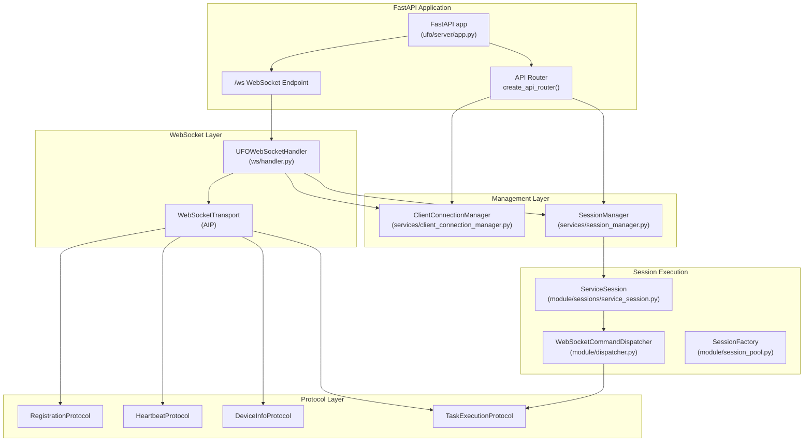
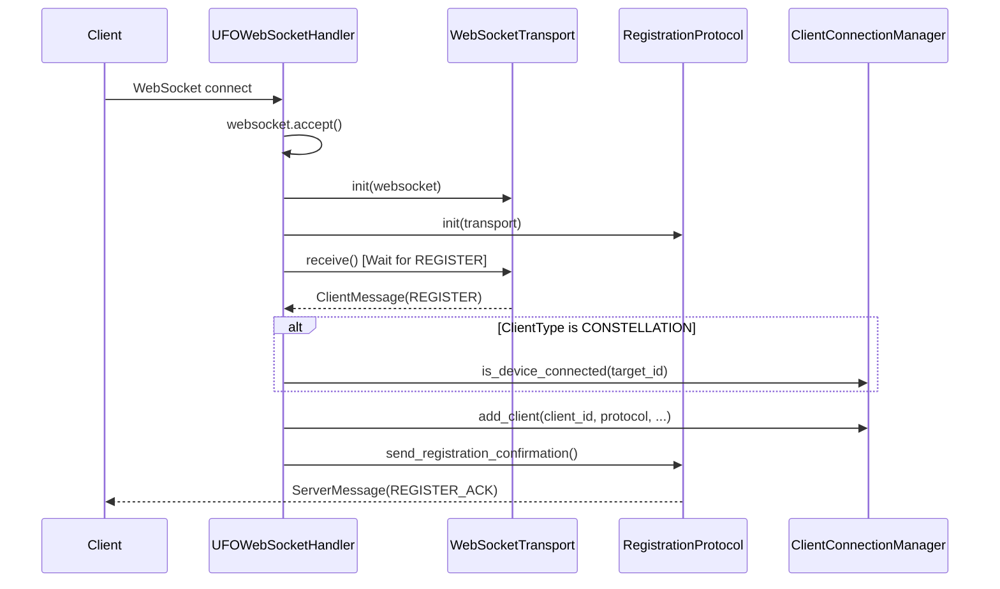
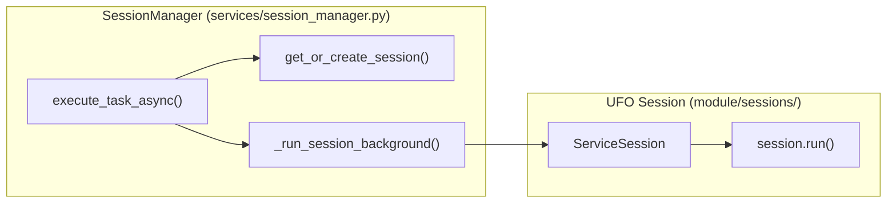

<!-- source: DeepWiki mcp.deepwiki.com · repo microsoft/UFO · unicode-title page UFO² Server Implementation · patched 2026-10-26 -->

# UFO² Server Implementation
# UFO² Server Implementation

<details>
<summary>Relevant source files</summary>

The following files were used as context for generating this wiki page:

- [ufo/client/client.py](ufo/client/client.py)
- [ufo/client/mcp/http_servers/hardware_mcp_server.py](ufo/client/mcp/http_servers/hardware_mcp_server.py)
- [ufo/client/mcp/mcp_registry.py](ufo/client/mcp/mcp_registry.py)
- [ufo/client/mcp/mcp_server_manager.py](ufo/client/mcp/mcp_server_manager.py)
- [ufo/client/ufo_client.py](ufo/client/ufo_client.py)
- [ufo/client/websocket.py](ufo/client/websocket.py)
- [ufo/module/context.py](ufo/module/context.py)
- [ufo/module/dispatcher.py](ufo/module/dispatcher.py)
- [ufo/module/sessions/service_session.py](ufo/module/sessions/service_session.py)
- [ufo/server/app.py](ufo/server/app.py)
- [ufo/server/services/api.py](ufo/server/services/api.py)
- [ufo/server/services/client_connection_manager.py](ufo/server/services/client_connection_manager.py)
- [ufo/server/services/session_manager.py](ufo/server/services/session_manager.py)
- [ufo/server/ws/handler.py](ufo/server/ws/handler.py)

</details>


This page documents the server-side implementation of the Agent Interaction Protocol (AIP) in UFO², including the FastAPI-based WebSocket server, connection management, session orchestration, and message routing components. The server acts as the execution endpoint for both standalone device operations and Galaxy-orchestrated tasks.

For information about the AIP protocol structure and message types, see [Protocol Architecture](). For details on client-side implementation, see [Client-Side Implementation](). For device registration flows, see [Device Registration and Lifecycle]().

---

## Overview

The UFO² server provides a WebSocket-based service that:
- Accepts connections from device clients and constellation orchestrators. [ufo/server/ws/handler.py:19-23]()
- Routes AIP messages to appropriate handlers. [ufo/server/ws/handler.py:261-314]()
- Manages concurrent session execution in the background. [ufo/server/services/session_manager.py:151-178]()
- Tracks client connections and active sessions. [ufo/server/services/client_connection_manager.py:30-52]()
- Provides REST API endpoints for task dispatch and health checks. [ufo/server/services/api.py:26-109]()

The server supports three deployment modes:
- **Local mode**: Client and server run on the same machine with auto-connection. [ufo/server/app.py:36-40]()
- **Remote mode**: Distributed deployment with network-based WebSocket connections. [ufo/server/app.py:12-14]()
- **Galaxy mode**: Server acts as device agent receiving tasks from Galaxy orchestrator. [ufo/server/ws/handler.py:168-170]()

**Sources:** [ufo/server/app.py:1-114](), [ufo/server/ws/handler.py:1-565]()

---

## Server Architecture

### Component Hierarchy



**Sources:** [ufo/server/app.py:63-93](), [ufo/server/ws/handler.py:19-48](), [ufo/server/services/api.py:26-109](), [ufo/module/sessions/service_session.py:16-28](), [ufo/module/dispatcher.py:134-160]()

---

## FastAPI Application Setup

### Application Initialization

The server is initialized in `ufo/server/app.py` [ufo/server/app.py:79-93]() with the following core components:

| Component | Class / Function | Purpose |
|-----------|------------------|---------|
| `app` | `FastAPI()` | Main ASGI application. [ufo/server/app.py:80]() |
| `session_manager` | `SessionManager` | Manages UFO session lifecycle and background tasks. [ufo/server/app.py:83]() |
| `client_manager` | `ClientConnectionManager` | Tracks connected clients and their protocol instances. [ufo/server/app.py:84]() |
| `ws_handler` | `UFOWebSocketHandler` | Orchestrates WebSocket connections and AIP routing. [ufo/server/app.py:92]() |
| `api_router` | `create_api_router()` | Generates REST API endpoints for external control. [ufo/server/app.py:88]() |

**Command-line Arguments:**
The server accepts various CLI arguments to configure its behavior, including `--port`, `--host`, `--api-key` (for authentication), and `--local` mode. [ufo/server/app.py:9-41]()

**Sources:** [ufo/server/app.py:9-93]()

### WebSocket Endpoint and Authentication

The `/ws` endpoint is secured using an API key passed as a query parameter. [ufo/server/app.py:95-107]()

```python
@app.websocket("/ws")
async def websocket_endpoint(websocket: WebSocket, token: str = Query(default=None)) -> None:
    if not secrets.compare_digest(token or "", _api_key):
        await websocket.close(code=WS_1008_POLICY_VIOLATION, reason="Invalid token")
        return
    await ws_handler.handler(websocket)
```
[ufo/server/app.py:95-107]()

---

## UFOWebSocketHandler

### Connection Lifecycle

The `UFOWebSocketHandler` manages the state of each WebSocket connection from initial handshake to termination. [ufo/server/ws/handler.py:19-48]()

#### 1. Connection Establishment and Registration
The connection flow uses the AIP `RegistrationProtocol` to validate clients. [ufo/server/ws/handler.py:49-65]()



**Sources:** [ufo/server/ws/handler.py:49-100](), [ufo/server/ws/handler.py:101-124](), [ufo/server/ws/handler.py:147-153]()

#### 2. Message Handling Loop
After registration, the handler enters an infinite loop. [ufo/server/ws/handler.py:246-251]() Incoming messages are processed concurrently using `asyncio.create_task()` to prevent blocking the connection. [ufo/server/ws/handler.py:251]()

#### 3. Disconnection and Cleanup
When a client disconnects, `UFOWebSocketHandler.disconnect()` is triggered. [ufo/server/ws/handler.py:183-185]() It performs the following cleanup:
1. Identifies all active sessions associated with the client. [ufo/server/ws/handler.py:196-204]()
2. Cancels background tasks in the `SessionManager`. [ufo/server/ws/handler.py:207-210]()
3. Removes the client from the `ClientConnectionManager`. [ufo/server/ws/handler.py:233]()

**Sources:** [ufo/server/ws/handler.py:183-260]()

---

## Session Management and Background Execution

### SessionManager Implementation

The `SessionManager` is responsible for the asynchronous execution of UFO tasks. [ufo/server/services/session_manager.py:20-51]() It maintains a mapping of `session_id` to `BaseSession` objects and their corresponding `asyncio.Task` handles. [ufo/server/services/session_manager.py:33-42]()



**Sources:** [ufo/server/services/session_manager.py:53-109](), [ufo/server/services/session_manager.py:151-196]()

### Background Task Flow
The `execute_task_async` method allows the server to handle long-running GUI automation tasks without stalling the WebSocket. [ufo/server/services/session_manager.py:151-178]()

1. **Session Creation**: Uses `SessionFactory` to create a `ServiceSession` (e.g., `WindowsBaseSession` for Windows). [ufo/server/services/session_manager.py:80-97]()
2. **Task Spawning**: Wraps `_run_session_background` in an `asyncio.Task`. [ufo/server/services/session_manager.py:192]()
3. **Execution**: The task calls `session.run()`, which enters the agent processing loop. [ufo/server/services/session_manager.py:247]()
4. **Completion Callback**: Once the session finishes or fails, a callback is executed to send the final `TASK_END` message via AIP. [ufo/server/services/session_manager.py:270-282]()

**Sources:** [ufo/server/services/session_manager.py:151-282]()

---

## Message Dispatching and Protocol Integration

### WebSocketCommandDispatcher
When an agent (Host or App) decides on an action, it uses the `WebSocketCommandDispatcher`. [ufo/module/dispatcher.py:134-155]() This class translates internal UFO commands into AIP `ServerMessage` objects. [ufo/module/dispatcher.py:174-204]()

```python
def make_server_response(self, commands: List[Command]) -> ServerMessage:
    return ServerMessage(
        type=ServerMessageType.COMMAND,
        status=TaskStatus.CONTINUE,
        actions=commands,
        session_id=self.session.id,
        ...
    )
```
[ufo/module/dispatcher.py:174-204]()

The dispatcher uses `asyncio.Future` to wait for the client to return execution results. [ufo/module/dispatcher.py:236-241]()

### REST API Dispatch
The server also supports task dispatch via standard HTTP POST requests to `/api/dispatch`. [ufo/server/services/api.py:45-96]() This endpoint:
1. Validates the `X-API-Key`. [ufo/server/services/api.py:19-21]()
2. Retrieves the client's WebSocket connection. [ufo/server/services/api.py:67-70]()
3. Initializes a temporary `TaskExecutionProtocol`. [ufo/server/services/api.py:73-74]()
4. Sends a `TASK` assignment to the client. [ufo/server/services/api.py:84-89]()

**Sources:** [ufo/server/services/api.py:16-109](), [ufo/module/dispatcher.py:134-253]()

---

## Client Connection Management

The `ClientConnectionManager` acts as the registry for all active participants in the AIP ecosystem. [ufo/server/services/client_connection_manager.py:30-52]()

| Functionality | Implementation |
|---------------|----------------|
| **Client Storage** | Stores `ClientInfo` objects containing WebSocket, transport, and protocol instances. [ufo/server/services/client_connection_manager.py:14-28]() |
| **Type Validation** | Distinguishes between `DEVICE` (executors) and `CONSTELLATION` (orchestrators). [ufo/server/services/client_connection_manager.py:141-155]() |
| **Session Mapping** | Maintains mappings of `constellation_id` to `session_id` and `device_id` to `session_id` for cleanup. [ufo/server/services/client_connection_manager.py:54-126]() |
| **System Metadata** | Merges client-provided system info with server-side `devices.yaml` configurations. [ufo/server/services/client_connection_manager.py:306-406]() |

**Sources:** [ufo/server/services/client_connection_manager.py:14-406]()

---

