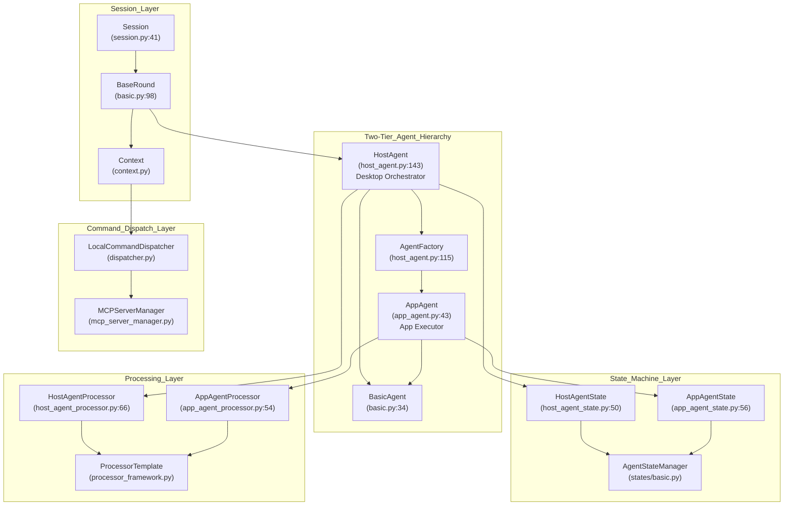
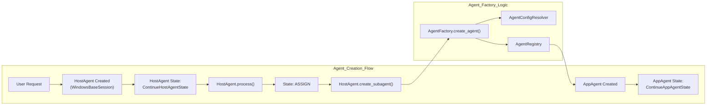
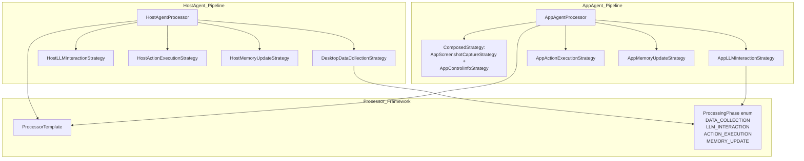

<!-- source: DeepWiki mcp.deepwiki.com · repo microsoft/UFO · page 3 UFO² Desktop AgentOS · patched2 2026-10-26 -->

# UFO² Desktop AgentOS
# UFO² Desktop AgentOS

Relevant source files

The following files were used as context for generating this wiki page:

- [documents/docs/img/aip_new.png](documents/docs/img/aip_new.png)
- [documents/docs/img/decomposition.png](documents/docs/img/decomposition.png)
- [documents/docs/ufo2/app_agent/commands.md](documents/docs/ufo2/app_agent/commands.md)
- [documents/docs/ufo2/app_agent/overview.md](documents/docs/ufo2/app_agent/overview.md)
- [documents/docs/ufo2/app_agent/state.md](documents/docs/ufo2/app_agent/state.md)
- [documents/docs/ufo2/app_agent/strategy.md](documents/docs/ufo2/app_agent/strategy.md)
- [documents/docs/ufo2/core_features/hybrid_actions.md](documents/docs/ufo2/core_features/hybrid_actions.md)
- [documents/docs/ufo2/host_agent/commands.md](documents/docs/ufo2/host_agent/commands.md)
- [documents/docs/ufo2/host_agent/overview.md](documents/docs/ufo2/host_agent/overview.md)
- [documents/docs/ufo2/host_agent/state.md](documents/docs/ufo2/host_agent/state.md)
- [documents/docs/ufo2/host_agent/strategy.md](documents/docs/ufo2/host_agent/strategy.md)
- [documents/docs/ufo2/overview.md](documents/docs/ufo2/overview.md)
- [ufo/__main__.py](ufo/__main__.py)
- [ufo/agents/agent/app_agent.py](ufo/agents/agent/app_agent.py)
- [ufo/agents/agent/basic.py](ufo/agents/agent/basic.py)
- [ufo/agents/agent/evaluation_agent.py](ufo/agents/agent/evaluation_agent.py)
- [ufo/agents/agent/host_agent.py](ufo/agents/agent/host_agent.py)
- [ufo/agents/processors/app_agent_processor.py](ufo/agents/processors/app_agent_processor.py)
- [ufo/agents/processors/host_agent_processor.py](ufo/agents/processors/host_agent_processor.py)
- [ufo/agents/states/app_agent_state.py](ufo/agents/states/app_agent_state.py)
- [ufo/agents/states/basic.py](ufo/agents/states/basic.py)
- [ufo/agents/states/host_agent_state.py](ufo/agents/states/host_agent_state.py)
- [ufo/agents/states/operator_state.py](ufo/agents/states/operator_state.py)
- [ufo/llm/llm_call.py](ufo/llm/llm_call.py)
- [ufo/llm/openai.py](ufo/llm/openai.py)
- [ufo/module/basic.py](ufo/module/basic.py)
- [ufo/module/sessions/plan_reader.py](ufo/module/sessions/plan_reader.py)
- [ufo/module/sessions/session.py](ufo/module/sessions/session.py)
- [ufo/rag/retriever.py](ufo/rag/retriever.py)
- [ufo/ufo.py](ufo/ufo.py)

## Overview

**UFO² Desktop AgentOS** is a single-device Windows automation system that executes natural language requests through intelligent agent orchestration. It serves dual roles in the UFO³ ecosystem: as a **standalone Windows automation framework** and as the **execution layer** for Windows devices when operating as a Galaxy device agent.

### Hierarchical Agent Architecture

UFO² implements a **two-tier hierarchical agent system**:
- **HostAgent**: Desktop-level orchestrator analyzing the overall environment and selecting applications. [ufo/agents/agent/host_agent.py:142-146]()
- **AppAgent**: Application-level executors performing fine-grained actions within specific applications. [ufo/agents/agent/app_agent.py:42-46]()

This hierarchy mirrors the operating system structure: the `HostAgent` operates at the desktop/OS level while `AppAgents` operate at the application/process level.

### Hybrid GUI/API Execution

UFO² uniquely combines two automation approaches:
- **GUI Automation**: UI element interaction via `pywinauto` or `pyautogui` through the `ControlReceiver`. [ufo/agents/processors/app_agent_processor.py:66-68]()
- **API Automation**: Native application APIs via COM interfaces through specialized receivers for Office applications like Word, Excel, and PowerPoint. [ufo/module/sessions/session.py:13-17]()

The automation framework intelligently routes actions to the appropriate execution method, enabling both robustness (GUI) and efficiency (API) in a unified framework.

### Dual Operating Modes

- **Standalone Mode**: Direct execution via `LocalCommandDispatcher` for interactive automation. [ufo/module/sessions/session.py:102-103]()
- **Galaxy Device Agent Mode**: Remote execution via `WebSocketCommandDispatcher` when coordinated by UFO³ Galaxy. [ufo/module/sessions/session.py:101-103]()

**Navigation:** This page documents UFO²'s core architecture and execution model. For multi-device orchestration, see [UFO³ Galaxy Framework](#4). For agent implementations, see [Host Agent](#3.3) and [App Agent](#3.4). For the processing pipeline, see [Agent Processing System](#3.1).

**Sources:** [ufo/agents/agent/host_agent.py:142-177](), [ufo/agents/agent/app_agent.py:42-87](), [ufo/module/sessions/session.py:41-65](), [ufo/agents/processors/app_agent_processor.py:54-73]()

## System Architecture

UFO² implements a hierarchical agent architecture where a `HostAgent` orchestrates multiple `AppAgent` instances to complete cross-application workflows. The system is organized into distinct layers handling session management, agent processing, action execution, and system interaction.

### UFO² Component Architecture

**Component Responsibilities:**

| Layer | Component | Role | Key References |
|-------|-----------|------|---------------------|
| **Session** | `Session` | Manages multi-round user interactions, creates rounds | [ufo/module/sessions/session.py:41-65]() |
| | `BaseRound` | Executes single user request through agent state transitions | [ufo/module/basic.py:98-129]() |
| | `Context` | Shared data structure propagating state across components | [ufo/module/context.py:35-41]() |
| **Agent Hierarchy** | `HostAgent` | **Tier 1**: Desktop-level orchestrator, selects applications | [ufo/agents/agent/host_agent.py:143-177]() |
| | `AppAgent` | **Tier 2**: Application-level executor, controls individual apps | [ufo/agents/agent/app_agent.py:43-87]() |
| | `AgentFactory` | Creates agent instances based on mode and type | [ufo/agents/agent/host_agent.py:115-140]() |
| **State Machine** | `HostAgentState` | FSM states for HostAgent: CONTINUE, ASSIGN, PENDING, FINISH | [ufo/agents/states/host_agent_state.py:21-33]() |
| | `AppAgentState` | FSM states for AppAgent: CONTINUE, CONFIRM, PENDING, FINISH | [ufo/agents/states/app_agent_state.py:30-42]() |
| **Processing** | `HostAgentProcessor` | Executes 4-phase pipeline for desktop analysis | [ufo/agents/processors/host_agent_processor.py:66-113]() |
| | `AppAgentProcessor` | Executes 4-phase pipeline for app automation | [ufo/agents/processors/app_agent_processor.py:54-110]() |

**Sources:** [ufo/module/basic.py:1-155](), [ufo/agents/agent/host_agent.py:142-177](), [ufo/agents/agent/app_agent.py:42-87](), [ufo/agents/processors/host_agent_processor.py:66-126](), [ufo/agents/processors/app_agent_processor.py:54-110]()

## Agent Hierarchy and Lifecycle

UFO² implements a two-tier agent hierarchy where `HostAgent` acts as the desktop orchestrator and `AppAgent` instances handle application-specific automation. Agent creation follows the Factory pattern, with state machines controlling their behavior.

### Agent Creation and State Transitions

**Agent Factory Implementation:**

The `AgentFactory` in [ufo/agents/agent/host_agent.py:115-140]() creates agents based on type and mode. It supports standard host agents, app agents, and specialized agents like `OpenAIOperatorAgent`.

The `AgentConfigResolver` in [ufo/agents/agent/host_agent.py:42-113]() provides configuration based on mode and agent type:
- `resolve_app_agent_config()`: Returns config for standard `AppAgent` with prompts and visual settings. [ufo/agents/agent/host_agent.py:46-76]()
- `resolve_operator_agent_config()`: Returns config for `OpenAIOperatorAgent`. [ufo/agents/agent/host_agent.py:78-94]()
- `resolve_third_party_config()`: Returns config for third-party agents registered in the system. [ufo/agents/agent/host_agent.py:97-113]()

**Agent Lifecycle States:**

| Agent | States | Transitions |
|-------|--------|-------------|
| **HostAgent** | `CONTINUE` → `ASSIGN` → `PENDING` → `FINISH` | Managed by `HostAgentStateManager`. [ufo/agents/states/host_agent_state.py:35-41]() |
| **AppAgent** | `CONTINUE` → `CONFIRM` → `PENDING` → `FINISH` | Managed by `AppAgentStateManager`. [ufo/agents/states/app_agent_state.py:44-47]() |

**Sources:** [ufo/agents/agent/host_agent.py:42-177](), [ufo/agents/states/host_agent_state.py:21-41](), [ufo/agents/states/app_agent_state.py:30-47]()

## Processing Pipeline

Both `HostAgent` and `AppAgent` execute through a unified **Processor-Strategy-Middleware** architecture. Each agent's processor orchestrates four sequential phases using dedicated strategy implementations.

### Processor-Strategy Architecture

**Processing Phases:**

Each processor executes strategies in a fixed order defined in the `ProcessingPhase` enum: [ufo/agents/processors/app_agent_processor.py:84-109]()

1. **DATA_COLLECTION**: Gather environment information (screenshots, UI trees, application states).
2. **LLM_INTERACTION**: Build prompts, call LLM, parse structured responses.
3. **ACTION_EXECUTION**: Execute commands through the `CommandDispatcher`.
4. **MEMORY_UPDATE**: Update agent memory, blackboard, and context.

**Middleware Chain:**

Middleware wraps processor execution for cross-cutting concerns like logging and performance monitoring. Currently, both processors use specialized logging middleware for Rich-formatted console output:
- `HostAgentLoggingMiddleware`: [ufo/agents/processors/host_agent_processor.py:186-192]()
- `AppAgentLoggingMiddleware`: [ufo/agents/processors/app_agent_processor.py:132-142]()

**Sources:** [ufo/agents/processors/host_agent_processor.py:66-126](), [ufo/agents/processors/app_agent_processor.py:54-114](), [ufo/agents/processors/core/processor_framework.py:26-30]()

## Session and Round Execution Model

UFO² organizes execution into **Sessions** (multi-round conversations) and **Rounds** (single user requests). Each session maintains a `Context` object that propagates state across rounds and agents.

### Execution Flow

A `BaseRound` manages the lifecycle of a single user request, driving the agent through state transitions until the task is finished or a step limit is reached. [ufo/module/basic.py:156-191]()

1. **Round Initialization**: Sets up `ROUND_STEP`, `ROUND_COST`, and `REQUEST` in the shared context. [ufo/module/basic.py:132-154]()
2. **Execution Loop**: The round calls `agent.handle(context)` repeatedly. [ufo/module/basic.py:161-163]()
3. **State Transition**: After each handle call, the round determines the next state and next agent. [ufo/module/basic.py:167-174]()
4. **Completion**: Once finished, it captures a final snapshot and performs evaluation if configured. [ufo/module/basic.py:186-191]()

**Context Management:**

The `Context` class stores shared state with typed keys defined in the `ContextNames` enum: [ufo/module/context.py:35-41]()
- `SESSION_STEP`: Global step counter.
- `ROUND_STEP`: Per-round step counters.
- `REQUEST`: Current user request.
- `APPLICATION_PROCESS_NAME`: Active application process.

**Sources:** [ufo/module/basic.py:98-201](), [ufo/module/sessions/session.py:41-158](), [ufo/module/context.py:35-41]()

## Session Types and Operational Modes

UFO² supports different session types for interactive, automated, and batch processing scenarios.

| Session Type | Class | Use Case | Mode |
|--------------|-------|----------|------|
| **Standard Session** | `Session` | Interactive automation with user prompts. | `"normal"` |
| **Follower Session** | `FollowerSession` | Executes a predefined plan from a file. | `"follower"` |
| **Batch Session** | `FromFileSession` | Processes multiple files automatically. | `"batch_normal"` |

**Operational Modes:**
- **Normal Mode**: Standard interactive use. [ufo/ufo.py:55-56]()
- **Follower Mode**: Follows a plan file or folder. [ufo/ufo.py:58-59]()
- **Batch Mode**: Processes tasks in batch. [ufo/ufo.py:61-62]()
- **Operator Mode**: Runs the OpenAI Operator agent separately. [ufo/ufo.py:20-21]()

**Sources:** [ufo/module/sessions/session.py:41-491](), [ufo/ufo.py:9-42](), [ufo/agents/agent/host_agent.py:34-40]()

## Summary

UFO² Desktop AgentOS provides a robust execution layer for Windows automation through:

1. **Hierarchical Agent Architecture**: `HostAgent` orchestrates desktop-level tasks, spawning `AppAgent` instances for application-specific automation.
2. **Phase-Based Processing Pipeline**: Processor-strategy-middleware architecture separates data collection, LLM interaction, action execution, and memory update.
3. **State Machine Control**: FSM-based state transitions provide deterministic execution flow.
4. **Flexible Session Management**: Supports interactive, follower, and batch modes for diverse automation needs.

**Sources:** [ufo/agents/agent/host_agent.py:142-177](), [ufo/agents/agent/app_agent.py:42-87](), [ufo/agents/processors/app_agent_processor.py:54-110](), [ufo/module/basic.py:98-201]()

---

