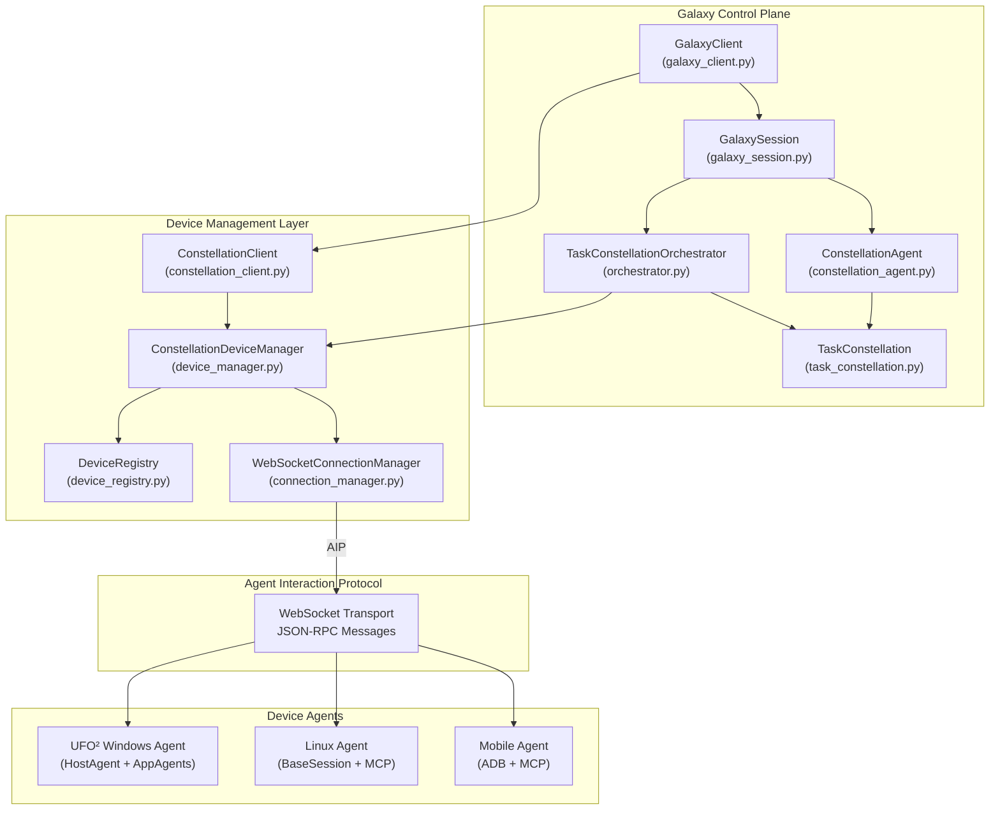
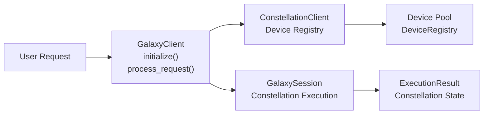
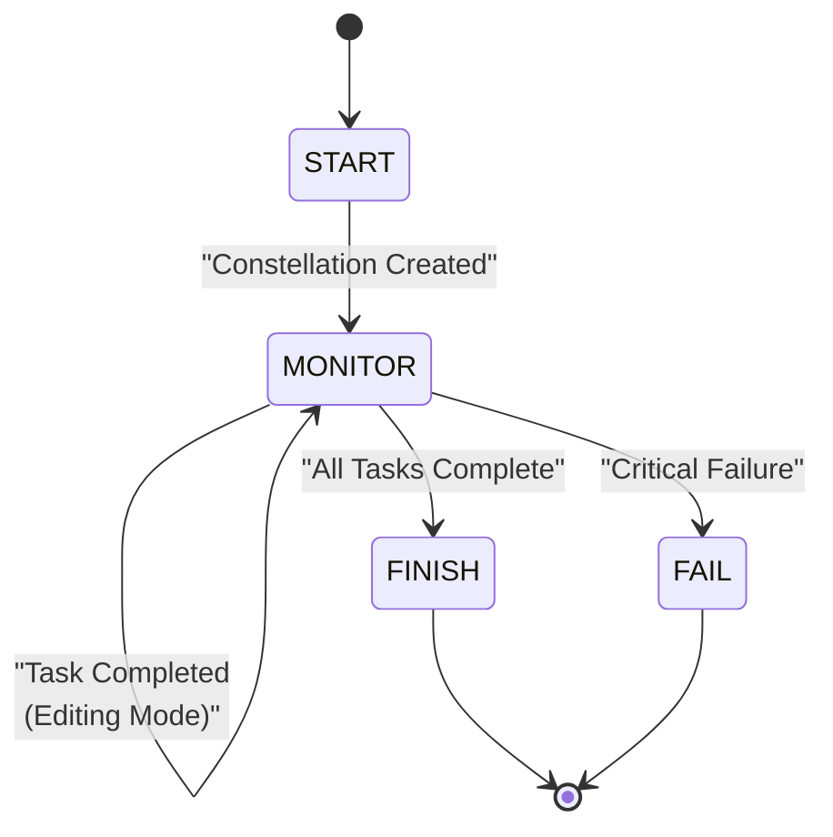
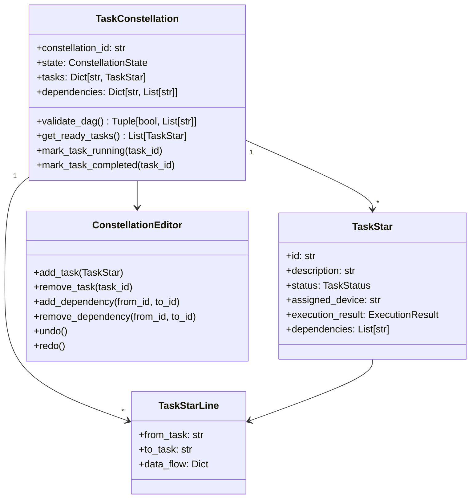
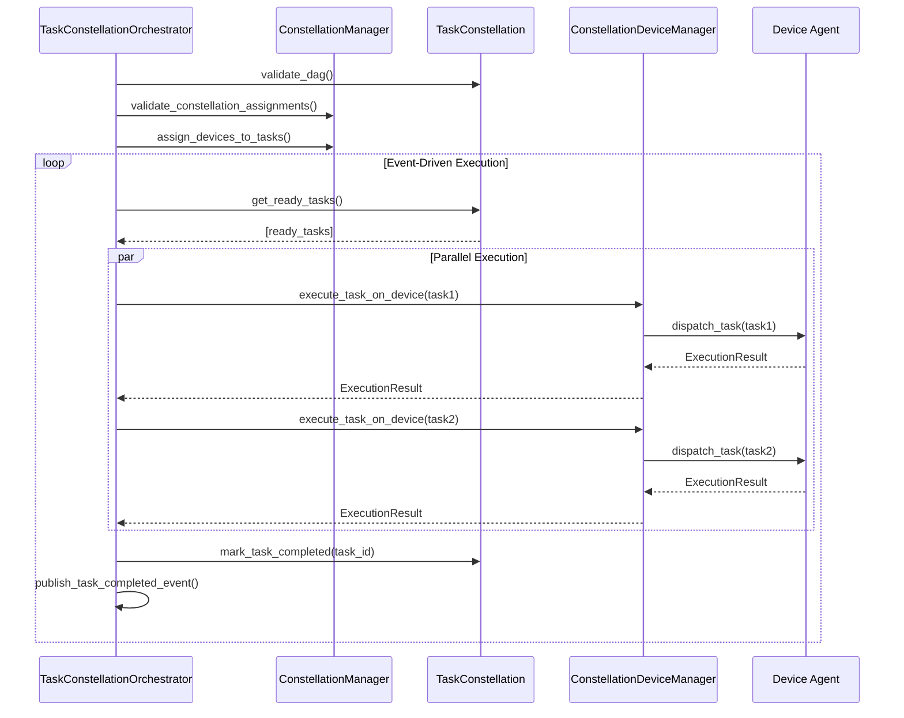
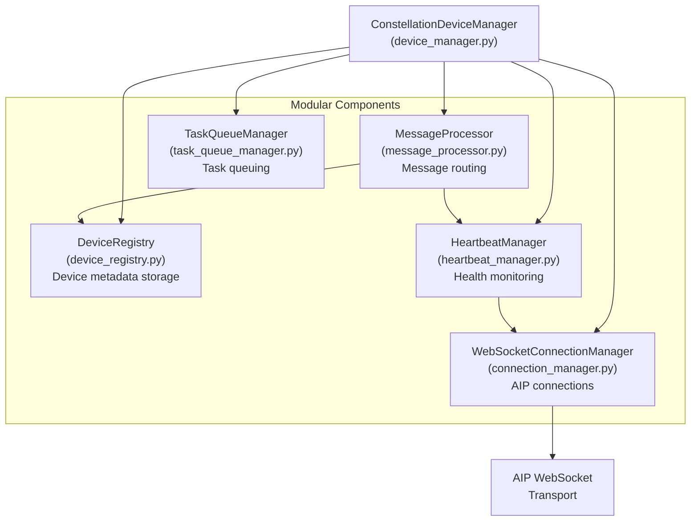
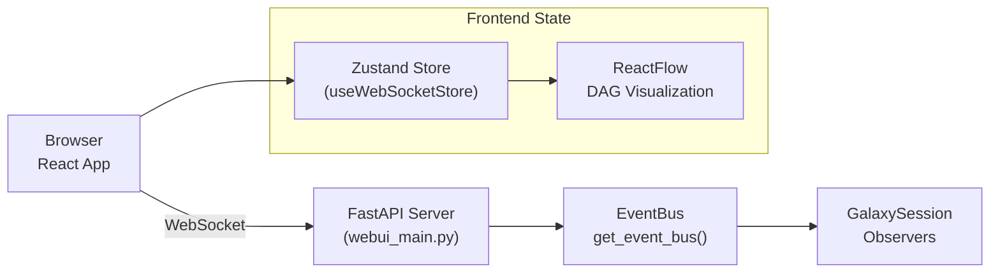
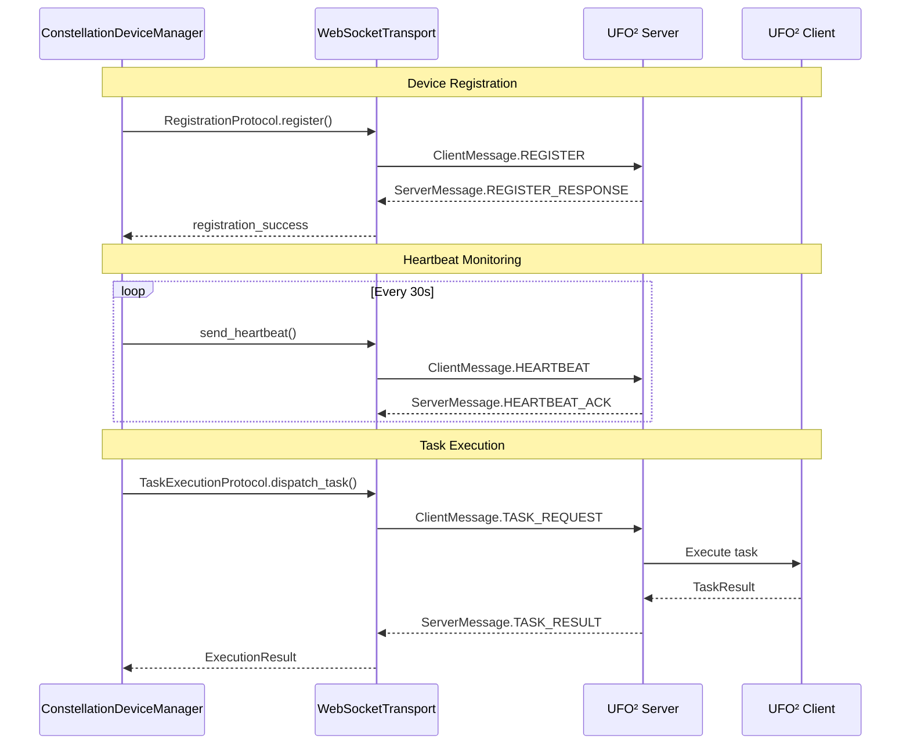
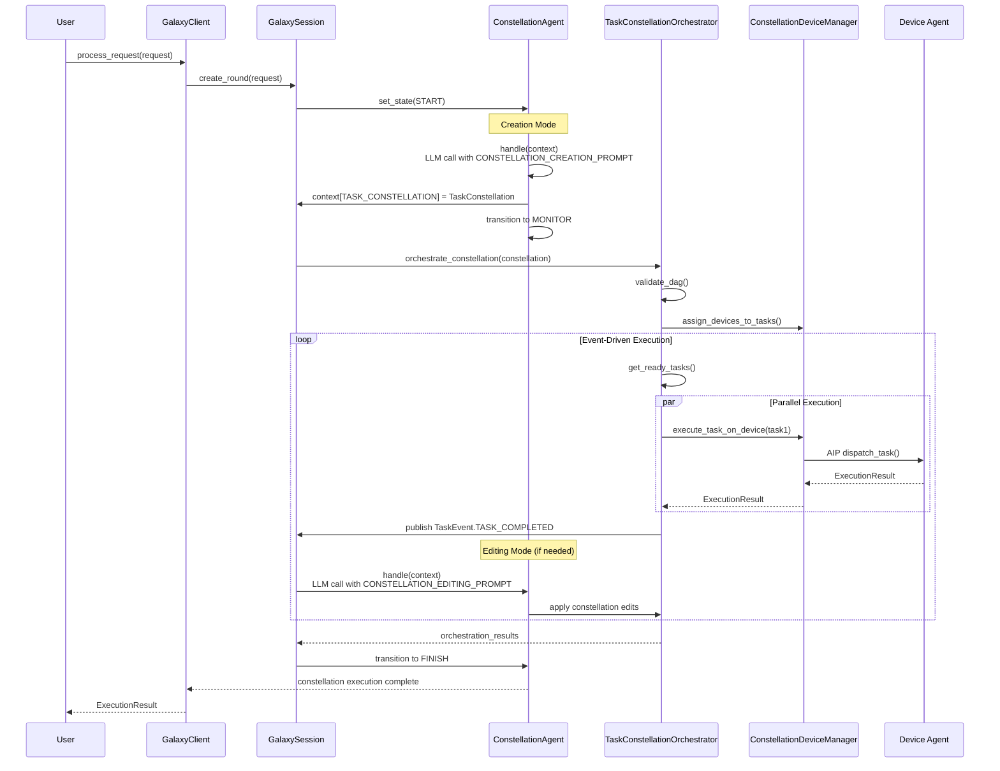
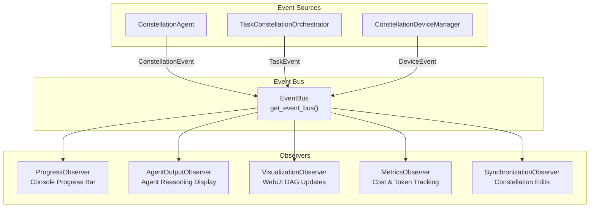

<!-- source: DeepWiki mcp.deepwiki.com · repo microsoft/UFO · page 4 UFO³ Galaxy Framework · patched2 2026-10-26 -->

# UFO³ Galaxy Framework
# UFO³ Galaxy Framework

Relevant source files

The following files were used as context for generating this wiki page:

- [README.md](README.md)
- [README_ZH.md](README_ZH.md)
- [assets/orchestrator.png](assets/orchestrator.png)
- [assets/task_constellation.png](assets/task_constellation.png)
- [documents/docs/choose_path.md](documents/docs/choose_path.md)
- [documents/docs/galaxy/overview.md](documents/docs/galaxy/overview.md)
- [documents/docs/getting_started/quick_start_galaxy.md](documents/docs/getting_started/quick_start_galaxy.md)
- [documents/docs/img/aip_new.png](documents/docs/img/aip_new.png)
- [documents/docs/img/decomposition.png](documents/docs/img/decomposition.png)
- [documents/docs/index.md](documents/docs/index.md)
- [documents/docs/ufo2/app_agent/commands.md](documents/docs/ufo2/app_agent/commands.md)
- [documents/docs/ufo2/app_agent/overview.md](documents/docs/ufo2/app_agent/overview.md)
- [documents/docs/ufo2/app_agent/state.md](documents/docs/ufo2/app_agent/state.md)
- [documents/docs/ufo2/app_agent/strategy.md](documents/docs/ufo2/app_agent/strategy.md)
- [documents/docs/ufo2/core_features/hybrid_actions.md](documents/docs/ufo2/core_features/hybrid_actions.md)
- [documents/docs/ufo2/host_agent/commands.md](documents/docs/ufo2/host_agent/commands.md)
- [documents/docs/ufo2/host_agent/overview.md](documents/docs/ufo2/host_agent/overview.md)
- [documents/docs/ufo2/host_agent/state.md](documents/docs/ufo2/host_agent/state.md)
- [documents/docs/ufo2/host_agent/strategy.md](documents/docs/ufo2/host_agent/strategy.md)
- [documents/docs/ufo2/overview.md](documents/docs/ufo2/overview.md)
- [documents/mkdocs.yml](documents/mkdocs.yml)
- [galaxy/README.md](galaxy/README.md)
- [galaxy/README_ZH.md](galaxy/README_ZH.md)
- [galaxy/client/components/connection_manager.py](galaxy/client/components/connection_manager.py)
- [galaxy/client/components/device_registry.py](galaxy/client/components/device_registry.py)
- [galaxy/client/components/message_processor.py](galaxy/client/components/message_processor.py)
- [galaxy/client/constellation_client.py](galaxy/client/constellation_client.py)
- [galaxy/client/device_manager.py](galaxy/client/device_manager.py)
- [galaxy/constellation/orchestrator/orchestrator.py](galaxy/constellation/orchestrator/orchestrator.py)
- [galaxy/galaxy_client.py](galaxy/galaxy_client.py)
- [galaxy/session/galaxy_session.py](galaxy/session/galaxy_session.py)
- [ufo/README.md](ufo/README.md)
- [ufo/README_ZH.md](ufo/README_ZH.md)

## Purpose and Scope

The **UFO³ Galaxy Framework** is a multi-device orchestration system that coordinates distributed agent execution across heterogeneous platforms (Windows, Linux, Mobile). It transforms natural language requests into dynamic Directed Acyclic Graphs (DAGs) called **Task Constellations**, enabling parallel cross-device workflows with formal safety guarantees and adaptive execution.

This document covers the Galaxy orchestration layer architecture, components, and execution model. For single-device Windows automation, see [UFO² Desktop AgentOS](#3). For the communication protocol between Galaxy and device agents, see [Agent Interaction Protocol](#5). For device agent implementation details, see [Session and Round Management](#3.2).

---

## Architecture Overview

Galaxy operates as a **control plane** that sits above device agents, providing global orchestration while delegating local execution to platform-specific agents. The system follows a hierarchical design separating strategic planning (ConstellationAgent) from tactical execution (device agents).

### High-Level System Layers

**Sources:** [README.md:125-154](), [galaxy/README.md:169-203](), [documents/docs/galaxy/overview.md:32-86]()

---

## Core Components

### GalaxyClient

`GalaxyClient` serves as the main programmatic entry point for the Galaxy framework, managing session lifecycle and request processing.

**Class:** [galaxy/galaxy_client.py:40-149]()

**Key Responsibilities:**
- Initialize `ConstellationClient` and `GalaxySession` [galaxy/galaxy_client.py:126-130]()
- Process user requests into constellation workflows [galaxy/galaxy_client.py:150-170]()
- Manage device status monitoring [galaxy/galaxy_client.py:173-182]()
- Coordinate interactive and batch execution modes [galaxy/galaxy_client.py:42-49]()

**Configuration:** Loaded from `config/galaxy/agent.yaml` and `config/galaxy/devices.yaml` via [galaxy/galaxy_client.py:92-94]()

**Sources:** [galaxy/galaxy_client.py:40-223](), [galaxy/README.md:205-260]()

---

### ConstellationAgent

`ConstellationAgent` is an LLM-powered agent that decomposes user requests into structured Task Constellations and evolves them based on execution feedback. It operates in a **dual-mode state machine** with distinct creation and editing phases.

**Class:** [galaxy/agents/constellation_agent.py]()

#### State Machine

**States:**
- **START** ([galaxy/session/galaxy_session.py:87-90]()): Parse request, invoke ConstellationAgent in creation mode, synthesize initial DAG.
- **MONITOR**: Track execution, invoke ConstellationAgent in editing mode, adapt DAG based on feedback.
- **FINISH/FAIL**: Terminal states with result aggregation.

**Dual-Mode Operation:**
- **Creation Mode**: Synthesizes initial `TaskConstellation` from natural language request using `CONSTELLATION_CREATION_PROMPT` template. [documents/docs/galaxy/constellation_agent/overview.md]()
- **Editing Mode**: Incrementally refines constellation structure based on task completion events and runtime feedback. [galaxy/README.md:82-93]()

**Sources:** [galaxy/session/galaxy_session.py:43-168](), [galaxy/README.md:66-93](), [documents/docs/galaxy/constellation_agent/overview.md]()

---

### Task Constellation (DAG Structure)

A **TaskConstellation** is a dynamic DAG representing a decomposed workflow. Nodes are **TaskStars** (individual tasks), edges are **TaskStarLines** (dependencies).

#### Core Classes

**Key Properties:**
- **DAG Validation:** Ensures acyclicity and structural integrity. [galaxy/README.md:97-108]()
- **Dynamic Rewriting:** Supports controlled modifications with undo/redo mechanisms. [galaxy/README.md:82-93]()
- **State Machine:** Transitions through states such as `PENDING`, `RUNNING`, `COMPLETED`, or `FAILED`. [galaxy/constellation/orchestrator/orchestrator.py:25]()

**Sources:** [galaxy/constellation/orchestrator/orchestrator.py:24-28](), [galaxy/README.md:66-77](), [documents/docs/galaxy/constellation/overview.md]()

---

### TaskConstellationOrchestrator

`TaskConstellationOrchestrator` executes Task Constellations using event-driven scheduling with formal safety guarantees.

**Class:** [galaxy/constellation/orchestrator/orchestrator.py:31-38]()

#### Execution Workflow

**Core Methods:**
- `orchestrate_constellation()` [galaxy/constellation/orchestrator/orchestrator.py:143-160](): Main entry point coordinating the entire orchestration workflow.
- `cancel_execution()` [galaxy/constellation/orchestrator/orchestrator.py:99-141](): Immediately cancels all running tasks and marks the constellation for cancellation.
- `set_modification_synchronizer()` [galaxy/constellation/orchestrator/orchestrator.py:87-98](): Attaches a synchronizer to prevent race conditions during DAG modifications.

**Safety Guarantees:**
- **Safe Assignment Locking:** Prevents race conditions during task assignment. [galaxy/README.md:102]()
- **Event-driven Scheduling:** Tasks are triggered based on DAG readiness. [galaxy/README.md:103]()
- **Consistency Checks:** Ensures structural integrity throughout execution. [galaxy/README.md:105]()

**Sources:** [galaxy/constellation/orchestrator/orchestrator.py:31-195](), [galaxy/README.md:97-110]()

---

### ConstellationDeviceManager

`ConstellationDeviceManager` coordinates device lifecycle, communication, and task distribution using a modular component architecture.

**Class:** [galaxy/client/device_manager.py:33-43]()

#### Component Architecture

**Key Responsibilities:**

| Component | Responsibility | File |
|-----------|---------------|------|
| **DeviceRegistry** | Store/retrieve device profiles, status tracking | [galaxy/client/components/device_registry.py]() |
| **WebSocketConnectionManager** | Establish AIP connections, manage transports | [galaxy/client/components/connection_manager.py]() |
| **HeartbeatManager** | Send periodic heartbeats, detect failures | [galaxy/client/components/heartbeat_manager.py]() |
| **MessageProcessor** | Route incoming messages, complete pending tasks | [galaxy/client/components/message_processor.py]() |
| **TaskQueueManager** | Queue tasks for busy devices, retry logic | [galaxy/client/components/task_queue_manager.py]() |

**Device Lifecycle:**
1. **Registration:** Device registers via `register_device()` with capabilities and metadata. [galaxy/client/device_manager.py:174-182]()
2. **Connection:** `connect_device()` establishes WebSocket connection via AIP. [galaxy/client/device_manager.py:199-200]()
3. **Monitoring:** `HeartbeatManager` tracks health via the `connection_manager`. [galaxy/client/device_manager.py:64-66]()
4. **Disconnection:** `_handle_device_disconnection` manages cleanup and reconnection logic. [galaxy/client/device_manager.py:75-77]()

**Sources:** [galaxy/client/device_manager.py:33-203](), [galaxy/client/components/connection_manager.py:37-65](), [galaxy/README.md:115-127]()

---

### ConstellationClient

`ConstellationClient` provides a simplified device management interface for `GalaxyClient`, abstracting device pool configuration and connection details.

**Class:** [galaxy/client/constellation_client.py:18-53]()

**Responsibilities:**
- Load device configurations from `config/galaxy/devices.yaml`.
- Initialize `ConstellationDeviceManager`. [galaxy/galaxy_client.py:126-129]()
- Provide high-level device connection API.
- Status monitoring and reporting.

**Sources:** [galaxy/galaxy_client.py:126-132](), [galaxy/client/constellation_client.py:18-53](), [galaxy/README.md:186-189]()

---

### Galaxy Web UI

The **Galaxy Web UI** provides real-time visualization of constellation execution through a React-based frontend with WebSocket integration.

**Architecture:** Client-server model with FastAPI backend and React frontend.

**Key Features:**
- **Real-time DAG Visualization:** Renders `TaskConstellation` structure dynamically. [galaxy/README.md:162-180]()
- **Chat Interface:** Submit requests and view `ConstellationAgent` responses.
- **Task Status Tracking:** Monitor each `TaskStar`'s state transitions.
- **Event Streaming:** WebSocket events from `EventBus` propagate to frontend. [galaxy/session/galaxy_session.py:31-37]()

**Sources:** [galaxy/README.md:162-180](), [galaxy/session/galaxy_session.py:31-37](), [documents/docs/galaxy/webui.md]()

---

## Communication Architecture

Galaxy communicates with device agents via the **Agent Interaction Protocol (AIP)**, a WebSocket-based JSON-RPC protocol.

### AIP Message Flow

**Protocol Components:**
- **RegistrationProtocol:** Device handshake and capability exchange. [galaxy/client/components/connection_manager.py:98-100]()
- **TaskExecutionProtocol:** Task dispatch and result aggregation. [galaxy/client/components/connection_manager.py:101-103]()
- **DeviceInfoProtocol:** Capability discovery. [galaxy/client/components/connection_manager.py:104-106]()

**Transport Layer:** `WebSocketTransport` [galaxy/client/components/connection_manager.py:85-92]() provides persistent WebSocket connections with automatic reconnection.

**Sources:** [galaxy/client/components/connection_manager.py:71-153](), [galaxy/README.md:115-127](), [documents/docs/galaxy/overview.md:73-84]()

---

## Execution Flow

### End-to-End Request Processing

**Key Phases:**

1. **Request Parsing:** `process_request` in `GalaxyClient` handles initial input. [galaxy/galaxy_client.py:150-170]()
2. **Session Initialization:** `GalaxySession` setup manages the lifecycle of the request. [galaxy/session/galaxy_session.py:178-219]()
3. **DAG Synthesis:** `ConstellationAgent` in `START` state initializes the state machine. [galaxy/session/galaxy_session.py:87-90]()
4. **Parallel Execution:** `TaskConstellationOrchestrator` runs the main execution loop. [galaxy/constellation/orchestrator/orchestrator.py:173]()
5. **Result Aggregation:** `finalize_constellation_execution` compiles results and stats. [galaxy/constellation/orchestrator/orchestrator.py:176-178]()

**Sources:** [galaxy/galaxy_client.py:150-170](), [galaxy/session/galaxy_session.py:71-135](), [galaxy/constellation/orchestrator/orchestrator.py:143-195]()

---

## Observer System

Galaxy uses the **Observer pattern** to enable real-time monitoring and visualization.

### Event-Driven Architecture

**Event Types:**
- **ConstellationEvent:** Constellation state changes (CREATED, MODIFIED, COMPLETED). [galaxy/constellation/orchestrator/orchestrator.py:24]()
- **TaskEvent:** TaskStar state transitions (PENDING → RUNNING → COMPLETED). [galaxy/constellation/orchestrator/orchestrator.py:24]()
- **DeviceEvent:** Device status changes (CONNECTED, DISCONNECTED, BUSY). [galaxy/client/device_manager.py:18]()

**Observer Implementations:**

| Observer | Purpose | File |
|----------|---------|------|
| `ConstellationProgressObserver` | Rich console progress bars | [galaxy/session/galaxy_session.py:34]() |
| `AgentOutputObserver` | Display ConstellationAgent reasoning | [galaxy/session/galaxy_session.py:32]() |
| `DAGVisualizationObserver` | Stream updates to WebUI | [galaxy/session/galaxy_session.py:35]() |
| `SessionMetricsObserver` | Track LLM costs and tokens | [galaxy/session/galaxy_session.py:36]() |
| `ConstellationModificationSynchronizer` | Coordinate edits during execution | [galaxy/session/galaxy_session.py:33]() |

**Sources:** [galaxy/session/galaxy_session.py:31-37](), [galaxy/constellation/orchestrator/orchestrator.py:24-28](), [galaxy/client/device_manager.py:18-19]()

---

## Configuration

### Galaxy Configuration Files

| File | Purpose | Template |
|------|---------|----------|
| `config/galaxy/agent.yaml` | ConstellationAgent LLM settings | `agent.yaml.template` |
| `config/galaxy/devices.yaml` | Device pool configuration | `devices.yaml.template` |

**ConstellationAgent Configuration:**
Loaded via `get_galaxy_config()`. [galaxy/session/galaxy_session.py:40]()

**Device Configuration:**
`ConstellationConfig` is loaded from the path specified in the galaxy config. [galaxy/galaxy_client.py:92-94]()

**Sources:** [galaxy/session/galaxy_session.py:40-41](), [galaxy/galaxy_client.py:92-94](), [galaxy/README.md:222-307]()

---

## Deployment Modes

Galaxy supports multiple operational modes:

### Interactive WebUI Mode
Starts the React-based interface with real-time constellation visualization. [documents/docs/galaxy/webui.md]()

### Interactive Terminal Mode
Provides a command-line interface with rich console output via `ClientDisplay`. [galaxy/galaxy_client.py:98-106]()

### Direct Request Mode
Processes a single user request string and executes the resulting DAG. [galaxy/galaxy_client.py:150-170]()

**Sources:** [galaxy/galaxy_client.py:41-49](), [galaxy/galaxy_client.py:96-106](), [documents/docs/galaxy/webui.md]()

---

