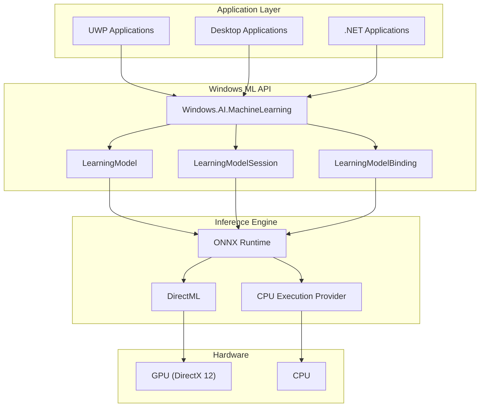
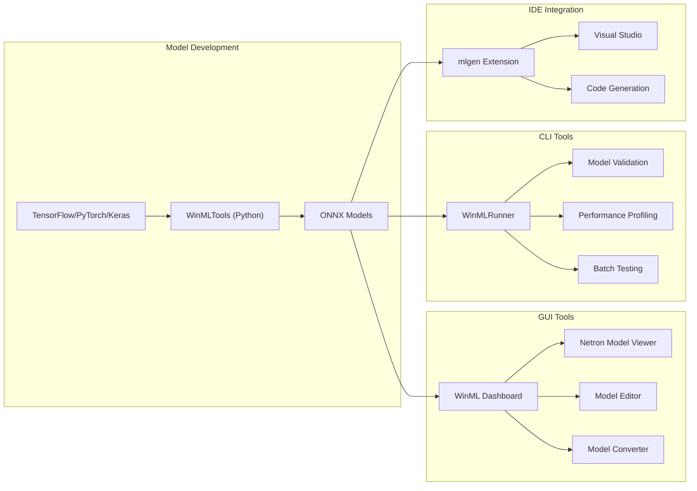
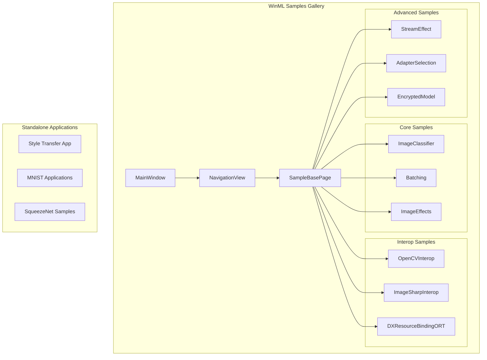
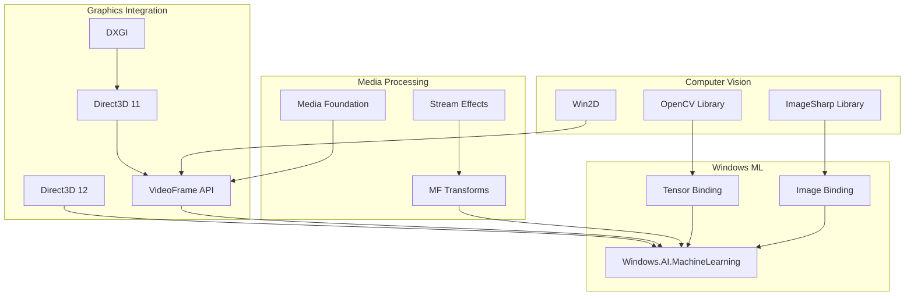

<!-- source: DeepWiki mcp.deepwiki.com · repo microsoft/Windows-Machine-Learning · page 1 Overview · fetched 2026-10-26 -->

# Overview

Relevant source files

The following files were used as context for generating this wiki page:

- [README.md](README.md)
- [Samples/StyleTransfer/README.md](Samples/StyleTransfer/README.md)
- [Samples/WinMLSamplesGallery/README.md](Samples/WinMLSamplesGallery/README.md)
- [Samples/WinMLSamplesGallery/WinMLSamplesGallery/Samples/Batching/README.md](Samples/WinMLSamplesGallery/WinMLSamplesGallery/Samples/Batching/README.md)
- [Samples/WinMLSamplesGallery/WinMLSamplesGallery/Samples/ImageClassifier/docs/screenshot.png](Samples/WinMLSamplesGallery/WinMLSamplesGallery/Samples/ImageClassifier/docs/screenshot.png)
- [Samples/WinMLSamplesGallery/WinMLSamplesGallery/Samples/ImageEffects/README.md](Samples/WinMLSamplesGallery/WinMLSamplesGallery/Samples/ImageEffects/README.md)
- [Samples/WinMLSamplesGallery/WinMLSamplesGallery/Samples/ImageEffects/docs/screenshot.png](Samples/WinMLSamplesGallery/WinMLSamplesGallery/Samples/ImageEffects/docs/screenshot.png)
- [Samples/WinMLSamplesGallery/WinMLSamplesGallery/Samples/ImageSharpInterop/ImageSharpExtensions.cs](Samples/WinMLSamplesGallery/WinMLSamplesGallery/Samples/ImageSharpInterop/ImageSharpExtensions.cs)
- [Samples/WinMLSamplesGallery/WinMLSamplesGallery/Samples/ImageSharpInterop/README.md](Samples/WinMLSamplesGallery/WinMLSamplesGallery/Samples/ImageSharpInterop/README.md)
- [Samples/WinMLSamplesGallery/WinMLSamplesGallery/Samples/ImageSharpInterop/docs/screenshot.png](Samples/WinMLSamplesGallery/WinMLSamplesGallery/Samples/ImageSharpInterop/docs/screenshot.png)
- [Samples/WinMLSamplesGallery/docs/WinMLSamplesGalleryLanding.png](Samples/WinMLSamplesGallery/docs/WinMLSamplesGalleryLanding.png)
- [ThirdPartyNotices.txt](ThirdPartyNotices.txt)

## Purpose and Scope

The Windows Machine Learning repository provides a comprehensive ecosystem for integrating machine learning inference capabilities into Windows applications. This repository contains samples, tools, and documentation that demonstrate how to use the Windows ML API for high-performance, low-latency machine learning scenarios across desktop, UWP, and .NET applications.

The repository focuses on ONNX model inference using the `Windows.AI.MachineLearning` API, which is powered by ONNX Runtime and DirectML for GPU acceleration. For information about the core Windows ML API concepts, see [Core API and Architecture](#2). For details about specific development tools, see [Development Tools](#3).

Sources: [README.md:1-21](), [README.md:36-46]()

## Core Architecture

Windows ML provides a layered architecture built around the `Windows.AI.MachineLearning` namespace, with ONNX Runtime serving as the inference engine and DirectML providing GPU acceleration.

### High-Level System Architecture

Sources: [README.md:3](), [README.md:8]()

### Distribution Options

Windows ML is available through two primary distribution mechanisms:

| Distribution | Availability | Servicing | Forward Compatibility |
|--------------|--------------|-----------|----------------------|
| **In-Box** | Windows 10 Build 17763+ | Microsoft-driven | Automatic |
| **NuGet** | Windows 8.1+ | Developer-driven | Manual updates |

The in-box version provides automatic updates through Windows Update, while the NuGet package (`Microsoft.AI.MachineLearning`) allows developers to bundle and control versioning independently.

Sources: [README.md:36-46]()

## Development Tools and Utilities

The repository includes several tools to support the complete development lifecycle for Windows ML applications.

### Tool Ecosystem

The **WinML Dashboard** serves as a comprehensive GUI tool for model viewing, editing, conversion, and validation. It integrates the Netron model viewer and provides capabilities for enabling free dimensions on models with fixed dimensions.

The **WinMLRunner** is a command-line tool that validates ONNX models and captures performance measurements. It supports various input formats including tensors and images, and provides detailed diagnostic output.

Sources: [README.md:115-143](), [README.md:128](), [README.md:136-138]()

## Sample Applications

The repository contains extensive samples demonstrating various Windows ML capabilities across different application types and use cases.

### Sample Application Architecture

The **WinML Samples Gallery** serves as the primary showcase application, built with WinUI 3 and demonstrating interactive machine learning scenarios. Each sample implements the `SampleBasePage` pattern for consistent user experience.

Key sample categories include:

- **Image Classification**: Supports multiple models from the ONNX Model Zoo including AlexNet, EfficientNet, ResNet50, and SqueezeNet
- **Performance Optimization**: Batching samples that demonstrate performance improvements with the `BatchSizeOverride` property
- **Library Integration**: Interoperability with OpenCV and ImageSharp for image processing workflows
- **Real-time Processing**: Stream effects and video processing capabilities

Sources: [Samples/WinMLSamplesGallery/README.md:1-3](), [Samples/WinMLSamplesGallery/README.md:32-50](), [README.md:48-73]()

## Integration Ecosystem

Windows ML provides extensive integration capabilities with graphics APIs, computer vision libraries, and media processing frameworks.

### Integration Points

**DirectX Resource Binding** enables GPU memory sharing through Direct3D 12 surfaces, allowing efficient processing pipelines without CPU-GPU memory transfers.

**OpenCV Integration** provides computer vision preprocessing capabilities, with samples demonstrating image loading, manipulation, and tensor conversion workflows.

**ImageSharp Integration** offers cross-platform graphics processing with extension methods for converting between ImageSharp formats and Windows ML tensors.

Sources: [Samples/WinMLSamplesGallery/WinMLSamplesGallery/Samples/ImageSharpInterop/ImageSharpExtensions.cs:1-49](), [Samples/WinMLSamplesGallery/README.md:39](), [Samples/WinMLSamplesGallery/README.md:47](), [ThirdPartyNotices.txt:1-8]()

## Platform Support and Build System

The repository supports multiple Windows application types and development frameworks through a comprehensive build system.

### Supported Application Types

| Application Type | In-Box API | NuGet API | Sample Coverage |
|------------------|------------|-----------|-----------------|
| **UWP** | ✓ | ✓ | MNIST, SqueezeNet, Style Transfer |
| **Desktop (Win32)** | ✓ | ✓ | SqueezeNet, Custom Operators |
| **.NET 5/Core** | - | ✓ | Samples Gallery, SqueezeNet |
| **WinUI 3** | ✓ | ✓ | Samples Gallery |

The build pipeline uses Azure DevOps with automated testing across multiple configurations. OpenCV is built as a submodule using CMake and Visual Studio build tools.

**Language Support** includes C++/WinRT, C#, JavaScript, and experimental Rust bindings, demonstrating the API's versatility across different development ecosystems.

Sources: [README.md:55-73](), [README.md:24-28](), [README.md:32-34]()

---

