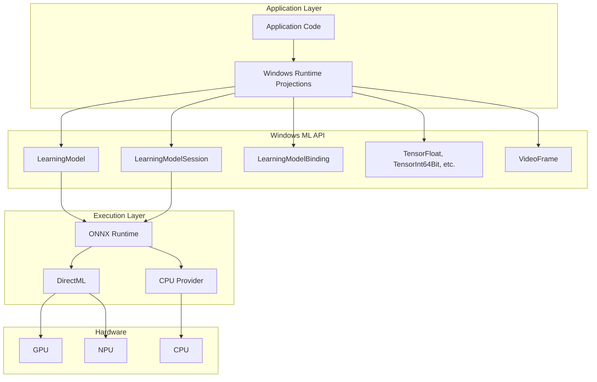
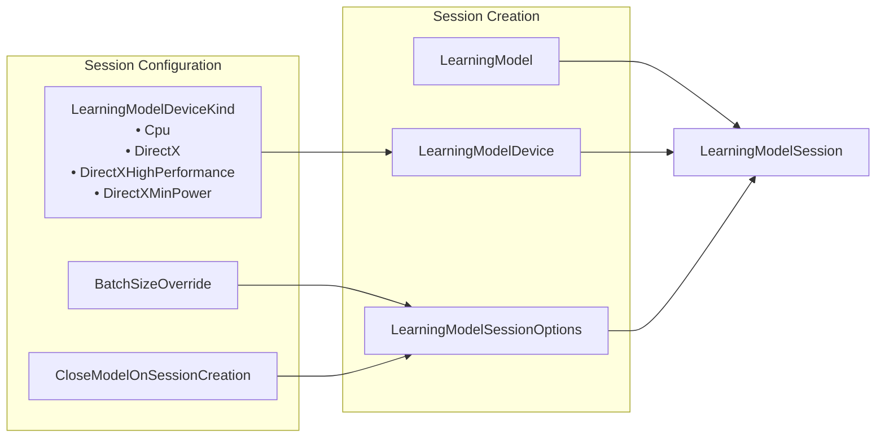
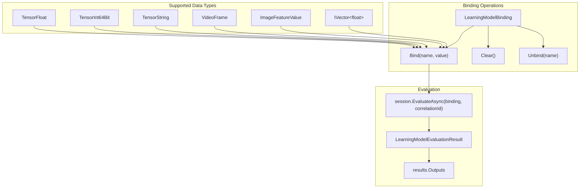
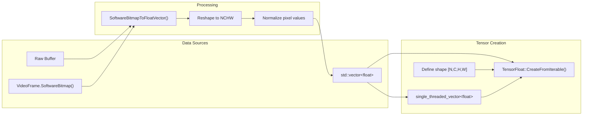
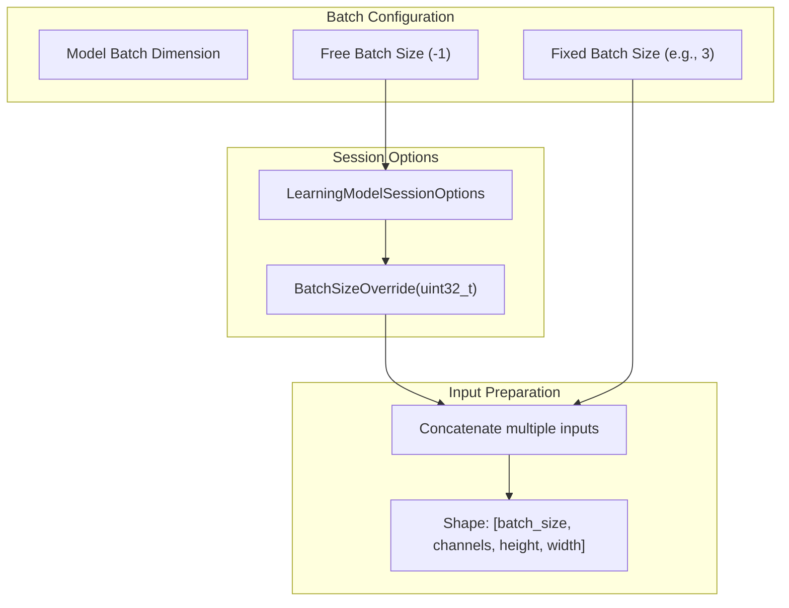
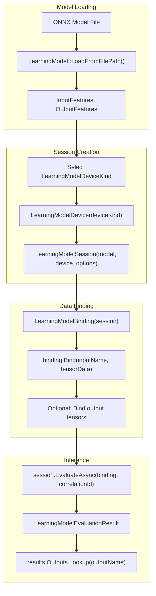
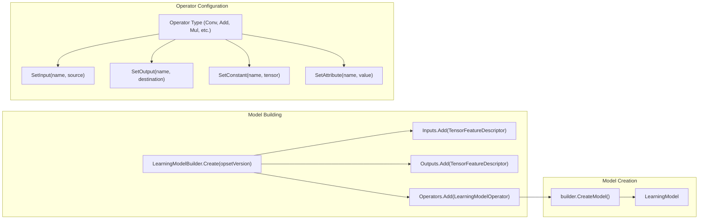
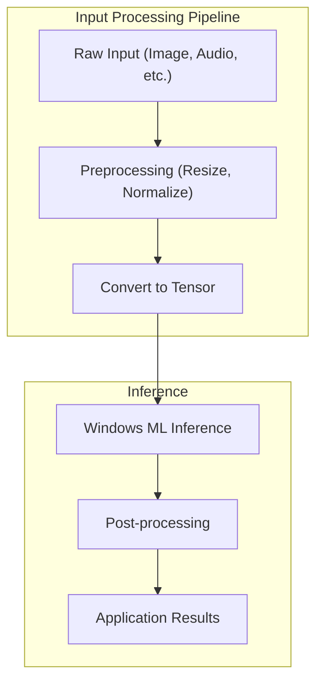

<!-- source: DeepWiki mcp.deepwiki.com · repo microsoft/Windows-Machine-Learning · page 2 Core API and Architecture · fetched 2026-10-26 -->

# Core API and Architecture

Relevant source files

The following files were used as context for generating this wiki page:

- [Samples/BatchSupport/BatchSupport.sln](Samples/BatchSupport/BatchSupport.sln)
- [Samples/BatchSupport/BatchSupport/BatchSupport.vcxproj](Samples/BatchSupport/BatchSupport/BatchSupport.vcxproj)
- [Samples/BatchSupport/BatchSupport/BatchSupport.vcxproj.filters](Samples/BatchSupport/BatchSupport/BatchSupport.vcxproj.filters)
- [Samples/BatchSupport/BatchSupport/PropertySheet.props](Samples/BatchSupport/BatchSupport/PropertySheet.props)
- [Samples/BatchSupport/BatchSupport/SampleHelper.cpp](Samples/BatchSupport/BatchSupport/SampleHelper.cpp)
- [Samples/BatchSupport/BatchSupport/SampleHelper.h](Samples/BatchSupport/BatchSupport/SampleHelper.h)
- [Samples/BatchSupport/BatchSupport/main.cpp](Samples/BatchSupport/BatchSupport/main.cpp)
- [Samples/BatchSupport/BatchSupport/packages.config](Samples/BatchSupport/BatchSupport/packages.config)
- [Samples/BatchSupport/BatchSupport/pch.cpp](Samples/BatchSupport/BatchSupport/pch.cpp)
- [Samples/BatchSupport/BatchSupport/pch.h](Samples/BatchSupport/BatchSupport/pch.h)
- [Samples/BatchSupport/forReadMe/fixBatchSize.png](Samples/BatchSupport/forReadMe/fixBatchSize.png)
- [Samples/BatchSupport/forReadMe/freeBatchSize.png](Samples/BatchSupport/forReadMe/freeBatchSize.png)
- [Samples/BatchSupport/readme.md](Samples/BatchSupport/readme.md)
- [Samples/SampleSharedLib/SampleSharedLib/SampleSharedLib.vcxproj](Samples/SampleSharedLib/SampleSharedLib/SampleSharedLib.vcxproj)
- [Samples/SampleSharedLib/SampleSharedLib/SampleSharedLib.vcxproj.filters](Samples/SampleSharedLib/SampleSharedLib/SampleSharedLib.vcxproj.filters)
- [Samples/SampleSharedLib/SampleSharedLib/packages.config](Samples/SampleSharedLib/SampleSharedLib/packages.config)
- [Samples/WinMLSamplesGallery/WinMLSamplesGallery/Samples/TensorizationModels.cs](Samples/WinMLSamplesGallery/WinMLSamplesGallery/Samples/TensorizationModels.cs)

This document explains the Windows.AI.MachineLearning API, its integration with ONNX Runtime, and the fundamental concepts including models, sessions, bindings, and tensor operations. This covers the core programming model and architectural components that developers use to perform machine learning inference on Windows.

For information about development tools and utilities, see [Development Tools](#3). For sample applications demonstrating these APIs, see [Sample Applications](#4). For advanced integration scenarios like DirectX interoperability, see [Advanced Integration](#5).

## API Overview

Windows ML provides machine learning inference capabilities through two primary API surfaces:

- **Windows.AI.MachineLearning** - The in-box Windows Runtime API available on Windows 10 version 1809 and later
- **Microsoft.AI.MachineLearning** - The NuGet package providing the same API surface with additional features and broader platform support

The core architecture is built on ONNX Runtime with DirectML providing GPU acceleration capabilities.

### Windows ML API Layers

**Sources:** [Samples/BatchSupport/BatchSupport/main.cpp:1-50](), [Samples/BatchSupport/BatchSupport/pch.h:1-19]()

## Core Components

### LearningModel

The `LearningModel` class represents a trained ONNX model and provides metadata about inputs, outputs, and model properties.

| Property | Description | Usage |
|----------|-------------|--------|
| `InputFeatures` | Collection of input feature descriptors | Define expected input data types and shapes |
| `OutputFeatures` | Collection of output feature descriptors | Define output data types and shapes |
| `Author`, `Name`, `Version` | Model metadata | Retrieve model information |

**Key Methods:**
- `LoadFromFilePath(hstring)` - Load model from file path
- `LoadFromStreamAsync(IRandomAccessStreamReference)` - Load model from stream

### LearningModelSession

The `LearningModelSession` manages the inference execution context and device selection.

**Sources:** [Samples/BatchSupport/BatchSupport/main.cpp:41-53]()

### LearningModelBinding

The `LearningModelBinding` class manages input and output data binding for model evaluation.

**Sources:** [Samples/BatchSupport/BatchSupport/main.cpp:54-96](), [Samples/BatchSupport/BatchSupport/SampleHelper.cpp:84-114]()

## Tensor Types and Data Handling

### Core Tensor Types

Windows ML provides strongly-typed tensor classes for different data types:

| Tensor Type | Description | Creation Methods |
|-------------|-------------|------------------|
| `TensorFloat` | 32-bit floating point tensors | `Create()`, `CreateFromArray()`, `CreateFromIterable()` |
| `TensorInt64Bit` | 64-bit integer tensors | `Create()`, `CreateFromArray()`, `CreateFromIterable()` |
| `TensorString` | String tensors | `CreateFromArray()` |
| `TensorUInt8` | 8-bit unsigned integer tensors | `Create()`, `CreateFromArray()` |

### Tensor Creation Patterns

**Sources:** [Samples/BatchSupport/BatchSupport/SampleHelper.cpp:25-102]()

### Batching Support

Windows ML supports both fixed and dynamic batch sizes:

**Sources:** [Samples/BatchSupport/BatchSupport/main.cpp:18-50](), [Samples/BatchSupport/BatchSupport/SampleHelper.cpp:84-101]()

## Device Selection and Execution Providers

### Device Types

Windows ML supports multiple execution providers through the `LearningModelDeviceKind` enumeration:

| Device Kind | Description | Use Case |
|-------------|-------------|----------|
| `Cpu` | CPU execution using ONNX Runtime CPU provider | General compatibility, debugging |
| `DirectX` | Default DirectX device selection | Balanced performance and compatibility |
| `DirectXHighPerformance` | High-performance GPU selection | Maximum throughput |
| `DirectXMinPower` | Power-efficient GPU selection | Battery-powered devices |

### Execution Flow

**Sources:** [Samples/BatchSupport/BatchSupport/main.cpp:27-96]()

## Advanced Model Building

The experimental `LearningModelBuilder` API allows creating ONNX models programmatically:

### Model Builder Components

**Sources:** [Samples/WinMLSamplesGallery/WinMLSamplesGallery/Samples/TensorizationModels.cs:44-50](), [Samples/WinMLSamplesGallery/WinMLSamplesGallery/Samples/TensorizationModels.cs:114-141]()

### Common ONNX Operators

The model builder supports various ONNX operators for image processing and tensor manipulation:

| Operator | Purpose | Key Attributes |
|----------|---------|----------------|
| `Identity` | Pass-through operation | None |
| `Conv` | Convolution operation | `kernel_shape`, `auto_pad` |
| `Resize` | Image resizing | `mode`, `scales` or `sizes` |
| `Transpose` | Tensor dimension reordering | `perm` |
| `Slice` | Tensor slicing | `starts`, `ends`, `axes`, `steps` |
| `Cast` | Data type conversion | `to` |

**Sources:** [Samples/WinMLSamplesGallery/WinMLSamplesGallery/Samples/TensorizationModels.cs:37-51](), [Samples/WinMLSamplesGallery/WinMLSamplesGallery/Samples/TensorizationModels.cs:405-426]()

## Error Handling and Performance

### Performance Optimization

- **Batch Size Override**: For models with free dimensions, specify batch size at session creation for better performance
- **Device Selection**: Choose appropriate device kind based on performance vs. power requirements  
- **Pre-allocated Outputs**: Optionally bind output tensors to avoid allocation during inference
- **Session Reuse**: Create sessions once and reuse for multiple evaluations

### Common Integration Patterns

**Sources:** [Samples/BatchSupport/BatchSupport/main.cpp:80-95](), [Samples/BatchSupport/BatchSupport/SampleHelper.cpp:116-141]()

---

