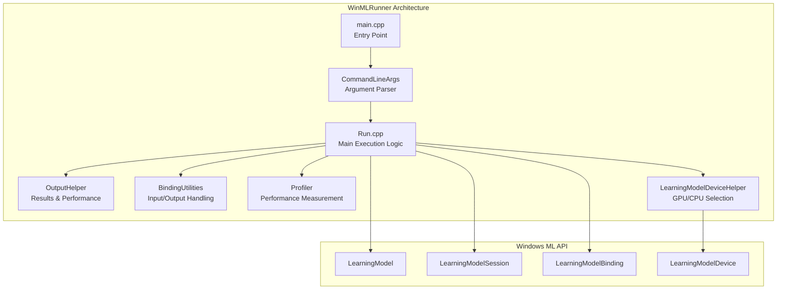
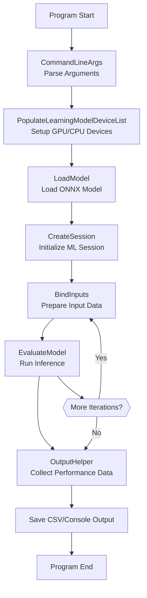
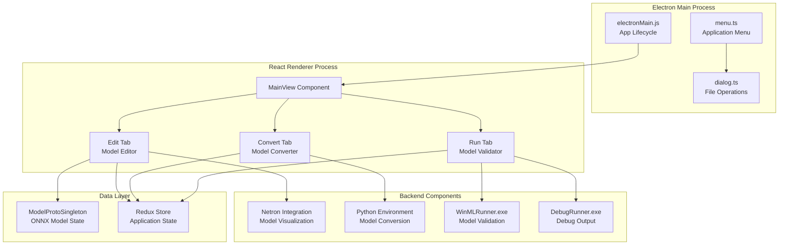
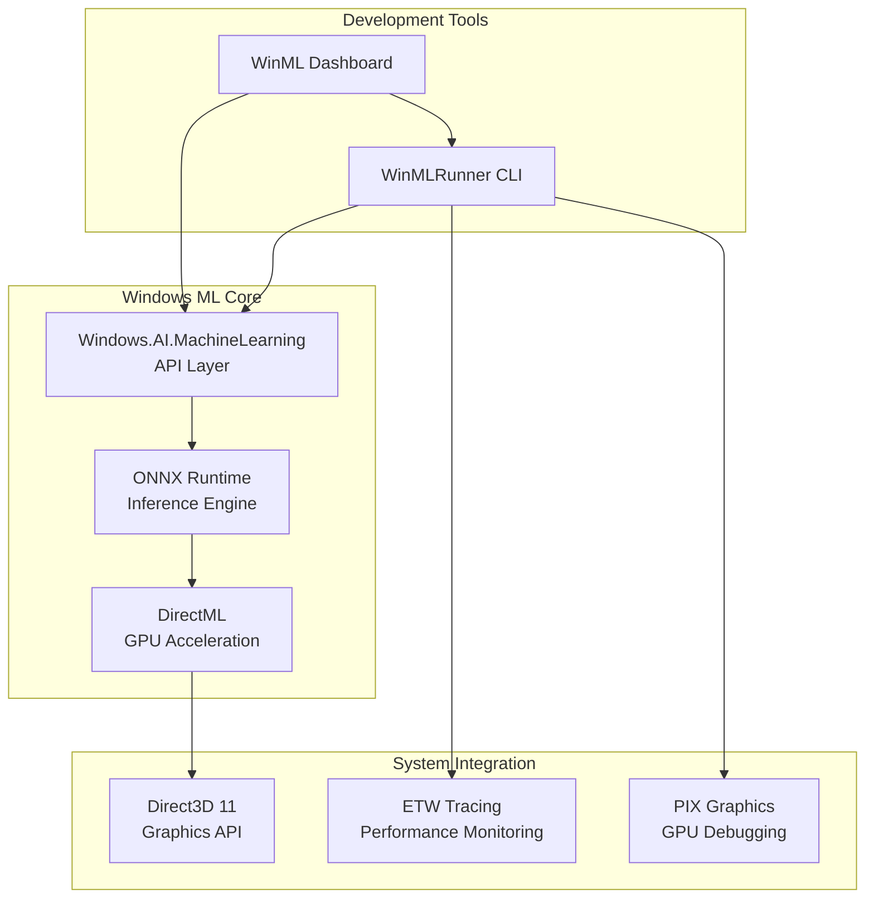
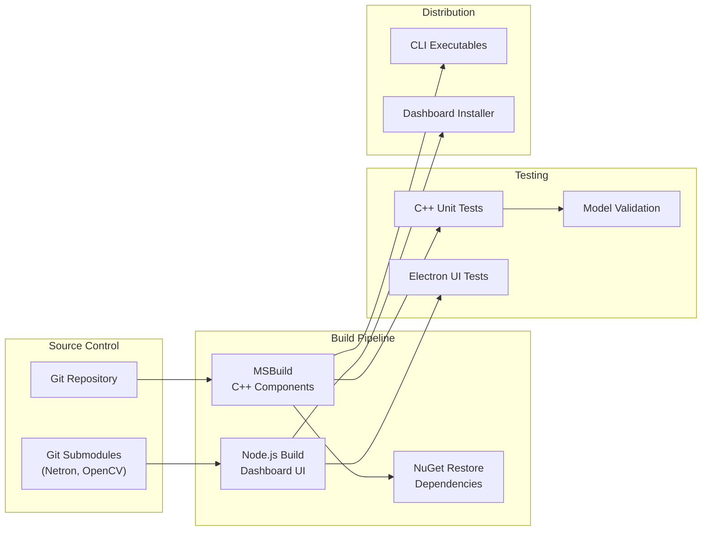

<!-- source: DeepWiki mcp.deepwiki.com · repo microsoft/Windows-Machine-Learning · page 3 Development Tools · fetched 2026-10-26 -->

# Development Tools

Relevant source files

The following files were used as context for generating this wiki page:

- [Testing/WinMLRunnerTest/WinMLRunnerTest.cpp](Testing/WinMLRunnerTest/WinMLRunnerTest.cpp)
- [Testing/WinMLRunnerTest/WinMLRunnerTest.vcxproj](Testing/WinMLRunnerTest/WinMLRunnerTest.vcxproj)
- [Tools/WinMLDashboard/.gitignore](Tools/WinMLDashboard/.gitignore)
- [Tools/WinMLDashboard/.vscode/launch.json](Tools/WinMLDashboard/.vscode/launch.json)
- [Tools/WinMLDashboard/README.md](Tools/WinMLDashboard/README.md)
- [Tools/WinMLDashboard/build.js](Tools/WinMLDashboard/build.js)
- [Tools/WinMLDashboard/package.json](Tools/WinMLDashboard/package.json)
- [Tools/WinMLDashboard/public/Converter.png](Tools/WinMLDashboard/public/Converter.png)
- [Tools/WinMLDashboard/public/DebugPngs.png](Tools/WinMLDashboard/public/DebugPngs.png)
- [Tools/WinMLDashboard/public/about.css](Tools/WinMLDashboard/public/about.css)
- [Tools/WinMLDashboard/public/about.html](Tools/WinMLDashboard/public/about.html)
- [Tools/WinMLDashboard/public/progress_bar.gif](Tools/WinMLDashboard/public/progress_bar.gif)
- [Tools/WinMLDashboard/public/questionmark.png](Tools/WinMLDashboard/public/questionmark.png)
- [Tools/WinMLDashboard/public/questionmark2.png](Tools/WinMLDashboard/public/questionmark2.png)
- [Tools/WinMLDashboard/src/electronMain.js](Tools/WinMLDashboard/src/electronMain.js)
- [Tools/WinMLDashboard/src/native/dialog.ts](Tools/WinMLDashboard/src/native/dialog.ts)
- [Tools/WinMLDashboard/src/native/menu.ts](Tools/WinMLDashboard/src/native/menu.ts)
- [Tools/WinMLDashboard/test/test.js](Tools/WinMLDashboard/test/test.js)
- [Tools/WinMLRunner/README.md](Tools/WinMLRunner/README.md)
- [Tools/WinMLRunner/src/BindingUtilities.h](Tools/WinMLRunner/src/BindingUtilities.h)
- [Tools/WinMLRunner/src/CommandLineArgs.cpp](Tools/WinMLRunner/src/CommandLineArgs.cpp)
- [Tools/WinMLRunner/src/CommandLineArgs.h](Tools/WinMLRunner/src/CommandLineArgs.h)
- [Tools/WinMLRunner/src/Common.h](Tools/WinMLRunner/src/Common.h)
- [Tools/WinMLRunner/src/Filehelper.cpp](Tools/WinMLRunner/src/Filehelper.cpp)
- [Tools/WinMLRunner/src/Filehelper.h](Tools/WinMLRunner/src/Filehelper.h)
- [Tools/WinMLRunner/src/LearningModelDeviceHelper.cpp](Tools/WinMLRunner/src/LearningModelDeviceHelper.cpp)
- [Tools/WinMLRunner/src/LearningModelDeviceHelper.h](Tools/WinMLRunner/src/LearningModelDeviceHelper.h)
- [Tools/WinMLRunner/src/OutputHelper.h](Tools/WinMLRunner/src/OutputHelper.h)
- [Tools/WinMLRunner/src/Run.cpp](Tools/WinMLRunner/src/Run.cpp)
- [Tools/WinMLRunner/src/Run.h](Tools/WinMLRunner/src/Run.h)
- [Tools/WinMLRunner/src/TimerHelper.h](Tools/WinMLRunner/src/TimerHelper.h)
- [Tools/WinMLRunner/src/TypeHelper.h](Tools/WinMLRunner/src/TypeHelper.h)
- [Tools/WinMLRunner/src/main.cpp](Tools/WinMLRunner/src/main.cpp)

This document covers the development tools provided in the Windows Machine Learning repository for working with ONNX models. The tools include both command-line and GUI applications for model evaluation, performance testing, conversion, and validation. For information about the core Windows ML APIs these tools utilize, see [Core API and Architecture](#2). For sample applications demonstrating Windows ML usage, see [Sample Applications](#4).

## Overview

The Windows ML repository provides two primary development tools:

- **WinMLRunner**: A command-line tool for model evaluation, performance benchmarking, and testing
- **WinML Dashboard**: A GUI application for model viewing, editing, conversion, and validation

Both tools are designed to work with ONNX models and leverage the Windows.AI.MachineLearning API for inference operations.

## WinMLRunner Command-Line Tool

WinMLRunner is a comprehensive command-line utility for evaluating ONNX models, measuring performance, and testing various execution configurations.

### Architecture and Core Components

**Key Components:**

| Component | File Path | Purpose |
|-----------|-----------|---------|
| `CommandLineArgs` | `Tools/WinMLRunner/src/CommandLineArgs.h` | Parse and validate command-line arguments |
| `run()` function | `Tools/WinMLRunner/src/Run.cpp` | Main execution orchestration |
| `OutputHelper` | `Tools/WinMLRunner/src/OutputHelper.h` | Performance data collection and output formatting |
| `BindingUtilities` | `Tools/WinMLRunner/src/BindingUtilities.h` | Input tensor and image binding operations |
| `Profiler` | `Tools/WinMLRunner/src/TimerHelper.h` | CPU/GPU performance measurement |

**Sources:** [Tools/WinMLRunner/src/main.cpp:1-59](), [Tools/WinMLRunner/src/Run.h:1-7](), [Tools/WinMLRunner/src/CommandLineArgs.h:1-223](), [Tools/WinMLRunner/src/OutputHelper.h:1-91]()

### Execution Flow

**Sources:** [Tools/WinMLRunner/src/Run.cpp:528-646](), [Tools/WinMLRunner/src/Run.cpp:95-127](), [Tools/WinMLRunner/src/Run.cpp:165-195]()

### Capabilities and Features

WinMLRunner supports extensive configuration options for testing different scenarios:

**Device Selection:**
- CPU execution (`-CPU`)
- Default GPU (`-GPU`) 
- High-performance GPU (`-GPUHighPerformance`)
- Low-power GPU (`-GPUMinPower`)
- GPU adapter by name (`-GPUAdapterName`)

**Input Data Types:**
- Tensor data (`-Tensor`)
- RGB images (`-RGB`)
- BGR images (`-BGR`)
- CSV data files
- Synthetic garbage data (default)

**Performance Measurement:**
- Wall-clock timing
- GPU execution time
- CPU execution time  
- Memory usage (working set, dedicated, shared)
- ETW trace logging support

**Sources:** [Tools/WinMLRunner/README.md:32-90](), [Tools/WinMLRunner/src/CommandLineArgs.cpp:114-407]()

## WinML Dashboard GUI Application

WinML Dashboard is an Electron-based desktop application that provides a visual interface for working with ONNX models.

### Architecture and Components

**Sources:** [Tools/WinMLDashboard/src/electronMain.js:1-171](), [Tools/WinMLDashboard/src/native/menu.ts:1-141](), [Tools/WinMLDashboard/package.json:1-77]()

### Key Features and Workflow

**Model Viewing and Editing:**
- Netron-based model visualization
- Model metadata editing (properties, input/output nodes)
- ONNX model structure inspection

**Model Conversion:**
- Support for multiple input formats: Core ML, TensorFlow, Keras, Scikit-learn, XGBoost, LibSVM
- ONNX version targeting (1.2, 1.3)
- Quantization options (Type1, Type2)
- Automated Python environment setup

**Model Validation:**
- Integration with WinMLRunner for model testing
- CPU/GPU execution options
- Debug output capture with intermediate tensor visualization
- Synthetic and real input data support

**Sources:** [Tools/WinMLDashboard/README.md:17-82](), [Tools/WinMLDashboard/README.md:29-51](), [Tools/WinMLDashboard/README.md:54-82]()

### Build System and Dependencies

The Dashboard uses a Node.js-based build system with the following key dependencies:

| Component | Purpose | Configuration |
|-----------|---------|---------------|
| Electron | Desktop app framework | Version 3.0.11 |
| React + TypeScript | UI framework | react-scripts-ts |
| Netron | Model visualization | Git submodule integration |
| MSBuild | C++ component builds | Visual Studio integration |
| Python | Model conversion backend | Automated environment setup |

**Build Process:**
1. `yarn install` - Install Node.js dependencies
2. `yarn copy-netron` - Setup Netron visualization component  
3. `yarn build-cpp` - Build C++ debugging components
4. `yarn build-electron` - Build React application
5. `electron .` - Launch desktop application

**Sources:** [Tools/WinMLDashboard/package.json:10-23](), [Tools/WinMLDashboard/README.md:109-118]()

## Tool Integration and Ecosystem

Both development tools integrate with the broader Windows ML ecosystem and share common architectural patterns.

### Windows ML API Integration

**Shared Components:**
- Both tools use `Windows.AI.MachineLearning` API for model loading and inference
- Common ONNX model format support
- Unified device selection (CPU/GPU) mechanisms
- Consistent performance measurement approaches

**Testing Infrastructure:**
- WinMLRunner serves as validation backend for Dashboard
- Automated testing via `WinMLRunnerTest` project
- CI/CD integration through Azure DevOps pipelines

**Sources:** [Tools/WinMLRunner/src/Common.h:7-11](), [Tools/WinMLRunner/src/Run.cpp:345-401](), [Testing/WinMLRunnerTest/WinMLRunnerTest.cpp:1-50]()

### Build and Development Workflow

The tools integrate into the repository's build system:

**Sources:** [Tools/WinMLDashboard/package.json:17-22](), [Tools/WinMLDashboard/build.js:1-19](), [Testing/WinMLRunnerTest/WinMLRunnerTest.vcxproj:1-50]()

---

