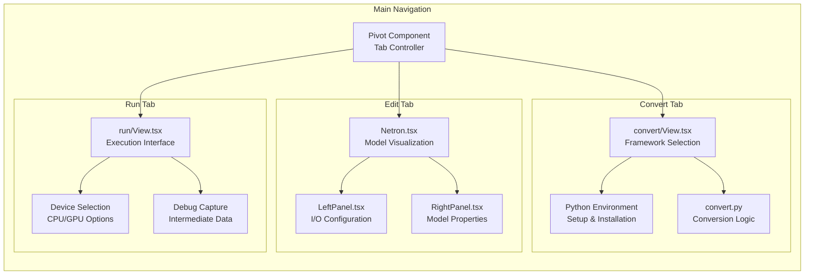
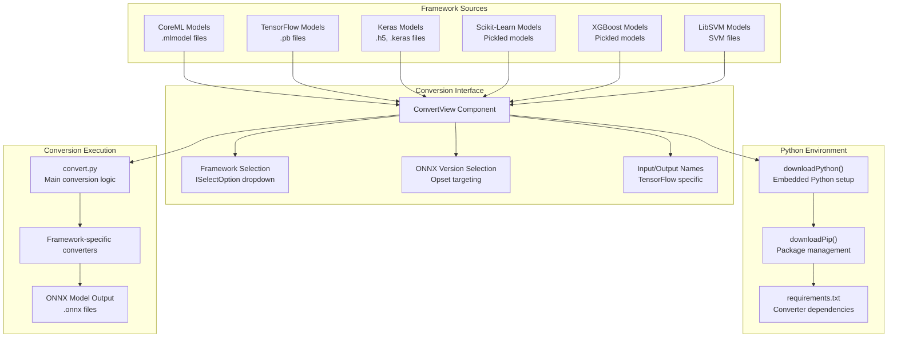
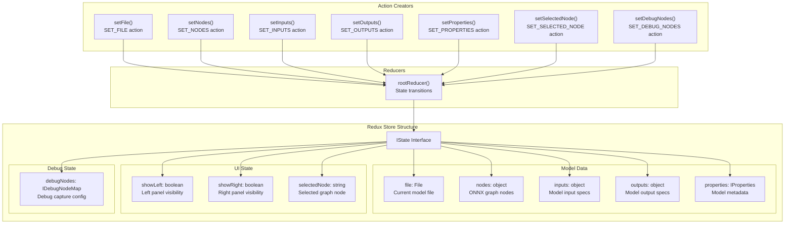
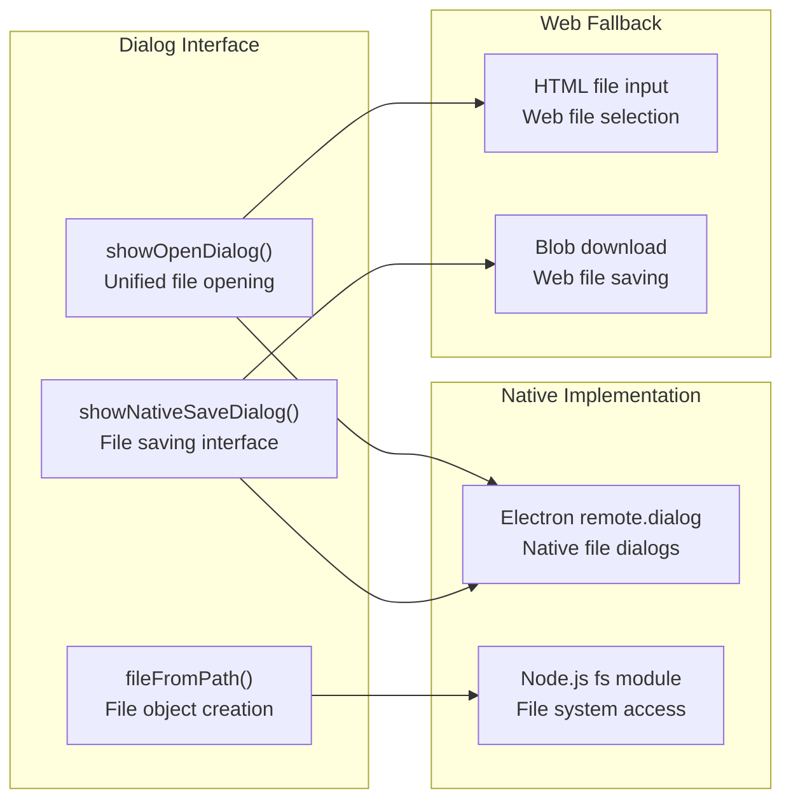
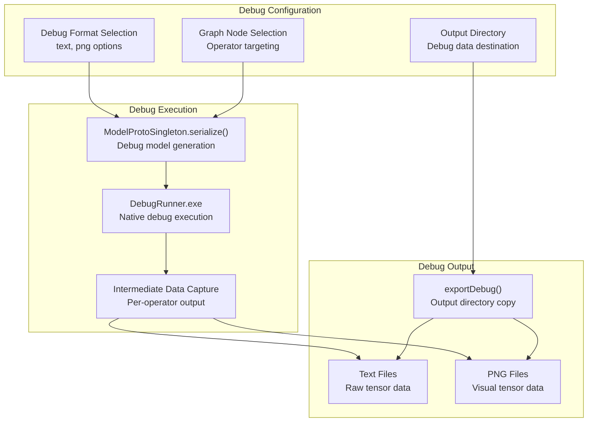

<!-- source: DeepWiki mcp.deepwiki.com · repo microsoft/Windows-Machine-Learning · page 3.1 WinML Dashboard · fetched 2026-10-26 -->

# WinML Dashboard

Relevant source files

The following files were used as context for generating this wiki page:

- [Tools/WinMLDashboard/.gitignore](Tools/WinMLDashboard/.gitignore)
- [Tools/WinMLDashboard/.vscode/launch.json](Tools/WinMLDashboard/.vscode/launch.json)
- [Tools/WinMLDashboard/README.md](Tools/WinMLDashboard/README.md)
- [Tools/WinMLDashboard/build.js](Tools/WinMLDashboard/build.js)
- [Tools/WinMLDashboard/package.json](Tools/WinMLDashboard/package.json)
- [Tools/WinMLDashboard/public/Converter.png](Tools/WinMLDashboard/public/Converter.png)
- [Tools/WinMLDashboard/public/DebugPngs.png](Tools/WinMLDashboard/public/DebugPngs.png)
- [Tools/WinMLDashboard/public/about.css](Tools/WinMLDashboard/public/about.css)
- [Tools/WinMLDashboard/public/about.html](Tools/WinMLDashboard/public/about.html)
- [Tools/WinMLDashboard/public/convert.py](Tools/WinMLDashboard/public/convert.py)
- [Tools/WinMLDashboard/public/progress_bar.gif](Tools/WinMLDashboard/public/progress_bar.gif)
- [Tools/WinMLDashboard/public/questionmark.png](Tools/WinMLDashboard/public/questionmark.png)
- [Tools/WinMLDashboard/public/questionmark2.png](Tools/WinMLDashboard/public/questionmark2.png)
- [Tools/WinMLDashboard/public/requirements.txt](Tools/WinMLDashboard/public/requirements.txt)
- [Tools/WinMLDashboard/src/components/Resizable.tsx](Tools/WinMLDashboard/src/components/Resizable.tsx)
- [Tools/WinMLDashboard/src/datastore/actionCreators.ts](Tools/WinMLDashboard/src/datastore/actionCreators.ts)
- [Tools/WinMLDashboard/src/datastore/actions.ts](Tools/WinMLDashboard/src/datastore/actions.ts)
- [Tools/WinMLDashboard/src/datastore/reducers.ts](Tools/WinMLDashboard/src/datastore/reducers.ts)
- [Tools/WinMLDashboard/src/datastore/state.ts](Tools/WinMLDashboard/src/datastore/state.ts)
- [Tools/WinMLDashboard/src/electronMain.js](Tools/WinMLDashboard/src/electronMain.js)
- [Tools/WinMLDashboard/src/native/dialog.ts](Tools/WinMLDashboard/src/native/dialog.ts)
- [Tools/WinMLDashboard/src/native/menu.ts](Tools/WinMLDashboard/src/native/menu.ts)
- [Tools/WinMLDashboard/src/view/convert/View.css](Tools/WinMLDashboard/src/view/convert/View.css)
- [Tools/WinMLDashboard/src/view/convert/View.tsx](Tools/WinMLDashboard/src/view/convert/View.tsx)
- [Tools/WinMLDashboard/src/view/edit/LeftPanel.tsx](Tools/WinMLDashboard/src/view/edit/LeftPanel.tsx)
- [Tools/WinMLDashboard/src/view/edit/Panel.css](Tools/WinMLDashboard/src/view/edit/Panel.css)
- [Tools/WinMLDashboard/src/view/edit/RightPanel.tsx](Tools/WinMLDashboard/src/view/edit/RightPanel.tsx)
- [Tools/WinMLDashboard/src/view/edit/netron/Netron.tsx](Tools/WinMLDashboard/src/view/edit/netron/Netron.tsx)
- [Tools/WinMLDashboard/src/view/edit/netron/fixed-position-override.css](Tools/WinMLDashboard/src/view/edit/netron/fixed-position-override.css)
- [Tools/WinMLDashboard/src/view/run/View.tsx](Tools/WinMLDashboard/src/view/run/View.tsx)
- [Tools/WinMLDashboard/test/test.js](Tools/WinMLDashboard/test/test.js)
- [Tools/WinMLDashboard/tsconfig.json](Tools/WinMLDashboard/tsconfig.json)

WinML Dashboard is a desktop application for viewing, editing, converting, and validating machine learning models for the Windows ML inference engine. It provides a comprehensive GUI tool for working with ONNX models and converting models from various machine learning frameworks to ONNX format. The dashboard supports model visualization through Netron integration, model metadata editing, cross-framework conversion via Python tools, and model validation using the built-in Windows ML runtime.

For information about the Windows ML API itself and core inference capabilities, see [Core API and Architecture](#2). For sample applications demonstrating Windows ML usage, see [Sample Applications](#4).

## Architecture Overview

WinML Dashboard is built as an Electron application with a React-based user interface. The application follows a multi-layered architecture combining web technologies with native system integration.

```mermaid
graph TB
    subgraph "Electron Main Process"
        electronMain["electronMain.js<br/>Main Window & Menu"]
        nativeDialogs["Native File Dialogs"]
        pythonProcess["Python Subprocess<br/>Model Conversion"]
    end
    
    subgraph "React Renderer Process"
        mainApp["App.tsx<br/>Main Application"]
        redux["Redux Store<br/>State Management"]
        
        subgraph "Core Views"
            editView["Edit/View Tab<br/>Model Visualization"]
            convertView["Convert Tab<br/>Model Conversion"]
            runView["Run Tab<br/>Model Validation"]
        end
        
        subgraph "Components"
            netron["Netron Integration<br/>Model Viewer"]
            leftPanel["LeftPanel.tsx<br/>Input/Output Editor"]
            rightPanel["RightPanel.tsx<br/>Properties Editor"]
        end
    end
    
    subgraph "Native Components"
        debugRunner["DebugRunner.exe<br/>C++ Debug Tool"]
        mlRunner["MicrosoftMLRunner.exe<br/>Model Execution"]
        winmlAPI["Windows.AI.MachineLearning<br/>Windows ML Runtime"]
    end
    
    subgraph "External Tools"
        pythonEnv["Embedded Python<br/>Converter Dependencies"]
        winmltools["WinMLTools<br/>Model Conversion"]
        netronBundle["netron_bundle.js<br/>Model Visualization"]
    end
    
    electronMain --> mainApp
    electronMain --> nativeDialogs
    electronMain --> pythonProcess
    
    mainApp --> redux
    redux --> editView
    redux --> convertView
    redux --> runView
    
    editView --> netron
    editView --> leftPanel
    editView --> rightPanel
    
    netron --> netronBundle
    convertView --> pythonProcess
    runView --> debugRunner
    runView --> mlRunner
    
    pythonProcess --> pythonEnv
    pythonEnv --> winmltools
    mlRunner --> winmlAPI
    debugRunner --> winmlAPI
```

Sources: [Tools/WinMLDashboard/src/electronMain.js:1-171](), [Tools/WinMLDashboard/package.json:1-76](), [Tools/WinMLDashboard/README.md:1-142]()

## Core Views and Navigation

The application is organized around three primary tabs that handle different aspects of model management. Each view is implemented as a React component with Redux state management.

Sources: [Tools/WinMLDashboard/src/view/edit/netron/Netron.tsx:1-360](), [Tools/WinMLDashboard/src/view/convert/View.tsx:1-387](), [Tools/WinMLDashboard/src/view/run/View.tsx:1-427]()

### Edit/View Tab

The Edit tab provides model visualization and editing capabilities through Netron integration. It supports viewing model graphs and editing ONNX model properties.

| Component | Purpose | File Location |
|-----------|---------|---------------|
| `Netron.tsx` | Main model viewer integration | [src/view/edit/netron/Netron.tsx]() |
| `LeftPanel.tsx` | Input/output node editor | [src/view/edit/LeftPanel.tsx]() |
| `RightPanel.tsx` | Model properties editor | [src/view/edit/RightPanel.tsx]() |

The Netron component manages the integration with the Netron model viewer, handling model loading and providing edit/view mode switching functionality.

Sources: [Tools/WinMLDashboard/src/view/edit/netron/Netron.tsx:51-360](), [Tools/WinMLDashboard/src/view/edit/LeftPanel.tsx:79-319](), [Tools/WinMLDashboard/src/view/edit/RightPanel.tsx:22-59]()

### Convert Tab

The Convert tab handles model conversion from various machine learning frameworks to ONNX format. It manages Python environment setup and conversion execution.

Key conversion steps managed by [convert/View.tsx:59-375]():

1. **Python Environment Setup**: Downloads and configures embedded Python with required dependencies
2. **Framework Selection**: Supports CoreML, Keras, scikit-learn, XGBoost, LibSVM, and TensorFlow
3. **Conversion Execution**: Runs [convert.py:1-170]() with framework-specific parameters
4. **Output Management**: Handles converted model file saving and loading

Sources: [Tools/WinMLDashboard/src/view/convert/View.tsx:59-375](), [Tools/WinMLDashboard/public/convert.py:1-170](), [Tools/WinMLDashboard/public/requirements.txt:1-19]()

### Run Tab

The Run tab provides model validation and debugging capabilities using the Windows ML runtime. It supports both standard inference and debug capture modes.

Runtime execution modes:
- **Standard Validation**: Uses `MicrosoftMLRunner.exe` for basic model testing
- **Debug Capture**: Uses `DebugRunner.exe` for intermediate data capture and visualization
- **Performance Profiling**: Includes ETW tracing capabilities for performance analysis

Sources: [Tools/WinMLDashboard/src/view/run/View.tsx:88-427]()

## Model Conversion Pipeline

The conversion system integrates multiple machine learning frameworks through a Python-based conversion pipeline. The system automatically manages dependencies and provides a unified interface for cross-framework conversion.

### Framework-Specific Conversion

The conversion system uses specialized converters for each supported framework, implemented in [convert.py:123-131]():

| Framework | Converter Function | Dependencies |
|-----------|-------------------|--------------|
| CoreML | `coreml_converter()` | `coremltools`, `onnxmltools` |
| Keras | `keras_converter()` | `keras`, `onnxmltools` |
| TensorFlow | `tensorFlow_converter()` | `tensorflow`, `tf2onnx` |
| Scikit-Learn | `scikit_learn_converter()` | `scikit-learn`, `skl2onnx` |
| XGBoost | `xgboost_converter()` | `xgboost`, `onnxmltools` |
| LibSVM | `libSVM_converter()` | `libsvm`, `onnxmltools` |

Sources: [Tools/WinMLDashboard/public/convert.py:50-131](), [Tools/WinMLDashboard/public/requirements.txt:1-19]()

## State Management and Data Flow

The application uses Redux for centralized state management, coordinating between the various views and components. The state structure supports model data, UI configuration, and debugging information.

Sources: [Tools/WinMLDashboard/src/datastore/state.ts:1-35](), [Tools/WinMLDashboard/src/datastore/actionCreators.ts:1-68](), [Tools/WinMLDashboard/src/datastore/reducers.ts:1-37]()

## Native Integration and File Management

The application provides seamless integration with the native Windows environment through Electron's file system APIs and custom dialog implementations.

### File Dialog System

The dialog system abstracts file operations to work both in Electron and web environments:

### Menu System

The application menu provides standard file operations and help functions, implemented in [src/native/menu.ts:8-141]():

- **File Menu**: Open, Save, Save As operations with keyboard shortcuts
- **Help Menu**: Documentation links, issue reporting, third-party notices, and about dialog

Sources: [Tools/WinMLDashboard/src/native/dialog.ts:1-86](), [Tools/WinMLDashboard/src/native/menu.ts:8-141]()

## Model Debugging and Validation

The debugging system provides detailed insights into model execution and intermediate data visualization. It supports both text-based data capture and image visualization for computer vision models.

### Debug Capture Workflow

The debug system captures intermediate data at specified graph nodes and formats it for analysis. For computer vision models, tensor data can be visualized as PNG images to inspect feature maps and intermediate processing stages.

Sources: [Tools/WinMLDashboard/src/view/run/View.tsx:346-414](), [Tools/WinMLDashboard/src/view/edit/LeftPanel.tsx:253-282]()

## Build System and Dependencies

The build system manages the complex integration of multiple technologies and external dependencies required for the dashboard's functionality.

### Build Configuration

Key build scripts in [package.json:10-22]():
- `electron-prod`: Full production build with C++ components
- `build-cpp`: Native component compilation via MSBuild
- `copy-netron`: Netron integration and dependency management
- `lock-netron-deps`: Netron version pinning and compatibility

### External Dependencies

| Dependency | Purpose | Integration Point |
|------------|---------|-------------------|
| Netron | Model visualization | [netron_bundle.js]() bundled asset |
| Python Environment | Model conversion | Embedded Python with [requirements.txt]() |
| C++ Debug Tools | Native debugging | [DebugRunner.exe](), [MicrosoftMLRunner.exe]() |
| Windows ML Runtime | Model execution | System-provided Windows ML APIs |

Sources: [Tools/WinMLDashboard/package.json:1-76](), [Tools/WinMLDashboard/public/requirements.txt:1-19]()

---

