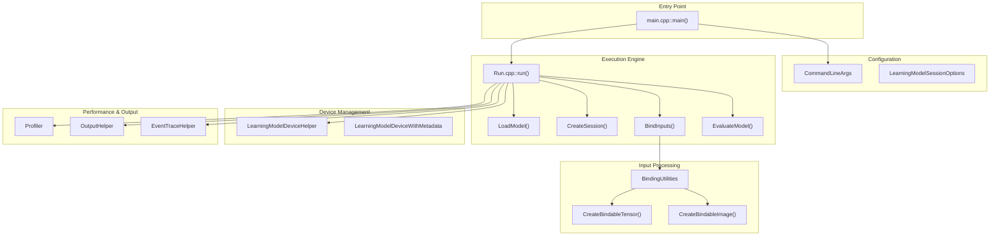
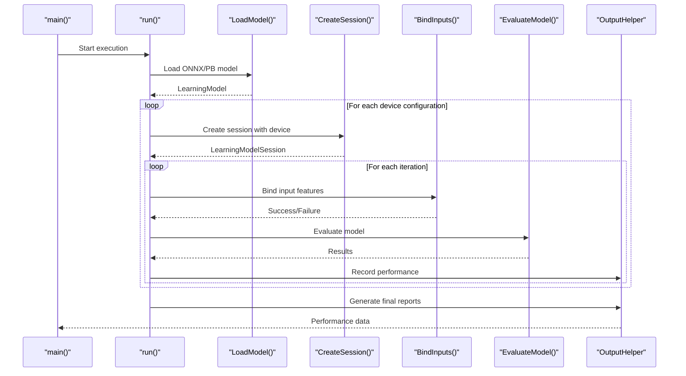
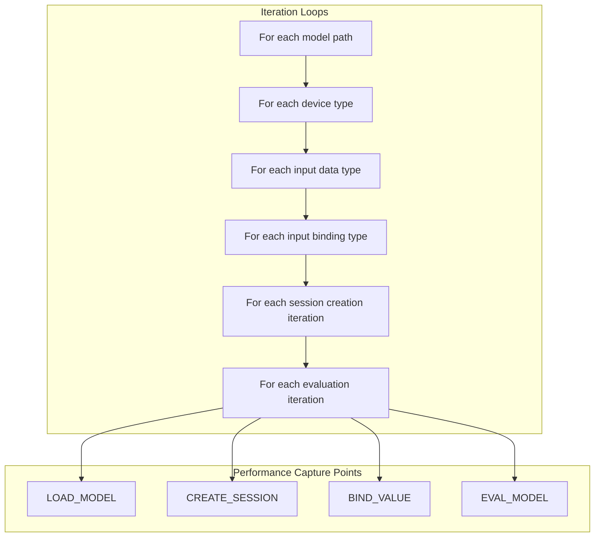
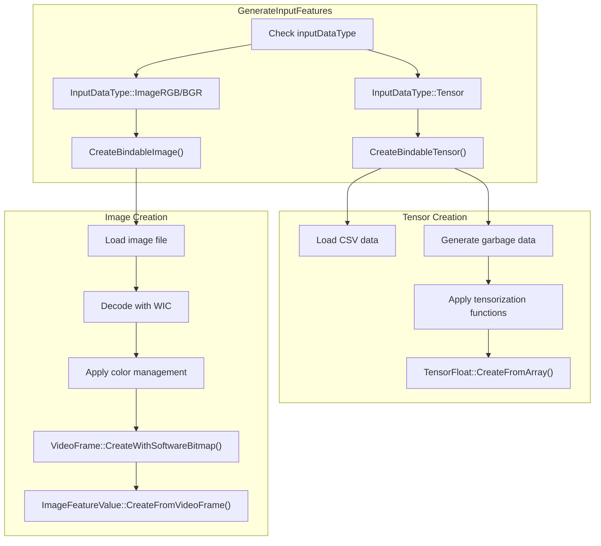
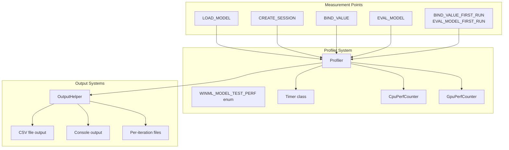
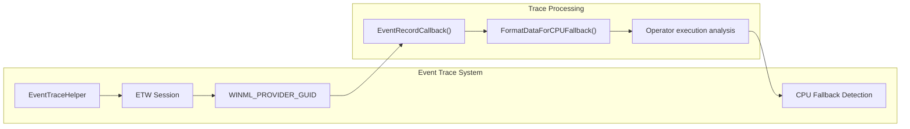
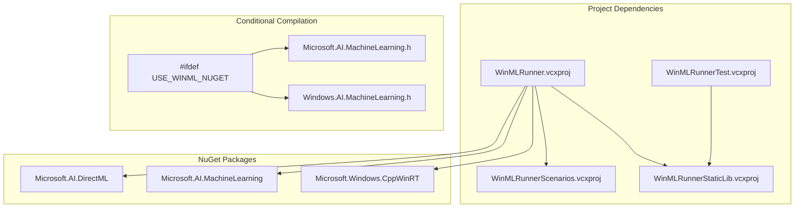

<!-- source: DeepWiki mcp.deepwiki.com · repo microsoft/Windows-Machine-Learning · page 3.2 WinMLRunner · fetched 2026-10-26 -->

# WinMLRunner

Relevant source files

The following files were used as context for generating this wiki page:

- [Testing/WinMLRunnerTest/WinMLRunnerTest.cpp](Testing/WinMLRunnerTest/WinMLRunnerTest.cpp)
- [Testing/WinMLRunnerTest/WinMLRunnerTest.vcxproj](Testing/WinMLRunnerTest/WinMLRunnerTest.vcxproj)
- [Tools/WinMLRunner/README.md](Tools/WinMLRunner/README.md)
- [Tools/WinMLRunner/WinMLRunner.vcxproj](Tools/WinMLRunner/WinMLRunner.vcxproj)
- [Tools/WinMLRunner/WinMLRunnerScenarios.vcxproj](Tools/WinMLRunner/WinMLRunnerScenarios.vcxproj)
- [Tools/WinMLRunner/WinMLRunnerStaticLib.vcxproj](Tools/WinMLRunner/WinMLRunnerStaticLib.vcxproj)
- [Tools/WinMLRunner/WinMLRunnerStaticLib.vcxproj.filters](Tools/WinMLRunner/WinMLRunnerStaticLib.vcxproj.filters)
- [Tools/WinMLRunner/packages.config](Tools/WinMLRunner/packages.config)
- [Tools/WinMLRunner/src/BindingUtilities.cpp](Tools/WinMLRunner/src/BindingUtilities.cpp)
- [Tools/WinMLRunner/src/BindingUtilities.h](Tools/WinMLRunner/src/BindingUtilities.h)
- [Tools/WinMLRunner/src/CommandLineArgs.cpp](Tools/WinMLRunner/src/CommandLineArgs.cpp)
- [Tools/WinMLRunner/src/CommandLineArgs.h](Tools/WinMLRunner/src/CommandLineArgs.h)
- [Tools/WinMLRunner/src/Common.h](Tools/WinMLRunner/src/Common.h)
- [Tools/WinMLRunner/src/EventTraceHelper.cpp](Tools/WinMLRunner/src/EventTraceHelper.cpp)
- [Tools/WinMLRunner/src/EventTraceHelper.h](Tools/WinMLRunner/src/EventTraceHelper.h)
- [Tools/WinMLRunner/src/Filehelper.cpp](Tools/WinMLRunner/src/Filehelper.cpp)
- [Tools/WinMLRunner/src/Filehelper.h](Tools/WinMLRunner/src/Filehelper.h)
- [Tools/WinMLRunner/src/LearningModelDeviceHelper.cpp](Tools/WinMLRunner/src/LearningModelDeviceHelper.cpp)
- [Tools/WinMLRunner/src/LearningModelDeviceHelper.h](Tools/WinMLRunner/src/LearningModelDeviceHelper.h)
- [Tools/WinMLRunner/src/OutputHelper.h](Tools/WinMLRunner/src/OutputHelper.h)
- [Tools/WinMLRunner/src/Run.cpp](Tools/WinMLRunner/src/Run.cpp)
- [Tools/WinMLRunner/src/Run.h](Tools/WinMLRunner/src/Run.h)
- [Tools/WinMLRunner/src/TimerHelper.h](Tools/WinMLRunner/src/TimerHelper.h)
- [Tools/WinMLRunner/src/TypeHelper.h](Tools/WinMLRunner/src/TypeHelper.h)
- [Tools/WinMLRunner/src/main.cpp](Tools/WinMLRunner/src/main.cpp)

WinMLRunner is a command-line tool for evaluating ONNX and Protobuf machine learning models using the Windows Machine Learning (WinML) API. It provides comprehensive model testing capabilities including performance benchmarking, device selection, input data binding, and result validation.

This tool serves as both a standalone evaluation utility and a reference implementation for integrating Windows ML into applications. For information about the GUI-based model development tool, see [WinML Dashboard](#3.1). For sample applications demonstrating Windows ML integration patterns, see [WinML Samples Gallery](#4.1).

## Architecture Overview

WinMLRunner follows a modular architecture that separates command-line parsing, model execution, and performance monitoring into distinct components.

### Core Components Architecture

Sources: [Tools/WinMLRunner/src/main.cpp:22-58](), [Tools/WinMLRunner/src/Run.cpp:528-645](), [Tools/WinMLRunner/src/CommandLineArgs.h:25-222](), [Tools/WinMLRunner/src/Run.h:1-7]()

## Command Line Interface

The tool accepts models via `-model` (single file) or `-folder` (directory) arguments and supports extensive configuration options for execution parameters.

### Key Configuration Categories

| Category | Options | Purpose |
|----------|---------|---------|
| Device Selection | `-CPU`, `-GPU`, `-GPUHighPerformance`, `-GPUMinPower` | Choose execution device |
| Input Binding | `-CPUBoundInput`, `-GPUBoundInput` | Control where input data resides |
| Input Format | `-RGB`, `-BGR`, `-Tensor` | Specify input data format |
| Device Creation | `-CreateDeviceOnClient`, `-CreateDeviceInWinML` | Control D3D device creation location |
| Performance | `-Perf`, `-Iterations`, `-SavePerIterationPerf` | Enable performance monitoring |
| Input Data | `-Input`, `-InputImageFolder` | Provide real input data |

### Command Line Processing Flow

```mermaid
graph LR
    subgraph "CommandLineArgs Constructor"
        Parse["Parse arguments"]
        Validate["Validate combinations"]
        SetupPaths["Setup output paths"]
    end
    
    subgraph "Fetch Methods"
        FetchDeviceTypes["FetchDeviceTypes()"]
        FetchInputBindingTypes["FetchInputBindingTypes()"] 
        FetchInputDataTypes["FetchInputDataTypes()"]
        FetchDeviceCreationLocations["FetchDeviceCreationLocations()"]
    end
    
    Parse --> Validate
    Validate --> SetupPaths
    SetupPaths --> FetchDeviceTypes
    FetchDeviceTypes --> FetchInputBindingTypes
    FetchInputBindingTypes --> FetchInputDataTypes
    FetchInputDataTypes --> FetchDeviceCreationLocations
```

Sources: [Tools/WinMLRunner/src/CommandLineArgs.cpp:106-442](), [Tools/WinMLRunner/src/CommandLineArgs.cpp:568-627]()

## Core Execution Flow

The main execution logic in `Run.cpp` orchestrates model loading, session creation, input binding, and evaluation across multiple iterations and device configurations.

### Primary Execution Sequence

Sources: [Tools/WinMLRunner/src/Run.cpp:95-127](), [Tools/WinMLRunner/src/Run.cpp:165-195](), [Tools/WinMLRunner/src/Run.cpp:197-249](), [Tools/WinMLRunner/src/Run.cpp:310-342]()

### Configuration Iteration Strategy

The tool supports comprehensive testing by iterating through multiple configuration combinations:

Sources: [Tools/WinMLRunner/src/Run.cpp:568-625](), [Tools/WinMLRunner/src/Common.h:39-49]()

## Input Data Binding

The `BindingUtilities` module handles creation of appropriate input feature values based on the specified input data type and binding location.

### Input Feature Creation Flow

Sources: [Tools/WinMLRunner/src/Run.cpp:14-50](), [Tools/WinMLRunner/src/BindingUtilities.cpp:215-480](), [Tools/WinMLRunner/src/BindingUtilities.cpp:482-650]()

## Performance Monitoring

WinMLRunner provides comprehensive performance monitoring through multiple measurement systems.

### Performance Measurement Architecture

### Event Tracing Integration

The tool includes ETW (Event Tracing for Windows) support for detailed execution analysis:

Sources: [Tools/WinMLRunner/src/TimerHelper.h:14-38](), [Tools/WinMLRunner/src/EventTraceHelper.cpp:1-34](), [Tools/WinMLRunner/src/EventTraceHelper.cpp:356-430](), [Tools/WinMLRunner/src/Common.h:39-49]()

## Build Configurations

WinMLRunner supports multiple build configurations to accommodate different deployment scenarios.

### Configuration Matrix

| Configuration | Purpose | Target Binary | WinML Source |
|---------------|---------|---------------|---------------|
| `Debug/Release` | Standard Windows ML | `WinMLRunner.exe` | System Windows ML |
| `Debug_NuGet/Release_NuGet` | NuGet package testing | `MicrosoftMLRunner.exe` | Microsoft.AI.MachineLearning NuGet |

### Project Structure

The build system uses preprocessor definitions to switch between the in-box Windows ML API and the NuGet package version, enabling testing of different WinML versions.

Sources: [Tools/WinMLRunner/WinMLRunner.vcxproj:1-447](), [Tools/WinMLRunner/WinMLRunnerStaticLib.vcxproj:1-400](), [Tools/WinMLRunner/src/Common.h:7-11](), [Tools/WinMLRunner/packages.config:1-6]()

---

