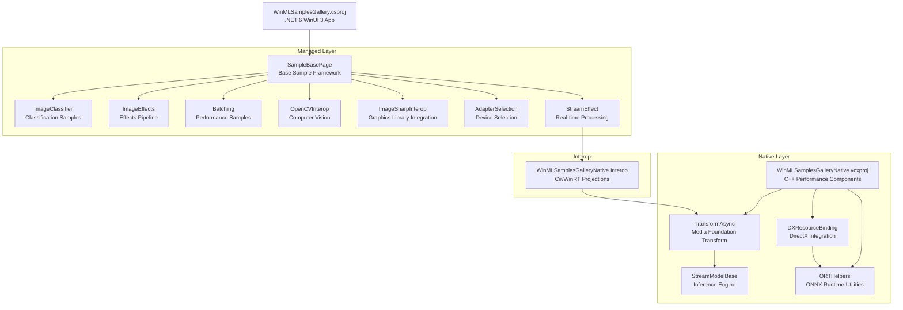
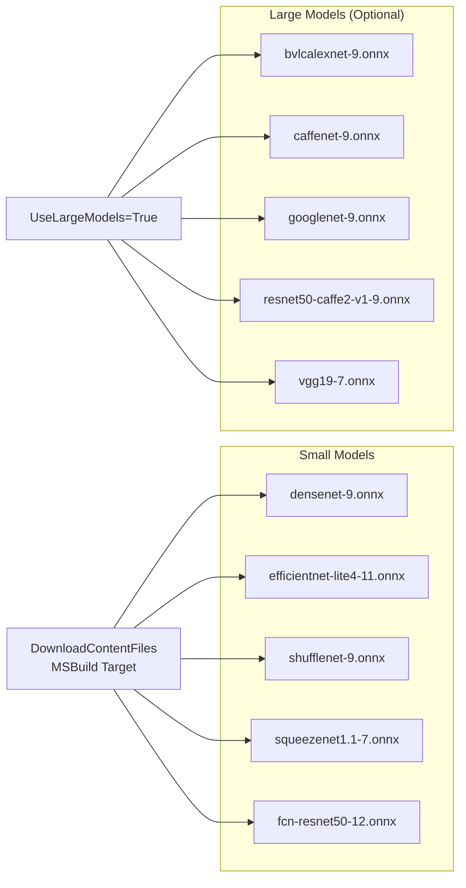
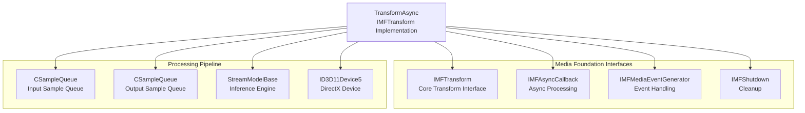
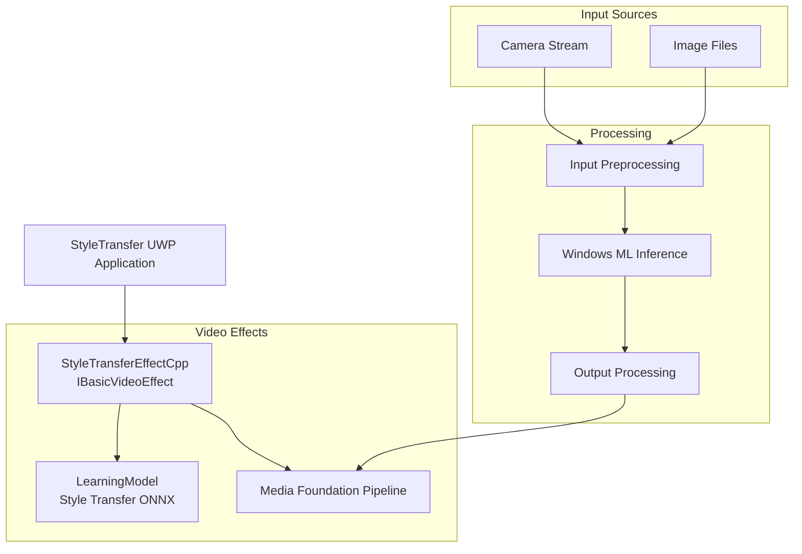
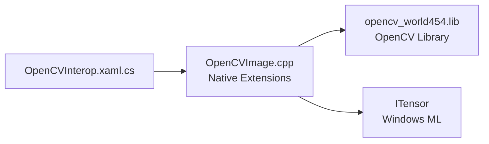
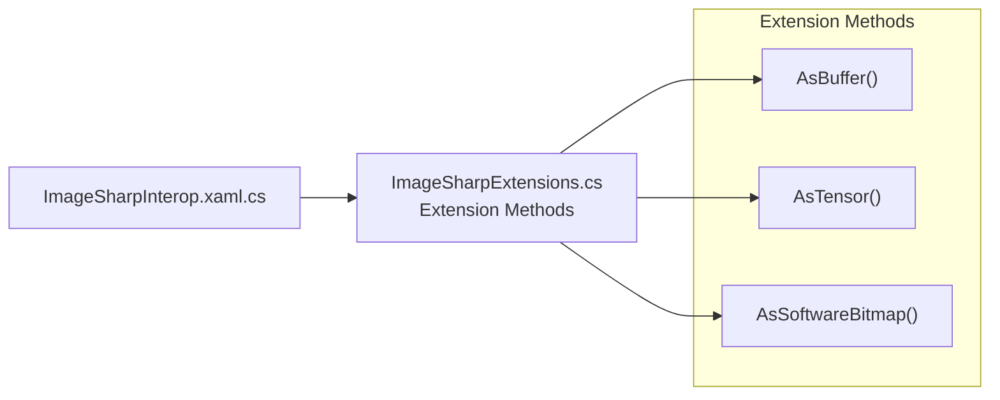

<!-- source: DeepWiki mcp.deepwiki.com · repo microsoft/Windows-Machine-Learning · page 4 Sample Applications · fetched 2026-10-26 -->

# Sample Applications

Relevant source files

The following files were used as context for generating this wiki page:

- [README.md](README.md)
- [Samples/StyleTransfer/README.md](Samples/StyleTransfer/README.md)
- [Samples/WinMLSamplesGallery/README.md](Samples/WinMLSamplesGallery/README.md)
- [Samples/WinMLSamplesGallery/WinMLSamplesGallery (Package)/Package.appxmanifest](Samples/WinMLSamplesGallery/WinMLSamplesGallery (Package)/Package.appxmanifest)
- [Samples/WinMLSamplesGallery/WinMLSamplesGallery (Package)/WinMLSamplesGallery (Package).wapproj](Samples/WinMLSamplesGallery/WinMLSamplesGallery (Package)/WinMLSamplesGallery (Package).wapproj)
- [Samples/WinMLSamplesGallery/WinMLSamplesGallery/Samples/Batching/README.md](Samples/WinMLSamplesGallery/WinMLSamplesGallery/Samples/Batching/README.md)
- [Samples/WinMLSamplesGallery/WinMLSamplesGallery/Samples/ImageClassifier/docs/screenshot.png](Samples/WinMLSamplesGallery/WinMLSamplesGallery/Samples/ImageClassifier/docs/screenshot.png)
- [Samples/WinMLSamplesGallery/WinMLSamplesGallery/Samples/ImageEffects/README.md](Samples/WinMLSamplesGallery/WinMLSamplesGallery/Samples/ImageEffects/README.md)
- [Samples/WinMLSamplesGallery/WinMLSamplesGallery/Samples/ImageEffects/docs/screenshot.png](Samples/WinMLSamplesGallery/WinMLSamplesGallery/Samples/ImageEffects/docs/screenshot.png)
- [Samples/WinMLSamplesGallery/WinMLSamplesGallery/Samples/ImageSharpInterop/ImageSharpExtensions.cs](Samples/WinMLSamplesGallery/WinMLSamplesGallery/Samples/ImageSharpInterop/ImageSharpExtensions.cs)
- [Samples/WinMLSamplesGallery/WinMLSamplesGallery/Samples/ImageSharpInterop/README.md](Samples/WinMLSamplesGallery/WinMLSamplesGallery/Samples/ImageSharpInterop/README.md)
- [Samples/WinMLSamplesGallery/WinMLSamplesGallery/Samples/ImageSharpInterop/docs/screenshot.png](Samples/WinMLSamplesGallery/WinMLSamplesGallery/Samples/ImageSharpInterop/docs/screenshot.png)
- [Samples/WinMLSamplesGallery/WinMLSamplesGallery/WinMLSamplesGallery.csproj](Samples/WinMLSamplesGallery/WinMLSamplesGallery/WinMLSamplesGallery.csproj)
- [Samples/WinMLSamplesGallery/WinMLSamplesGalleryNative.Interop/WinMLSamplesGalleryNative.Interop.csproj](Samples/WinMLSamplesGallery/WinMLSamplesGalleryNative.Interop/WinMLSamplesGalleryNative.Interop.csproj)
- [Samples/WinMLSamplesGallery/WinMLSamplesGalleryNative/TransformAsync.h](Samples/WinMLSamplesGallery/WinMLSamplesGalleryNative/TransformAsync.h)
- [Samples/WinMLSamplesGallery/WinMLSamplesGalleryNative/WinMLSamplesGalleryNative.vcxproj](Samples/WinMLSamplesGallery/WinMLSamplesGalleryNative/WinMLSamplesGalleryNative.vcxproj)
- [Samples/WinMLSamplesGallery/WinMLSamplesGalleryNative/WinMLSamplesGalleryNative.vcxproj.filters](Samples/WinMLSamplesGallery/WinMLSamplesGalleryNative/WinMLSamplesGalleryNative.vcxproj.filters)
- [Samples/WinMLSamplesGallery/WinMLSamplesGalleryNative/packages.config](Samples/WinMLSamplesGallery/WinMLSamplesGalleryNative/packages.config)
- [Samples/WinMLSamplesGallery/docs/WinMLSamplesGalleryLanding.png](Samples/WinMLSamplesGallery/docs/WinMLSamplesGalleryLanding.png)
- [ThirdPartyNotices.txt](ThirdPartyNotices.txt)

This document provides an overview of the sample applications included in the Windows Machine Learning repository. These applications demonstrate various Windows ML capabilities through practical implementations ranging from basic image classification to advanced real-time video processing scenarios.

For information about the core Windows ML API architecture, see [Core API and Architecture](#2). For details about development tools used with these samples, see [Development Tools](#3).

## Overview

The repository contains two primary sample application categories:

1. **WinML Samples Gallery** - An interactive desktop application showcasing multiple Windows ML scenarios in a single interface
2. **Standalone Applications** - Individual applications demonstrating specific use cases like style transfer and MNIST classification

## WinML Samples Gallery

The WinML Samples Gallery serves as the primary demonstration application, implemented as a WinUI 3 desktop application targeting .NET 6. The gallery provides an interactive interface for exploring various Windows ML capabilities.

### Application Architecture

Sources: [Samples/WinMLSamplesGallery/WinMLSamplesGallery/WinMLSamplesGallery.csproj](), [Samples/WinMLSamplesGallery/WinMLSamplesGalleryNative/WinMLSamplesGalleryNative.vcxproj](), [Samples/WinMLSamplesGallery/WinMLSamplesGalleryNative.Interop/WinMLSamplesGalleryNative.Interop.csproj]()

### Sample Categories

The gallery contains several categories of samples, each demonstrating different aspects of Windows ML:

| Sample Type | Implementation | Key Components |
|-------------|---------------|----------------|
| Image Classification | C# WinUI | `ImageClassifier.xaml.cs`, Multiple ONNX models |
| Image Effects | C# WinUI | `ImageEffects.xaml.cs`, Model chaining |
| Batching | C# WinUI | `Batching.xaml.cs`, `BatchSizeOverride` |
| OpenCV Interop | C# + Native | `OpenCVInterop.xaml.cs`, `OpenCVImage.cpp` |
| ImageSharp Interop | C# | `ImageSharpInterop.xaml.cs`, `ImageSharpExtensions.cs` |
| Stream Effects | C# + Native | `StreamEffect.xaml.cs`, `TransformAsync.cpp` |
| DX Resource Binding | Native | `DXResourceBindingORT.xaml`, `DXResourceBinding.cpp` |

### Model Management

The application automatically downloads ONNX models from the ONNX Model Zoo during build:

Sources: [Samples/WinMLSamplesGallery/WinMLSamplesGallery/WinMLSamplesGallery.csproj:190-245]()

### Native Components

The native layer provides performance-critical functionality through several key components:

#### Media Foundation Transform
The `TransformAsync` class implements `IMFTransform` for real-time video processing:

Sources: [Samples/WinMLSamplesGallery/WinMLSamplesGalleryNative/TransformAsync.h:44-351]()

## Style Transfer Application

The Style Transfer application demonstrates real-time neural style transfer on video streams using a standalone UWP implementation.

### Architecture

Sources: [Samples/StyleTransfer/README.md:1-51]()

## MNIST and Basic Samples

Several standalone applications demonstrate basic Windows ML integration patterns across different application types:

| Application Type | Project Structure | Key Features |
|------------------|-------------------|--------------|
| UWP C++/CX | `Samples/MNIST/UWP` | Basic digit recognition |
| UWP C# | `Samples/MNIST/Tutorial/cs` | Managed implementation |
| Desktop C++/WinRT | `Samples/SqueezeNetObjectDetection/Desktop/cpp` | Object detection |
| .NET 5 | `Samples/SqueezeNetObjectDetection/NET5` | Cross-platform |
| .NET Core 2 | `Samples/SqueezeNetObjectDetection/NETCore/cs` | Legacy framework |

## Advanced Integration Samples

### OpenCV Integration

The OpenCV interoperability sample demonstrates computer vision pipeline integration:

Sources: [Samples/WinMLSamplesGallery/WinMLSamplesGalleryNative/OpenCVImage.cpp](), [Samples/WinMLSamplesGallery/WinMLSamplesGalleryNative/WinMLSamplesGalleryNative.vcxproj:115-131]()

### ImageSharp Integration

The ImageSharp sample provides managed graphics library integration through extension methods:

Sources: [Samples/WinMLSamplesGallery/WinMLSamplesGallery/Samples/ImageSharpInterop/ImageSharpExtensions.cs:18-47]()

## Build Configuration

The samples support conditional compilation based on feature flags:

| Build Flag | Effect | Components Affected |
|------------|--------|-------------------|
| `USE_LARGE_MODELS` | Includes additional ONNX models | Model download targets |
| `USE_OPENCV` | Enables OpenCV integration | Native compilation, OpenCV samples |
| Platform targets | x86, x64, ARM64 support | All components |

The build system automatically detects OpenCV availability and conditionally compiles related samples based on library presence.

Sources: [Samples/WinMLSamplesGallery/WinMLSamplesGallery/WinMLSamplesGallery.csproj:11-19](), [Samples/WinMLSamplesGallery/WinMLSamplesGalleryNative/WinMLSamplesGalleryNative.vcxproj:115-131]()

---

