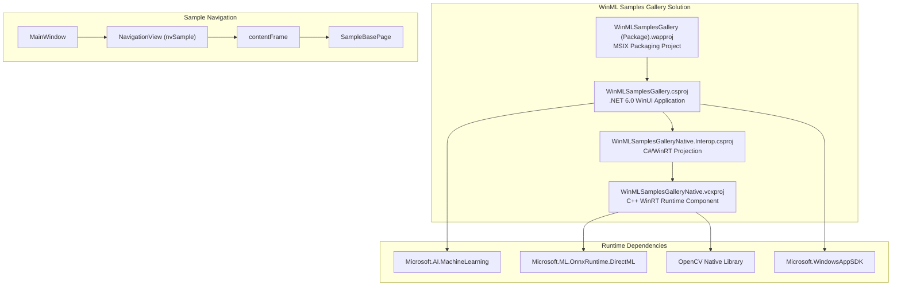
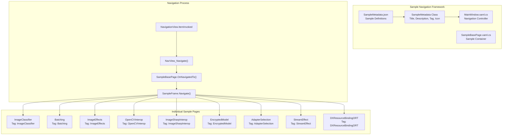
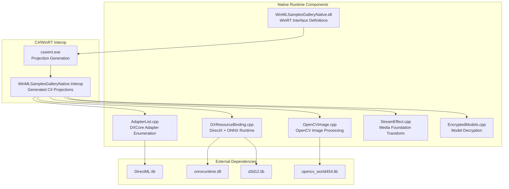
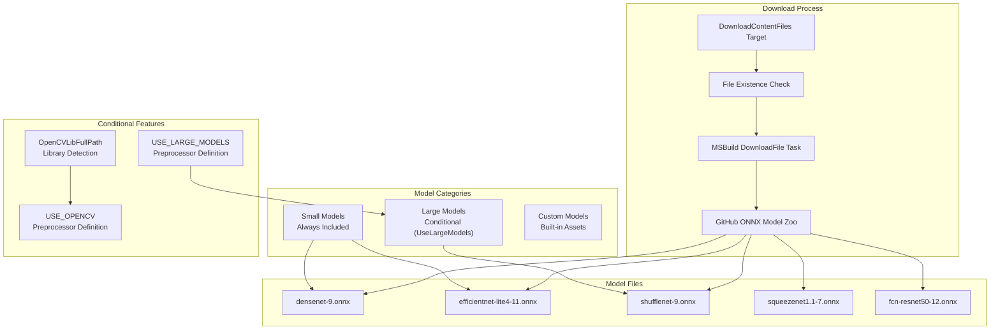

<!-- source: DeepWiki mcp.deepwiki.com · repo microsoft/Windows-Machine-Learning · page 4.1 WinML Samples Gallery · fetched 2026-10-26 -->

# WinML Samples Gallery

Relevant source files

The following files were used as context for generating this wiki page:

- [Samples/WinMLSamplesGallery/WinMLSamplesGallery (Package)/Package.appxmanifest](Samples/WinMLSamplesGallery/WinMLSamplesGallery (Package)/Package.appxmanifest)
- [Samples/WinMLSamplesGallery/WinMLSamplesGallery (Package)/WinMLSamplesGallery (Package).wapproj](Samples/WinMLSamplesGallery/WinMLSamplesGallery (Package)/WinMLSamplesGallery (Package).wapproj)
- [Samples/WinMLSamplesGallery/WinMLSamplesGallery.sln](Samples/WinMLSamplesGallery/WinMLSamplesGallery.sln)
- [Samples/WinMLSamplesGallery/WinMLSamplesGallery/MainWindow.xaml](Samples/WinMLSamplesGallery/WinMLSamplesGallery/MainWindow.xaml)
- [Samples/WinMLSamplesGallery/WinMLSamplesGallery/MainWindow.xaml.cs](Samples/WinMLSamplesGallery/WinMLSamplesGallery/MainWindow.xaml.cs)
- [Samples/WinMLSamplesGallery/WinMLSamplesGallery/Pages/SampleBasePage.xaml.cs](Samples/WinMLSamplesGallery/WinMLSamplesGallery/Pages/SampleBasePage.xaml.cs)
- [Samples/WinMLSamplesGallery/WinMLSamplesGallery/Pages/SamplesGrid.xaml](Samples/WinMLSamplesGallery/WinMLSamplesGallery/Pages/SamplesGrid.xaml)
- [Samples/WinMLSamplesGallery/WinMLSamplesGallery/SampleMetadata/SampleMetadata.json](Samples/WinMLSamplesGallery/WinMLSamplesGallery/SampleMetadata/SampleMetadata.json)
- [Samples/WinMLSamplesGallery/WinMLSamplesGallery/Samples/AdapterSelection/AdapterSelection.xaml](Samples/WinMLSamplesGallery/WinMLSamplesGallery/Samples/AdapterSelection/AdapterSelection.xaml)
- [Samples/WinMLSamplesGallery/WinMLSamplesGallery/Samples/AdapterSelection/AdapterSelection.xaml.cs](Samples/WinMLSamplesGallery/WinMLSamplesGallery/Samples/AdapterSelection/AdapterSelection.xaml.cs)
- [Samples/WinMLSamplesGallery/WinMLSamplesGallery/Samples/DXResourceBindingORT/DXResourceBindingORT.xaml](Samples/WinMLSamplesGallery/WinMLSamplesGallery/Samples/DXResourceBindingORT/DXResourceBindingORT.xaml)
- [Samples/WinMLSamplesGallery/WinMLSamplesGallery/Samples/DXResourceBindingORT/DXResourceBindingORT.xaml.cs](Samples/WinMLSamplesGallery/WinMLSamplesGallery/Samples/DXResourceBindingORT/DXResourceBindingORT.xaml.cs)
- [Samples/WinMLSamplesGallery/WinMLSamplesGallery/WinMLSamplesGallery.csproj](Samples/WinMLSamplesGallery/WinMLSamplesGallery/WinMLSamplesGallery.csproj)
- [Samples/WinMLSamplesGallery/WinMLSamplesGalleryNative.Interop/WinMLSamplesGalleryNative.Interop.csproj](Samples/WinMLSamplesGallery/WinMLSamplesGalleryNative.Interop/WinMLSamplesGalleryNative.Interop.csproj)
- [Samples/WinMLSamplesGallery/WinMLSamplesGalleryNative/AdapterList.cpp](Samples/WinMLSamplesGallery/WinMLSamplesGalleryNative/AdapterList.cpp)
- [Samples/WinMLSamplesGallery/WinMLSamplesGalleryNative/AdapterList.h](Samples/WinMLSamplesGallery/WinMLSamplesGalleryNative/AdapterList.h)
- [Samples/WinMLSamplesGallery/WinMLSamplesGalleryNative/DXResourceBinding.h](Samples/WinMLSamplesGallery/WinMLSamplesGalleryNative/DXResourceBinding.h)
- [Samples/WinMLSamplesGallery/WinMLSamplesGalleryNative/TransformAsync.h](Samples/WinMLSamplesGallery/WinMLSamplesGalleryNative/TransformAsync.h)
- [Samples/WinMLSamplesGallery/WinMLSamplesGalleryNative/WinMLSamplesGalleryNative.idl](Samples/WinMLSamplesGallery/WinMLSamplesGalleryNative/WinMLSamplesGalleryNative.idl)
- [Samples/WinMLSamplesGallery/WinMLSamplesGalleryNative/WinMLSamplesGalleryNative.vcxproj](Samples/WinMLSamplesGallery/WinMLSamplesGalleryNative/WinMLSamplesGalleryNative.vcxproj)
- [Samples/WinMLSamplesGallery/WinMLSamplesGalleryNative/WinMLSamplesGalleryNative.vcxproj.filters](Samples/WinMLSamplesGallery/WinMLSamplesGalleryNative/WinMLSamplesGalleryNative.vcxproj.filters)
- [Samples/WinMLSamplesGallery/WinMLSamplesGalleryNative/packages.config](Samples/WinMLSamplesGallery/WinMLSamplesGalleryNative/packages.config)

The WinML Samples Gallery is the primary demonstration application within the Windows Machine Learning repository, serving as an interactive showcase of various Windows ML capabilities and integration patterns. This document covers the application's architecture, sample framework, individual sample implementations, and native component integration. For information about the underlying Windows ML API concepts, see [Core API and Architecture](#2). For details about specific sample categories, see [Image Classification Samples](#4.3), [Batching and Performance](#4.2), and [Advanced Integration](#5).

## Application Architecture

The WinML Samples Gallery consists of four main projects that work together to provide a comprehensive demonstration platform:

**Sources:** [Samples/WinMLSamplesGallery/WinMLSamplesGallery/WinMLSamplesGallery.csproj:1-248](), [Samples/WinMLSamplesGallery/WinMLSamplesGalleryNative/WinMLSamplesGalleryNative.vcxproj:1-281](), [Samples/WinMLSamplesGallery/WinMLSamplesGallery/MainWindow.xaml.cs:17-36]()

## Sample Framework Architecture

The application uses a metadata-driven approach to manage and navigate between different samples:

**Sources:** [Samples/WinMLSamplesGallery/WinMLSamplesGallery/SampleMetadata/SampleMetadata.json:1-109](), [Samples/WinMLSamplesGallery/WinMLSamplesGallery/Pages/SampleBasePage.xaml.cs:19-56](), [Samples/WinMLSamplesGallery/WinMLSamplesGallery/MainWindow.xaml.cs:38-63]()

## Sample Categories and Implementation

The gallery includes nine primary sample categories, each demonstrating different aspects of Windows ML integration:

| Sample | Tag | Primary Focus | Key Technologies |
|--------|-----|---------------|------------------|
| Image Classification | `ImageClassifier` | Basic model inference | `LearningModel`, `LearningModelSession` |
| Batched Inputs | `Batching` | Performance optimization | `BatchSizeOverride` |
| Image Effects | `ImageEffects` | Pre/post-processing | Image manipulation pipelines |
| OpenCV Interop | `OpenCVInterop` | Native library integration | OpenCV + Windows ML |
| ImageSharp Interop | `ImageSharpInterop` | Managed library integration | ImageSharp + Windows ML |
| Encrypted Models | `EncryptedModel` | Model security | Encrypted resource loading |
| Adapter Selection | `AdapterSelection` | Device management | `LearningModelDevice`, GPU adapters |
| Real-Time Inference | `StreamEffect` | Media Foundation integration | Video streaming + inference |
| DX Resource Binding | `DXResourceBindingORT` | Direct GPU memory access | ONNX Runtime + DirectX |

**Sources:** [Samples/WinMLSamplesGallery/WinMLSamplesGallery/SampleMetadata/SampleMetadata.json:2-108]()

## Native Component Integration

The `WinMLSamplesGalleryNative` project provides C++ implementations for performance-critical operations and advanced DirectX integration:

**Sources:** [Samples/WinMLSamplesGallery/WinMLSamplesGalleryNative/WinMLSamplesGalleryNative.idl:1-44](), [Samples/WinMLSamplesGallery/WinMLSamplesGalleryNative.Interop/WinMLSamplesGalleryNative.Interop.csproj:20-37](), [Samples/WinMLSamplesGallery/WinMLSamplesGalleryNative/WinMLSamplesGalleryNative.vcxproj:114-131]()

## Model Management and Build Process

The application implements automatic model downloading and conditional compilation features:

**Sources:** [Samples/WinMLSamplesGallery/WinMLSamplesGallery/WinMLSamplesGallery.csproj:190-245](), [Samples/WinMLSamplesGallery/WinMLSamplesGallery/WinMLSamplesGallery.csproj:11-18](), [Samples/WinMLSamplesGallery/WinMLSamplesGallery/WinMLSamplesGallery.csproj:82-96]()

## Key Implementation Patterns

### Sample Page Navigation

The `SampleBasePage` class implements a tag-based navigation pattern that routes to specific sample implementations:

- Tag resolution occurs in `SampleBasePage.OnNavigatedTo()` using a switch statement
- Each sample tag corresponds to a specific `Page` type in the `WinMLSamplesGallery.Samples` namespace
- Navigation cleanup is handled in `OnNavigatingFrom()` for samples with background operations

**Sources:** [Samples/WinMLSamplesGallery/WinMLSamplesGallery/Pages/SampleBasePage.xaml.cs:22-51](), [Samples/WinMLSamplesGallery/WinMLSamplesGallery/Pages/SampleBasePage.xaml.cs:58-78]()

### Telemetry Integration

The application includes telemetry support through the `LearningModelExperimental` class:

- Model names are set using `SetModelNameForTelemetry()` static method
- Telemetry model names follow the pattern `{modelName}_{sampleName}`
- Implementation appears in multiple samples including `AdapterSelection` and `DXResourceBindingORT`

**Sources:** [Samples/WinMLSamplesGallery/WinMLSamplesGallery/Pages/SampleBasePage.xaml.cs:80-85](), [Samples/WinMLSamplesGallery/WinMLSamplesGallery/Samples/AdapterSelection/AdapterSelection.xaml.cs:107-116]()

### Conditional Compilation

The project uses MSBuild properties to enable/disable features:

- `UseOpenCV` property controls OpenCV integration based on library availability
- `UseLargeModels` property controls inclusion of large model assets
- Preprocessor definitions `USE_OPENCV` and `USE_LARGE_MODELS` are set conditionally

**Sources:** [Samples/WinMLSamplesGallery/WinMLSamplesGallery/WinMLSamplesGallery.csproj:15-18](), [Samples/WinMLSamplesGallery/WinMLSamplesGalleryNative/WinMLSamplesGalleryNative.vcxproj:119-131]()

---

