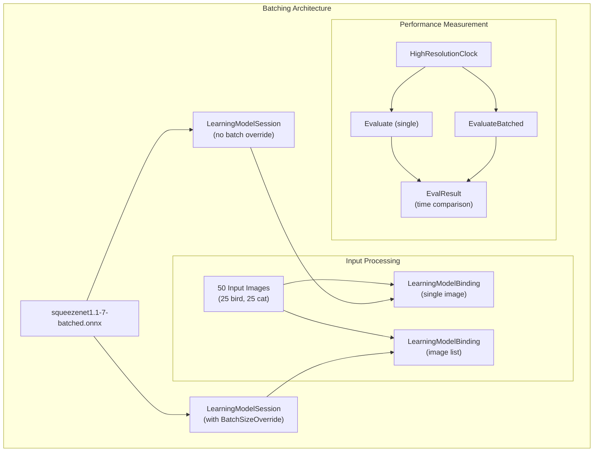
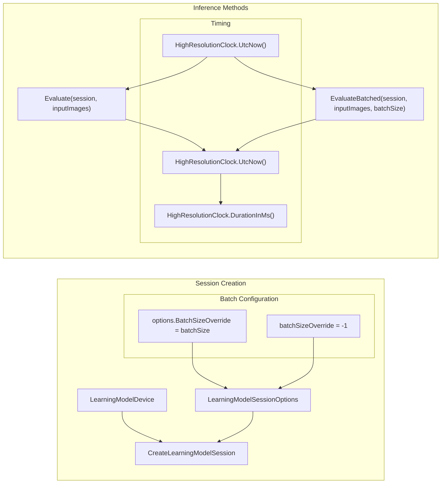
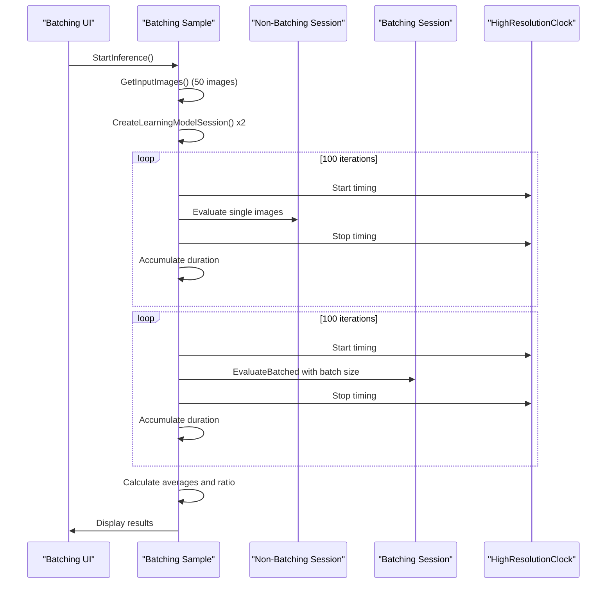
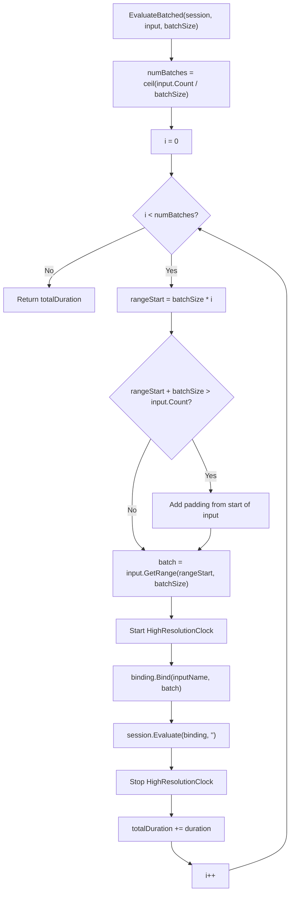
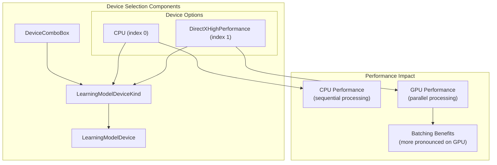
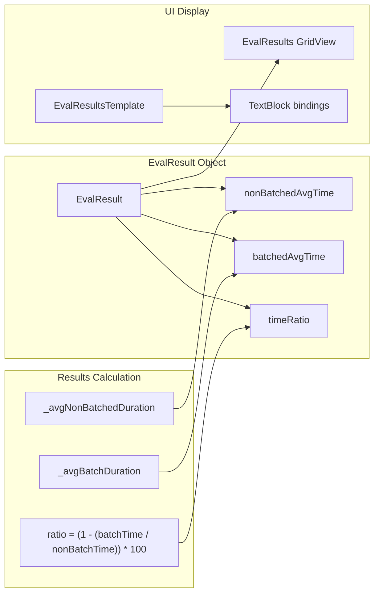

<!-- source: DeepWiki mcp.deepwiki.com · repo microsoft/Windows-Machine-Learning · page 4.2 Batching and Performance · fetched 2026-10-26 -->

# Batching and Performance

Relevant source files

The following files were used as context for generating this wiki page:

- [Samples/WinMLSamplesGallery/WinMLSamplesGallery/Controls/DeviceComboBox.xaml](Samples/WinMLSamplesGallery/WinMLSamplesGallery/Controls/DeviceComboBox.xaml)
- [Samples/WinMLSamplesGallery/WinMLSamplesGallery/Controls/DeviceComboBox.xaml.cs](Samples/WinMLSamplesGallery/WinMLSamplesGallery/Controls/DeviceComboBox.xaml.cs)
- [Samples/WinMLSamplesGallery/WinMLSamplesGallery/InputData/fish.png](Samples/WinMLSamplesGallery/WinMLSamplesGallery/InputData/fish.png)
- [Samples/WinMLSamplesGallery/WinMLSamplesGallery/Pages/HomePage.xaml](Samples/WinMLSamplesGallery/WinMLSamplesGallery/Pages/HomePage.xaml)
- [Samples/WinMLSamplesGallery/WinMLSamplesGallery/Pages/SampleBasePage.xaml](Samples/WinMLSamplesGallery/WinMLSamplesGallery/Pages/SampleBasePage.xaml)
- [Samples/WinMLSamplesGallery/WinMLSamplesGallery/Samples/Batching/Batching.xaml](Samples/WinMLSamplesGallery/WinMLSamplesGallery/Samples/Batching/Batching.xaml)
- [Samples/WinMLSamplesGallery/WinMLSamplesGallery/Samples/Batching/Batching.xaml.cs](Samples/WinMLSamplesGallery/WinMLSamplesGallery/Samples/Batching/Batching.xaml.cs)
- [Samples/WinMLSamplesGallery/WinMLSamplesGallery/Samples/ImageClassifier/ImageClassifier.xaml](Samples/WinMLSamplesGallery/WinMLSamplesGallery/Samples/ImageClassifier/ImageClassifier.xaml)
- [Samples/WinMLSamplesGallery/WinMLSamplesGallery/Samples/ImageEffects/ImageEffects.xaml](Samples/WinMLSamplesGallery/WinMLSamplesGallery/Samples/ImageEffects/ImageEffects.xaml)
- [Samples/WinMLSamplesGallery/WinMLSamplesGallery/Samples/ImageSharpInterop/ImageSharpInterop.xaml](Samples/WinMLSamplesGallery/WinMLSamplesGallery/Samples/ImageSharpInterop/ImageSharpInterop.xaml)
- [Samples/WinMLSamplesGallery/WinMLSamplesGallery/Samples/ObjectDetector/ObjectDetector.xaml](Samples/WinMLSamplesGallery/WinMLSamplesGallery/Samples/ObjectDetector/ObjectDetector.xaml)

This document covers the batching functionality and performance optimization techniques demonstrated in the Windows ML Samples Gallery. It focuses on the batching sample implementation, performance measurement methodologies, and optimization strategies for machine learning inference.

For general information about the Windows ML Samples Gallery architecture, see [WinML Samples Gallery](#4.1). For device adapter selection details, see [Adapter Selection](#4.7).

## Batching Concepts

Windows ML supports batched inference to improve performance when processing multiple inputs. Batching allows the runtime to optimize memory usage and computation by processing multiple inputs simultaneously rather than sequentially.

The batching sample demonstrates performance differences between individual inference calls and batched inference using the `LearningModelSessionOptions.BatchSizeOverride` property.

Sources: [Samples/WinMLSamplesGallery/WinMLSamplesGallery/Samples/Batching/Batching.xaml.cs:1-265]()

## Implementation Architecture

The batching sample creates two separate `LearningModelSession` instances to compare performance:

The `CreateLearningModelSession` method handles both session types:

Sources: [Samples/WinMLSamplesGallery/WinMLSamplesGallery/Samples/Batching/Batching.xaml.cs:121-132]()

## Performance Measurement

The sample implements comprehensive performance measurement using a controlled testing methodology:

| Measurement Parameter | Value | Purpose |
|----------------------|-------|---------|
| `NumInputImages` | 50 | Consistent test dataset size |
| `NumEvalIterations` | 100 | Statistical significance |
| Input composition | 25 bird + 25 cat images | Balanced dataset |
| Timing precision | `HighResolutionClock` | High-precision measurement |

The performance comparison calculates the percentage improvement:

Sources: [Samples/WinMLSamplesGallery/WinMLSamplesGallery/Samples/Batching/Batching.xaml.cs:134-149](), [Samples/WinMLSamplesGallery/WinMLSamplesGallery/Samples/Batching/Batching.xaml.cs:173-185](), [Samples/WinMLSamplesGallery/WinMLSamplesGallery/Samples/Batching/Batching.xaml.cs:237-243]()

## Batch Processing Implementation

The `EvaluateBatched` method handles variable batch sizes with padding for incomplete batches:

Sources: [Samples/WinMLSamplesGallery/WinMLSamplesGallery/Samples/Batching/Batching.xaml.cs:187-222]()

## Device Selection for Performance

The batching sample integrates with the `DeviceComboBox` control to allow performance comparison across different execution devices:

The `GetDeviceKind()` method maps UI selection to device types:

Sources: [Samples/WinMLSamplesGallery/WinMLSamplesGallery/Controls/DeviceComboBox.xaml.cs:25-31](), [Samples/WinMLSamplesGallery/WinMLSamplesGallery/Samples/Batching/Batching.xaml.cs:123-124]()

## UI Controls and User Experience

The batching sample provides interactive controls for performance experimentation:

| Control | Range | Purpose |
|---------|-------|---------|
| `BatchSizeSlider` | 1-50 | Adjustable batch size |
| `DeviceComboBox` | CPU/DirectML | Device selection |
| `StartInferenceBtn` | - | Trigger performance test |
| `EvalProgressBar` | 0-100 | Progress indication |

The UI updates dynamically during testing:

Sources: [Samples/WinMLSamplesGallery/WinMLSamplesGallery/Samples/Batching/Batching.xaml:40-55](), [Samples/WinMLSamplesGallery/WinMLSamplesGallery/Samples/Batching/Batching.xaml.cs:224-227](), [Samples/WinMLSamplesGallery/WinMLSamplesGallery/Samples/Batching/Batching.xaml.cs:229-233]()

## Results Display and Analysis

The sample presents performance results through the `EvalResult` class and data binding:

Sources: [Samples/WinMLSamplesGallery/WinMLSamplesGallery/Samples/Batching/Batching.xaml.cs:14-19](), [Samples/WinMLSamplesGallery/WinMLSamplesGallery/Samples/Batching/Batching.xaml.cs:237-252](), [Samples/WinMLSamplesGallery/WinMLSamplesGallery/Samples/Batching/Batching.xaml:13-36]()

---

