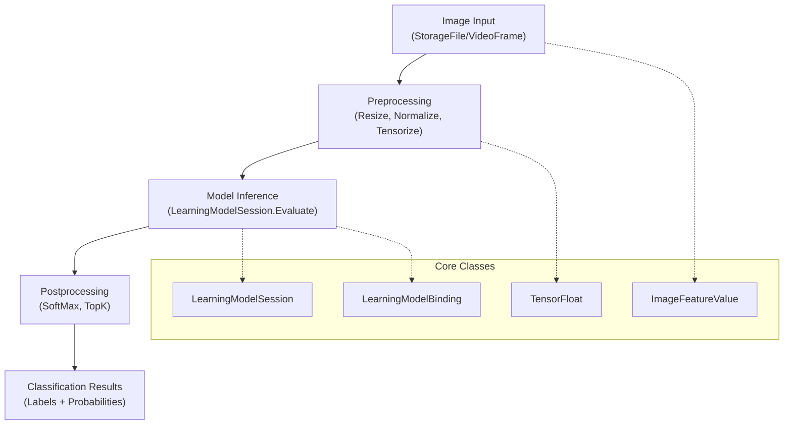
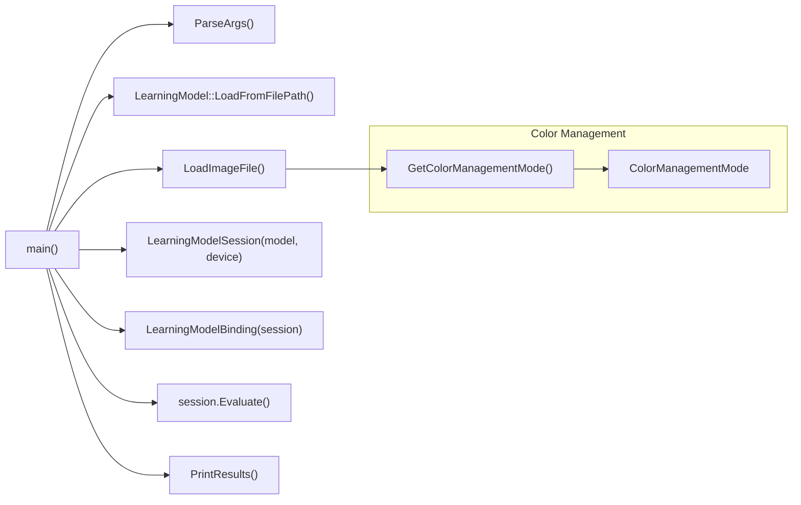
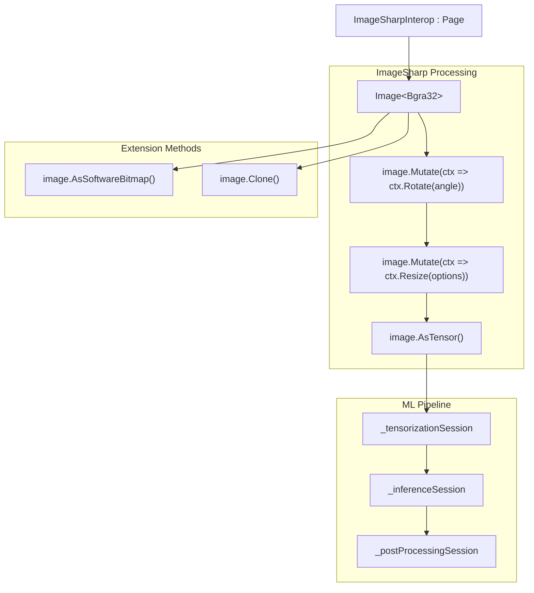
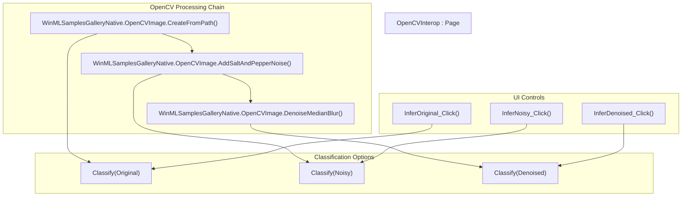
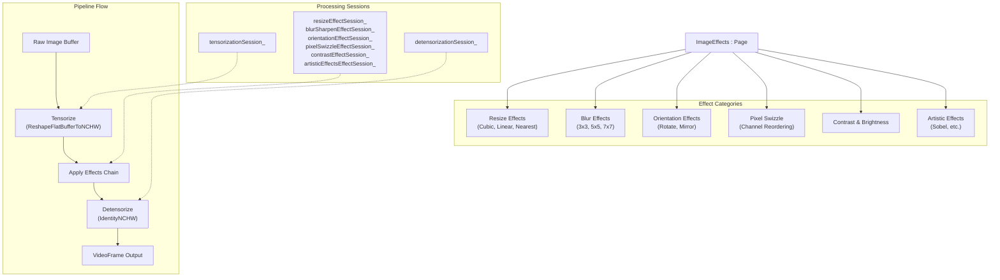

<!-- source: DeepWiki mcp.deepwiki.com · repo microsoft/Windows-Machine-Learning · page 4.3 Image Classification Samples · fetched 2026-10-26 -->

# Image Classification Samples

<details>
<summary>Relevant source files</summary>

The following files were used as context for generating this wiki page:

- [Samples/SqueezeNetObjectDetection/Desktop/cpp/SqueezeNetObjectDetectionCPP.vcxproj](Samples/SqueezeNetObjectDetection/Desktop/cpp/SqueezeNetObjectDetectionCPP.vcxproj)
- [Samples/SqueezeNetObjectDetection/Desktop/cpp/SqueezeNetObjectDetectionCPP.vcxproj.filters](Samples/SqueezeNetObjectDetection/Desktop/cpp/SqueezeNetObjectDetectionCPP.vcxproj.filters)
- [Samples/SqueezeNetObjectDetection/Desktop/cpp/main.cpp](Samples/SqueezeNetObjectDetection/Desktop/cpp/main.cpp)
- [Samples/SqueezeNetObjectDetection/Desktop/cpp/packages.config](Samples/SqueezeNetObjectDetection/Desktop/cpp/packages.config)
- [Samples/SqueezeNetObjectDetection/NET5/SqueezeNetObjectDetectionNET5.csproj](Samples/SqueezeNetObjectDetection/NET5/SqueezeNetObjectDetectionNET5.csproj)
- [Samples/SqueezeNetObjectDetection/NETCore/cs/SqueezeNetObjectDetectionNC.csproj](Samples/SqueezeNetObjectDetection/NETCore/cs/SqueezeNetObjectDetectionNC.csproj)
- [Samples/SqueezeNetObjectDetection/SqueezeNetObjectDetection.sln](Samples/SqueezeNetObjectDetection/SqueezeNetObjectDetection.sln)
- [Samples/SqueezeNetObjectDetection/UWP/cs/SqueezeNetObjectDetectionCS.csproj](Samples/SqueezeNetObjectDetection/UWP/cs/SqueezeNetObjectDetectionCS.csproj)
- [Samples/WinMLSamplesGallery/.editorconfig](Samples/WinMLSamplesGallery/.editorconfig)
- [Samples/WinMLSamplesGallery/WinMLSamplesGallery/Common/ImageHelper.cs](Samples/WinMLSamplesGallery/WinMLSamplesGallery/Common/ImageHelper.cs)
- [Samples/WinMLSamplesGallery/WinMLSamplesGallery/Samples/ImageClassifier/ImageClassifier.xaml.cs](Samples/WinMLSamplesGallery/WinMLSamplesGallery/Samples/ImageClassifier/ImageClassifier.xaml.cs)
- [Samples/WinMLSamplesGallery/WinMLSamplesGallery/Samples/ImageEffects/ImageEffects.xaml.cs](Samples/WinMLSamplesGallery/WinMLSamplesGallery/Samples/ImageEffects/ImageEffects.xaml.cs)
- [Samples/WinMLSamplesGallery/WinMLSamplesGallery/Samples/ImageSharpInterop/ImageSharpInterop.xaml.cs](Samples/WinMLSamplesGallery/WinMLSamplesGallery/Samples/ImageSharpInterop/ImageSharpInterop.xaml.cs)
- [Samples/WinMLSamplesGallery/WinMLSamplesGallery/Samples/ObjectDetector/ObjectDetector.xaml.cs](Samples/WinMLSamplesGallery/WinMLSamplesGallery/Samples/ObjectDetector/ObjectDetector.xaml.cs)
- [Samples/WinMLSamplesGallery/WinMLSamplesGallery/Samples/OpenCVInterop/OpenCVInterop.xaml](Samples/WinMLSamplesGallery/WinMLSamplesGallery/Samples/OpenCVInterop/OpenCVInterop.xaml)
- [Samples/WinMLSamplesGallery/WinMLSamplesGallery/Samples/OpenCVInterop/OpenCVInterop.xaml.cs](Samples/WinMLSamplesGallery/WinMLSamplesGallery/Samples/OpenCVInterop/OpenCVInterop.xaml.cs)

</details>


This document covers the image classification samples in the Windows Machine Learning repository, which demonstrate how to perform image classification using various neural network models, frameworks, and integration approaches. These samples showcase the `Windows.AI.MachineLearning` API for classifying images into predefined categories using pre-trained ONNX models.

For information about object detection samples, see [Object Detection Samples](#4.4). For advanced DirectX integration patterns, see [DirectX Resource Binding](#5.1). For comprehensive coverage of the samples gallery application architecture, see [WinML Samples Gallery](#4.1).

## Overview

The image classification samples demonstrate several key scenarios:

- **Multi-model classification** in the WinML Samples Gallery with support for 15+ different models
- **Standalone console applications** using SqueezeNet across multiple platforms and languages
- **Library interoperability** with ImageSharp and OpenCV for image processing
- **Image effects pipeline** with classification integration
- **Performance optimization** with GPU acceleration and preprocessing chains

## Sample Architecture

The image classification samples follow a consistent pipeline architecture across different implementations:

### Classification Pipeline Flow



Sources: [Samples/WinMLSamplesGallery/WinMLSamplesGallery/Samples/ImageClassifier/ImageClassifier.xaml.cs:271-348](), [Samples/SqueezeNetObjectDetection/Desktop/cpp/main.cpp:41-92]()

## Main ImageClassifier Sample

The primary image classification sample is implemented in the `ImageClassifier` class within the WinML Samples Gallery. This sample supports multiple pre-trained models and demonstrates comprehensive preprocessing and postprocessing pipelines.

### Supported Models

The `ImageClassifier` class supports 15 different classification models through the `Classifier` enum:

| Model | Enum Value | Preprocessing Required |
|-------|------------|----------------------|
| SqueezeNet | `Classifier.SqueezeNet` | None |
| DenseNet-121 | `Classifier.DenseNet121` | Z-score normalization |
| EfficientNet-Lite4 | `Classifier.EfficientNetLite4` | -1 to 1 normalization |
| ShuffleNet V1/V2 | `Classifier.ShuffleNet_V1` | Z-score normalization |
| ResNet-50 | `Classifier.ResNet` | Z-score normalization |
| VGG-19 | `Classifier.VGG` | Z-score normalization |

### ImageClassifier Class Architecture

```mermaid
graph TB
    ImageClassifier["ImageClassifier : Page"]
    
    subgraph "Model Management"
        ModelDictionary["_modelDictionary<br/>Dictionary&lt;Classifier, string&gt;"]
        PreProcessorDict["_preProcessorDictionary<br/>Dictionary&lt;Classifier, Func&lt;LearningModel&gt;&gt;"]
        PostProcessorDict["_postProcessorDictionary<br/>Dictionary&lt;Classifier, Func&lt;LearningModel&gt;&gt;"]
    end
    
    subgraph "ML Sessions"
        InferenceSession["_inferenceSession<br/>LearningModelSession"]
        PreProcessingSession["_preProcessingSession<br/>LearningModelSession"]
        PostProcessingSession["_postProcessingSession<br/>LearningModelSession"]
        TensorizationSession["_tensorizationSession<br/>LearningModelSession"]
    end
    
    subgraph "Core Methods"
        Classify["Classify(BitmapDecoder)<br/>→ (IEnumerable&lt;string&gt;, IReadOnlyList&lt;float&gt;)"]
        EnsureInitialized["EnsureInitialized()"]
        CreateLearningModelSession["CreateLearningModelSession()"]
    end

    ImageClassifier --> ModelDictionary
    ImageClassifier --> PreProcessorDict
    ImageClassifier --> PostProcessorDict
    ImageClassifier --> InferenceSession
    ImageClassifier --> PreProcessingSession
    ImageClassifier --> PostProcessingSession
    ImageClassifier --> TensorizationSession
    ImageClassifier --> Classify
    ImageClassifier --> EnsureInitialized
    ImageClassifier --> CreateLearningModelSession
```



Sources: [Samples/WinMLSamplesGallery/WinMLSamplesGallery/Samples/ImageClassifier/ImageClassifier.xaml.cs:21-82](), [Samples/WinMLSamplesGallery/WinMLSamplesGallery/Samples/ImageClassifier/ImageClassifier.xaml.cs:131-231]()

### Model Loading and Session Management

The `ImageClassifier` implements lazy initialization of models and preprocessing chains through the `EnsureInitialized()` method. Model paths are resolved from the application package, and different preprocessing requirements are handled via factory functions:

```
_modelDictionary = new Dictionary<Classifier, string>{
    { Classifier.DenseNet121, Path.Combine(installPath, "Models\\densenet-9.onnx") },
    { Classifier.EfficientNetLite4, Path.Combine(installPath, "Models\\efficientnet-lite4-11.onnx") },
    { Classifier.SqueezeNet, Path.Combine(installPath, "Models\\squeezenet1.1-7.onnx") }
}
```

Preprocessing requirements vary by model and are implemented using `TensorizationModels` factory methods:

```
_preProcessorDictionary = new Dictionary<Classifier, Func<LearningModel>>{
    { Classifier.DenseNet121, () => TensorizationModels.Normalize0_1ThenZScore(...) },
    { Classifier.EfficientNetLite4, () => TensorizationModels.NormalizeMinusOneToOneThenTransposeNHWC() },
    { Classifier.SqueezeNet, null } // No preprocessing required
}
```

Sources: [Samples/WinMLSamplesGallery/WinMLSamplesGallery/Samples/ImageClassifier/ImageClassifier.xaml.cs:134-156](), [Samples/WinMLSamplesGallery/WinMLSamplesGallery/Samples/ImageClassifier/ImageClassifier.xaml.cs:186-228]()

## Standalone SqueezeNet Samples

The repository includes standalone SqueezeNet classification samples across multiple platforms and languages, demonstrating Windows ML usage outside the main samples gallery.

### Platform Coverage

| Platform | Language | Project Path | Key Features |
|----------|----------|--------------|-------------|
| Desktop C++ | C++/WinRT | `SqueezeNetObjectDetection/Desktop/cpp/` | Console application, color management |
| UWP C# | C# | `SqueezeNetObjectDetection/UWP/cs/` | UWP application, JSON labels |
| .NET Core | C# | `SqueezeNetObjectDetection/NETCore/cs/` | Cross-platform console |
| .NET 5 | C# | `SqueezeNetObjectDetection/NET5/` | Modern .NET with NuGet |

### C++ Console Implementation

The C++ implementation demonstrates core Windows ML concepts without UI dependencies:



The C++ sample includes sophisticated color management based on model metadata:

```cpp
ColorManagementMode GetColorManagementMode(const LearningModel& model)
{
    hstring gammaSpace = model.Metadata().Lookup(L"Image.ColorSpaceGamma");
    if (gammaSpace == L"" || _wcsicmp(gammaSpace.c_str(), L"SRGB") == 0)
        return ColorManagementMode::ColorManageToSRgb;
    return ColorManagementMode::DoNotColorManage;
}
```

Sources: [Samples/SqueezeNetObjectDetection/Desktop/cpp/main.cpp:41-92](), [Samples/SqueezeNetObjectDetection/Desktop/cpp/main.cpp:123-142]()

## Library Interoperability Samples

The samples gallery includes specialized samples demonstrating integration with popular image processing libraries.

### ImageSharp Integration

The `ImageSharpInterop` sample demonstrates using SixLabors.ImageSharp for image manipulation before classification:



The sample provides real-time image rotation and classification:

```
var (labels, probabilities) = Classify(CurrentImage.Clone(), angle);
```

Key integration points include:
- `Image<Bgra32>` as the primary image container
- Real-time rotation via `RotationSlider.Value`
- Crop resizing to 224x224 for model input
- Extension methods for Windows ML interop

Sources: [Samples/WinMLSamplesGallery/WinMLSamplesGallery/Samples/ImageSharpInterop/ImageSharpInterop.xaml.cs:73-122](), [Samples/WinMLSamplesGallery/WinMLSamplesGallery/Samples/ImageSharpInterop/ImageSharpInterop.xaml.cs:158-228]()

### OpenCV Integration

The `OpenCVInterop` sample demonstrates noise reduction using OpenCV before classification:



The sample creates three image variants and allows comparison of classification accuracy:

```
Original = WinMLSamplesGalleryNative.OpenCVImage.CreateFromPath(CurrentImagePath);
Noisy = WinMLSamplesGalleryNative.OpenCVImage.AddSaltAndPepperNoise(Original);
Denoised = WinMLSamplesGalleryNative.OpenCVImage.DenoiseMedianBlur(Noisy);
```

Sources: [Samples/WinMLSamplesGallery/WinMLSamplesGallery/Samples/OpenCVInterop/OpenCVInterop.xaml.cs:214-226](), [Samples/WinMLSamplesGallery/WinMLSamplesGallery/Samples/OpenCVInterop/OpenCVInterop.xaml.cs:128-173]()

## Image Effects Pipeline

The `ImageEffects` sample demonstrates a comprehensive image processing pipeline that can be combined with classification. This sample shows advanced GPU-accelerated image transformations using the Windows ML tensorization system.

### Effects Architecture



### Effects Processing Chain

The `ApplyEffects()` method implements a sequential processing pipeline where each effect operates on the output of the previous stage:

```
// Tensorize → Resize → Pixel Swizzle → Blur → Contrast → Artistic → Orientation → Detensorize
```

Each effect is implemented using `TensorizationModels` factory methods:

| Effect Type | Factory Method | Parameters |
|-------------|---------------|------------|
| Resize | `UniformScaleAndCenterFill()` | Target size, interpolation mode |
| Blur | `AveragePool()` | Kernel size (3, 5, or 7) |
| Rotation | `RotateRight90()`, `RotateLeft90()` | None |
| Mirror | `MirrorHorizontalNCHW()`, `MirrorVerticalNCHW()` | None |
| Pixel Swizzle | `Swizzle()` | Channel order (e.g., 3,2,1 for BGR→RGB) |

Sources: [Samples/WinMLSamplesGallery/WinMLSamplesGallery/Samples/ImageEffects/ImageEffects.xaml.cs:156-310](), [Samples/WinMLSamplesGallery/WinMLSamplesGallery/Samples/ImageEffects/ImageEffects.xaml.cs:312-357]()

## Performance Monitoring

All image classification samples include comprehensive performance monitoring through the `PerformanceMetricsMonitor` class. The monitoring breaks down timing into distinct pipeline stages:

### Performance Metrics

| Stage | Description | Measured In |
|-------|-------------|-------------|
| Pixel Access | Image loading and buffer creation | Microseconds |
| Tensorize | Image to tensor conversion | Microseconds |
| Pre-process | Model-specific preprocessing | Microseconds |
| Inference | Model evaluation | Microseconds |
| Post-process | SoftMax and TopK operations | Microseconds |

Performance monitoring is implemented consistently across samples:

```
PerformanceMetricsMonitor.ClearLog();
start = HighResolutionClock.UtcNow();
// ... operation ...
stop = HighResolutionClock.UtcNow();
var duration = HighResolutionClock.DurationInMs(start, stop);
PerformanceMetricsMonitor.Log("Operation Name", duration);
```

This enables detailed analysis of bottlenecks in the classification pipeline and comparison of CPU vs GPU performance.

Sources: [Samples/WinMLSamplesGallery/WinMLSamplesGallery/Samples/ImageClassifier/ImageClassifier.xaml.cs:341-346](), [Samples/WinMLSamplesGallery/WinMLSamplesGallery/Samples/ImageSharpInterop/ImageSharpInterop.xaml.cs:113-117]()

---

