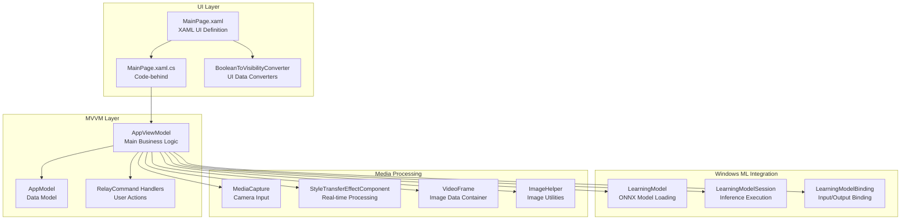
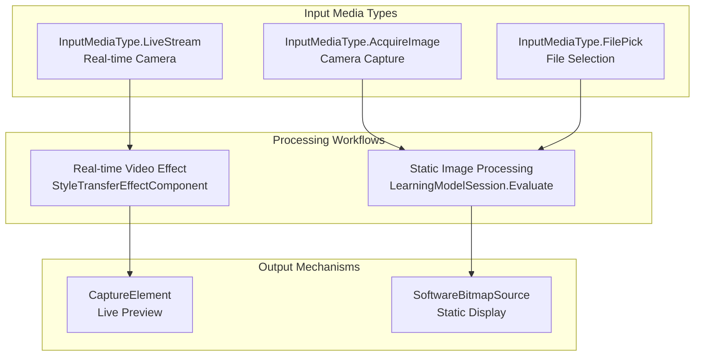
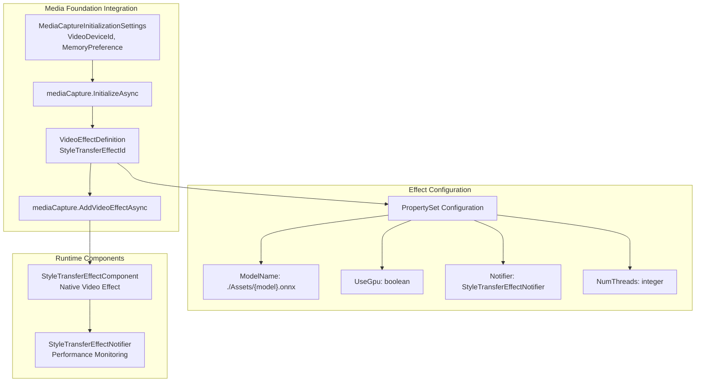
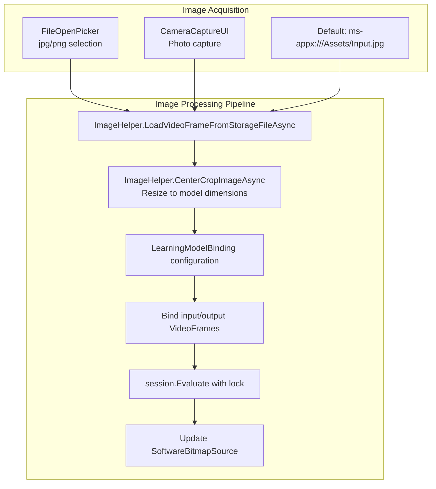
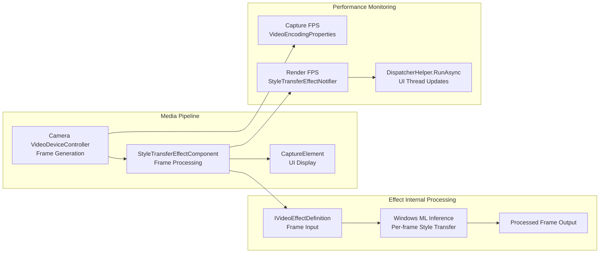
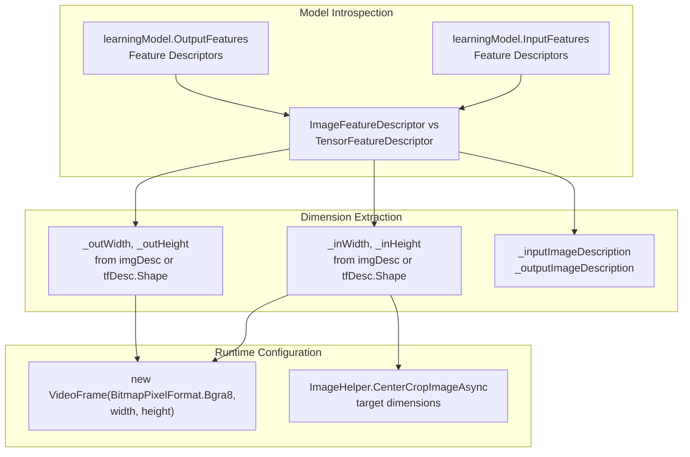

<!-- source: DeepWiki mcp.deepwiki.com · repo microsoft/Windows-Machine-Learning · page 4.4 Style Transfer Application · fetched 2026-10-26 -->

# Style Transfer Application

<details>
<summary>Relevant source files</summary>

The following files were used as context for generating this wiki page:

- [Samples/StyleTransfer/AppModel.cs](Samples/StyleTransfer/AppModel.cs)
- [Samples/StyleTransfer/AppViewModel.cs](Samples/StyleTransfer/AppViewModel.cs)
- [Samples/StyleTransfer/BooleanToVisibilityConverter.cs](Samples/StyleTransfer/BooleanToVisibilityConverter.cs)
- [Samples/StyleTransfer/ImageHelper.cs](Samples/StyleTransfer/ImageHelper.cs)
- [Samples/StyleTransfer/MainPage.xaml](Samples/StyleTransfer/MainPage.xaml)
- [Samples/StyleTransfer/MainPage.xaml.cs](Samples/StyleTransfer/MainPage.xaml.cs)
- [Samples/StyleTransfer/Package.appxmanifest](Samples/StyleTransfer/Package.appxmanifest)
- [Samples/StyleTransfer/StyleTransfer.csproj](Samples/StyleTransfer/StyleTransfer.csproj)

</details>


## Purpose and Scope

The Style Transfer Application is a standalone UWP application that demonstrates real-time neural style transfer using Windows ML. It showcases how to apply artistic styles to live camera feeds and static images using ONNX models, with support for both CPU and GPU inference. The application illustrates advanced Windows ML integration including video effects, media foundation transforms, and real-time processing pipelines.

For information about other Windows ML samples, see [WinML Samples Gallery](#4.1). For details about DirectX integration patterns, see [DirectX Resource Binding](#5.1). For real-time video processing concepts, see [Real-time Video Processing](#5.3).

## Application Architecture

The Style Transfer Application follows an MVVM architecture pattern with specialized components for media processing and Windows ML integration.

### Core Application Structure



**Sources:** [Samples/StyleTransfer/MainPage.xaml:1-340](), [Samples/StyleTransfer/MainPage.xaml.cs:1-50](), [Samples/StyleTransfer/AppViewModel.cs:1-642](), [Samples/StyleTransfer/AppModel.cs:1-157](), [Samples/StyleTransfer/BooleanToVisibilityConverter.cs:1-52]()

### Input Media Types and Processing Modes

The application supports three distinct input modes, each with different processing workflows:



**Sources:** [Samples/StyleTransfer/AppModel.cs:19-25](), [Samples/StyleTransfer/AppViewModel.cs:258-282](), [Samples/StyleTransfer/AppViewModel.cs:395-490]()

## Core Components

### AppViewModel Class

The `AppViewModel` class serves as the central orchestrator for the application, managing Windows ML models, media capture, and UI state coordination.

| Component | Property/Method | Purpose |
|-----------|----------------|---------|
| Model Management | `_learningModel`, `_session`, `_binding` | Windows ML model lifecycle |
| Media Processing | `_mediaCapture`, `_isPreviewing` | Camera and video management |
| Threading | `_processLock`, `NumThreads` | Synchronization and performance |
| Device Selection | `UseGpu`, `_inferenceDeviceSelected` | CPU/GPU inference control |

Key responsibilities include:

- **Model Loading**: Dynamically loads ONNX models from application assets via `LoadModelAsync()`
- **Device Management**: Configures inference devices (`LearningModelDeviceKind.DirectX` or `LearningModelDeviceKind.Cpu`)
- **Media Coordination**: Manages `MediaCapture` initialization and video effect integration
- **State Synchronization**: Thread-safe coordination between UI updates and inference operations

**Sources:** [Samples/StyleTransfer/AppViewModel.cs:36-91](), [Samples/StyleTransfer/AppViewModel.cs:498-523]()

### Windows ML Integration Pattern

The application demonstrates a sophisticated Windows ML integration pattern with dynamic model switching and device selection:

```mermaid
graph LR
    subgraph "Model Loading Workflow"
        StorageFile["StorageFile.GetFileFromApplicationUriAsync<br/>ms-appx:///Assets/{model}.onnx"]
        LoadModel["LearningModel.LoadFromStorageFileAsync"]
        CreateSession["new LearningModelSession<br/>with LearningModelDevice"]
        CreateBinding["new LearningModelBinding"]
    end
    
    subgraph "Inference Execution"
        BindInput["binding.Bind(inputName, ImageFeatureValue)"]
        BindOutput["binding.Bind(outputName, ImageFeatureValue)"]
        Evaluate["session.Evaluate(binding)"]
        ParseResults["Parse IReadOnlyDictionary outputs"]
    end
    
    StorageFile --> LoadModel
    LoadModel --> CreateSession
    CreateSession --> CreateBinding
    
    CreateBinding --> BindInput
    BindInput --> BindOutput
    BindOutput --> Evaluate
    Evaluate --> ParseResults
```



**Sources:** [Samples/StyleTransfer/AppViewModel.cs:498-523](), [Samples/StyleTransfer/AppViewModel.cs:363-394]()

### Real-time Video Effect Integration

For live camera streams, the application uses a custom video effect component that integrates Windows ML directly into the Media Foundation pipeline:



**Sources:** [Samples/StyleTransfer/AppViewModel.cs:432-490](), [Samples/StyleTransfer/AppViewModel.cs:472-478](), [Samples/StyleTransfer/StyleTransfer.csproj:193-197]()

## Processing Workflows

### Static Image Processing Workflow

For static images (file picker or camera capture), the application performs synchronous inference using the Windows ML session directly:



**Sources:** [Samples/StyleTransfer/AppViewModel.cs:328-361](), [Samples/StyleTransfer/AppViewModel.cs:363-394](), [Samples/StyleTransfer/ImageHelper.cs:32-85]()

### Real-time Stream Processing

Live camera processing leverages the `StyleTransferEffectComponent` for frame-by-frame processing within the Media Foundation pipeline:



**Sources:** [Samples/StyleTransfer/AppViewModel.cs:78-86](), [Samples/StyleTransfer/AppViewModel.cs:480-484](), [Samples/StyleTransfer/AppViewModel.cs:30-44]()

## Model and Asset Management

### Supported Style Transfer Models

The application includes four pre-trained ONNX style transfer models, each implementing different artistic styles:

| Model File | Style Description | Usage Context |
|------------|------------------|---------------|
| `candy.onnx` | Bright, colorful candy-like effects | Default model selection |
| `mosaic.onnx` | Mosaic tile artistic style | Alternative artistic rendering |
| `la_muse.onnx` | Classical painting style | Fine art style transfer |
| `udnie.onnx` | Modern abstract art style | Contemporary artistic effects |

**Sources:** [Samples/StyleTransfer/AppModel.cs:35-46](), [Samples/StyleTransfer/StyleTransfer.csproj:183-187]()

### Model I/O Configuration

The application dynamically inspects model input/output specifications to configure processing dimensions:



**Sources:** [Samples/StyleTransfer/AppViewModel.cs:525-558](), [Samples/StyleTransfer/AppViewModel.cs:519-521]()

## Dependencies and Build Configuration

### Key Package References

The application leverages several critical NuGet packages for Windows ML and UI functionality:

| Package | Version | Purpose |
|---------|---------|---------|
| `Microsoft.AI.MachineLearning` | 1.4.0 | Core Windows ML functionality |
| `Microsoft.NETCore.UniversalWindowsPlatform` | 6.2.10 | UWP runtime support |
| `Microsoft.UI.Xaml` | 2.4.2 | Modern XAML controls |
| `MvvmLightLibs` | 5.4.1.1 | MVVM framework and commands |

### Native Component Integration

The application references a native Windows Runtime Component for real-time video effects:

```
StyleTransferEffectComponent.winmd
Location: VideoEffect\StyleTransferEffectComponent\x64\Release\
```

This component implements the `IVideoEffectDefinition` interface for Media Foundation integration, enabling frame-by-frame processing with minimal latency.

**Sources:** [Samples/StyleTransfer/StyleTransfer.csproj:166-181](), [Samples/StyleTransfer/StyleTransfer.csproj:193-197](), [Samples/StyleTransfer/AppViewModel.cs:54]()

---

