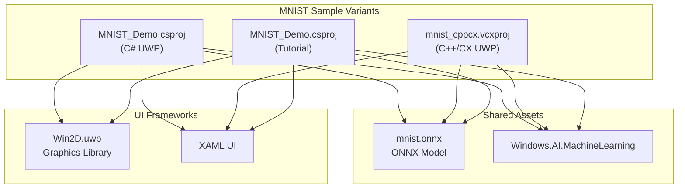
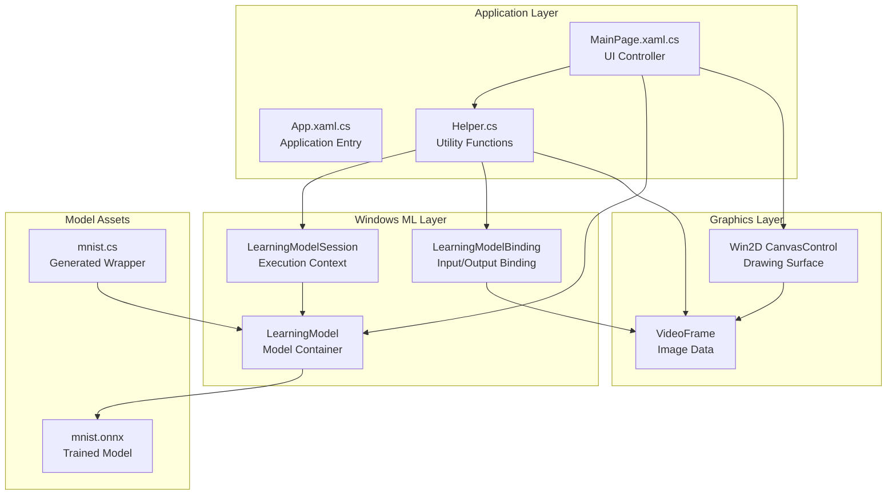
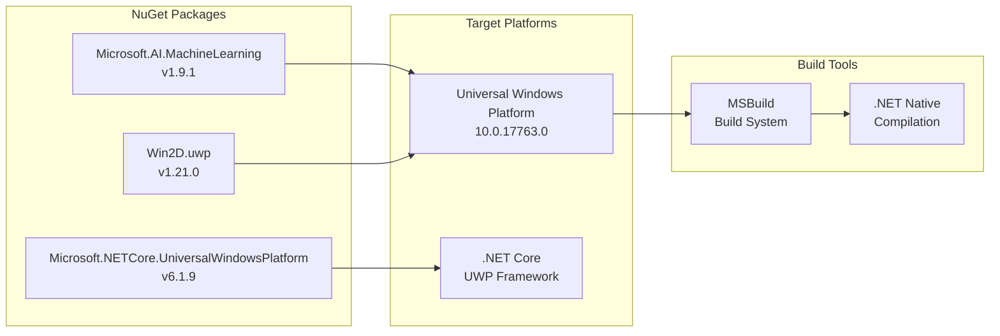
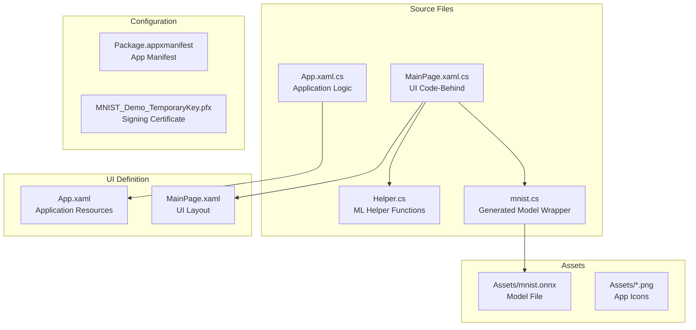
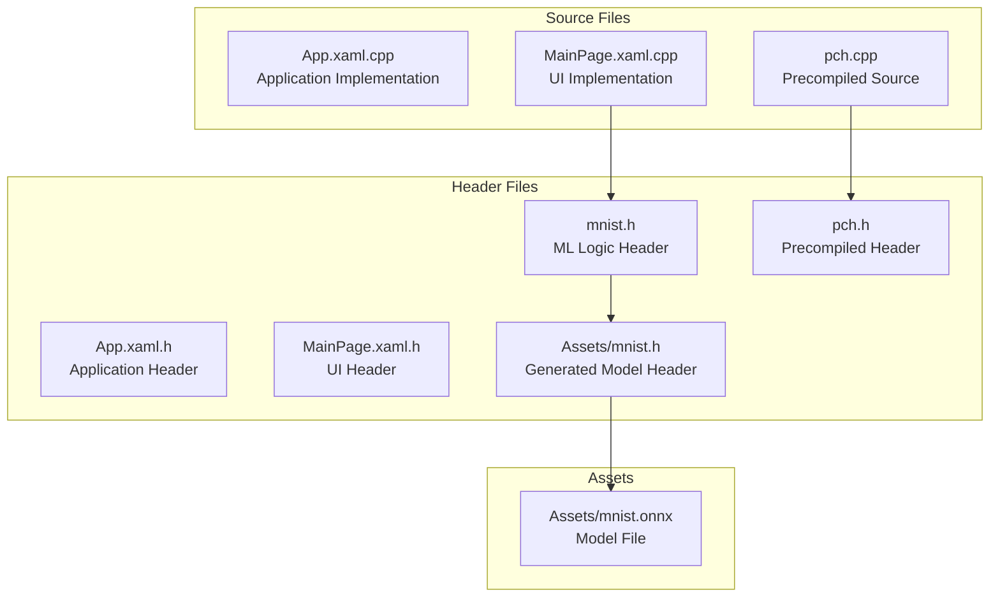

<!-- source: DeepWiki mcp.deepwiki.com · repo microsoft/Windows-Machine-Learning · page 4.5 MNIST and Basic Samples · fetched 2026-10-26 -->

# MNIST and Basic Samples

Relevant source files

The following files were used as context for generating this wiki page:

- [Samples/FNSCandyStyleTransfer/UWP/cs/SnapCandy.csproj](Samples/FNSCandyStyleTransfer/UWP/cs/SnapCandy.csproj)
- [Samples/FNSCandyStyleTransfer/UWP/cs/SnapCandy_TemporaryKey.pfx](Samples/FNSCandyStyleTransfer/UWP/cs/SnapCandy_TemporaryKey.pfx)
- [Samples/MNIST/Tutorial/cs/MNIST_Demo.csproj](Samples/MNIST/Tutorial/cs/MNIST_Demo.csproj)
- [Samples/MNIST/Tutorial/cs/MNIST_Demo.sln](Samples/MNIST/Tutorial/cs/MNIST_Demo.sln)
- [Samples/MNIST/Tutorial/cs/MNIST_Demo_TemporaryKey.pfx](Samples/MNIST/Tutorial/cs/MNIST_Demo_TemporaryKey.pfx)
- [Samples/MNIST/UWP/cppcx/mnist_cppcx.sln](Samples/MNIST/UWP/cppcx/mnist_cppcx.sln)
- [Samples/MNIST/UWP/cppcx/mnist_cppcx.vcxproj](Samples/MNIST/UWP/cppcx/mnist_cppcx.vcxproj)
- [Samples/MNIST/UWP/cppcx/mnist_cppcx_TemporaryKey.pfx](Samples/MNIST/UWP/cppcx/mnist_cppcx_TemporaryKey.pfx)
- [Samples/MNIST/UWP/cs/MNIST_Demo.csproj](Samples/MNIST/UWP/cs/MNIST_Demo.csproj)
- [Samples/MNIST/UWP/cs/MNIST_Demo.sln](Samples/MNIST/UWP/cs/MNIST_Demo.sln)
- [Samples/MNIST/UWP/cs/MNIST_Demo_TemporaryKey.pfx](Samples/MNIST/UWP/cs/MNIST_Demo_TemporaryKey.pfx)
- [Samples/SqueezeNetObjectDetection/UWP/cs/SqueezeNetObjectDetectionCS_TemporaryKey.pfx](Samples/SqueezeNetObjectDetection/UWP/cs/SqueezeNetObjectDetectionCS_TemporaryKey.pfx)
- [Samples/SqueezeNetObjectDetection/UWP/js/SqueezeNetObjectDetectionJS.jsproj](Samples/SqueezeNetObjectDetection/UWP/js/SqueezeNetObjectDetectionJS.jsproj)

## Purpose and Scope

This document covers the MNIST digit recognition samples and other basic getting-started examples in the Windows Machine Learning repository. These samples demonstrate fundamental Windows ML concepts through simple digit classification tasks, serving as entry points for developers new to Windows ML. For more complex image classification scenarios, see [Image Classification Samples](#4.3). For the comprehensive samples collection, see [WinML Samples Gallery](#4.1).

## Overview

The MNIST samples provide multiple implementations of handwritten digit recognition using a pre-trained ONNX model. These samples demonstrate basic Windows ML workflows including model loading, input binding, inference execution, and result processing.

**Sample Variants:**
- **UWP C# Version**: Full-featured implementation with NuGet and Inbox configurations
- **UWP C++/CX Version**: Native C++ implementation demonstrating C++/CX bindings
- **Tutorial Version**: Simplified version focused on learning fundamentals

Sources: [Samples/MNIST/UWP/cs/MNIST_Demo.csproj:1-273](), [Samples/MNIST/UWP/cppcx/mnist_cppcx.vcxproj:1-201](), [Samples/MNIST/Tutorial/cs/MNIST_Demo.csproj:1-152]()

## Implementation Architecture

### Core Components

The MNIST samples follow a standard Windows ML application pattern with clear separation between UI, ML processing, and graphics components.

Sources: [Samples/MNIST/UWP/cs/MNIST_Demo.csproj:105-109](), [Samples/MNIST/Tutorial/cs/MNIST_Demo.csproj:96-103]()

## Build Configurations

### Configuration Matrix

| Configuration | Platform Support | Windows ML Source | Purpose |
|---------------|------------------|-------------------|---------|
| Debug/Release | x86, x64, ARM | NuGet Package | Standard development |
| Debug_Inbox/Release_Inbox | x86, x64, ARM | Inbox Windows ML | System integration testing |

### Key Dependencies

**Conditional Compilation Symbols:**
- `USE_WINML_NUGET`: Enables NuGet package usage
- `NETFX_CORE`: UWP framework indicator
- `WINDOWS_UWP`: Platform-specific code paths

Sources: [Samples/MNIST/UWP/cs/MNIST_Demo.csproj:32-33](), [Samples/MNIST/UWP/cs/MNIST_Demo.csproj:138-146]()

## Project Structure Comparison

### C# UWP Implementation

### C++/CX Implementation

**Key Differences:**
- C# version includes `Helper.cs` for ML operations abstraction
- C++/CX version uses header/implementation file separation
- Both versions share the same `mnist.onnx` model file
- Tutorial version omits generated model wrapper for learning purposes

Sources: [Samples/MNIST/UWP/cs/MNIST_Demo.csproj:102-110](), [Samples/MNIST/UWP/cppcx/mnist_cppcx.vcxproj:146-197]()

## Solution Configurations

### Multi-Configuration Support

The MNIST samples support both development and distribution scenarios through multiple solution configurations:

**Standard Configurations:**
- `Debug|Release` with `x86|x64|ARM` platforms
- Uses Microsoft.AI.MachineLearning NuGet package

**Inbox Configurations:**  
- `Debug_Inbox|Release_Inbox` with same platform matrix
- Uses Windows inbox Windows ML APIs
- Includes `CODE_ANALYSIS` define for static analysis

**Build Optimization:**
- Release builds enable `.NET Native` compilation on x64 and ARM
- `UseDotNetNativeToolchain` improves startup performance
- Platform-specific optimizations for each architecture

Sources: [Samples/MNIST/UWP/cs/MNIST_Demo.sln:9-22](), [Samples/MNIST/UWP/cs/MNIST_Demo.csproj:160-201]()

---

