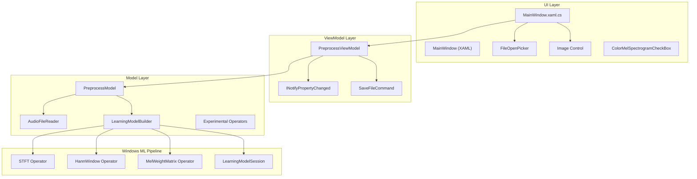
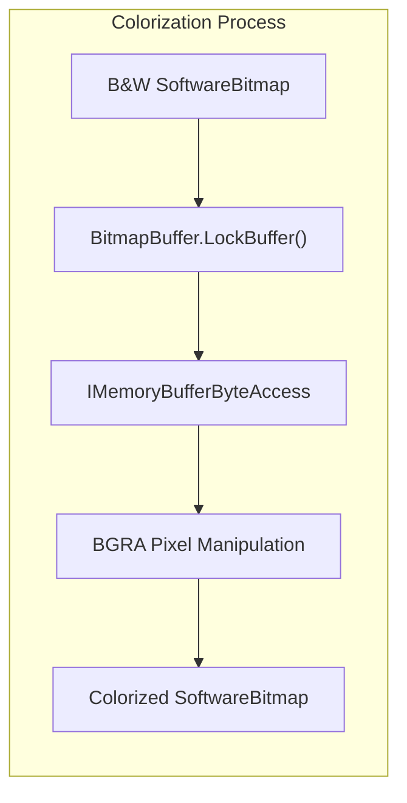

<!-- source: DeepWiki mcp.deepwiki.com · repo microsoft/Windows-Machine-Learning · page 4.6 Audio Processing Samples · fetched 2026-10-26 -->

# Audio Processing Samples

<details>
<summary>Relevant source files</summary>

The following files were used as context for generating this wiki page:

- [Samples/AudioPreprocessing/WinUI/AudioPreprocessing/AudioPreprocessing/MainWindow.xaml](Samples/AudioPreprocessing/WinUI/AudioPreprocessing/AudioPreprocessing/MainWindow.xaml)
- [Samples/AudioPreprocessing/WinUI/AudioPreprocessing/AudioPreprocessing/MainWindow.xaml.cs](Samples/AudioPreprocessing/WinUI/AudioPreprocessing/AudioPreprocessing/MainWindow.xaml.cs)
- [Samples/AudioPreprocessing/WinUI/AudioPreprocessing/AudioPreprocessing/Model/PreprocessModel.cs](Samples/AudioPreprocessing/WinUI/AudioPreprocessing/AudioPreprocessing/Model/PreprocessModel.cs)
- [Samples/AudioPreprocessing/WinUI/AudioPreprocessing/AudioPreprocessing/ViewModel/PreprocessViewModel.cs](Samples/AudioPreprocessing/WinUI/AudioPreprocessing/AudioPreprocessing/ViewModel/PreprocessViewModel.cs)

</details>


This document covers the audio preprocessing sample application that demonstrates how to use Windows ML experimental operators for audio signal processing. The sample specifically shows mel spectrogram generation from WAV audio files using a custom-built ONNX model with experimental operators like STFT (Short-Time Fourier Transform) and mel filterbank operations.

For general information about Windows ML samples architecture, see [WinML Samples Gallery](#4.1). For other signal processing examples, see [Image Classification Samples](#4.3).

## Application Overview

The audio preprocessing sample is a WinUI application that converts WAV audio files into mel spectrograms using Windows ML experimental operators. The application demonstrates real-time audio signal processing pipeline construction using the `LearningModelBuilder` API and visualization of the resulting spectrograms.

### Core Features

| Feature | Description | Implementation |
|---------|-------------|----------------|
| WAV File Loading | Reads audio signals from WAV files | NAudio library integration |
| Mel Spectrogram Generation | Converts audio signals to mel spectrograms | Custom ONNX model with experimental operators |
| Spectrogram Visualization | Displays spectrograms as images | WinUI Image control with SoftwareBitmap |
| Colorization | Optional color enhancement of spectrograms | Direct pixel manipulation |
| Export Functionality | Save generated spectrograms as JPEG | Windows Storage APIs |

Sources: [Samples/AudioPreprocessing/WinUI/AudioPreprocessing/AudioPreprocessing/Model/PreprocessModel.cs:32-38]()

## Application Architecture

The application follows MVVM pattern with clear separation between UI, business logic, and data processing components.



Sources: [Samples/AudioPreprocessing/WinUI/AudioPreprocessing/AudioPreprocessing/MainWindow.xaml.cs:26-78](), [Samples/AudioPreprocessing/WinUI/AudioPreprocessing/AudioPreprocessing/ViewModel/PreprocessViewModel.cs:15-141](), [Samples/AudioPreprocessing/WinUI/AudioPreprocessing/AudioPreprocessing/Model/PreprocessModel.cs:24-175]()

## Audio Processing Pipeline

The core audio processing pipeline transforms raw audio signals into mel spectrograms through a series of Windows ML experimental operators.

### Signal Processing Flow

```mermaid
graph LR
    subgraph "Input Processing"
        WAVFile["WAV File"]
        AudioFileReader["NAudio.AudioFileReader"]
        RawSignal["float[] signal"]
        AmplitudeScaling["Amplitude Scaling (* 5000)"]
    end
    
    subgraph "Windows ML Model Construction"
        LearningModelBuilder["LearningModelBuilder.Create(13)"]
        InputDescriptor["TimeSignal Input (batchSize, signalSize)"]
        OutputDescriptor["MelSpectrogram Output (batchSize, 1, nDFT, nMelBins)"]
    end
    
    subgraph "Experimental Operators Pipeline"
        HannWindowOp["HannWindow Operator (windowSize=256)"]
        STFTOp["STFT Operator (frame_length=256, frame_step=3)"]
        ReduceSumSquareOp["ReduceSumSquare Operator"]
        DivOp["Div Operator (/ dftSize)"]
        MelWeightMatrixOp["MelWeightMatrix Operator (nMelBins=1024)"]
        MatMulOp["MatMul Operator"]
        ReshapeOp1["Reshape Operator (flatten)"]
        ReshapeOp2["Reshape Operator (final shape)"]
    end
    
    subgraph "Output Processing"
        LearningModelSession["LearningModelSession"]
        VideoFrameBinding["VideoFrame Binding"]
        SoftwareBitmap["SoftwareBitmap Output"]
        Colorization["Optional Colorization"]
    end
    
    WAVFile --> AudioFileReader
    AudioFileReader --> RawSignal
    RawSignal --> AmplitudeScaling
    AmplitudeScaling --> LearningModelBuilder
    
    LearningModelBuilder --> InputDescriptor
    LearningModelBuilder --> OutputDescriptor
    LearningModelBuilder --> HannWindowOp
    
    HannWindowOp --> STFTOp
    STFTOp --> ReduceSumSquareOp
    ReduceSumSquareOp --> DivOp
    DivOp --> ReshapeOp1
    ReshapeOp1 --> MatMulOp
    MelWeightMatrixOp --> MatMulOp
    MatMulOp --> ReshapeOp2
    
    ReshapeOp2 --> LearningModelSession
    LearningModelSession --> VideoFrameBinding
    VideoFrameBinding --> SoftwareBitmap
    SoftwareBitmap --> Colorization
```



Sources: [Samples/AudioPreprocessing/WinUI/AudioPreprocessing/AudioPreprocessing/Model/PreprocessModel.cs:55-143]()

### Processing Parameters

The audio processing pipeline uses the following default parameters, which can be customized:

| Parameter | Default Value | Purpose |
|-----------|---------------|---------|
| `windowSize` | 256 | STFT window size |
| `dftSize` | 256 | DFT size for frequency analysis |
| `hopSize` | 3 | Step size between windows |
| `nMelBins` | 1024 | Number of mel frequency bins |
| `samplingRate` | 8192 | Audio sampling rate |
| `amplitude` | 5000 | Signal amplitude scaling factor |

Sources: [Samples/AudioPreprocessing/WinUI/AudioPreprocessing/AudioPreprocessing/Model/PreprocessModel.cs:55-64]()

## Key Implementation Components

### PreprocessModel Class

The `PreprocessModel` class contains the core audio processing logic and Windows ML model construction.

#### Signal Loading

The `GetSignalFromFile` method uses NAudio to read WAV files:

```csharp
private IEnumerable<float> GetSignalFromFile(string filename)
{
    using (var reader = new AudioFileReader(filename))
    {
        var nSamples = reader.Length / sizeof(float);
        var signal = Array.CreateInstance(typeof(float), nSamples);
        var read = reader.Read(signal as float[], 0, signal.Length);
        return (IEnumerable<float>)signal;
    }
}
```

Sources: [Samples/AudioPreprocessing/WinUI/AudioPreprocessing/AudioPreprocessing/Model/PreprocessModel.cs:40-53]()

#### Experimental Operators

The model uses several Windows ML experimental operators from the `com.microsoft.experimental` domain:

- **HannWindow**: Generates Hann window for windowing
- **STFT**: Performs Short-Time Fourier Transform
- **MelWeightMatrix**: Creates mel filterbank matrix
- **ReduceSumSquare**: Computes magnitude squared
- **MatMul**: Matrix multiplication for mel filtering

Sources: [Samples/AudioPreprocessing/WinUI/AudioPreprocessing/AudioPreprocessing/Model/PreprocessModel.cs:81-118]()

### Colorization Feature

The application includes optional spectrogram colorization through direct pixel manipulation:



The colorization applies custom color filters by modifying BGRA channels:
- Blue channel: `(255 - dataInBytes[pixel + 0]) / 2`
- Green channel: `dataInBytes[pixel + 1] / 2`
- Red channel: unchanged
- Alpha channel: set to 255 (opaque)

Sources: [Samples/AudioPreprocessing/WinUI/AudioPreprocessing/AudioPreprocessing/Model/PreprocessModel.cs:145-173]()

### UI Integration

The `MainWindow` class handles file selection and spectrogram display:

#### File Picker Integration

The application uses `FileOpenPicker` with proper initialization for Win32 applications:

```csharp
private async Task<string> GetFilePath()
{
    FileOpenPicker openPicker = new FileOpenPicker();
    openPicker.ViewMode = PickerViewMode.Thumbnail;
    openPicker.FileTypeFilter.Add(".wav");
    
    // Win32 initialization
    if (Window.Current == null)
    {
        var picker_unknown = Marshal.GetComInterfaceForObject(openPicker, typeof(IInitializeWithWindow));
        var initializeWithWindowWrapper = (IInitializeWithWindow)Marshal.GetTypedObjectForIUnknown(picker_unknown, typeof(IInitializeWithWindow));
        IntPtr hwnd = GetActiveWindow();
        initializeWithWindowWrapper.Initialize(hwnd);
    }
}
```

Sources: [Samples/AudioPreprocessing/WinUI/AudioPreprocessing/AudioPreprocessing/MainWindow.xaml.cs:60-77]()

#### Image Display

The generated spectrograms are displayed using WinUI `Image` control with `SoftwareBitmapSource`. The application handles pixel format conversion to ensure compatibility:

```csharp
if (softwareBitmap.BitmapPixelFormat != BitmapPixelFormat.Bgra8 ||
    softwareBitmap.BitmapAlphaMode != BitmapAlphaMode.Premultiplied)
{
    softwareBitmap = SoftwareBitmap.Convert(softwareBitmap, BitmapPixelFormat.Bgra8, BitmapAlphaMode.Premultiplied);
}
```

Sources: [Samples/AudioPreprocessing/WinUI/AudioPreprocessing/AudioPreprocessing/MainWindow.xaml.cs:47-57]()

## Dependencies and Requirements

The audio preprocessing sample requires several key dependencies:

| Dependency | Purpose | Usage |
|------------|---------|-------|
| NAudio | WAV file reading | Audio signal extraction |
| Microsoft.AI.MachineLearning.Experimental | Experimental operators | STFT, mel filterbank operations |
| Windows.Graphics.Imaging | Image processing | SoftwareBitmap manipulation |
| WinUI 3 | User interface | File pickers, image display |

Sources: [Samples/AudioPreprocessing/WinUI/AudioPreprocessing/AudioPreprocessing/Model/PreprocessModel.cs:1-12]()

---

