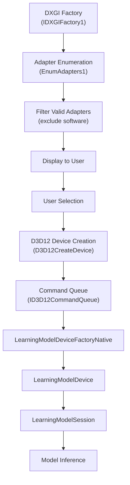
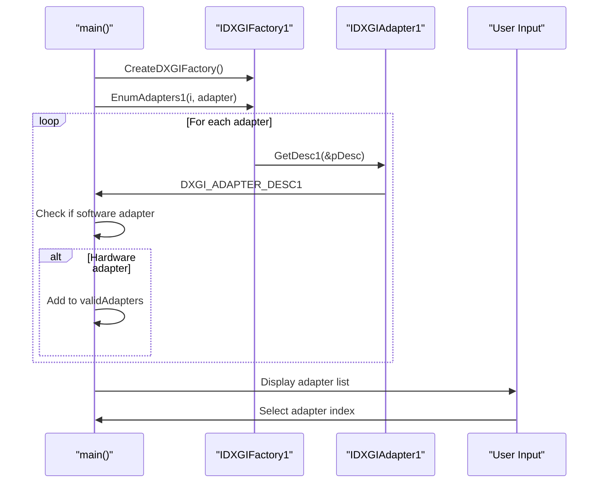
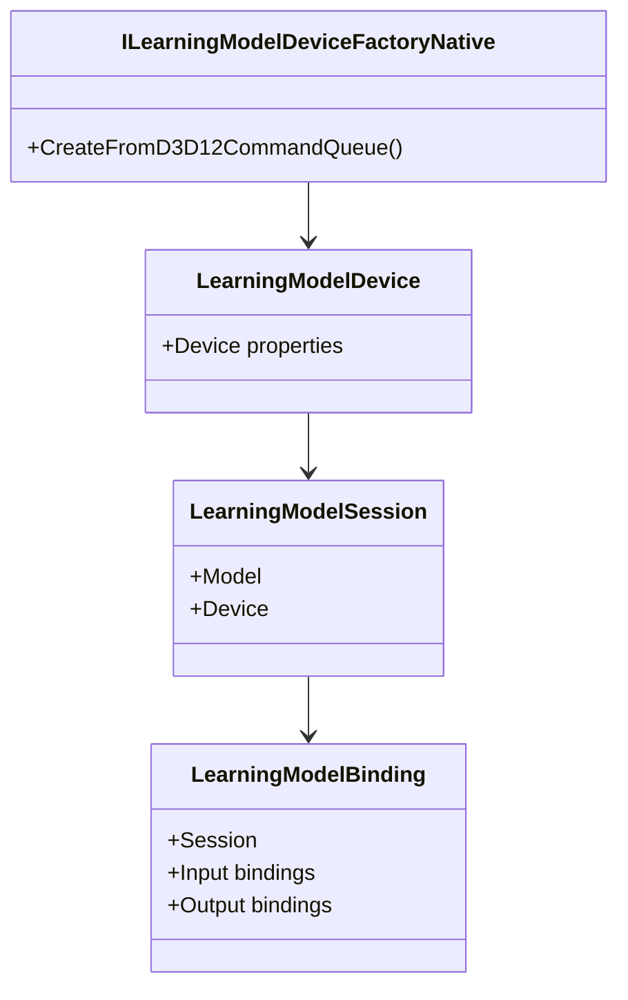

<!-- source: DeepWiki mcp.deepwiki.com · repo microsoft/Windows-Machine-Learning · page 4.7 Adapter Selection · fetched 2026-10-26 -->

# Adapter Selection

<details>
<summary>Relevant source files</summary>

The following files were used as context for generating this wiki page:

- [Samples/AdapterSelection/AdapterSelection.sln](Samples/AdapterSelection/AdapterSelection.sln)
- [Samples/AdapterSelection/AdapterSelection/cpp/AdapterSelection.vcxproj](Samples/AdapterSelection/AdapterSelection/cpp/AdapterSelection.vcxproj)
- [Samples/AdapterSelection/AdapterSelection/cpp/AdapterSelection.vcxproj.filters](Samples/AdapterSelection/AdapterSelection/cpp/AdapterSelection.vcxproj.filters)
- [Samples/AdapterSelection/AdapterSelection/cpp/Labels.txt](Samples/AdapterSelection/AdapterSelection/cpp/Labels.txt)
- [Samples/AdapterSelection/AdapterSelection/cpp/README.md](Samples/AdapterSelection/AdapterSelection/cpp/README.md)
- [Samples/AdapterSelection/AdapterSelection/cpp/main.cpp](Samples/AdapterSelection/AdapterSelection/cpp/main.cpp)
- [Samples/AdapterSelection/AdapterSelection/cpp/pch.cpp](Samples/AdapterSelection/AdapterSelection/cpp/pch.cpp)
- [Samples/AdapterSelection/AdapterSelection/cpp/pch.h](Samples/AdapterSelection/AdapterSelection/cpp/pch.h)
- [Samples/SqueezeNetObjectDetection/Desktop/cpp/pch.h](Samples/SqueezeNetObjectDetection/Desktop/cpp/pch.h)
- [Samples/SqueezeNetObjectDetection/NETCore/cs/Assets/Labels.json](Samples/SqueezeNetObjectDetection/NETCore/cs/Assets/Labels.json)
- [Samples/SqueezeNetObjectDetection/NETCore/cs/Program.cs](Samples/SqueezeNetObjectDetection/NETCore/cs/Program.cs)
- [Samples/SqueezeNetObjectDetection/NETCore/cs/README.md](Samples/SqueezeNetObjectDetection/NETCore/cs/README.md)
- [Samples/SqueezeNetObjectDetection/UWP/cs/MainPage.xaml.cs](Samples/SqueezeNetObjectDetection/UWP/cs/MainPage.xaml.cs)
- [Samples/SqueezeNetObjectDetection/UWP/js/js/main.js](Samples/SqueezeNetObjectDetection/UWP/js/js/main.js)

</details>


This document covers the Adapter Selection sample application, which demonstrates how to enumerate available GPU adapters on a system and allow users to select a specific adapter for Windows ML inference. The sample shows the integration between DXGI adapter enumeration, Direct3D 12 device creation, and Windows ML device selection.

For information about other device selection approaches in Windows ML, see [Core API and Architecture](#2). For DirectX resource binding and GPU memory management, see [DirectX Resource Binding](#5.1).

## Purpose and Architecture

The Adapter Selection sample provides a command-line application that enumerates available GPU adapters, presents them to the user for selection, and demonstrates how to create a Windows ML device bound to the selected adapter. This enables developers to target specific GPUs in multi-adapter systems for optimal performance.

### System Overview



**Sources:** [Samples/AdapterSelection/AdapterSelection/cpp/main.cpp:23-110]()

The application follows a clear pipeline from low-level adapter enumeration through DirectX device creation to high-level Windows ML inference.

### Core Components

| Component | Purpose | Key Classes |
|-----------|---------|-------------|
| Adapter Enumeration | Discover available GPU hardware | `IDXGIFactory1`, `IDXGIAdapter1` |
| Device Creation | Create DirectX compute device | `ID3D12Device`, `ID3D12CommandQueue` |
| Windows ML Integration | Bridge DirectX to Windows ML | `ILearningModelDeviceFactoryNative` |
| Model Execution | Run inference on selected device | `LearningModelSession`, `LearningModelBinding` |

**Sources:** [Samples/AdapterSelection/AdapterSelection/cpp/main.cpp:1-174](), [Samples/AdapterSelection/AdapterSelection/cpp/pch.h:16-26]()

## Adapter Enumeration Process

The sample implements a comprehensive adapter discovery mechanism that filters hardware-accelerated adapters suitable for machine learning workloads.

### Enumeration Implementation



**Sources:** [Samples/AdapterSelection/AdapterSelection/cpp/main.cpp:33-74]()

The enumeration logic implements several key filtering steps:

1. **Factory Creation**: Creates `IDXGIFactory1` instance for adapter access
2. **Adapter Iteration**: Loops through available adapters using `EnumAdapters1`
3. **Software Filtering**: Excludes adapters with `DXGI_ADAPTER_FLAG_SOFTWARE` flag
4. **Vendor Filtering**: Excludes Microsoft Basic Render Driver (VendorId 0x1414, DeviceId 0x8c)

**Sources:** [Samples/AdapterSelection/AdapterSelection/cpp/main.cpp:34-54]()

### Adapter Validation Logic

The sample applies specific criteria to identify suitable adapters:

```cpp
// Filter software adapters and basic render driver
if (pDesc.Flags == DXGI_ADAPTER_FLAG_SOFTWARE || 
    (pDesc.VendorId == 0x1414 && pDesc.DeviceId == 0x8c)) {
    continue;
}
```

**Sources:** [Samples/AdapterSelection/AdapterSelection/cpp/main.cpp:46-48]()

Valid adapters are stored in a `std::vector<com_ptr<IDXGIAdapter1>>` collection and presented to the user with descriptive names from `DXGI_ADAPTER_DESC1::Description`.

## Device Creation Workflow

The `getLearningModelDeviceFromAdapter` function implements the critical bridge between DXGI adapter selection and Windows ML device creation.

### DirectX Device Creation

```mermaid
flowchart LR
    Adapter["IDXGIAdapter1"] --> IUnknown["IUnknown Interface"]
    IUnknown --> D3D12Create["D3D12CreateDevice()"]
    D3D12Create --> Device["ID3D12Device"]
    Device --> QueueDesc["D3D12_COMMAND_QUEUE_DESC"]
    QueueDesc --> Queue["ID3D12CommandQueue"]
    Queue --> Factory["ILearningModelDeviceFactoryNative"]
    Factory --> WinMLDevice["LearningModelDevice"]
```



**Sources:** [Samples/AdapterSelection/AdapterSelection/cpp/main.cpp:112-133]()

The device creation process involves several steps:

1. **Interface Conversion**: Convert `IDXGIAdapter1` to `IUnknown` for D3D12 compatibility
2. **D3D12 Device**: Create `ID3D12Device` using `D3D12CreateDevice` with minimum feature level D3D_FEATURE_LEVEL_11_0
3. **Command Queue**: Create direct command queue with `D3D12_COMMAND_LIST_TYPE_DIRECT`
4. **Windows ML Device**: Use native factory to create `LearningModelDevice` from command queue

**Sources:** [Samples/AdapterSelection/AdapterSelection/cpp/main.cpp:114-132]()

### Command Queue Configuration

The sample creates a command queue with specific parameters optimized for machine learning workloads:

```cpp
D3D12_COMMAND_QUEUE_DESC queueDesc = {};
queueDesc.Flags = D3D12_COMMAND_QUEUE_FLAG_NONE;
queueDesc.Type = D3D12_COMMAND_LIST_TYPE_DIRECT;
```

**Sources:** [Samples/AdapterSelection/AdapterSelection/cpp/main.cpp:121-123]()

This configuration provides direct GPU access without additional command list overhead, suitable for the computational requirements of neural network inference.

## Windows ML Integration

The integration with Windows ML leverages the native interop interfaces to create device objects that can execute on the selected adapter.

### Native Factory Usage



**Sources:** [Samples/AdapterSelection/AdapterSelection/cpp/main.cpp:128-132](), [Samples/AdapterSelection/AdapterSelection/cpp/main.cpp:84-98]()

The native factory approach provides direct control over device creation:

```cpp
com_ptr<ILearningModelDeviceFactoryNative> dFactory =
    get_activation_factory<LearningModelDevice, ILearningModelDeviceFactoryNative>();
com_ptr<::IUnknown> spLearningDevice;
dFactory->CreateFromD3D12CommandQueue(spCommandQueue.get(), spLearningDevice.put());
return spLearningDevice.as<LearningModelDevice>();
```

**Sources:** [Samples/AdapterSelection/AdapterSelection/cpp/main.cpp:128-132]()

### Session and Binding Setup

Once the device is created, the sample demonstrates standard Windows ML workflow:

1. **Model Loading**: Load ONNX model using `LearningModel::LoadFromFilePath`
2. **Session Creation**: Create `LearningModelSession` with model and selected device
3. **Input Binding**: Bind image input using `ImageFeatureValue::CreateFromVideoFrame`
4. **Output Binding**: Pre-allocate output tensor with `TensorFloat::Create`

**Sources:** [Samples/AdapterSelection/AdapterSelection/cpp/main.cpp:76-98]()

## Usage and Command Line Interface

The sample provides a command-line interface for model evaluation with adapter selection.

### Command Line Arguments

| Argument | Purpose | Example |
|----------|---------|---------|
| modelfile | Path to ONNX model | `SqueezeNet.onnx` |
| imagefile | Path to input image | `kitten_224.png` |

**Sources:** [Samples/AdapterSelection/AdapterSelection/cpp/README.md:33-36]()

### Interactive Adapter Selection

The application presents available adapters and prompts for user selection:

```
Index: 0, Description: AMD Radeon Pro WX 3100
Please enter the index of the adapter you want to use...
```

**Sources:** [Samples/AdapterSelection/AdapterSelection/cpp/README.md:38-44](), [Samples/AdapterSelection/AdapterSelection/cpp/main.cpp:51-72]()

Input validation ensures the selected index is within the valid range of enumerated adapters.

### Fallback Behavior

When no valid adapters are found, the sample gracefully falls back to CPU execution:

```cpp
if (validAdapters.size() == 0) {
    printf("There are no available adapters, running on CPU...\n");
    device = LearningModelDevice(LearningModelDeviceKind::Cpu);
}
```

**Sources:** [Samples/AdapterSelection/AdapterSelection/cpp/main.cpp:56-59]()

This ensures the sample can run on systems without suitable GPU hardware while still demonstrating the adapter selection workflow.

## Build Configuration

The sample is configured as a Visual Studio C++ project with specific dependencies and settings for Windows ML and DirectX integration.

### Project Dependencies

| Dependency | Purpose | Link Target |
|------------|---------|-------------|
| `DXGI.lib` | DirectX Graphics Infrastructure | Adapter enumeration |
| `windowsapp.lib` | Windows Runtime | WinRT projections |
| `SampleSharedLib.lib` | Shared utilities | File helpers and utilities |

**Sources:** [Samples/AdapterSelection/AdapterSelection/cpp/AdapterSelection.vcxproj:142](), [Samples/AdapterSelection/AdapterSelection/cpp/AdapterSelection.vcxproj:160]()

The project targets Windows SDK 17763+ and uses C++17 standard for modern language features and Windows ML compatibility.

**Sources:** [Samples/AdapterSelection/AdapterSelection/cpp/AdapterSelection.vcxproj:34-35](), [Samples/AdapterSelection/AdapterSelection/cpp/AdapterSelection.vcxproj:135]()

---

