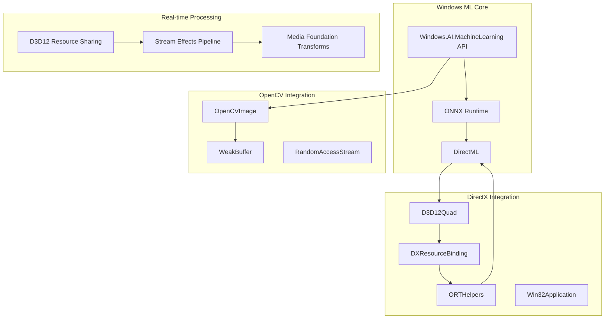
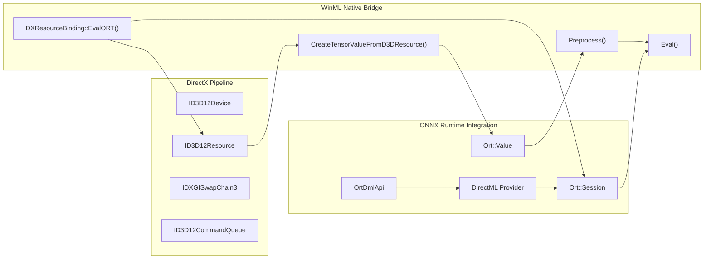
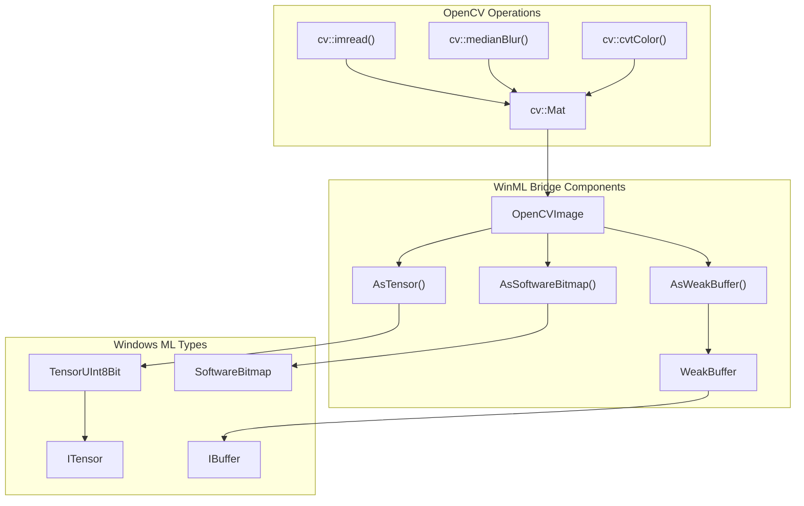
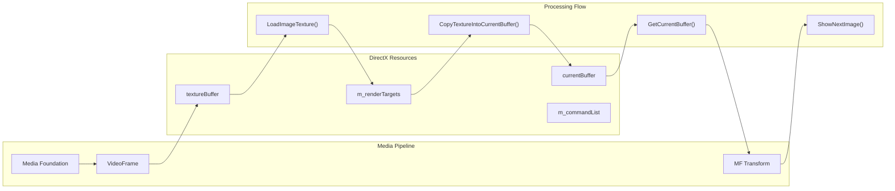

<!-- source: DeepWiki mcp.deepwiki.com · repo microsoft/Windows-Machine-Learning · page 5 Advanced Integration · fetched 2026-10-26 -->

# Advanced Integration

Relevant source files

The following files were used as context for generating this wiki page:

- [Samples/WinMLSamplesGallery/WinMLSamplesGallery/Samples/OpenCVInterop/README.md](Samples/WinMLSamplesGallery/WinMLSamplesGallery/Samples/OpenCVInterop/README.md)
- [Samples/WinMLSamplesGallery/WinMLSamplesGalleryNative/D3D12Quad.cpp](Samples/WinMLSamplesGallery/WinMLSamplesGalleryNative/D3D12Quad.cpp)
- [Samples/WinMLSamplesGallery/WinMLSamplesGalleryNative/D3D12Quad.h](Samples/WinMLSamplesGallery/WinMLSamplesGalleryNative/D3D12Quad.h)
- [Samples/WinMLSamplesGallery/WinMLSamplesGalleryNative/DXResourceBinding.cpp](Samples/WinMLSamplesGallery/WinMLSamplesGalleryNative/DXResourceBinding.cpp)
- [Samples/WinMLSamplesGallery/WinMLSamplesGalleryNative/ORTHelpers.cpp](Samples/WinMLSamplesGallery/WinMLSamplesGalleryNative/ORTHelpers.cpp)
- [Samples/WinMLSamplesGallery/WinMLSamplesGalleryNative/ORTHelpers.h](Samples/WinMLSamplesGallery/WinMLSamplesGalleryNative/ORTHelpers.h)
- [Samples/WinMLSamplesGallery/WinMLSamplesGalleryNative/OpenCVImage.cpp](Samples/WinMLSamplesGallery/WinMLSamplesGalleryNative/OpenCVImage.cpp)
- [Samples/WinMLSamplesGallery/WinMLSamplesGalleryNative/OpenCVImage.h](Samples/WinMLSamplesGallery/WinMLSamplesGalleryNative/OpenCVImage.h)
- [Samples/WinMLSamplesGallery/WinMLSamplesGalleryNative/RandomAccessStream.h](Samples/WinMLSamplesGallery/WinMLSamplesGalleryNative/RandomAccessStream.h)
- [Samples/WinMLSamplesGallery/WinMLSamplesGalleryNative/WeakBuffer.h](Samples/WinMLSamplesGallery/WinMLSamplesGalleryNative/WeakBuffer.h)
- [Samples/WinMLSamplesGallery/WinMLSamplesGalleryNative/Win32Application.cpp](Samples/WinMLSamplesGallery/WinMLSamplesGalleryNative/Win32Application.cpp)
- [Samples/WinMLSamplesGallery/WinMLSamplesGalleryNative/Win32Application.h](Samples/WinMLSamplesGallery/WinMLSamplesGalleryNative/Win32Application.h)
- [Samples/WinMLSamplesGallery/WinMLSamplesGalleryNative/stdafx.h](Samples/WinMLSamplesGallery/WinMLSamplesGalleryNative/stdafx.h)
- [azure-pipelines-samples.yml](azure-pipelines-samples.yml)
- [external/tools/BuildOpenCV.ps1](external/tools/BuildOpenCV.ps1)
- [external/tools/CMakeConfigureOpenCV.ps1](external/tools/CMakeConfigureOpenCV.ps1)
- [package.config](package.config)

This document provides an overview of advanced integration scenarios available in the Windows Machine Learning repository, covering DirectX resource binding, OpenCV interoperability, and real-time video processing capabilities. These integrations demonstrate sophisticated use cases that go beyond basic machine learning inference to enable high-performance, specialized workflows.

For basic Windows ML API usage, see [Core API and Architecture](#2). For specific implementation details of each integration type, see [DirectX Resource Binding](#5.1), [OpenCV Integration](#5.2), and [Real-time Video Processing](#5.3).

## Integration Architecture Overview

The Windows ML repository supports three primary advanced integration scenarios that extend beyond standard inference workflows:

**Advanced Integration Capabilities Overview**

Sources: [Samples/WinMLSamplesGallery/WinMLSamplesGalleryNative/DXResourceBinding.cpp:1-57](), [Samples/WinMLSamplesGallery/WinMLSamplesGalleryNative/OpenCVImage.cpp:1-117](), [azure-pipelines-samples.yml:64-93]()

## DirectX Resource Binding Integration

The DirectX integration enables direct GPU memory sharing between Direct3D 12 resources and ONNX Runtime, eliminating CPU-GPU memory transfers for high-performance scenarios.

**Key Components and Data Flow**

| Component | Class/Function | Purpose |
|-----------|----------------|---------|
| DirectX Window Management | `D3D12Quad` | Manages D3D12 rendering pipeline and texture resources |
| Resource Binding | `DXResourceBinding::EvalORT()` | Coordinates GPU memory sharing between D3D12 and ORT |
| Tensor Creation | `CreateTensorValueFromD3DResource()` | Creates ORT tensors directly from D3D12 resources |
| Session Management | `CreateSession()` | Initializes ORT sessions with DirectML provider |

Sources: [Samples/WinMLSamplesGallery/WinMLSamplesGalleryNative/DXResourceBinding.cpp:17-56](), [Samples/WinMLSamplesGallery/WinMLSamplesGalleryNative/D3D12Quad.cpp:19-27](), [Samples/WinMLSamplesGallery/WinMLSamplesGalleryNative/ORTHelpers.cpp:121-158]()

## OpenCV Interoperability Integration

The OpenCV integration provides seamless interoperability between OpenCV's computer vision operations and Windows ML inference, enabling preprocessing and postprocessing workflows.

**OpenCV-WinML Type Conversions**

| OpenCV Type | Bridge Method | Windows ML Type | Purpose |
|-------------|---------------|-----------------|---------|
| `cv::Mat` | `AsWeakBuffer()` | `IBuffer` | Memory-efficient buffer sharing |
| `cv::Mat` | `AsTensor()` | `TensorUInt8Bit` | Direct tensor creation for inference |
| `cv::Mat` | `AsSoftwareBitmap()` | `SoftwareBitmap` | UI display integration |

Sources: [Samples/WinMLSamplesGallery/WinMLSamplesGalleryNative/OpenCVImage.cpp:33-74](), [Samples/WinMLSamplesGallery/WinMLSamplesGalleryNative/WeakBuffer.h:15-71](), [Samples/WinMLSamplesGallery/WinMLSamplesGallery/Samples/OpenCVInterop/README.md:1-49]()

## Real-time Video Processing Integration

Real-time video processing combines DirectX resource management with Media Foundation transforms to enable low-latency inference on video streams.

**Real-time Processing Components**

Sources: [Samples/WinMLSamplesGallery/WinMLSamplesGalleryNative/D3D12Quad.cpp:285-343](), [Samples/WinMLSamplesGallery/WinMLSamplesGalleryNative/D3D12Quad.cpp:347-393](), [Samples/WinMLSamplesGallery/WinMLSamplesGalleryNative/D3D12Quad.h:25-107]()

## Build System Integration

The advanced integrations require specialized build configurations that handle external dependencies and platform-specific compilation requirements.

**Build Pipeline Integration**

| Integration | Build Requirement | Configuration |
|-------------|-------------------|---------------|
| DirectX | Windows SDK 10.0.19041.0 | Native C++ with D3D12 |
| OpenCV | External submodule build | CMake configuration with `BuildOpenCV.ps1` |
| Media Foundation | Platform-specific MF SDK | UWP/Desktop targeting |

**OpenCV Build Process**

The OpenCV integration requires a multi-stage build process:

1. **Submodule Synchronization**: `git submodule update --init --recursive`
2. **CMake Configuration**: `CMakeConfigureOpenCV.ps1 -Architecture x64`
3. **MSBuild Compilation**: Platform-specific OpenCV library generation
4. **Integration**: Link with `WinMLSamplesGalleryNative` project

Sources: [azure-pipelines-samples.yml:47-92](), [external/tools/CMakeConfigureOpenCV.ps1:24-62](), [external/tools/BuildOpenCV.ps1:22-47]()

## Performance Considerations

Advanced integrations optimize performance through several mechanisms:

- **Zero-copy memory sharing** between DirectX and ONNX Runtime via `CreateTensorValueFromD3DResource()`
- **GPU-resident processing** eliminating CPU-GPU transfers in DirectX scenarios  
- **Weak buffer references** in OpenCV integration avoiding unnecessary memory copies
- **Asynchronous processing pipelines** for real-time video scenarios

Sources: [Samples/WinMLSamplesGallery/WinMLSamplesGalleryNative/ORTHelpers.cpp:121-158](), [Samples/WinMLSamplesGallery/WinMLSamplesGalleryNative/WeakBuffer.h:28-70](), [Samples/WinMLSamplesGallery/WinMLSamplesGalleryNative/RandomAccessStream.h:207-234]()

---

