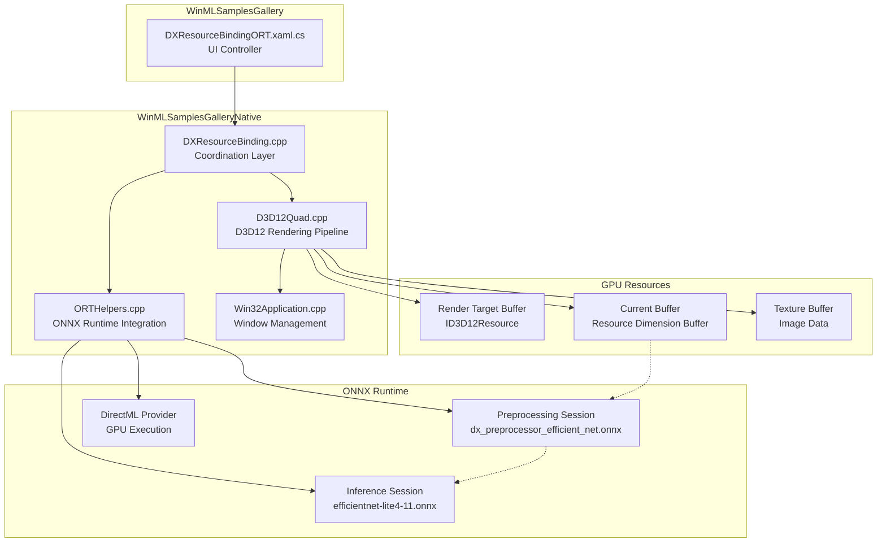
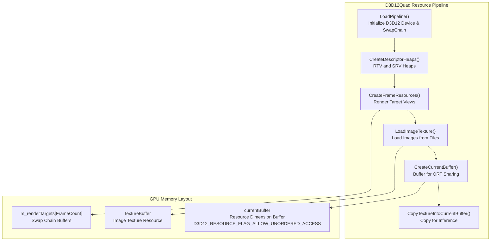
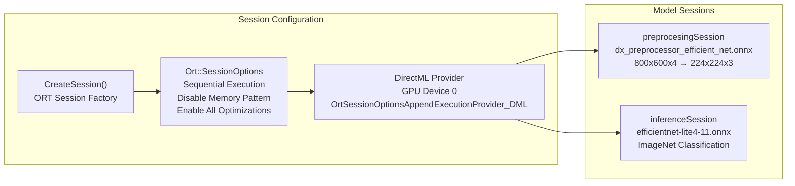
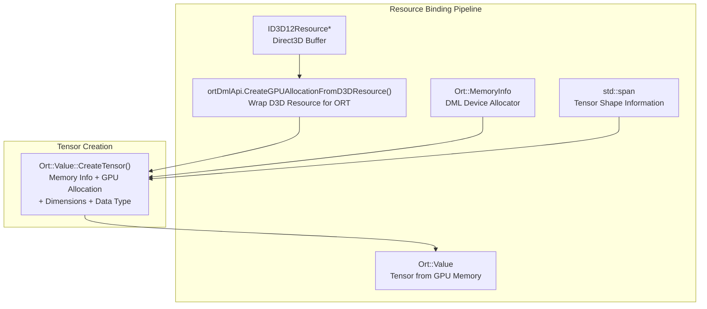
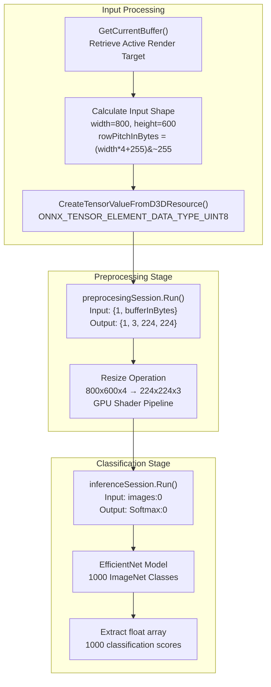
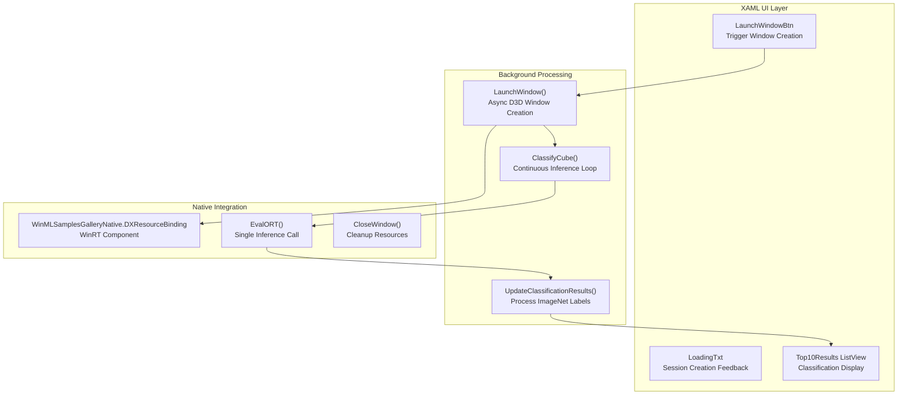
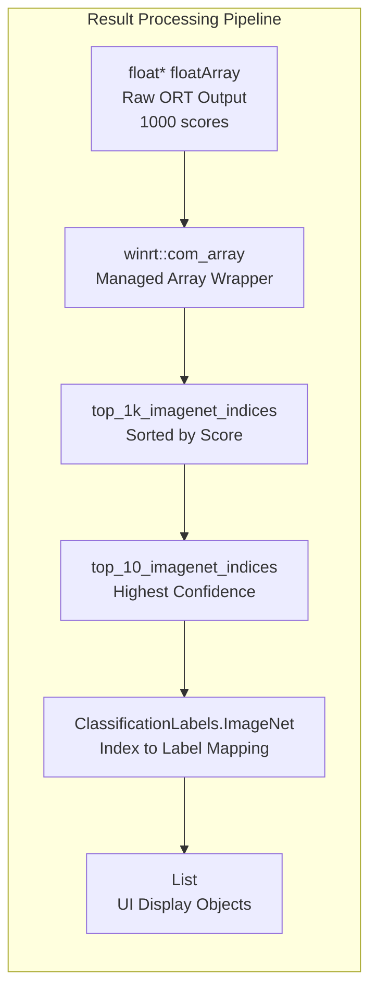

<!-- source: DeepWiki mcp.deepwiki.com · repo microsoft/Windows-Machine-Learning · page 5.1 DirectX Resource Binding · fetched 2026-10-26 -->

# DirectX Resource Binding

Relevant source files

The following files were used as context for generating this wiki page:

- [Samples/WinMLSamplesGallery/WinMLSamplesGallery/Pages/SampleBasePage.xaml.cs](Samples/WinMLSamplesGallery/WinMLSamplesGallery/Pages/SampleBasePage.xaml.cs)
- [Samples/WinMLSamplesGallery/WinMLSamplesGallery/Pages/SamplesGrid.xaml](Samples/WinMLSamplesGallery/WinMLSamplesGallery/Pages/SamplesGrid.xaml)
- [Samples/WinMLSamplesGallery/WinMLSamplesGallery/SampleMetadata/SampleMetadata.json](Samples/WinMLSamplesGallery/WinMLSamplesGallery/SampleMetadata/SampleMetadata.json)
- [Samples/WinMLSamplesGallery/WinMLSamplesGallery/Samples/AdapterSelection/AdapterSelection.xaml](Samples/WinMLSamplesGallery/WinMLSamplesGallery/Samples/AdapterSelection/AdapterSelection.xaml)
- [Samples/WinMLSamplesGallery/WinMLSamplesGallery/Samples/AdapterSelection/AdapterSelection.xaml.cs](Samples/WinMLSamplesGallery/WinMLSamplesGallery/Samples/AdapterSelection/AdapterSelection.xaml.cs)
- [Samples/WinMLSamplesGallery/WinMLSamplesGallery/Samples/DXResourceBindingORT/DXResourceBindingORT.xaml](Samples/WinMLSamplesGallery/WinMLSamplesGallery/Samples/DXResourceBindingORT/DXResourceBindingORT.xaml)
- [Samples/WinMLSamplesGallery/WinMLSamplesGallery/Samples/DXResourceBindingORT/DXResourceBindingORT.xaml.cs](Samples/WinMLSamplesGallery/WinMLSamplesGallery/Samples/DXResourceBindingORT/DXResourceBindingORT.xaml.cs)
- [Samples/WinMLSamplesGallery/WinMLSamplesGalleryNative/AdapterList.cpp](Samples/WinMLSamplesGallery/WinMLSamplesGalleryNative/AdapterList.cpp)
- [Samples/WinMLSamplesGallery/WinMLSamplesGalleryNative/AdapterList.h](Samples/WinMLSamplesGallery/WinMLSamplesGalleryNative/AdapterList.h)
- [Samples/WinMLSamplesGallery/WinMLSamplesGalleryNative/D3D12Quad.cpp](Samples/WinMLSamplesGallery/WinMLSamplesGalleryNative/D3D12Quad.cpp)
- [Samples/WinMLSamplesGallery/WinMLSamplesGalleryNative/D3D12Quad.h](Samples/WinMLSamplesGallery/WinMLSamplesGalleryNative/D3D12Quad.h)
- [Samples/WinMLSamplesGallery/WinMLSamplesGalleryNative/DXResourceBinding.cpp](Samples/WinMLSamplesGallery/WinMLSamplesGalleryNative/DXResourceBinding.cpp)
- [Samples/WinMLSamplesGallery/WinMLSamplesGalleryNative/DXResourceBinding.h](Samples/WinMLSamplesGallery/WinMLSamplesGalleryNative/DXResourceBinding.h)
- [Samples/WinMLSamplesGallery/WinMLSamplesGalleryNative/ORTHelpers.cpp](Samples/WinMLSamplesGallery/WinMLSamplesGalleryNative/ORTHelpers.cpp)
- [Samples/WinMLSamplesGallery/WinMLSamplesGalleryNative/ORTHelpers.h](Samples/WinMLSamplesGallery/WinMLSamplesGalleryNative/ORTHelpers.h)
- [Samples/WinMLSamplesGallery/WinMLSamplesGalleryNative/Win32Application.cpp](Samples/WinMLSamplesGallery/WinMLSamplesGalleryNative/Win32Application.cpp)
- [Samples/WinMLSamplesGallery/WinMLSamplesGalleryNative/Win32Application.h](Samples/WinMLSamplesGallery/WinMLSamplesGalleryNative/Win32Application.h)
- [Samples/WinMLSamplesGallery/WinMLSamplesGalleryNative/WinMLSamplesGalleryNative.idl](Samples/WinMLSamplesGallery/WinMLSamplesGalleryNative/WinMLSamplesGalleryNative.idl)
- [Samples/WinMLSamplesGallery/WinMLSamplesGalleryNative/stdafx.h](Samples/WinMLSamplesGallery/WinMLSamplesGalleryNative/stdafx.h)

This document covers the DirectX Resource Binding system in Windows Machine Learning, which demonstrates how to share GPU memory directly between Direct3D 12 and ONNX Runtime for efficient inference without CPU-GPU memory transfers. This system showcases advanced GPU integration capabilities using the DirectML execution provider.

For information about basic Windows ML API usage, see [Core API and Architecture](#2). For OpenCV interoperability, see [OpenCV Integration](#5.2).

## Overview

The DirectX Resource Binding sample demonstrates zero-copy GPU memory sharing between Direct3D 12 graphics resources and ONNX Runtime. Instead of copying image data from GPU to CPU and back to GPU for inference, this system keeps all data resident on the GPU throughout the entire pipeline.

**Core Components:**

| Component | Purpose | Key Files |
|-----------|---------|-----------|
| `D3D12Quad` | Direct3D 12 rendering pipeline | [D3D12Quad.cpp](), [D3D12Quad.h]() |
| `DXResourceBinding` | Coordination layer | [DXResourceBinding.cpp](), [DXResourceBinding.h]() |
| `ORTHelpers` | ONNX Runtime integration | [ORTHelpers.cpp](), [ORTHelpers.h]() |
| `DXResourceBindingORT` | UI layer | [DXResourceBindingORT.xaml.cs]() |

Sources: [Samples/WinMLSamplesGallery/WinMLSamplesGalleryNative/DXResourceBinding.cpp:1-57](), [Samples/WinMLSamplesGallery/WinMLSamplesGalleryNative/D3D12Quad.h:1-109](), [Samples/WinMLSamplesGallery/WinMLSamplesGalleryNative/ORTHelpers.h:1-27]()

## System Architecture

### High-Level Component Flow

Sources: [Samples/WinMLSamplesGallery/WinMLSamplesGalleryNative/DXResourceBinding.cpp:17-33](), [Samples/WinMLSamplesGallery/WinMLSamplesGallery/Samples/DXResourceBindingORT/DXResourceBindingORT.xaml.cs:39-49]()

### DirectX Resource Management

The `D3D12Quad` class manages the Direct3D 12 pipeline and creates specialized GPU resources for sharing with ONNX Runtime:

Sources: [Samples/WinMLSamplesGallery/WinMLSamplesGalleryNative/D3D12Quad.cpp:45-161](), [Samples/WinMLSamplesGallery/WinMLSamplesGalleryNative/D3D12Quad.cpp:347-369]()

## ONNX Runtime DirectML Integration

### Session Creation and Configuration

The system creates two separate ONNX Runtime sessions optimized for GPU execution:

Sources: [Samples/WinMLSamplesGallery/WinMLSamplesGalleryNative/ORTHelpers.cpp:28-43](), [Samples/WinMLSamplesGallery/WinMLSamplesGalleryNative/DXResourceBinding.cpp:22-23]()

### GPU Resource Binding Process

The core innovation is the `CreateTensorValueFromD3DResource` function that creates ONNX Runtime tensors directly from Direct3D 12 resources:

Sources: [Samples/WinMLSamplesGallery/WinMLSamplesGalleryNative/ORTHelpers.cpp:121-158](), [Samples/WinMLSamplesGallery/WinMLSamplesGalleryNative/ORTHelpers.cpp:69-76]()

## Inference Pipeline

### Complete Processing Flow

The system implements a two-stage inference pipeline that processes images entirely on the GPU:

Sources: [Samples/WinMLSamplesGallery/WinMLSamplesGalleryNative/ORTHelpers.cpp:48-92](), [Samples/WinMLSamplesGallery/WinMLSamplesGalleryNative/ORTHelpers.cpp:95-118](), [Samples/WinMLSamplesGallery/WinMLSamplesGalleryNative/DXResourceBinding.cpp:37-51]()

### Memory Layout and Tensor Shapes

The system handles specific tensor shapes and memory layouts for GPU efficiency:

| Stage | Input Shape | Output Shape | Data Type | Memory Layout |
|-------|-------------|--------------|-----------|---------------|
| D3D12 Buffer | `{1, bufferInBytes}` | - | `UINT8` | Row-major, 256-byte aligned |
| Preprocessing | `{1, bufferInBytes}` | `{1, 3, 224, 224}` | `UINT8` → `FLOAT32` | GPU texture format |
| Classification | `{1, 3, 224, 224}` | `{1, 1000}` | `FLOAT32` | ImageNet classes |

Sources: [Samples/WinMLSamplesGallery/WinMLSamplesGalleryNative/ORTHelpers.cpp:62-67](), [Samples/WinMLSamplesGallery/WinMLSamplesGalleryNative/D3D12Quad.cpp:356]()

## UI Integration and Control Flow

### Sample Application Architecture

The UI layer provides user control over the DirectX Resource Binding demonstration:

Sources: [Samples/WinMLSamplesGallery/WinMLSamplesGallery/Samples/DXResourceBindingORT/DXResourceBindingORT.xaml.cs:39-75](), [Samples/WinMLSamplesGallery/WinMLSamplesGallery/Samples/DXResourceBindingORT/DXResourceBindingORT.xaml.cs:77-93]()

### Classification Results Processing

The system processes raw inference outputs into user-friendly results:

Sources: [Samples/WinMLSamplesGallery/WinMLSamplesGallery/Samples/DXResourceBindingORT/DXResourceBindingORT.xaml.cs:77-93](), [Samples/WinMLSamplesGallery/WinMLSamplesGalleryNative/ORTHelpers.cpp:109-118]()

## Key Implementation Details

### DirectML API Integration

The system uses specific DirectML APIs for GPU resource management:

- `ortDmlApi.CreateGPUAllocationFromD3DResource()` - Wraps D3D12 resources for ONNX Runtime
- `OrtSessionOptionsAppendExecutionProvider_DML()` - Enables DirectML execution provider
- `D3D12_RESOURCE_FLAG_ALLOW_UNORDERED_ACCESS` - Required flag for DML resource sharing

### Resource Synchronization

The D3D12 pipeline includes proper resource state transitions:
- `D3D12_RESOURCE_STATE_COPY_DEST` - For buffer creation and updates
- `D3D12_RESOURCE_STATE_COPY_SOURCE` - For copying render targets to inference buffers
- `D3D12_RESOURCE_STATE_PRESENT` - For display pipeline integration

### Memory Alignment Requirements

The system handles GPU memory alignment requirements:
- Row pitch calculation: `(width * 4 + 255) & ~255` for 256-byte alignment
- Buffer size: `rowPitchInBytes * height` for proper GPU memory layout

Sources: [Samples/WinMLSamplesGallery/WinMLSamplesGalleryNative/ORTHelpers.cpp:132-134](), [Samples/WinMLSamplesGallery/WinMLSamplesGalleryNative/D3D12Quad.cpp:353](), [Samples/WinMLSamplesGallery/WinMLSamplesGalleryNative/D3D12Quad.cpp:373-393]()

---

