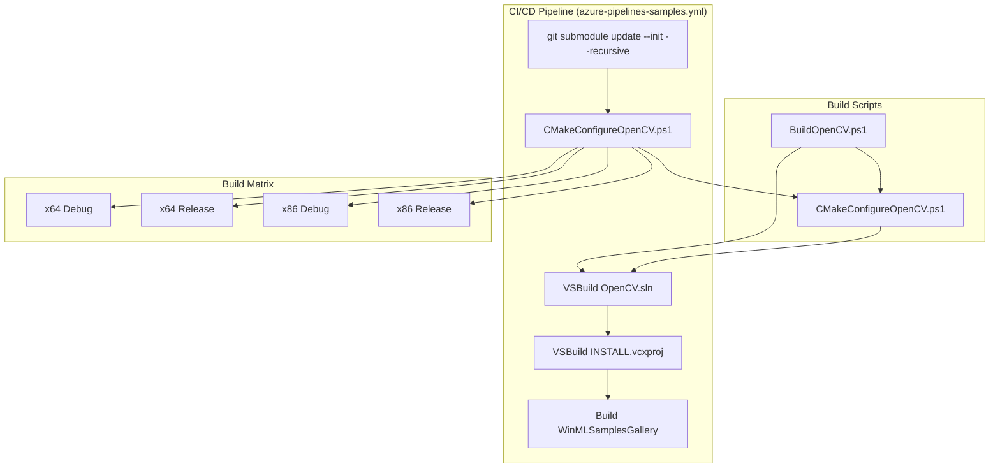
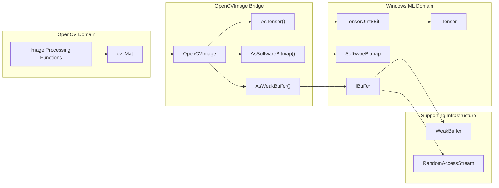
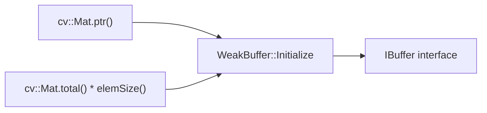
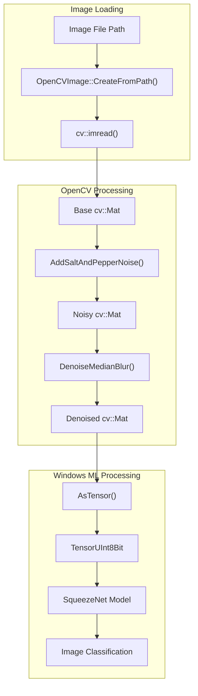

<!-- source: DeepWiki mcp.deepwiki.com · repo microsoft/Windows-Machine-Learning · page 5.2 OpenCV Integration · fetched 2026-10-26 -->

# OpenCV Integration

Relevant source files

The following files were used as context for generating this wiki page:

- [Samples/WinMLSamplesGallery/WinMLSamplesGallery/Samples/OpenCVInterop/README.md](Samples/WinMLSamplesGallery/WinMLSamplesGallery/Samples/OpenCVInterop/README.md)
- [Samples/WinMLSamplesGallery/WinMLSamplesGalleryNative/OpenCVImage.cpp](Samples/WinMLSamplesGallery/WinMLSamplesGalleryNative/OpenCVImage.cpp)
- [Samples/WinMLSamplesGallery/WinMLSamplesGalleryNative/OpenCVImage.h](Samples/WinMLSamplesGallery/WinMLSamplesGalleryNative/OpenCVImage.h)
- [Samples/WinMLSamplesGallery/WinMLSamplesGalleryNative/RandomAccessStream.h](Samples/WinMLSamplesGallery/WinMLSamplesGalleryNative/RandomAccessStream.h)
- [Samples/WinMLSamplesGallery/WinMLSamplesGalleryNative/WeakBuffer.h](Samples/WinMLSamplesGallery/WinMLSamplesGalleryNative/WeakBuffer.h)
- [azure-pipelines-samples.yml](azure-pipelines-samples.yml)
- [external/tools/BuildOpenCV.ps1](external/tools/BuildOpenCV.ps1)
- [external/tools/CMakeConfigureOpenCV.ps1](external/tools/CMakeConfigureOpenCV.ps1)
- [package.config](package.config)

This document covers the integration of OpenCV (Open Source Computer Vision Library) with the Windows Machine Learning ecosystem. The integration enables interoperability between OpenCV's image processing capabilities and Windows ML's machine learning inference, allowing developers to leverage OpenCV for image preprocessing and Windows ML for model execution within the same application.

For information about other library integrations, see [DirectX Resource Binding](#5.1). For real-time processing capabilities, see [Real-time Video Processing](#5.3).

## Build System Integration

The OpenCV integration is implemented as part of the CI/CD pipeline and requires a multi-stage build process involving CMake configuration, Visual Studio compilation, and installation.

### Pipeline Integration

The Azure DevOps pipeline handles OpenCV as a git submodule and builds it for multiple architectures and configurations:

**Sources:** [azure-pipelines-samples.yml:47-92]()

### CMake Configuration

The `CMakeConfigureOpenCV.ps1` script configures OpenCV with specific build options optimized for Windows ML integration:

| Configuration Option | Value | Purpose |
|----------------------|-------|---------|
| `WITH_OPENCL` | OFF | Disable OpenCL to avoid conflicts |
| `WITH_FFMPEG` | OFF | Reduce dependencies |
| `WITH_CUDA` | OFF | Use DirectML instead |
| `BUILD_EXAMPLES` | OFF | Minimize build size |
| `BUILD_TESTS` | OFF | Skip test builds |
| `BUILD_opencv_world` | ON | Create single OpenCV library |

**Sources:** [external/tools/CMakeConfigureOpenCV.ps1:36-44]()

## Runtime Interoperability

The core interoperability is implemented through the `OpenCVImage` class, which provides bidirectional conversion between OpenCV's `cv::Mat` format and Windows ML's tensor and bitmap formats.

### Data Conversion Architecture

**Sources:** [Samples/WinMLSamplesGallery/WinMLSamplesGalleryNative/OpenCVImage.h:11-31](), [Samples/WinMLSamplesGallery/WinMLSamplesGalleryNative/OpenCVImage.cpp:19-116]()

### Core Conversion Methods

The `OpenCVImage` class provides three primary conversion methods:

#### Buffer Conversion
The `AsWeakBuffer()` method creates a Windows Runtime `IBuffer` that wraps the OpenCV `cv::Mat` data without copying:

**Sources:** [Samples/WinMLSamplesGallery/WinMLSamplesGalleryNative/OpenCVImage.cpp:33-44]()

#### Tensor Conversion
The `AsTensor()` method creates a `TensorUInt8Bit` with dimensions `[1, rows, cols, 3]`:

**Sources:** [Samples/WinMLSamplesGallery/WinMLSamplesGalleryNative/OpenCVImage.cpp:46-55]()

#### Bitmap Conversion
The `AsSoftwareBitmap()` method performs color space conversion from RGB to BGRA format:

**Sources:** [Samples/WinMLSamplesGallery/WinMLSamplesGalleryNative/OpenCVImage.cpp:58-74]()

## Sample Implementation

The OpenCV interop sample demonstrates a complete image processing pipeline combining OpenCV preprocessing with Windows ML inference.

### Image Processing Pipeline

**Sources:** [Samples/WinMLSamplesGallery/WinMLSamplesGallery/Samples/OpenCVInterop/README.md:6-9]()

### Noise Processing Functions

The sample includes two image processing functions implemented using OpenCV:

#### Salt and Pepper Noise Addition
The `AddSaltAndPepperNoise()` function creates random noise using `cv::randu()` and applies thresholds to create salt (white) and pepper (black) pixels:

**Sources:** [Samples/WinMLSamplesGallery/WinMLSamplesGalleryNative/OpenCVImage.cpp:87-104]()

#### Median Blur Denoising  
The `DenoiseMedianBlur()` function applies a 5x5 median filter using `cv::medianBlur()`:

**Sources:** [Samples/WinMLSamplesGallery/WinMLSamplesGalleryNative/OpenCVImage.cpp:106-115]()

## Supporting Infrastructure

### WeakBuffer Implementation

The `WeakBuffer<T>` template class provides a non-owning wrapper around memory buffers, implementing both `IBuffer` and `IBufferByteAccess` interfaces:

**Sources:** [Samples/WinMLSamplesGallery/WinMLSamplesGalleryNative/WeakBuffer.h:15-71]()

### RandomAccessStream Components

The `RandomAccessStream` infrastructure enables streaming data access for large images and provides async operation support:

**Sources:** [Samples/WinMLSamplesGallery/WinMLSamplesGalleryNative/RandomAccessStream.h:103-256]()

## Build Requirements

To enable OpenCV integration in the samples:

1. **Submodule Initialization**: `git submodule update --init --recursive`
2. **Architecture-Specific Build**: Run `BuildOpenCV.ps1 -Architecture <ARCH> -Configuration <CONFIG>`
3. **Conditional Compilation**: OpenCV features are gated behind `USE_OPENCV` preprocessor define

**Sources:** [Samples/WinMLSamplesGallery/WinMLSamplesGallery/Samples/OpenCVInterop/README.md:24-36](), [Samples/WinMLSamplesGallery/WinMLSamplesGalleryNative/OpenCVImage.cpp:23-25]()

---

