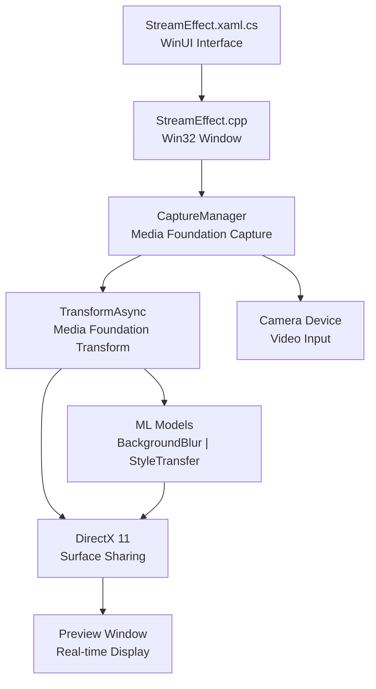
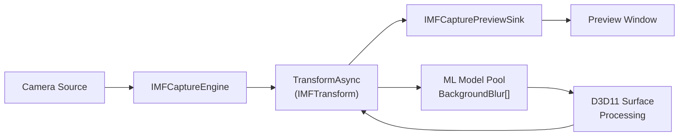
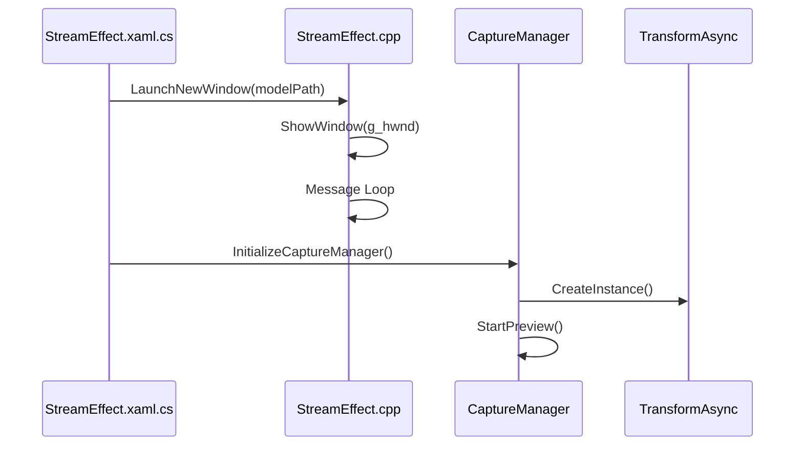
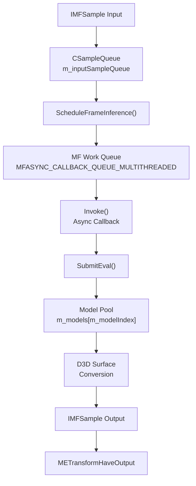
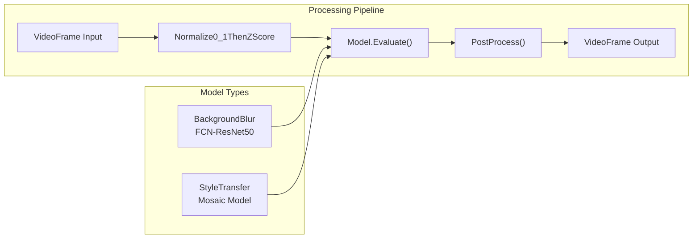
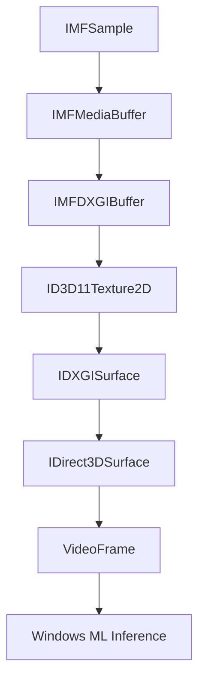
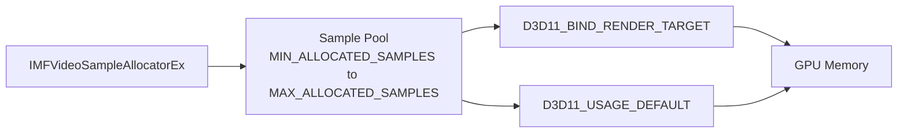

<!-- source: DeepWiki mcp.deepwiki.com · repo microsoft/Windows-Machine-Learning · page 5.3 Real-time Video Processing · fetched 2026-10-26 -->

# Real-time Video Processing

Relevant source files

The following files were used as context for generating this wiki page:

- [Samples/WinMLSamplesGallery/WinMLSamplesGallery/Samples/StreamEffect/StreamEffect.xaml](Samples/WinMLSamplesGallery/WinMLSamplesGallery/Samples/StreamEffect/StreamEffect.xaml)
- [Samples/WinMLSamplesGallery/WinMLSamplesGallery/Samples/StreamEffect/StreamEffect.xaml.cs](Samples/WinMLSamplesGallery/WinMLSamplesGallery/Samples/StreamEffect/StreamEffect.xaml.cs)
- [Samples/WinMLSamplesGallery/WinMLSamplesGalleryNative/Capture.cpp](Samples/WinMLSamplesGallery/WinMLSamplesGalleryNative/Capture.cpp)
- [Samples/WinMLSamplesGallery/WinMLSamplesGalleryNative/Capture.h](Samples/WinMLSamplesGallery/WinMLSamplesGalleryNative/Capture.h)
- [Samples/WinMLSamplesGallery/WinMLSamplesGalleryNative/External/CSampleQueue.cpp](Samples/WinMLSamplesGallery/WinMLSamplesGalleryNative/External/CSampleQueue.cpp)
- [Samples/WinMLSamplesGallery/WinMLSamplesGalleryNative/SegmentModel.cpp](Samples/WinMLSamplesGallery/WinMLSamplesGalleryNative/SegmentModel.cpp)
- [Samples/WinMLSamplesGallery/WinMLSamplesGalleryNative/SegmentModel.h](Samples/WinMLSamplesGallery/WinMLSamplesGalleryNative/SegmentModel.h)
- [Samples/WinMLSamplesGallery/WinMLSamplesGalleryNative/StreamEffect.cpp](Samples/WinMLSamplesGallery/WinMLSamplesGalleryNative/StreamEffect.cpp)
- [Samples/WinMLSamplesGallery/WinMLSamplesGalleryNative/StreamEffect.h](Samples/WinMLSamplesGallery/WinMLSamplesGalleryNative/StreamEffect.h)
- [Samples/WinMLSamplesGallery/WinMLSamplesGalleryNative/TransformAsync.cpp](Samples/WinMLSamplesGallery/WinMLSamplesGalleryNative/TransformAsync.cpp)
- [Samples/WinMLSamplesGallery/WinMLSamplesGalleryNative/TransformAsync_IMFVideoSampleAllocatorNotify.cpp](Samples/WinMLSamplesGallery/WinMLSamplesGalleryNative/TransformAsync_IMFVideoSampleAllocatorNotify.cpp)
- [Samples/WinMLSamplesGallery/WinMLSamplesGalleryNative/TransformBlur.cpp](Samples/WinMLSamplesGallery/WinMLSamplesGalleryNative/TransformBlur.cpp)
- [Samples/WinMLSamplesGallery/WinMLSamplesGalleryNative/TransformBlur.h](Samples/WinMLSamplesGallery/WinMLSamplesGalleryNative/TransformBlur.h)

This document covers the real-time video processing system in Windows ML, which demonstrates how to apply machine learning inference to live camera streams using Media Foundation transforms and DirectX integration. The system provides real-time effects like background blur and style transfer on video feeds.

For information about DirectX resource binding and GPU memory sharing, see [DirectX Resource Binding](#5.1). For details about the sample applications gallery, see [WinML Samples Gallery](#4.1).

## System Architecture

The real-time video processing system consists of several integrated components that work together to capture video, apply ML inference, and display results in real-time.

### High-Level Architecture

**Sources:** [Samples/WinMLSamplesGallery/WinMLSamplesGallery/Samples/StreamEffect/StreamEffect.xaml.cs:1-89](), [Samples/WinMLSamplesGallery/WinMLSamplesGalleryNative/StreamEffect.cpp:1-470](), [Samples/WinMLSamplesGallery/WinMLSamplesGalleryNative/Capture.h:89-232]()

### Media Foundation Pipeline

The system uses Media Foundation's capture engine with custom transforms to process video frames in real-time:

**Sources:** [Samples/WinMLSamplesGallery/WinMLSamplesGalleryNative/Capture.cpp:258-314](), [Samples/WinMLSamplesGallery/WinMLSamplesGalleryNative/TransformAsync.cpp:37-51]()

## Core Components

### StreamEffect Entry Point

The `StreamEffect` class provides the main interface for launching the real-time video processing demo. It manages the lifecycle of the native processing window.

| Component | File | Purpose |
|-----------|------|---------|
| `StreamEffect.xaml.cs` | [Samples/WinMLSamplesGallery/WinMLSamplesGallery/Samples/StreamEffect/StreamEffect.xaml.cs]() | WinUI interface for launching demo |
| `StreamEffect.cpp` | [Samples/WinMLSamplesGallery/WinMLSamplesGalleryNative/StreamEffect.cpp]() | Native window creation and message loop |
| `CaptureManager` | [Samples/WinMLSamplesGallery/WinMLSamplesGalleryNative/Capture.h:92-232]() | Camera capture and preview management |

The demo is launched when the user clicks the toggle button, which calls `LaunchNewWindow()` in the native component:

**Sources:** [Samples/WinMLSamplesGallery/WinMLSamplesGallery/Samples/StreamEffect/StreamEffect.xaml.cs:60-85](), [Samples/WinMLSamplesGallery/WinMLSamplesGalleryNative/StreamEffect.cpp:454-468]()

### TransformAsync Media Foundation Transform

`TransformAsync` is the core component that implements `IMFTransform` for asynchronous video processing with ML inference:

**Key Features:**
- Asynchronous processing using Media Foundation work queues
- Multiple model instances for parallel processing ([TransformAsync.cpp:182-184]())
- D3D11 surface sharing for GPU acceleration
- Sample allocator for efficient memory management

**Sources:** [Samples/WinMLSamplesGallery/WinMLSamplesGalleryNative/TransformAsync.cpp:149-172](), [Samples/WinMLSamplesGallery/WinMLSamplesGalleryNative/TransformAsync.cpp:175-236]()

### Model Processing Pipeline

The system supports multiple ML models that can be applied to video streams:

**Model Implementations:**
- `BackgroundBlur`: Uses FCN-ResNet50 for semantic segmentation with custom post-processing
- `StyleTransfer`: Applies artistic style transfer using pre-trained models

**Sources:** [Samples/WinMLSamplesGallery/WinMLSamplesGalleryNative/SegmentModel.cpp:81-136](), [Samples/WinMLSamplesGallery/WinMLSamplesGalleryNative/SegmentModel.cpp:44-79]()

## DirectX Integration

### Surface Conversion and GPU Processing

The system uses DirectX 11 for efficient GPU processing and surface sharing between Media Foundation and Windows ML:

The `SampleToD3Dsurface()` method handles this conversion chain:

**Sources:** [Samples/WinMLSamplesGallery/WinMLSamplesGalleryNative/TransformAsync.cpp:613-628]()

### Device Management

The system manages DirectX devices and handles device loss scenarios:

| Component | Purpose |
|-----------|---------|
| `IMFDXGIDeviceManager` | Manages D3D11 device sharing across components |
| `CheckDX11Device()` | Validates device health and handles device loss |
| `UpdateDX11Device()` | Recreates device resources when needed |
| `IMFVideoSampleAllocatorEx` | Efficiently allocates D3D-backed video samples |

**Sources:** [Samples/WinMLSamplesGallery/WinMLSamplesGalleryNative/TransformAsync.cpp:404-417](), [Samples/WinMLSamplesGallery/WinMLSamplesGalleryNative/TransformAsync.cpp:329-353]()

## Performance Optimizations

### Asynchronous Processing

The system uses several techniques to maintain real-time performance:

1. **Multi-threaded Model Pool**: Multiple model instances process frames in parallel ([TransformAsync.cpp:653-656]())
2. **Asynchronous MFT**: Uses Media Foundation's async callback system ([TransformAsync.cpp:169-171]())
3. **Frame Dropping**: Skips frames when models are busy to maintain smooth playback ([TransformAsync.cpp:215-233]())
4. **GPU Memory Sharing**: Avoids CPU-GPU memory copies using D3D surfaces

### Memory Management

The sample allocator is configured for optimal GPU usage:

**Sources:** [Samples/WinMLSamplesGallery/WinMLSamplesGalleryNative/TransformAsync.cpp:361-402](), [Samples/WinMLSamplesGallery/WinMLSamplesGalleryNative/TransformAsync.cpp:14-16]()

## Frame Rate Monitoring

The system includes frame rate monitoring using D3D11 fences to track rendering performance:

**Sources:** [Samples/WinMLSamplesGallery/WinMLSamplesGalleryNative/TransformAsync_IMFVideoSampleAllocatorNotify.cpp:6-54]()

## Usage Flow

The complete flow from user interaction to processed video output:

1. **Initialization**: User launches demo from WinUI interface
2. **Window Creation**: Native window created with capture preview area
3. **Device Setup**: Camera enumeration and selection dialog
4. **Capture Start**: Media Foundation capture engine starts with custom MFT
5. **Frame Processing**: Each frame goes through ML inference pipeline
6. **Display**: Processed frames displayed in real-time preview window

**Sources:** [Samples/WinMLSamplesGallery/WinMLSamplesGallery/Samples/StreamEffect/StreamEffect.xaml.cs:60-85](), [Samples/WinMLSamplesGallery/WinMLSamplesGalleryNative/StreamEffect.cpp:321-331](), [Samples/WinMLSamplesGallery/WinMLSamplesGalleryNative/Capture.cpp:258-314]()

---

